# Behavioral LTspice models for automotive power distribution

A library of behavioral LTspice models for simulating an automotive power
distribution system end to end. Each device has its own model library,
symbols and validated test benches; all of them are documented in this README:

| Device | Model | Section | Benches |
|---|---|---|---|
| 48 V eFuse (ST VNF1048F reference) | `models/VNF1048F_beh.lib` | [1](#1-48-v-efuse-st-vnf1048f-reference) | tb01–tb14, interview companions tb15– |
| Automotive battery, 12 / 24 / 48 V, optional pack BMS | `models/BATTERY_beh.lib` | [2](#2-automotive-battery-model) | bat01–bat07 |
| 700 W 48 → 12 V buck DC/DC (averaged) | `models/DCDC48_12_beh.lib` | [3](#3-dcdc-converter-model-48-v-to-12-v-700-w) | dc01–dc08 |
| Parameter sets of real products (Varta AGM, A123 48 V pack, Toshiba 3 kW DC/DC) | `models/REFERENCE_SETS_beh.lib` | [2.11](#211-reference-parameter-sets-from-public-data), [3.9](#39-reference-parameter-set-from-public-data) | ref01–ref02 |

The models share conventions (B-source logic, `[EST]` flags for estimated
values, `0 = default` parameters) and one regression: `tools/validate.py`
runs <!--v {m('summary','checks_total'):.0f}-->291<!--/v--> checks of <!--v {m('summary','benches'):.0f}-->57<!--/v--> simulations against datasheets, model
equations, hand calculations and public product data (validated with LTspice
26.0.2). The system benches that combine the devices are
[bat07](#bat07-48-v-pdu-fed-by-the-pack-selectivity-and-load-dump-bat07_pdn_48vcir)
(48 V pack → eFuse PDU, load dump) and
[dc08](#dc08-two-voltage-system-dc08_pdn_48v_12vcir)
(48 V pack → eFuse → DC/DC → 12 V battery and loads). An
[interview guide](interview/pdn_48v_12v_interview_guide.md) for hardware
engineers working on 48 V / 12 V power distribution (eFuse PDU, batteries,
DC/DC) uses the benches, with a simulation for most questions.

The README has a common part (using the models, repository layout,
regression, numerical guidance, limitations, known issues, adding a device,
changelog), then one numbered part per device, then the references.

> **Disclaimer.** The eFuse model is an independent, **unofficial** model.
> STMicroelectronics did not provide, review or endorse it. It was built from
> the public datasheet. Where the datasheet gives no number, an engineering
> estimate is used and marked **[EST]** (see
> [Assumptions and estimates](#111-assumptions-estimates-and-limitations)). The
> battery and DC/DC models are generic, not tied to a product; their defaults
> are engineering estimates. Use the models for architecture studies,
> protection coordination and harness/load interaction, not in place of
> vendor models, datasheets or hardware validation.
>
> **License.** Copyright (c) 2026 Salvatore La Malfa, all rights reserved; see
> [LICENSE](LICENSE).

---

## Contents

**Common to all models**

* [Using the models in a new LTspice simulation](#using-the-models-in-a-new-ltspice-simulation)
* [Repository layout](#repository-layout)
* [Regression, plots and documentation checks](#regression-plots-and-documentation-checks)
* [Numerical guidance for behavioural models](#numerical-guidance-for-behavioural-models)
* [Limitations at a glance](#limitations-at-a-glance)
* [Known issues](#known-issues)
* [Adding a new device](#adding-a-new-device)
* [Changelog](#changelog)

**Devices**

1. [48 V eFuse (ST VNF1048F reference)](#1-48-v-efuse-st-vnf1048f-reference):
   [1.1 how an eFuse works](#11-how-an-efuse-works-an-intuitive-guide),
   [1.2 what is modeled](#12-what-is-modeled),
   [1.3 files](#13-files-of-the-efuse-model),
   [1.4 quick start](#14-quick-start),
   [1.5 the reference device](#15-the-reference-device-in-one-page),
   [1.6 architecture and pins](#16-model-architecture-and-pins),
   [1.7 block by block](#17-block-by-block-description),
   [1.8 EFUSE48_MOD and external components](#18-efuse48_mod-complete-channel-and-external-component-design),
   [1.9 pre-charging capacitive loads](#19-pre-charging-capacitive-loads),
   [1.10 test benches](#110-test-benches-and-results),
   [1.11 assumptions and limitations](#111-assumptions-estimates-and-limitations),
   [1.12 numerical notes](#112-numerical-notes-and-troubleshooting),
   [1.13 worked example](#113-designing-with-the-model-worked-example)
2. [Automotive battery model](#2-automotive-battery-model): 2.1 to 2.11, listed at the start of the section
3. [DC/DC converter model (48 V to 12 V, 700 W)](#3-dcdc-converter-model-48-v-to-12-v-700-w): 3.1 to 3.9, listed at the start of the section
4. [References](#4-references)

---

## Using the models in a new LTspice simulation

This section is a step-by-step recipe for using the models in a simulation of
your own, from a schematic or from a netlist. The common steps come first,
then a checklist for each device, then an example that combines all three.
The fastest start is often to copy the closest test bench (`testbenches/*.cir`)
or demo schematic (`schematics/*.asc`) and modify it.

### Common steps in the schematic editor

1. **Create a folder for your project** and save a new schematic there
   (File → New Schematic, then File → Save As).
2. **Make the symbols available.** Copy the symbols you need from `symbols/`
   into the same folder as your schematic:

   | Model | Symbol files |
   |---|---|
   | eFuse channel | `EFUSE48_MOD.asy` |
   | bare eFuse controller | `VNF1048F.asy` (+ `NTC10K_ST.asy`) |
   | battery | `BATTERY.asy` |
   | battery pack with BMS | `BATTERY_BMS.asy` |
   | DC/DC converter | `DCDC48_12.asy` |

   LTspice lists the symbols next to the schematic at the top of the component
   dialog. Alternatively, add the repository's `symbols/` folder to the symbol
   search path in LTspice's settings.
3. **Include the model libraries.** Place a SPICE directive (press `S`, or Edit →
   SPICE Directive) with one `.include` per library you use, for example:

   ```spice
   .include ../models/VNF1048F_beh.lib
   .include ../models/BATTERY_beh.lib
   .include ../models/DCDC48_12_beh.lib
   ```

   * **Paths:** relative paths are resolved from the schematic's folder, which is
     how the demo schematics use `../models/…`. An absolute path works too.
   * **If you forget it:** the symbol only carries the subcircuit name. Without the
     `.include`, LTspice reports an unknown subcircuit.
4. **Place and wire the part.** Press `F2` and pick the symbol, then wire its
   power pins.
5. **Drive every logic input.** EN, BYP and CLR have only a 1 MΩ pull-down, so
   give each one a defined level: a voltage source, usually `3.3` or a `PWL` for
   events.
6. **Set the parameters.** Right-click the symbol (Ctrl + right-click in some
   versions) and edit its **SpiceLine** attribute, for example
   `VNOM=48 SOC0=0.8 T_PRE=0.3`. Any parameter you do not write keeps its
   default. The parameter tables are in sections [1.6.2](#162-parameters),
   [2.5](#25-pins-parameters-and-internal-nodes) and
   [3.4](#34-pins-parameters-and-internal-nodes).
7. **Add the analysis.** Use Simulate → Configure Analysis, or a `.tran`
   directive, with a maximum time step that fits the fastest event you want to
   see (table below).
   * **For `.meas` of fast events:** add `.options plotwinsize=0`, so that
     LTspice does not compress the waveforms.
8. **Run and probe.** Click a net to plot it.
   * **Internal model states:** these are nodes named
     `V(<instance>:<node>)`, for example `V(u1:xu:fd)` for the fuse state of
     eFuse `U1` (LTspice 24+, lower case). Add them with Add Traces.
   * **`.meas` on internal nodes:** list the nodes in a `.save` statement. A
     `.save` line limits the saved data to what it lists, so include your other
     traces as well.

| Event you want to resolve | Maximum time step |
|---|---|
| short circuits, eFuse hard-short trip, BMS short-circuit trip | 0.2 … 1 µs |
| eFuse start-up and pre-charge, DC/DC load steps | 1 … 5 µs |
| engine crank, BMS timers, DC/DC hiccup, input transients | 5 µs … 1 ms |
| charging and discharging over minutes to hours (battery alone) | 0.1 … 2 s |

### Using a netlist instead of a schematic

1. Write a `.cir` file with the same `.include` lines and the subcircuit
   instances. Each instance line starts with `X`, followed by the nodes in pin
   order, the subcircuit name and the parameters:

   | Model | Pin order |
   |---|---|
   | `EFUSE48_MOD` | VBAT OUT GND EN BYP CLR DIAG CS TFET |
   | `VNF1048F` | VS CP ISNS_P ISNS_N HS_GATE OUT NTC NTC_M GND DIAG OUTCTL BYPCTL CLR CS |
   | `BATTERY` | P N SOC |
   | `BATTERY_BMS` | P N SOC EN FLT |
   | `DCDC48_12` | VIN VOUT GND EN PG |

2. Open it in LTspice (File → Open, file type *Netlists*) and run it, or run it
   in batch mode with `tools/run_ltspice.sh my.cir`, which prints the `.meas`
   results and any convergence warnings.

### eFuse channel (`EFUSE48_MOD`, or the bare `VNF1048F`)

1. **Supply side.**
   * **A source with impedance:** the battery model, or a source with R and
     harness L.
   * **Bus capacitance:** ≥ 100 µF with its ESR.
   * **Optionally a TVS** (`EF_TVS58V`).

   Without bus capacitance the energy of a hard-short interruption has no
   realistic path ([1.8.3](#183-board-level-protection-seen-in-the-benches)).
2. **Instance and thresholds.**

   ```spice
   X1 vbat out 0 en byp clr diag cs tfet EFUSE48_MOD RSENSE=1m OVC_CODE=13 HSC_CODE=12 VDS_CODE=14 TNOM_CODE=0
   ```

   Choose the codes from the INOM, IHSC, VDS and tNOM you need
   ([1.8.1](#181-choosing-the-thresholds) and the worked example in
   [1.13](#113-designing-with-the-model-worked-example)).
3. **Logic inputs and outputs.**
   * **EN** (OUTCTL): 0 → 3.3 V turns the channel on.
   * **BYP:** tie to 0, unless you simulate stand-by.
   * **CLR:** tie to 0, and pulse it high to clear a latched fault.
   * **DIAG:** already pulled up to 3.3 V inside the module.
   * **CS** (current readback, V = I·RSENSE) and **TFET** (FET temperature in
     °C): outputs that can stay unconnected.
4. **Load side.**
   * **Load harness:** add its L and R, then the load.
   * **Freewheel diode:** an `EF_SCH100V` from GND to OUT for any inductive load
     or long harness.
   * **Converter that is off:** if OUT feeds a converter that is off, add the
     bleeder your design has. The ~1.3 mA OUT bias current would otherwise
     charge its input.
5. **Probe.** Useful states are `fd` (fuse heat, 1 = trip), `hsht`, `fusel` and
   `gcmd` (all `V(u1:xu:…)`, see [1.6.3](#163-internal-nodes-you-can-probe)).
6. **Bare controller.** To use the bare controller with your own FET, shunt and
   NTC, start from `schematics/app_vnf1048f_discrete.asc`.

### Battery (`BATTERY`) and battery pack (`BATTERY_BMS`)

1. **Pick the model.**
   * **`BATTERY`:** an unprotected battery (12 V starter battery, or any
     battery).
   * **`BATTERY_BMS`:** a pack with a disconnect switch and protections (48 V
     MHEV pack, 12 V lithium).
2. **Set the class and the state.**
   * **`VNOM`:** 12, 24 or 48. It selects every default.
   * **`SOC0` and `TBAT`:** the initial state of charge and the temperature.
   * **Your battery's data:** set `CAP_AH`, `R0`… if you have them. To fit them,
     see [2.7](#27-fitting-the-parameters-to-a-real-battery).
3. **Connect the pins.**
   * **P and N:** N does not have to be ground.
   * **SOC:** an output, 0…1 V; it can stay unconnected.
4. **Pack only: drive EN and plan the closing.**
   * **EN:** tie it to a 3.3 V source for a pack that is simply on; it is then
     connected at t = 0. Use a `PWL` to open it, or to re-close it and clear a
     fault.
   * **FLT:** an output, 3.3 V = tripped.
   * **Pre-charge:** if the pack closes onto several mF of bus capacitance, set
     `T_PRE` and `R_PRE`.
5. **Put real capacitance (with ESR) at the terminals.** Driving the battery
   with an ideal current source alone rings numerically
   ([2.10](#210-numerical-notes)).
6. **Probe.** Useful nodes are `V(u1:s)` (raw SOC), `V(u1:ocv)` and, for the pack,
   `V(u1:x)` (switch state), `V(u1:fl)` (fault latch) and `I(u1:Vsw)` (pack
   current).
7. **Expected log messages.** With a `BATTERY_BMS` in the circuit, the LTspice
   log may report "Direct Newton iteration failed" and "Gmin stepping failed"
   before "Gmin stepping level 2 succeeded". These are LTspice's normal
   fallbacks, not errors.

### DC/DC converter (`DCDC48_12`)

1. **Instance.**

   ```spice
   X1 vin vout 0 en pg DCDC48_12 VSET=14 PRATED=700
   ```

   The defaults are listed in [3.4](#34-pins-parameters-and-internal-nodes).
2. **Input.** Feed it from the 48 V bus or from an eFuse output. The input
   capacitance (470 µF) is already inside the model. Behind an eFuse, add a
   bleeder (4.7 kΩ in dc08).
3. **EN and start-up.** Tie EN to 3.3 V, or drive it with a `PWL`. The
   converter is off at t = 0. It soft-starts as soon as EN is high and VIN is
   above 30 V, so start your load events after ~6 ms.
4. **Output.**
   * **Typical load:** a 12 V battery model plus the 12 V loads.
   * **Current-source loads:** do not connect an ideal DC current sink that is
     already on at t = 0; ramp it in after the start-up, or use resistive loads.
5. **Integration method.** Including the library switches the whole simulation
   to Gear integration ([3.8](#38-numerical-notes)). Nothing else needs
   changing, but netlists with eFuses run slower under Gear (see
   [Numerical guidance](#numerical-guidance-for-behavioural-models)).
6. **AC analysis.** For `.ac`, set `DCRUN=1`, so that the converter is running in
   the operating point (dc06).
7. **Probe.** Useful nodes are `V(u1:il)` (output current), `V(u1:vref)`,
   `V(u1:run)`, `V(u1:hic)` (hiccup) and `V(u1:ploss)` (losses).

### Example: the three models together

A minimal two-voltage network: a 48 V pack feeds an eFuse channel, which feeds
the DC/DC, which charges a 12 V battery and supplies a 10 A load. Saved as
`testbenches/my_pdn.cir`, it runs in about 5 s.

```spice
* my_pdn.cir - 48 V pack -> eFuse -> 48/12 V DC/DC -> 12 V battery + load
.include ../models/VNF1048F_beh.lib
.include ../models/BATTERY_beh.lib
.include ../models/DCDC48_12_beh.lib

Vlog v33 0 3.3                                   ; logic supply for the EN inputs

* 48 V pack (connected from t = 0) and the main harness to the bus
Xpack vpack 0 soc48 v33 flt48 BATTERY_BMS VNOM=48 SOC0=0.8
Lmain vpack bus 2u Rser=5m
Cbus bus 0 220u Rser=20m

* eFuse channel feeding the DC/DC (EN at 1 ms; BYP and CLR not used)
Ven en 0 PWL(0 0 1m 0 1.001m 3.3)
Xfuse bus fout 0 en 0 0 diag cs tfet EFUSE48_MOD RSENSE=1m OVC_CODE=22 HSC_CODE=14
+ VDS_CODE=14 TNOM_CODE=2
Lh1 fout dcin 1u Rser=10m
Dfw 0 fout EF_SCH100V
Rbl dcin 0 4.7k                                  ; bleeder for the eFuse OUT bias

* 700 W DC/DC, always enabled: starts at its 30 V UVLO on the eFuse ramp
Xdc dcin v12 0 v33 pg DCDC48_12

* 12 V net: harness, battery, 10 A load
Lh12 v12 b12 0.5u Rser=2m
X12 b12 0 soc12 BATTERY VNOM=12 SOC0=0.7
Rload b12 0 1.25

.save V(bus) V(dcin) V(v12) V(b12) V(diag) V(pg) I(Lh1) I(Lh12) V(xdc:il)
.meas tran i12 avg V(xdc:il) from 15m to 20m
.meas tran vb12 avg V(b12) from 15m to 20m
.tran 0 20m 0 1u
.end
```

**Expected:**
* After the eFuse turns on at 1 ms, the DC/DC starts on the rising input and
  runs at its 55 A current limit (`i12` = 55 A).
* The 12 V battery charges with the current that the 10 A load does not take,
  and the 12 V net sits at ~12.66 V (`vb12`).

[dc08](#dc08-two-voltage-system-dc08_pdn_48v_12vcir) is the full version, with
a second eFuse channel, a 12 V load step and a 48 V branch short. In a
schematic the circuit is the same: place the parts, add the three `.include`
lines and the `.tran`, and set the parameters in each symbol's SpiceLine.

---

## Repository layout

```
efuse/
├── README.md                     this file (all devices)
├── LICENSE                       all rights reserved
├── requirements.txt              pinned Python dependencies of the tools (numpy, matplotlib)
├── .github/workflows/validate.yml   CI: re-checks the stored results and the docs
├── models/
│   ├── VNF1048F_beh.lib          eFuse model library (all subcircuits + device models)
│   ├── BATTERY_beh.lib           battery model library (BATTERY, BATTERY_BMS), section 2
│   ├── DCDC48_12_beh.lib         700 W 48/12 V DC/DC model library (DCDC48_12), section 3
│   └── REFERENCE_SETS_beh.lib    parameter sets fitted to public product data, sections 2.11 / 3.9
├── symbols/                      LTspice symbols (canonical copy)
│   ├── VNF1048F.asy              14-pin controller
│   ├── EFUSE48_MOD.asy           9-pin complete eFuse channel
│   ├── NTC10K_ST.asy             NTC thermistor with temperature input
│   ├── BATTERY.asy               3-pin battery (P, N, SOC)
│   ├── BATTERY_BMS.asy           5-pin battery pack with BMS (P, N, SOC, EN, FLT)
│   ├── DCDC48_12.asy             5-pin DC/DC (VIN, VOUT, GND, EN, PG)
│   └── BAT12_VARTA_E39.asy, BAT48_A123_8AH.asy, DCDC_TOSHIBA_RD210.asy   reference sets
├── schematics/                   ready-to-run schematics (symbols copied alongside)
│   ├── demo_efuse48_module.asc   module in a 48 V harness: start-up, short, retry
│   ├── app_vnf1048f_discrete.asc full discrete application (DS13084 Fig. 16 + slew network)
│   ├── demo_battery.asc          12 V cold crank + 48 V pack: pre-charge, load, short
│   └── demo_dcdc.asc             48 V feed -> DC/DC -> 12 V battery + switched load
├── testbenches/                  tb01..tb36 (eFuse, section 1.10), bat01..bat07 (battery, 2.8),
│                                 dc01..dc08 (DC/DC, 3.6), ref01..ref02 (reference sets)
├── interview/
│   └── pdn_48v_12v_interview_guide.md      48 V / 12 V power distribution question bank, a simulation per question
├── docs/
│   ├── img/                      result plots (generated)
│   ├── VALIDATION.md             pass/fail report vs datasheet and hand calculations (generated)
│   └── results.json              all .meas results of the last full run (generated, used by CI)
└── tools/
    ├── run_ltspice.sh            batch runner (native LTspice or macOS CrossOver build)
    ├── ltraw.py                  .raw / .log reader (numpy)
    ├── plot_results.py           regenerates docs/img/*.png
    ├── validate.py               checks the results and their integrity, regenerates docs/VALIDATION.md
    ├── lint_models.py            static checks: subckt/symbol pins, instance nodes and parameters, includes
    ├── sync_docs.py              keeps the simulated numbers quoted in the docs up to date
    ├── make_symbols.py           regenerates the .asy symbols
    ├── make_schematics.py        regenerates the demo .asc schematics
    └── bat_ocv.py                battery OCV(SOC) curve: prints the B-source expression for the .lib
```

---

## Regression, plots and documentation checks

```bash
pip install -r requirements.txt                                 # once
tools/run_ltspice.sh -j 6 testbenches/*.cir schematics/*.asc   # all <!--v {m('summary','benches'):.0f}-->57<!--/v--> simulations, ~2 min with 6 jobs
python3 tools/validate.py --export docs/results.json           # checks -> docs/VALIDATION.md, stores the results
python3 tools/sync_docs.py                                     # updates the numbers quoted in the docs
python3 tools/plot_results.py                                  # -> docs/img/*.png
python3 tools/lint_models.py                                   # static checks, no simulation
```

* **Checks.** `validate.py` runs <!--v {m('summary','checks_total'):.0f}-->291<!--/v--> checks against datasheets, model equations,
  hand calculations and public product data, in five groups:

  | Group | Checks |
  |---|---|
  | `efuse` (tb01–tb36) | <!--v {m('summary','checks_efuse'):.0f}-->178<!--/v--> |
  | `battery` (bat01–bat07) | <!--v {m('summary','checks_battery'):.0f}-->51<!--/v--> |
  | `dcdc` (dc01–dc08) | <!--v {m('summary','checks_dcdc'):.0f}-->48<!--/v--> |
  | `reference` (ref01–ref02) | <!--v {m('summary','checks_reference'):.0f}-->7<!--/v--> |
  | `schematics` | <!--v {m('summary','checks_schematics'):.0f}-->7<!--/v--> |

  `python3 tools/validate.py battery dcdc` checks only the groups you name, for
  example after re-running only those benches. `docs/VALIDATION.md` is
  rewritten only by a full run.
* **Integrity of the results.** A full run also fails, independently of the
  checks, if a bench has no results or no checks, if results are left from a
  deleted bench, if a `.log` is older than its bench or a model or symbol it
  includes (switching git branches counts: re-run), or if the logs come from
  different LTspice versions. A `.meas` that FAIL'ed is read as NaN, and a check
  that expects "no trip" fails if the measurement is missing altogether.
* **Stored results.** `--export docs/results.json` stores every `.meas` value of
  the run (a failed one as `null`), the LTspice version and a SHA-256 of every
  bench together with the model and symbol files it includes. It is refused
  unless the run is complete and passes the integrity checks.
  `--json docs/results.json` repeats the checks from that file, without LTspice,
  and fails if a bench or model file no longer matches its stored hash.
* **Numbers in the docs.** The simulated numbers in the README and the interview
  guide carry an invisible tag that names their source, for example
  `<!--v EXPRESSION-->` before the value and `<!--/v-->` after it, where
  EXPRESSION is a Python format string such as
  `{m('tb02_hard_short','dt_trip')*1e6:.1f}`. `sync_docs.py` rewrites the
  tagged numbers from the results, and `sync_docs.py --check` lists any that
  are out of date. A tag must stay on one line. Numbers without a tag (hand
  calculations, approximate "~" values in running text) are maintained by hand.
* **CI.** The GitHub Actions workflow (`.github/workflows/validate.yml`) runs
  `lint_models.py`, regenerates the symbols and schematics and checks that they
  are unchanged, repeats the checks from `docs/results.json` (with the hash
  check above), and checks that the tagged numbers and `docs/VALIDATION.md` match
  it. CI cannot run LTspice: after changing a model or a bench, run the commands
  above locally and commit the updated results, report and docs. Editing a model
  without re-running fails CI.
* **Runner.** `run_ltspice.sh` deletes the previous outputs of each bench before
  running it, and exits non-zero if a run times out (`-t`, default 900 s) or
  its log is incomplete, so a failed run never leaves old results behind. `-j N`
  runs N simulations in parallel. It detects the macOS LTspice 24/26 build, which
  is a CrossOver/Wine bundle, and runs `LTspice.exe -b` through its bundled
  `wine`; `LTSPICE_WINE`, `LTSPICE_BOTTLE` and `LTSPICE_EXE` override those paths.
  Without that bundle it runs `$LTSPICE_CMD -b` (default `LTspice`), which is the
  route for Windows or Linux (untested there; the script needs zsh). The models
  are validated with LTspice 26.0.2.

---

## Numerical guidance for behavioural models

The three models span nanoseconds (inductances, logic) to hours (battery
charge). These rules come from failures found while building them; they apply
to any new model added to the library. The device-specific notes are in
sections [1.12](#112-numerical-notes-and-troubleshooting), [2.10](#210-numerical-notes) and
[3.8](#38-numerical-notes).

* **No `idt()` for model states.** Charge counting, timers and filter states are
  voltages on normalized 1 F capacitors (`dV/dt = …`). `idt()` forced
  microsecond steps over hours of simulation.
* **No farad-size physical capacitors.** Long time constants are normalized
  states as well (the battery's RC pairs would need up to 28 kF).
* **No state may rest on, or creep slowly across, a discontinuity.** A `limit()`
  corner, a piecewise-linear `table()` breakpoint, or even a 10⁻⁷ step left by
  rounded coefficients can collapse the time step. Use smooth (C¹) curves with
  full-precision coefficients, and let equilibria sit in the smooth part of a
  rate law.
* **Prefer `limit()` to `min()`/`max()`** inside feedback loops; the latter made
  the DC operating point fail.
* **Make the DC operating point unique and easy.** Latches reset in the DC solve
  unless set; states that need an initial value are held with
  `if(time<=0, …)`. In `.ac`, `time` is also 0, so those states are frozen
  there. A converter starts "off" and soft-starts at t = 0.
* **No logic feedback through its own deglitch filter.** Use one timer state that
  moves monotonically through its thresholds.
* **Give every node a DC path.** Nodes driven only by B current sources and
  capacitors need a large resistor (MΩ–GΩ) for LTspice's floating-node check.
* **Test with several instances in one netlist.** Most stalls appeared only
  there, and some depended on the `.save` list.
* **Gear integration.** `DCDC48_12_beh.lib` switches the simulation to Gear,
  whether it is loaded with `.include` or `.lib` (checked: the log reports
  `method = Gear`). The last `.options` line wins, so `.options method=trap`
  placed after the include restores the default, at the risk of DC/DC stalls.
  All 35 eFuse benches were also run under Gear (validation of the default
  trapezoidal results): all eFuse checks still pass, and of 1046 measured values
  the median change is 0.000 %, 13 change by more than 1 % and one by more than
  5 % (a 0.45 vs 0.48 mJ TVS energy). Gear is slower on some eFuse netlists,
  however (tb10 286 s instead of 4 s, tb22 144 s instead of 3 s), so a system
  netlist with eFuses and a DC/DC runs slower than either alone.
* **In the benches:** put capacitance with ESR next to sources driven by ideal
  current steps, filter the inputs of behavioural comparators, ramp
  current-source loads in after start-up, and choose the maximum time step per
  event (see [Using the models in a new LTspice simulation](#using-the-models-in-a-new-ltspice-simulation)).

---

## Limitations at a glance

The details, and the estimated values behind each default, are in the
per-device sections [1.11](#111-assumptions-estimates-and-limitations),
[2.9](#29-assumptions-estimates-and-limitations) and
[3.7](#37-assumptions-estimates-and-limitations).

| | eFuse (`VNF1048F`, `EFUSE48_MOD`) | Battery (`BATTERY`, `BATTERY_BMS`) | DC/DC (`DCDC48_12`) |
|---|---|---|---|
| Level of detail | behavioural controller, real VDMOS FET; SPI mapped to parameters and logic pins | equivalent circuit: OCV(SOC), R0 + 2 RC, L | averaged: no switching ripple, no EMC |
| Values | typical; corners only through `TOL_T`, `CS_GERR` and mV overrides | class defaults [EST]; reference sets for 3 products | class defaults [EST]; one reference set |
| Temperature | FET thermal network drives NTC and `TFET`, but RDS(on) is isothermal | `TBAT` fixed: no self-heating, capacity independent of T | none: no derating |
| Not modeled | SPI protocol and state machine, self-tests, ADC sampling, reverse-current detection, FET avalanche energy limit (VDMOS BV only), CP ripple | OCV hysteresis, aging/SOH, charge vs discharge resistance, cell imbalance, contactor arcing | output OVP, foldback, droop for paralleled units, regulation of the 48 V side (BIDIR only sinks current), separate input/output grounds |
| Analyses | `.tran`; `.ac` not meaningful (logic) | `.tran`, `.ac` (without the SOC capacitance) | `.tran`, `.ac` with `DCRUN=1` |

## Known issues

* **Gear integration slows eFuse netlists.** Including `DCDC48_12_beh.lib`
  switches the whole simulation to Gear; some eFuse netlists then run much
  slower (tb10 286 s instead of 4 s). See
  [Numerical guidance](#numerical-guidance-for-behavioural-models).
* **A hard short already present at t = 0 with the channel commanded on**
  (OUTCTL high in the DC operating point) needs LTspice's pseudo-transient
  operating-point search (a few seconds). The fault then latches at the first
  time step. Starting the channel off and switching it on at t > 0 avoids it.
* **"Gmin stepping" messages.** Some benches print "Direct Newton iteration
  failed", followed by a successful Gmin stepping, in their log. The run and its
  results are fine.
* **Hung wine after a killed run (macOS CrossOver build).** Killing a stalled
  LTspice can leave `winedevice.exe` processes that block every later run (no
  log written). `tools/run_ltspice.sh` prints the command that clears them.
* **Only LTspice 26.0.2 on macOS is validated.** The runner needs zsh; on
  Windows or Linux set `LTSPICE_CMD` (untested). Other LTspice versions may
  differ in numerical details; `docs/results.json` records the version, and
  results from several versions are refused.
* **Some results depend on the `.save` list** (it changes LTspice's time-step
  control in a few netlists). Keep the benches' `.save` lines when you copy them.

## Adding a new device

Follow the pattern of the battery and DC/DC models:

1. **Model library** `models/<DEV>_beh.lib`: header (status, simulator,
   contents, what is modeled and what is not, pins, parameter table with
   defaults and `[EST]` flags), the subckt with `0 = class default` parameters,
   and helper subckts with a device prefix (e.g. `DC_LATCH`) so that names never
   clash between libraries. Respect the
   [numerical guidance](#numerical-guidance-for-behavioural-models): no `idt()`,
   normalized 1 F states, C¹ curves, unique DC operating point, fault latches
   with `DCS=0`.
2. **Symbol**: add it to `tools/make_symbols.py` and its pin coordinates to
   `PINS` in `tools/make_schematics.py`; run both. `tools/lint_models.py` checks
   that the pins match the subckt.
3. **Test benches** `testbenches/<dev>NN_*.cir`: a header with the scenario and
   the expected behaviour, `.meas` for every number you will quote (internal
   nodes must be in `.save`), at least one multi-instance bench.
4. **Checks**: a new group in `tools/validate.py` (`GROUPS`, `TITLES`) with an
   analytic reference for every check; a bench without checks fails the
   integrity check.
5. **Plots**: a function per bench in `tools/plot_results.py`, registered in `ALL`.
6. **Documentation**: a new numbered part of this README (before the
   References), a row in the device table at the top and in
   [Limitations at a glance](#limitations-at-a-glance), and the files in
   [Repository layout](#repository-layout). Tag every simulated number
   (`sync_docs.py`). Add interview questions for the device to the guide.
7. **Run** the commands of
   [Regression, plots and documentation checks](#regression-plots-and-documentation-checks)
   and commit the updated `docs/results.json`, `docs/VALIDATION.md`, plots
   and docs together.

## Changelog

Changes that alter simulation results are marked **(results)**.

* **2026-10-30, review: regression, model fixes, docs.**
  * Regression: the runner deletes old outputs and fails on incomplete runs;
    a failed `.meas` can no longer pass a check; results carry SHA-256 hashes
    of the benches and models (CI fails on an edited model without a re-run);
    `lint_models.py`; parallel runs (`-j`); pinned `requirements.txt`.
  * eFuse **(results)**: per-FET thermal network with `NPAR` > 1 (was NPAR×
    too hot); fault latches cannot set in the DC solve (a fault at t = 0 hung
    LTspice); CP_LOW blanked for `CP_BLK` after the charge pump starts (false
    CP_LOW at every wake-up from Stand-by); CS gain error before the full-scale
    clamp; `TOL_T` also on cooling; heating rate ramps in at INOM; `TAMB_IC`
    follows `TAMB`. Generic model names prefixed `EF_` (`EF_FET100V`,
    `EF_FET_TH`, `EF_TVS58V`, `EF_SCH100V`).
  * Battery **(results)**: C¹ OCV end regions (CV-charge end SOC and BMS
    OV/UV trip times change); make-before-break pre-charge hand-over; the
    pre-charge timer restarts after a short EN low pulse.
  * Reference sets: use-case parameters passed through; symbols.
  * Docs: README split into equal device parts (eFuse 1, battery 2, DC/DC 3,
    references 4; anchors changed); simulated numbers in the eFuse tables
    tagged; this changelog, known issues, limitations, new-device checklist.
* **2026-10-29: battery and DC/DC models, reference sets.** Battery/BMS and
  700 W DC/DC libraries with benches; review fixes **(results)**: DC/DC key-off
  drain 0.1 mA instead of 126 mA, eFuse latch and timer robustness; reference
  parameter sets fitted to public data; doc sync and CI.
* **2026-10-28: interview guide** with a simulation for most questions.
* **2026-10-23 … 27: 48 V eFuse model** (VNF1048F reference), benches
  tb01–tb14, pre-charge benches and guide.

---

## 1. 48 V eFuse (ST VNF1048F reference)

A detailed **behavioral model of a 48 V automotive electronic fuse**, using the
STMicroelectronics **VNF1048F** as the reference part ("High-side switch
controller with intelligent fuse protection for 12 V, 24 V and 48 V automotive
applications", datasheet DS13084 Rev 6). It comes with fourteen validated test
benches tb01–tb14 (four of them on pre-charging capacitive loads), the
interview companion benches from tb15 on, two ready-to-run schematics and
<!--v {m('summary','checks_efuse'):.0f}-->178<!--/v--> regression checks against the datasheet and against hand
calculations. The model is unofficial (see the disclaimer at the top).

### 1.1 How an eFuse works: an intuitive guide

This section is for electronic engineers who know power MOSFETs and op-amps but
have not worked with electronic fuses. It explains what the circuit does and why,
and points to the model parameter that controls each behaviour. The equations
are in [section 1.7](#17-block-by-block-description).

#### 1.1.1 The job: protect the wire, not the load

A conventional fuse protects the **wire harness and the PCB copper**, not the
load. Any conductor heats up with I²·R and cools to its surroundings. If the
current stays too high for too long, the insulation degrades, carbonizes and can
start a fire. A melting fuse is a thermal replica of the wire: it heats with I²
and opens before the wire is damaged. The characteristic number is its
**I²t** (A²s), the "melting energy".

Melting fuses have well-known weaknesses:

* they are one-shot, and you have to physically replace them;
* their tolerance is wide, so the wire must be oversized;
* they cannot tell a harmless inrush (charging a capacitor) from a real overload;
* at 48 V they have to break arcs, which is far harder than at 12 V.

An **eFuse** replaces the melting element with a **MOSFET switch + a current
measurement + logic** that *computes* the wire heating in real time and opens the
switch electronically. It is resettable and programmable, reports what happened
(DIAG pin, current readback), and adds protections a melting fuse cannot have:
microsecond short-circuit response and switch self-monitoring.

#### 1.1.2 The power path: shunt, MOSFET and charge pump

```
 Battery 48 V ──[ RSENSE 1 mΩ ]──┬──── D ┌─────────┐ S ──── OUT ──harness──► load
                                 │       │ N-MOSFET│
               ISNS_P   ISNS_N ──┘       └────┬────┘
                  │        │                  G
                  └──┬─────┘                  │
                 ┌───┴──────── VNF1048F ──────┴───────────┐
                 │ current sense   gate driver (VGS 14 V) │
                 │ fuse logic      charge pump (VS+14.5 V)│
                 └────────────────────────────────────────┘
```

* **The switch** is an N-channel MOSFET in the positive line (*high side*), so the
  load stays referenced to chassis ground. In the model it is `M1`
  (`EF_FET100V`: 100 V, ~2 mΩ). An N-channel device has lower resistance and is
  cheaper than a P-channel one. To turn it on, though, the gate must be about
  10–15 V **above the source**, and with the switch on the source sits at battery
  voltage. The gate therefore has to be driven *above the battery*.
* **The charge pump** generates that voltage: VCP = VS + 14.5 V ≈ 62.5 V at 48 V
  (`VCP_REG`). The gate driver takes charge from it and regulates
  VGS ≈ 14 V (`VGS_ON`). It sources ~0.2 A to turn on (`IG_SRC`) and sinks ~0.5 A
  to turn off (`IG_SNK`). Switching off simply means shorting gate to source.
* **The current measurement** uses a 1 mΩ shunt (`RSENSE`) before the MOSFET.
  The controller reads the small differential voltage
  **VSENSE = I × RSENSE**, which is 10 mV at 10 A, on top of a 48 V common mode.
  All current thresholds in the device are therefore specified in **millivolts
  of VSENSE**, and you choose amperes through RSENSE:

  ```
  INOM (max continuous current) = VOC_THRS / RSENSE   e.g. OVC_CODE 13 → 21.8 mV / 1 mΩ = 21.8 A
  IHSC (hard-short threshold)   = VHSC_THRS / RSENSE  e.g. HSC_CODE 12 → 105.6 mV / 1 mΩ = 105.6 A
  ```

  A larger RSENSE gives better resolution at low current but more loss: at 20 A,
  1 mΩ dissipates 0.4 W. The measured value is also reported back (`CS` pin =
  VSENSE, 13 bit), so the MCU can read the load current.

#### 1.1.3 Three layers of protection, three time scales

Think of the protections as three nested safety nets, each fast enough for its
own kind of fault:

| Layer | Fault it handles | Reaction time | Model parameter | Test bench |
|---|---|---|---|---|
| **Fuse emulation (I²t)** | overload: too much current for too long | ms … minutes | `OVC_CODE`, `TNOM_CODE`, node `fd` | tb03, tb04 |
| **Hard short** | short circuit: current shooting up | ~5 µs | `HSC_CODE`, `HSC_DLY` | tb02, tb10 |
| **Switch self-monitoring** | the MOSFET itself is in trouble | µs … ms | `VDS_CODE`, `NTC_CODE`, VGS UVLO | tb05, tb07 |

##### Layer 1: the fuse emulation as a bucket of heat

Picture a **bucket** that represents the heat stored in the wire. In the model
the bucket level is the node **`fd`**: 0 = cold, 1 = full = trip.

* Current **above INOM** pours water in, faster the higher the current
  (∝ I² − INOM², the excess heating).
* Current **below INOM** lets water drain out, because the wire cools.
* When the bucket is full, the MOSFET is switched off and the fault is latched
  (`fusel`).

The size of the bucket is set by **tNOM** (`TNOM_CODE`, tNOM = 2·code + 1 s),
which is the trip time at a current just above INOM. Larger tNOM means a bigger
bucket and a more tolerant fuse, matched to a thicker wire with more thermal mass.
The ST silicon rounds the fill rate to powers of two, so the curve looks like a
staircase (DS13084 Fig. 4, reproduced in tb03). For INOM = 21.8 A and tNOM = 1 s:

| Load current | I/INOM | Trip time (tNOM = 1 s) | Trip time scales with |
|---|---|---|---|
| 21.8 A | ≤ 1.00 | never | – |
| 22.9 A | 1.05 | 0.5 s | × tNOM |
| 26.2 A | 1.2 | 125 ms | × tNOM |
| 32.7 A | 1.5 | 31 ms | × tNOM |
| 43.6 A | 2 | 15.6 ms | × tNOM |
| 65.4 A | 3 | 3.9 ms | × tNOM |
| 104.6 A | 4.8 | 2 ms | × tNOM |
| > 105.6 A | > IHSC/INOM | **~5 µs: hard short (layer 2)** | – |

With TNOM_CODE = 15 (tNOM = 31 s) every time in the table is 31 times longer.
The bucket picture explains three behaviours that confuse newcomers:

* **Inrush is ignored.** Charging a 220 µF input capacitor at 30 A for 0.5 ms
  pours in only a spoonful (tb01: `fd` peaks at <!--v {m('tb01_startup_inrush','fdmax'):.3f}-->0.005<!--/v-->), so no trip occurs, even
  though the current is above INOM.
* **PWM loads are judged by their RMS current.** A load chopped at 40 A peak
  fills the bucket during the on-time and drains it during the off-time. The net
  level rises only if the *RMS* current exceeds INOM. tb04 shows that 25 % and
  30 % duty never trip, while 35 % and 50 % do.
* **The fuse remembers.** Right after a trip the bucket is still full and needs
  about tNOM/32 to empty. If the MCU re-enables too early, the next trip comes
  much sooner. This is intentional: the wire is still hot.

##### Layer 2: hard short circuit

In a real short the current is limited only by the battery and wiring
inductance. With 1 µH of load harness at 48 V it rises at 48 V / 1 µH = **48 A/µs**, so
within 10 µs it can reach several hundred amperes. The bucket logic, which
averages over 61 µs (`T_SAMP`), is too slow for that. A separate comparator
watches VSENSE directly. If it exceeds VHSC (`HSC_CODE`) for 5 µs (`HSC_DLY`),
the MOSFET is switched off at once and `hsht` is latched. tb02 shows a 105.6 A
threshold being crossed and the switch opening <!--v {m('tb02_hard_short','dt_trip')*1e6:.0f}-->8<!--/v--> µs after the short. The peak
reaches <!--v {m('tb02_hard_short','ipk_fet'):.0f}-->342<!--/v--> A because the current keeps rising during the delay and the
turn-off. Size the MOSFET's pulse rating and the input TVS/capacitors for that
peak, not for the threshold.

##### Layer 3: watching the switch itself

The MOSFET is only safe when it is either **fully on** (tiny VDS, little power)
or **fully off**. Any state in between dissipates P = VDS × I, which is
48 V × 50 A = 2.4 kW, and destroys it in milliseconds. The controller therefore
checks the switch continuously:

* **VDS desaturation** (`VDS_CODE`, 0.3–1.8 V). When the switch is on, VDS must be
  small (2 mΩ × 20 A = 40 mV). If VDS exceeds the threshold, the MOSFET is not
  fully on (weak gate, overload, damaged die), and it is switched off (`vdsmax`).
  During turn-on VDS is necessarily large, so the check is **blanked for 960 µs**
  (`VDS_BLK`) after every turn-on. That is why the output must finish ramping up
  within ~1 ms (tb05).
* **Gate under-voltage** (`vgslow`): if VGS drops below ~8.5 V the MOSFET is no
  longer fully enhanced. This can come from charge-pump problems, a gate leak or
  low battery.
* **MOSFET temperature** (`NTC_CODE`, 100–150 °C): a 10 kΩ NTC on the drain pad,
  read through a 1.2 V bridge. A slow overload just below INOM in a hot
  environment can still overheat a poorly cooled MOSFET, and the NTC catches it
  (tb07: trip at <!--v {m('tb07_ntc_overtemp','tc_ot'):.1f}-->119.8<!--/v--> °C for a 120 °C setting).
* **Controller temperature** (`TTSD`, 175 °C) and **battery under-voltage**
  (`VS_USD`, 4.5 V). Below that voltage the gate cannot be driven reliably, so the
  device turns everything off and restarts on its own when the battery recovers
  (tb06).

#### 1.1.4 Latch-off, not current limiting

The VNF1048F **never limits the current linearly**: it does not hold the MOSFET
half-on at a fixed current. At 48 V that would mean kilowatts in the MOSFET. Every
protection simply **turns the switch off and latches the fault**, so the channel
stays off. The decision to retry belongs to the MCU, which reads the fault
over SPI and clears it. In the model, SPI is replaced by three logic pins:

* `OUTCTL`: "switch on / off" (the normal command);
* `CLR`: "clear the latched faults". If the fault is still there, the device
  trips again immediately, as in tb02 where a retry into a short trips in 5 µs;
* `DIAG`: an open-drain flag that goes low on any fault, a quick hardware
  interrupt for the MCU. `CS` reports the measured current.

#### 1.1.5 Turning on gently: inrush and the slew network

Most 48 V loads (DC/DC converters, inverters, ECUs) have large input
capacitors. If the MOSFET turns on in microseconds, the capacitor charges almost
instantly, the inrush current is enormous, and the hard-short protection trips.
The fix is to **ramp the output voltage slowly**. In `EFUSE48_MOD` a resistor
(`RG_ON`, 2.2 kΩ) and a capacitor from gate to ground (`C_SLEW`, 47 nF) limit how
fast the gate, and therefore OUT, can rise: about 80–100 V/ms (<!--v {38.4/(m('tb01_startup_inrush','t90o')-m('tb01_startup_inrush','t10o'))/1e3:.0f}-->97<!--/v--> V/ms in tb01), so
48 V takes ~0.5 ms.
The inrush current is then I = C_LOAD × dV/dt, e.g. 220 µF × 97 V/ms ≈ 21 A
on top of the load current (tb01: 30 A peak with the 10 A load). Two limits pull in opposite directions:

* **too fast** → inrush above IHSC → hard-short trip;
* **too slow** → the ramp is still running when the 960 µs VDS blanking ends →
  desaturation trip (tb05 with C_SLEW = 470 nF).

A diode around `RG_ON` (`RG_OFF` path) makes the **turn-off** fast even though
the turn-on is slow. A short has to be interrupted in microseconds.

This slow ramp is one way to **pre-charge** the load capacitance. It only works
up to about 1–2 mF. Larger capacitances need a separate pre-charge path; see
[section 1.9](#19-pre-charging-capacitive-loads) and benches tb11–tb14.

#### 1.1.6 Turning off hard: where the energy goes

Every wire has inductance, and a current in an inductance stores energy, ½·L·I².
When the eFuse interrupts a current, that energy has to go somewhere:

* **Battery side**: the harness inductance pushes VBAT *up*. Bulk capacitance
  and a TVS keep it below the 70 V rating (tb25: <!--v {m('tb25_supply_clamp','vbatpk'):.0f}-->65<!--/v--> V with 100 µF + TVS;
  <!--v {m('tb25_supply_clamp','vbatpk',2):.0f}-->99<!--/v--> V with only 22 µF and no TVS).
* **Load side**: the load or harness inductance pulls OUT *below ground*. A
  freewheel Schottky from GND to OUT gives the current a path. Without it, OUT goes
  to <!--v {u(m('tb09_inductive_turnoff','vout_min'),'.0f')}-->−52<!--/v--> V and the MOSFET avalanches (tb09).

#### 1.1.7 Sleeping: the low-current bypass

When the vehicle is parked, the charge pump alone would drain the battery
(~8 mA, `IQ_ON`). In stand-by the pump is off (`CPON` = 0) and a small internal
switch (~7 Ω, ~0.1 A max, `RBYP`/`IBYP_SAT`) keeps always-on loads supplied, at
about 150 µA (`IQ_STBY`) of controller consumption. If the load suddenly wakes up and
draws more than the bypass can deliver, the voltage across the bypass rises
above ~1.3 V (`VBYP_SAT`). The controller then turns the main MOSFET on **by
itself** (AUTO-ON, node `autoon`) and pulls DIAG low to wake the MCU (tb08).

#### 1.1.8 Putting it together: a channel's life in the test benches

| Situation | What the eFuse does | Key parameters | Bench |
|---|---|---|---|
| Key-on, load with 220 µF input | slow ramp, inrush tolerated | `RG_ON`, `C_SLEW`, `VDS_BLK` | tb01 |
| Normal operation at 10 A | switch fully on, current reported on CS | `RSENSE`, `VGS_ON` | tb01 |
| Motor stalls at 1.5 × INOM | bucket fills, trip after 31 ms × tNOM | `OVC_CODE`, `TNOM_CODE` | tb03 |
| PWM heater | trips only if I_RMS > INOM | `OVC_CODE`, `TNOM_CODE` | tb04 |
| Harness chafes through, short to chassis | off in ~8 µs, faulty branch only | `HSC_CODE` | tb02, tb10 |
| Load too capacitive / ramp too slow | VDS trip after 960 µs | `VDS_CODE`, `C_SLEW` | tb05 |
| Battery sags or over-voltage | follows down to ~6 V, UV off at 4.5 V, auto-restart | `VS_USD` | tb06 |
| Hot under-hood, poor cooling | NTC trip at the set temperature | `NTC_CODE` | tb07 |
| Parked car, ECU wakes up | bypass → AUTO-ON | `CPON`, `VBYP_SAT` | tb08 |
| Solenoid switched off | energy into the freewheel diode | (external Schottky) | tb09 |
| Key-on with 1 mF: how fast may OUT ramp? | dV/dt window between HSC and VDS blanking | `C_SLEW`, `HSC_CODE` | tb11 |
| Key-on with 4.7 mF (inverter, big DC/DC) | resistor pre-charge, then eFuse hand-over | (external pre-charge path) | tb12, tb13 |
| Pre-charge into a shorted or leaky load | supervisor aborts, eFuse never closes | (pre-charge supervisor) | tb14 |

---

### 1.2 What is modeled

| Function (datasheet section) | Modeled behaviour |
|---|---|
| Supply, POR, battery under-voltage (5.1, Tab. 4) | POR 2.3/2.5 V, UV shutdown 4.5 V with 0.1 V hysteresis and a 33 µs filter, automatic restart, supply currents |
| Charge pump (Tab. 11) | VCP = VS + 14.5 V (VS > 10 V), reduced at low VS, finite drive, CP_LOW detection (VS+6.0/5.6 V, 60 µs filter) |
| HS gate driver (Tab. 12) | VGS regulated to ~14 V, ~0.2 A source / 0.5 A sink (from tON 4 µs and tOFF 2.6 µs at 80 nF), 20 V clamp |
| Current-sense amplifier and ADC (Tab. 13) | unidirectional high-side shunt sense, 13-bit / 160 mV readback (`CS` pin), input bias currents |
| **Hard short-circuit latch-off** (5.5, Tab. 15) | 16 SPI thresholds, 20 to 160 mV, 5 µs delay, latched, sets FUSE_LATCH too |
| **Current-vs-time latch-off: eFuse I²t** (3, 5.6, Tab. 16, Fig. 4/5) | the **exact stepwise ST curve**, recovered from Fig. 4/5 (see [1.7.6](#176-the-efuse-i²t-curve)): 32 INOM thresholds, tNOM 1 to 511 s, RMS behaviour with PWM, thermal memory after a trip |
| External FET desaturation (5.4, Tab. 14) | VDS = V(ISNS_N) − V(OUT), 31 thresholds 0.3 to 1.8 V, **960 µs blanking at turn-on**, 5 µs deglitch + 5 µs delay, latched |
| Gate under-voltage VGS_LOW (Tab. 12, SR#1) | 8.5 V (VS > 10 V) / 5 V (VS = 6 V), 8 µs deglitch, latched |
| External FET over-temperature via NTC (5.3, Tab. 17) | 1.2 V reference bridge, 16 threshold codes (100 to 150 °C), deglitch, latched, NTC model fitted to the thresholds |
| Device thermal shutdown (5.2, Tab. 9) | TJ = TAMB + RthJA·P, 175 °C / 15 °C hysteresis, real-time |
| Low-current bypass and AUTO-ON (5.7, Tab. 18) | ~7 Ω P-switch VS→OUT, ~0.1 A saturation, desat ~1.3 V for 5 µs → external FET on by hardware, DIAG low (wake-up) |
| DIAG pin (Tab. 8) | open drain, low on any shutdown fault, CP_LOW or wake-up |
| Fault clearing (SPI "read & clear") | `CLR` logic pin. Faults are re-armed, and if the fault persists the channel re-trips. |

Not modeled: the SPI protocol itself, watchdog, Locked/Unlocked state machine,
self-tests, HWLO, ADC sample timing (filters are used instead). See [1.11](#111-assumptions-estimates-and-limitations).

---

### 1.3 Files of the eFuse model

```
models/VNF1048F_beh.lib          VNF1048F, EFUSE48_MOD, NTC10K_ST, EF_FET_TH, helpers, device models
symbols/VNF1048F.asy             14-pin controller
symbols/EFUSE48_MOD.asy          9-pin complete eFuse channel
symbols/NTC10K_ST.asy            NTC thermistor with temperature input
schematics/demo_efuse48_module.asc   module in a 48 V harness: start-up, short, retry
schematics/app_vnf1048f_discrete.asc full discrete application (DS13084 Fig. 16 + slew network)
testbenches/tb01..tb36           test benches (section 1.10)
interview/pdn_48v_12v_interview_guide.md   question bank that uses tb15..tb36
```

The whole repository is described in [Repository layout](#repository-layout).

---

### 1.4 Quick start

#### In the LTspice GUI

* Open any `testbenches/*.cir` (File → Open, file type "Netlists") and press Run.
  Each test bench `.include`s `../models/VNF1048F_beh.lib`.
* Or open `schematics/demo_efuse48_module.asc` or `schematics/app_vnf1048f_discrete.asc`.
  The symbols sit next to the schematics, so they are found automatically.
* To use the model in your own schematic, copy `symbols/*.asy` next to the
  schematic (or into your LTspice `lib/sym` folder) and add a SPICE directive
  `.include <path>/VNF1048F_beh.lib`.

The command-line regression of all models is described in
[Regression, plots and documentation checks](#regression-plots-and-documentation-checks).

#### Minimal instantiation

```spice
.include ../models/VNF1048F_beh.lib
* complete channel: VBAT OUT GND EN BYP CLR DIAG CS TFET
X1 vbat out 0 en byp clr diag cs tfet EFUSE48_MOD RSENSE=1m OVC_CODE=13 HSC_CODE=12
+ VDS_CODE=14 NTC_CODE=4 TNOM_CODE=0
* -> INOM = 21.8 mV/1 mOhm = 21.8 A, IHSC = 105.6 A, VDS_THR = 1.0 V, NTC 120 degC, tNOM = 1 s
```

or the bare controller with your own FET, shunt and NTC:

```spice
XU vs cp vs drn hsg out ntc ntcm 0 diag en byp clr cs VNF1048F OVC_CODE=13 HSC_CODE=12 VDS_CODE=14
```

---

### 1.5 The reference device in one page

The VNF1048F is **not a switch with an integrated power stage**. It is a
**controller for an external N-channel MOSFET** in high-side configuration.
ST calls it the first member of its *STi2Fuse* family. Key datasheet values used by
the model:

| Item | Value (DS13084 Rev 6) |
|---|---|
| Operating supply | 6 to 60 V (48 V typ.), extended 70 V for ≤ 100 ms, abs. max 70 V |
| UV shutdown / POR | 4.5 V (+0.1 V hyst., 33 µs filter) / 2.5 V on, 2.3 V off |
| Charge pump | VS + 13.5…15.5 V (VS > 10 V), VS + 7…11 V at VS = 6 V, 400 kHz |
| Gate driver | VGS(on) 12…15 V, VGS max 20 V, tON 4 µs, tOFF 2.6 µs (80 nF), QG max 800 nC |
| Current sense | 0…160 mV differential, CM 0…70 V, 13-bit ADC, ±3 % above 20 mV |
| Hard short threshold | 16 steps 20…160 mV (±5 %), 5 µs delay |
| Over-current (I²t) threshold | 32 steps 6…89.3 mV, tNOM 1…511 s, sampling 61 µs, time tolerance ±10 % |
| VDS monitor | 0.30…1.80 V, 50 mV steps, 960 µs blanking at FET start-up, 5 µs deglitch + 5 µs delay |
| NTC monitor | VBG = 1.2 V bridge with RT_REF = 10 kΩ, 100…150 °C thresholds |
| Thermal shutdown | 175 °C (160…190), 15 °C hysteresis |
| Bypass P-switch | 4…10 Ω, ~100 mA, desat threshold ~1.3 V → AUTO-ON |
| Suggested parts (Fig. 16) | RSENSE 1 mΩ, CP/CP1/CP2 470 nF, CVS1 20 µF, CVS2 100 nF, RGB 47 kΩ, RT_REF 10 kΩ, RPU 4.7 kΩ |

All protections act as **latch-off**. There is no linear current limiting: the
FET is switched off and the MCU re-arms the channel over SPI by clearing the
latched bit.

---

### 1.6 Model architecture and pins

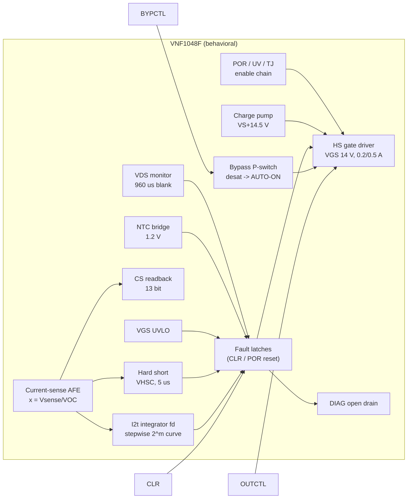

#### 1.6.1 `VNF1048F` (controller), 14 pins

| # | Pin | Type | Function |
|---|---|---|---|
| 1 | `VS` | power | battery supply (also the bypass P-switch source) |
| 2 | `CP` | power | charge-pump output. Connect the 470 nF reservoir from CP to VS. |
| 3 | `ISNS_P` | analog in | shunt, battery side |
| 4 | `ISNS_N` | analog in | shunt, FET drain side (also the VDS-monitor reference and the NTC bridge reference) |
| 5 | `HS_GATE` | analog out | gate driver output |
| 6 | `OUT` | analog | FET source / load (driver return, bypass output) |
| 7 | `NTC` | analog in | NTC bridge input (NTC between ISNS_N/drain and NTC) |
| 8 | `NTC_M` | analog out | ISNS_N − 1.2 V (bottom of the bridge, via RT_REF) |
| 9 | `GND` | power | ground |
| 10 | `DIAG` | open drain | low = fault / CP_LOW / wake-up |
| 11 | `OUTCTL` | logic in | **replaces SPI CR#1.OUTCTL** (1 = FET on) |
| 12 | `BYPCTL` | logic in | **replaces SPI CR#1.BYPASSCTL** (1 = bypass on) |
| 13 | `CLR` | logic in | **replaces SPI "read & clear" of SR#1** (high = clear latched faults) |
| 14 | `CS` | analog out | **replaces SR#2 CURR_SENSE**: V(CS) = quantized VSENSE [V], I = V(CS)/RSENSE |

Logic inputs switch at 1.5 V (3.3 V / 5 V CMOS) and have 1 MΩ to GND.

#### 1.6.2 Parameters

Thresholds are set with the **same register codes as the SPI fields**, so a value
that works in simulation maps 1:1 onto the firmware configuration.

| Parameter | Default | Meaning |
|---|---|---|
| `OVC_CODE` | 10 | CR#2.OVC_THR, 0..31 → VOC_THRS (Tab. 16): 6, 7.2, 8.7, 10.4, 11.8, 13, 13.8, 14.8, 15.8, 16.8, 17.9, 19.1, 20.4, 21.8, 23.3, 24.8, 26.5, 28.2, 30.1, 32.2, 34.3, 36.6, 39.1, 41.7, 44.5, 47.5, 50.6, 54, 61.3, 69.5, 78.8, 89.3 mV. **INOM = VOC_THRS / RSENSE** |
| `HSC_CODE` | 10 | CR#2.HSHT_THR, 0..15 → VHSC_THRS (Tab. 15): 20, 23, 26.4, 30.3, 34.8, 40, 45.9, 52.8, 60.6, 69.6, 80, 91.9, 105.6, 121.3, 139.3, 160 mV. **IHSC = VHSC_THRS / RSENSE** |
| `VDS_CODE` | 10 | CR#2.VDS_THR, 0..30 → 0.30 + 0.05·code V |
| `NTC_CODE` | 4 | CR#3.NTC_THR, 0..10 → 110.92 … 37.50 mV (100 … 150 °C in 5 °C steps). 11..15 = 37.5 mV. |
| `TNOM_CODE` | 0 | CR#2.T_NOM, 0..255 → **tNOM = 2·code + 1 s** |
| `VOC_MV`, `HSC_MV`, `VDS_MV`, `VNTC_MV`, `TNOM_S` | 0 | direct overrides in mV / s (used when > 0) |
| `FUSE_MODE` | 0 | 0 = ST stepwise curve (as the silicon), 1 = ideal continuous curve |
| `TOL_T` | 1 | trip-time multiplier, for corner analysis (datasheet ±10 % → 0.9 / 1.1); scales heating and cooling alike, so the RMS criterion holds for any value |
| `KCOOL` | 1 | cooling-rate factor of the fuse memory (1 = symmetric heat balance) |
| `T_SAMP` | 61u | fuse current averaging window (tI_SAMPLING) |
| `CPON` | 1 | 1 = Unlocked/Locked mode (charge pump running), 0 = Stand-by (CP off until AUTO-ON or OUTCTL) |
| `VGS_ON`, `IG_SRC`, `IG_SNK` | 14, 0.2, 0.5 | gate drive regulation [V], source / sink current [A] **[EST]** |
| `VCP_REG`, `ICP_MAX`, `RCP` | 14.5, 30m, 10 | charge pump: regulation above VS, current capability **[EST]**, output R **[EST]** |
| `HSC_DLY`, `VDS_DGL`, `VDS_DLY`, `VDS_BLK`, `VGU_DGL`, `UV_FLT`, `NTC_DGL`, `CP_FLT`, `BYP_DGL` | 5u, 5u, 5u, 960u, 8u, 33u, 100u, 60u, 5u | timing (datasheet; NTC_DGL is "10…500 µs", 100 µs chosen) |
| `CP_BLK` | 200u | CP_LOW is evaluated only this long after the charge pump is enabled (start-up from Stand-by takes ~100 µs) **[EST]** |
| `VS_USD`, `VS_USD_HYS` | 4.5, 0.1 | UV threshold and hysteresis |
| `VBYP_SAT`, `RBYP`, `IBYP_SAT` | 1.3, 7, 0.12 | bypass switch |
| `TTSD`, `TTSD_HYS`, `TAMB`, `RTHJA`, `P_EXT` | 175, 15, 25, 26, 0 | device thermal (P_EXT adds external heating to the IC) |
| `IQ_ON`, `IQ_STBY`, `IOUT_B`, `ISNSP_B`, `ISNSN_B` | 8m, 150u, 1.3m, 300u, 420u | supply and pin bias currents |
| `CS_GERR` | 0 | gain error of the CS readback (e.g. 0.03 = +3 %), applied before the 13-bit full-scale clamp |
| `VTH_LOGIC` | 1.5 | threshold of the OUTCTL, BYPCTL and CLR inputs |

**`EFUSE48_MOD` accepts all of these parameters too** and passes them to its
internal controller, with the controller's defaults except the thresholds
(`OVC_CODE=13`, `HSC_CODE=12`, `VDS_CODE=14`, sized for `RSENSE=1m`). The
module's own `TAMB` is the FET ambient; `TAMB_IC` is the controller's ambient
and follows `TAMB` unless set (default −1000, i.e. "same as `TAMB`"). For
example, a corner run on the complete channel:
`X1 … EFUSE48_MOD OVC_CODE=13 TOL_T=1.1 CS_GERR=-0.05 VGS_ON=12`.

#### 1.6.3 Internal nodes you can probe

All logic nodes are 0/1 V. Path syntax: netlist instance `X1` of the controller
→ `V(x1:fd)`. Inside the module (`X1 … EFUSE48_MOD`) the IC is `XU`, so use
`V(x1:xu:fd)`. In a schematic on LTspice 24+, instance `U1` → `V(u1:fd)` or
`V(u1:xu:fd)` (LTspice XVII: `V(xu1:…)`). **`.meas` only sees internal nodes
that are listed in a `.save` statement.**

| Node | Meaning (SPI equivalent) |
|---|---|
| `gcmd` | HS gate driver commanded on (SR#1.OUTST) |
| `bycmd`, `byp` | bypass commanded on (SR#1.BYPASSST) / smoothed |
| `hsht` | hard short latched (SR#1.HSHT) |
| `fusel` | current-vs-time latched (SR#1.FUSE_LATCH) |
| `fd` | **fuse state** 0…1, trip at 1 (the "VIP-fuse counter") |
| `xa` | x = I/INOM averaged over 61 µs |
| `ovc` | real-time over-current warning (GSB.OVC) |
| `vdsmax` | VDS desaturation latched (SR#1.VDS_MAX) |
| `vgslow` | gate under-voltage latched (SR#1.VGS_LOW) |
| `ntcovt` | external FET over-temperature latched (SR#1.NTC_OVT) |
| `uv` | battery under-voltage, real-time (SR#1.VS_UV) |
| `devovt`, `tj` | device over-temperature (SR#1.DEV_OVT), junction temperature [°C] |
| `cplow`, `cpok` | charge pump low (SR#1.CP_LOW) / CP above threshold |
| `autoon` | bypass desaturation → AUTO-ON (SR#1.BYPASS_SAT, GSB.AUTOON) |
| `flt` | OR of the latched shutdown faults |
| `ton` | time since HS turn-on (VDS blanking timer) |
| `porok`, `cpen` | out of POR / charge pump enabled |

Module-level nodes (`EFUSE48_MOD`): `drn` (FET drain = ISNS_N), `g` (FET gate),
`hsg` (HS_GATE pin), `cp`, `ntc`, `ntcm`, `tjf` (FET junction °C), `tcf` (pad/NTC °C).

---

### 1.7 Block-by-block description

#### 1.7.1 Supply, POR and under-voltage

* POR: the device is in reset below 2.3 V and leaves it above 2.5 V. POR clears
  every latch and the fuse memory `fd`, which matches "registers loaded with
  default values".
* UV: `VS < 4.5 V` sustained for 33 µs → `uv` = 1. Gate, bypass and charge pump
  turn off. `VS > 4.6 V` → `uv` clears and the channel **restarts by itself**,
  because UV is a real-time bit and not latched.
* Supply current: `IQ_STBY` + `IQ_ON` when the charge pump runs, plus the pump's
  input current.

#### 1.7.2 Charge pump

```
VCP_target = VS + min(VCP_REG, 9 V + 1.375·(VS − 6 V))      (14.5 V for VS ≥ 10 V, 9 V at 6 V)
I_CP       = ICP_MAX · tanh((VCP_target − V(CP)) / (ICP_MAX·RCP))
```

The model is a regulated source with output resistance `RCP` and current limit
`ICP_MAX`, charging the external CP capacitor (470 nF CP–VS). CP_LOW is set when
CP < VS + 5.6 V for 60 µs (released above VS + 6.0 V) and disables the gate
driver (DIAG low). With the mid-spec curve used here (VS + 9 V at 6 V), the pump
still provides ~VS + 7 V at 4.6 V. In tb06, therefore, the FET is switched off by the
4.5 V UV shutdown and not by CP_LOW. A weaker pump (`ICP_MAX`, `VCP_REG`) or a heavy
gate load can make CP_LOW act first. The datasheet only guarantees operation
down to 6 V.

#### 1.7.3 Gate driver

```
I_src = IG_SRC · clip((VGS_ON − V(HS_GATE,OUT))/0.5 V) · clip(V(CP,HS_GATE)/0.5 V)   from CP
I_snk = IG_SNK · clip(V(HS_GATE,OUT)/1 V)                                         to OUT
```

This gives a current-limited, VGS-regulated push-pull referred to OUT, with a
20 V clamp HS_GATE→OUT, a diode HS_GATE→CP and a 200 kΩ passive pull-down.
IG_SRC/IG_SNK come from tON = 4 µs (0.5→10 V) and tOFF = 2.6 µs with 80 nF:
80 nF·9.5 V/4 µs ≈ 0.19 A and 80 nF·14 V/2.6 µs ≈ 0.43 A **[EST]**.

#### 1.7.4 Current-sense front end and CS readback

`VSENSE = max(V(ISNS_P) − V(ISNS_N), 0)` (unidirectional). Three paths:

* **fast** (0.5 µs RC) for the hard-short comparator (0.9 MS/s ADC),
* **x = VSENSE/VOC** averaged with τ = `T_SAMP`/2 (≈ the 61 µs fuse sampling window),
* **CS readback**: 200 µs low-pass (2.4 kS/s refresh), quantized to
  160 mV/8192 = 19.5 µV, optional gain error `CS_GERR`.

#### 1.7.5 Hard short-circuit latch-off

`VSENSE > VHSC` while the FET is commanded on, sustained for `HSC_DLY` = 5 µs,
latches `hsht`. Per datasheet section 5.6 it also sets `fusel`. Note that the current keeps
rising during the 5 µs, limited only by the loop inductance. tb02 shows 105.6 A
threshold → <!--v {m('tb02_hard_short','ipk_fet'):.0f}-->342<!--/v--> A peak with 1 µH of load harness.

#### 1.7.6 The eFuse I²t curve

The datasheet text says the curve is "an optimized stepwise function", that
`tNOM` is the trip time at INOM ("the first step"), and that the number of steps
is 15 for VOC = 6 mV / VHSC = 160 mV and 9 for 26.5 / 105.6 mV. It does **not**
give the step values. They were recovered by digitising **Figure 4 and Figure 5**:

* the time levels **halve at every step**: t = tNOM, tNOM/2, tNOM/4, … The 15th
  step in Fig. 4 is 1 s/2¹⁴ = **61 µs, exactly tI_SAMPLING**;
* the step edges fall at **x = √(1 + 2ᵐ/32)** (x = I/INOM). From Fig. 4 (VOC = 6 mV):
  6.18, 6.36, 6.71, 7.35, 8.49, 10.4, 13.4, 18.0, 24.7, 34.5, 48.4, 68.1, 96.2,
  136 mV. All 15 edges match the figure to within reading accuracy, and Fig. 5
  (VOC = 26.5 mV, 9 steps, tNOM ≈ 51 s) matches as well.

This is the inverse of a classic **heat-balance (adiabatic + constant loss)
wire model**:

```
ideal:      t(x) = (tNOM/32) / (x² − 1)        capped at tNOM (x close to 1)
stepwise:   t(x) = tNOM / 2^m ,  m = floor(log2(32·(x² − 1))),  m ≥ 0
equivalent: dE/dt ∝ I² − INOM² ,  trip at  E = INOM²·tNOM/32
```

The model integrates a normalized fuse state `fd` (0 → 1) on a 1 F capacitor:

```
x > 1 :  dfd/dt = k(x) · r(x) / (tNOM · TOL_T)       k = 2^m (FUSE_MODE 0)  or  max(1, 32(x²−1)) (FUSE_MODE 1)
x < 1 :  dfd/dt = −KCOOL · 32 · (1 − x²) / (tNOM · TOL_T)      (cooling, fd ≥ 0)
trip  :  fd ≥ 1 while the FET is on  →  FUSE_LATCH
r(x) = limit((x − 1)/0.002, 0, 1)
```

`r(x)` ramps the heating rate in between x = 1 and 1.002 **[EST]**, so a current
sitting at INOM does not see a step from 0 to 1/tNOM (k ≥ 1 just above INOM);
it changes the trip time only within 0.2 % of INOM, well inside the sense
tolerance. `TOL_T` scales heating and cooling alike, so the RMS criterion below
holds for any `TOL_T`.

Consequences, all visible in the test benches:

* **No trip at I ≤ INOM, ever.**
* **PWM loads trip on RMS.** The averaged rate is 32·(⟨x²⟩ − 1), so the channel
  trips only if I_RMS > INOM (tb04), which is how the datasheet describes the
  fuse: it acts on the RMS (mean-square) value of the current, not on its peak.
  The stepwise quantization
  makes the silicon slightly more tolerant than ideal RMS.
* **Thermal memory.** After a trip `fd` = 1 decays in ≈ tNOM/32 at zero current.
  Re-arming earlier gives a shorter trip time, as the datasheet warns ("user can
  expect that trip time will be lower than expected").
* **Inrush.** Capacitor charging is ignored as long as its I²t is small compared
  with INOM²·tNOM/32 (tb01: fd = <!--v {m('tb01_startup_inrush','fdmax'):.3f}-->0.005<!--/v--> for a 30 A / 0.5 ms inrush).

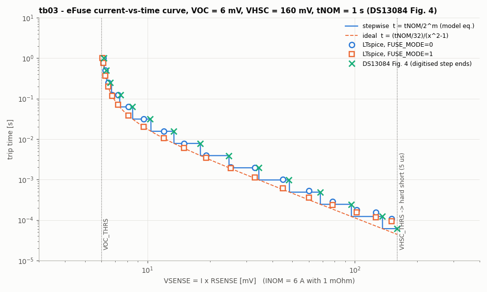

#### 1.7.7 VDS desaturation

`VDS = V(ISNS_N) − V(OUT)` (FET only; the shunt is upstream). The condition is
armed `VDS_BLK` = 960 µs after each HS turn-on and must persist for 5 + 5 µs.
The result is latched. **Design consequence: the output must finish ramping
within ~0.96 ms** (see [1.8.2](#182-gate-slew-network-and-the-960-µs-rule)).

#### 1.7.8 Gate under-voltage (VGS_LOW)

The threshold is 8.5 V for VS > 10 V and 5 V at VS = 6 V (interpolated). The
monitor arms once VGS has exceeded the threshold after turn-on (the "falls below"
wording) and trips if VGS stays below it for 8 µs. The result is latched.

#### 1.7.9 External FET over-temperature (NTC)

The bridge works as on the silicon: `NTC_M` = V(ISNS_N) − 1.2 V and
`VNTC = V(ISNS_N) − V(NTC) = 1.2 V · RNTC/(RT_REF + RNTC)`. Trip when VNTC < VNTC_THRS
(for `NTC_DGL`) while the FET is on. The result is latched.

`NTC10K_ST` is a Steinhart–Hart fit (A = 9.0308e-4, B = 2.4423e-4, C = 2.5784e-7)
through R25 = 10 kΩ and the 11 resistances implied by the ST thresholds with
RT_REF = 10 kΩ. It reproduces 100…150 °C to within ±0.06 °C, so a threshold code
in the model means the same temperature as on the bench with the recommended NTC
(B57232V5103F360 class). It is implemented as a ln R(T) table for robust convergence.

#### 1.7.10 Low-current bypass and AUTO-ON

A P-switch VS→OUT, modeled as `I = IBYP_SAT·tanh(V/(RBYP·IBYP_SAT))`, i.e. 7 Ω
saturating at ~0.12 A, with a body diode OUT→VS. It keeps sleeping loads alive
with the charge pump off (`CPON` = 0). If VS − VOUT > 1.3 V for 5 µs while the FET
is off, the controller sets `autoon`. Then the bypass turns off, the charge pump
starts and the **FET is switched on by hardware** regardless of OUTCTL. In
stand-by (`CPON` = 0) DIAG is pulled low to signal the wake-up. CLR clears it.
The charge pump needs ~100 µs to start from Stand-by (470 nF at 30 mA), longer
than the 60 µs CP_LOW filter, so CP_LOW is evaluated only `CP_BLK` = 200 µs
**[EST]** after the pump is enabled; otherwise every wake-up would flag CP_LOW
and hold the gate off until it cleared (tb08 checks that it does not).
The bypass must not be used to charge loads.

#### 1.7.11 Latches, clear and DIAG

`EF_LATCH` is a set-dominant SR latch that holds its state on a capacitor and
regenerates to 0/1. It starts deterministically at 0. The fault latches
(HSHT, FUSE_LATCH, VDS_MAX, VGS_LOW, NTC_OVT, AUTO-ON) cannot set during the DC
operating point (`DCS=0`): their trip removes their own cause (FET off, no
current), so a fault already present at t = 0, such as OUTCTL high into a short,
would leave the DC solve without a consistent solution and LTspice hung. Such a
fault now latches at the first time step. `CLR` (or POR) resets all
latched faults. Because set dominates, a fault still present re-latches at once.
For example, CLR into a persistent short makes the FET turn on and the HSC trip
again 5 µs later, which is how a firmware retry behaves (tb02).

---

### 1.8 EFUSE48_MOD: complete channel and external-component design

`EFUSE48_MOD VBAT OUT GND EN BYP CLR DIAG CS TFET` packages one channel as in
DS13084 Fig. 16, plus a gate slew network:

```
VBAT ──RSENSE──┬── drain [EF_FET100V ×NPAR] source ── OUT
  │            │                gate ─┬─ RG_ON (2.2k) ── HS_GATE
  │ CVS 100n   NTC 10k (pad)          ├─ D ─ RG_OFF (10 Ω) ── HS_GATE   (fast turn-off)
  │ CCP 470n   │                      ├─ C_SLEW (47 nF) ── GND           (dV/dt control)
  │ (CP–VBAT)  RT_REF 10k ── NTC_M    ├─ RGB 47k ── OUT
  │                                   └─ 15 V zener ── OUT              (gate protection)
  DIAG pull-up 4.7 kΩ to 3.3 V (internal), TFET = FET junction temperature [°C]
```

Extra parameters: `RSENSE`, `RG_ON`, `C_SLEW`, `RG_OFF`, `NPAR` (FETs in parallel),
and the FET thermal network `TAMB`, `RTHJC`, `RTHCA`, `CTHJ`, `CTHC`, per FET.
Each FET dissipates P = VDS·ID/NPAR into its 2-stage RC network (identical FETs
share the current equally), so `TFET` is the junction temperature of each FET;
tb22 checks this against NPAR = 1. The NTC sees the pad temperature.

#### 1.8.1 Choosing the thresholds

```
INOM = VOC_THRS(OVC_CODE) / RSENSE          IHSC = VHSC_THRS(HSC_CODE) / RSENSE
t_trip(I) = tNOM / 2^floor(log2(32((I/INOM)² − 1)))      for INOM < I < IHSC
```

The usable fuse window is IHSC/INOM ≤ 26.7 (6 mV vs 160 mV). Keep VSENSE at
nominal load above ~10 mV, where the sense accuracy is ±5 % or better.

#### 1.8.2 Gate slew network and the 960 µs rule

Without slew control the driver switches the FET in ~µs. Into a capacitive load
the inrush is then limited only by the loop resistance, so the HSC trips. The
module sets the output slew with RG_ON and C_SLEW to ground:

```
dVout/dt ≈ (VGS_ON − VGS_plateau) / (RG_ON · (C_SLEW + Cgd))  ≈ 9 V / (2.2k · 50 nF) ≈ 85 V/ms
t_ramp  ≈ VBAT / (dV/dt)  ≈ 0.6 ms        I_inrush ≈ C_LOAD · dV/dt
```

Two limits apply at the same time:

* `t_ramp` < **VDS_BLK = 960 µs**. Otherwise VDS (still tens of volts) trips the
  desaturation protection at the end of the blanking time (tb05, C_SLEW = 470 nF).
* `I_inrush` < IHSC, the FET has to survive the SOA of the ramp, and the inrush
  I²t has to stay small with respect to the fuse.

So with this controller the maximum load capacitance scales roughly as
C_LOAD,max ≈ IHSC · 0.96 ms / VBAT, about 2 mF for a 105 A HSC at 48 V before
margins. tb11 maps this window: with margins the practical limit is ~1–1.5 mF.
For larger capacitances, raise IHSC (if the FET and harness allow it) or
pre-charge the load through a separate path ([section 1.9](#19-pre-charging-capacitive-loads)).

Two more parts in the module are design lessons from the test benches:

* **Fast turn-off path.** The diode plus RG_OFF bypass RG_ON, so a short is
  interrupted in µs rather than through the 100 µs RG·C time constant.
* **Gate–source zener (15 V).** In a hard short OUT collapses while C_SLEW still
  holds the gate at ~62 V. Without the clamp the FET would see VGS ≫ 20 V
  (tb02: 15.9 V with the clamp).

#### 1.8.3 Board-level protection seen in the benches

* **Input bulk capacitance and TVS.** Interrupting ~230 A from 1 µH of supply
  harness gives an inductive kick. With only 22 µF of bus capacitance and no TVS
  VBAT reaches <!--v {m('tb25_supply_clamp','vbatpk',2):.0f}-->99<!--/v--> V, above the 70 V absolute maximum. With 100 µF + TVS it
  stays at <!--v {m('tb02_hard_short','vbatpk'):.0f}-->65<!--/v--> V (tb02, tb25).
* **Freewheel Schottky OUT→GND.** It is mandatory for inductive loads and long
  harnesses. Without it OUT goes to <!--v {u(m('tb09_inductive_turnoff','vout_min'),'.0f')}-->−52<!--/v--> V, the FET avalanches with ~120 mJ, and the
  VNF1048F OUT pin rating (−2 V DC, −10 V for 10 µs) is violated (tb09).

---

### 1.9 Pre-charging capacitive loads

Almost every 48 V load has a large capacitor at its input: DC/DC converters,
traction or e-compressor inverters, electric power steering, ECUs with bulk
capacitance. Before such a load is connected to the battery, that capacitor
has to be **pre-charged**. This section explains why, compares the ways of
doing it and lists the design considerations. Benches tb11–tb14
([section 1.10](#110-test-benches-and-results)) put numbers on each point.

#### 1.9.1 What pre-charge is, intuitively

Think of the load capacitor as an empty tank and the battery as a water main
under pressure. If you open the big main valve (the eFuse MOSFET) at once, the
water rushes in limited only by the pipe friction (the loop resistance). At 48 V
the loop is battery + harness + shunt + FET + capacitor ESR, about 30 mΩ, so an
empty capacitor would try to draw 48 V / 30 mΩ ≈ **1.5 kA**. For the first
microseconds a discharged capacitor is electrically **a short circuit**.

**Pre-charging** means filling the tank slowly through a small, controlled
path first, and opening the main valve only when the levels are (almost) equal.
Then the main switch closes with almost no voltage across it, and almost no
current flows at that instant.

Why it matters in an eFuse system:

* **False trips.** The eFuse cannot tell an empty capacitor from a short. An
  uncontrolled inrush crosses IHSC and the channel latches off (tb11, tb12).
* **Stress in the element that limits the current.** Whatever limits the
  inrush (FET, resistor, current regulator) has to absorb a lot of energy in a
  short time (see below).
* **Supply-side disturbance.** A large inrush pulls the 48 V bus down for every
  other load on it (tb10 shows how a short does the same).
* **Connector and relay contacts.** Closing a mechanical contact onto an empty
  capacitor makes it arc and can weld it. eFuses avoid this, but many 48 V systems
  also have a battery disconnect switch or relay.

##### The half-energy rule: you cannot avoid the heat, only move it

There is one fact that dominates every pre-charge design. When you charge a
capacitor from a constant voltage source through **any** resistive or linear
element, that element dissipates **exactly as much energy as the capacitor
stores**:

```
charge drawn from the battery     Q = C·VBAT
energy delivered by the battery   E_bat = Q·VBAT = C·VBAT²
energy stored in the capacitor    E_C   = ½·C·VBAT²
energy turned into heat           E_loss = E_bat − E_C = ½·C·VBAT²
(starting from V0 instead of 0:   E_loss = ½·C·(VBAT − V0)² )
```

The value of the resistor, the current limit, the ramp rate and the time all
drop out. A 4.7 mF capacitor charged to 48 V stores **5.4 J**, so the pre-charge
element turns 5.4 J into heat every time, whether it is a 1 Ω or a 100 Ω
resistor, a MOSFET ramping in 1 ms or a current source taking 20 ms. The
method decides only **where** the heat goes (FET, resistor), **how fast** (peak
power) and **how long** the event lasts. For comparison: dumped adiabatically into the
junction of the model's FET (thermal capacitance 0.02 J/K, [EST]) those 5.4 J
would mean +270 K. The FET survives tb01/tb11 only because the energy is smaller
and spread over a time in which the heat can reach the case.

The only way around the half-energy rule is to limit the current with an
**inductor** instead of a resistance, as a switch-mode converter does
(method D below, tb13: 0.11 J lost instead of 4 J).

The same formula with V0 explains the **hand-over**. If the main switch closes
while ΔV is still left across it, the remaining charge flows through the loop
resistance with a peak current of about ΔV / R_loop and dissipates ½·C·ΔV².
Pre-charging to 95 % (ΔV = 2.4 V) leaves only 0.25 % of the energy for the main
switch. tb12 shows what happens when the hand-over comes too early.

#### 1.9.2 Ways of doing it

```
 A  dV/dt control of the main switch          B  resistor + bypass switch

 VBAT ─RSENSE─ D[FET]S ─── OUT ── C_LOAD                ┌──[S_PRE]──[R_PRE]──┐
                  G                           VBAT ─────┤                    ├── OUT ── C_LOAD
                  ├── RG_ON ── HS_GATE                  └─────[ eFuse ]──────┘
                  └── C_SLEW ── GND           S_PRE on → V(OUT) ≥ 95 % → eFuse on → S_PRE off


 C  constant-current (linear) pre-charge     D  switch-mode (inductor-limited) pre-charge

          ┌──[ I_PRE regulator ]──┐                   ┌──[S]──┬──[ L ]──┐
 VBAT ────┤                       ├── OUT   VBAT ─────┤       │         ├── OUT
          └───────[ eFuse ]───────┘                   │       ▲ D       │
                                                      │      GND        │
                                                      └────[ eFuse ]────┘
```

**A. dV/dt (slew-rate) control of the main switch** (tb01, tb05, tb11). The
eFuse FET itself is the pre-charge element. Its gate is ramped slowly (RG_ON,
C_SLEW), the FET works as a source follower, and OUT follows the gate at a
constant dV/dt. The inrush is a constant I = C_LOAD·dV/dt, and the ramp takes
VBAT/(dV/dt). It needs no extra parts, but the FET dissipates the full ½·C·V² in linear
mode, and with the VNF1048F the method sits in a **window** with two edges:
fast enough to finish within the 960 µs VDS blanking, slow enough to keep
C·dV/dt below IHSC. That window closes at ~2 mF and is comfortable only up to
~1 mF (tb11).

**B. Resistor + bypass switch** (tb12, tb14). A small switch (a small
P-MOSFET, a low-current high-side driver channel, a relay) and a pre-charge
resistor in parallel with the main switch. The capacitor charges with
τ = R_PRE·C_LOAD and reaches 95 % after 3τ and 99 % after 4.6τ. Then the main switch
closes and the pre-charge switch opens. It is simple, robust and well understood
(it is the standard method for high-voltage traction batteries), and the heat
goes into a resistor, not the FET. The drawbacks: it is slow, the
current is highest at the start (peak power VBAT²/R_PRE), the final voltage is
approached only asymptotically, and the resistor must be rated for the pulse
energy and for the fault cases (9.3). A PTC thermistor as R_PRE limits itself
if the load is shorted.

**C. Constant-current (linear) pre-charge** (tb13). A current regulator, i.e. a
MOSFET in a current loop, charges the capacitor with a constant current, so the
voltage rises linearly and the time is t = C·ΔV/I. For the same peak current it is
about 3.5× faster than a resistor to 95 %. The energy lost is still ½·C·V², but
it is now dumped at a high, almost constant power (VBAT·I at the start) for the
whole charge. A long linear-mode pulse at high VDS is the hardest
SOA case for a MOSFET, so this needs a FET specified for linear operation and a
heatsink.

**D. Switch-mode pre-charge** (tb13). The current is limited by an inductor: a
switch, a freewheel diode and L form a buck converter (here with hysteretic 8–12 A
current control). The inductor stores energy and hands it on instead of turning
it into heat, so the loss is only the conduction and switching losses
(0.11 J instead of 4 J in tb13). The battery current is also lower than the
charging current (power, not current, is conserved). The cost is more parts,
switching noise (EMC) and control. Many 48 V architectures already have this
hardware: the bidirectional 48 V/12 V DC/DC converter can pre-charge the 48 V
bus from the 12 V side before the main switch closes.

**Other methods, not simulated here.**

* *Pulsed (PWM) switching of the main switch without an inductor*: the average
  current is limited, but each pulse must stay below IHSC and the ½·C·V² loss
  remains. It has the losses of method A plus the trip risk of every pulse.
* *NTC inrush limiters*: simple, but they work only when cold and are slow to
  recover, so they suit mains equipment better than vehicles.
* *Soft-start inside the load*: the load's own input stage limits its
  inrush, e.g. an active inrush limiter in the DC/DC. Then the eFuse can switch fast,
  but you depend on every load being designed that way.
* *Why not the VNF1048F low-current bypass?* It saturates at ~0.12 A, which would
  take C·V/I = 4.7 mF·48 V/0.12 A ≈ 1.9 s. More importantly, once VS − OUT
  exceeds ~1.3 V for 5 µs, the controller reads it as a load wake-up and turns
  the main FET on by itself (AUTO-ON, tb08). The bypass immediately hands over
  to method A, so it is not a pre-charge path.

**The methods compared** on the same 4.7 mF load at about 10 A (tb13, with tb11 for
method A at 1 mF):

| Method | Time to 95 % | Energy lost | Peak / average power in the element | Extra parts | Practical C range | Bench |
|---|---|---|---|---|---|---|
| A dV/dt (1 mF, 65 V/ms) | 0.66 ms | 0.79 J (FET) | 2.7 kW / 1.3 kW in the FET | none | ≲ 1–1.5 mF | tb11 |
| B resistor 4.8 Ω | 65.8 ms | 4.08 J | 377 W / 62 W | switch + R | any (time ∝ C) | tb12–14 |
| C constant current 10 A | 18.5 ms | 4.05 J | 415 W / 219 W | linear FET + loop | any, SOA-limited | tb13 |
| D switch-mode, 10 A avg | 18.4 ms | 0.11 J | (switching losses) | switch, L, diode, control | any | tb13 |

#### 1.9.3 Design considerations

1. **Size the energy, not only the current.** Every pre-charge dissipates
   ½·C·(VBAT − V0)² (5.4 J for 4.7 mF from 0 V). Check the element against its
   **single-pulse** rating at the actual pulse length: the pulse-load curve of the
   resistor, or the FET's transient thermal impedance and SOA at the VDS it actually
   sees. Then check the **repetitive** case: key cycles, retries and pre-charge
   aborts in quick succession all add heat.
2. **The fault case sizes the pre-charge element.** Into a shorted load a
   resistor dissipates VBAT²/R_PRE (470 W for 4.7 Ω) for as long as the
   pre-charge is allowed to run. tb14: 10.3 J by the checkpoint at 1τ, against
   4 J for a normal pre-charge. Without the early checkpoint, the 100 ms timeout
   alone would let ~47 J into the resistor. **Fail fast**: check that V(OUT) is
   rising after a fraction of the expected time.
3. **Hand over on voltage, not on time.** A fixed timer assumes a known C, VBAT,
   V0 and load. A comparator on the voltage across the main switch
   (VBAT − VOUT < ΔV_max) works for any capacitance tolerance, battery voltage
   or residual charge (hot restart). For the main switch,
   I_handover ≈ ΔV/R_loop must stay well below IHSC. In tb12, R_loop,eff ≈ 51 mΩ, so
   IHSC = 105.6 A is reached at ΔV ≈ 5.4 V: 2τ (5.9 V) trips, 3τ (2.2 V, 43 A) and
   95 % (2.4 V) are fine, and 98 % or more leaves comfortable margin.
4. **Supervise the pre-charge and give it an outcome.** A robust sequence has
   (a) an early **checkpoint** (V(OUT) above x % after ~1τ) that catches shorts,
   (b) a **timeout** that catches leaky loads, an oversized C or a load that
   switched on, (c) an **abort** that opens the pre-charge path, latches and reports,
   and (d) a rule never to close the main switch after an abort (tb14). The pre-charge is
   also a cheap **load diagnostic**: a short or a leak is found at 10 A
   instead of at 300 A (compare tb02).
5. **Keep the load off until power-good.** A resistive load forms a divider
   with R_PRE (final voltage VBAT·R_L/(R_L + R_PRE), tb14 "leaky load"). A
   **constant-power** load (DC/DC, inverter) is worse: it draws *more* current
   as its voltage falls. If it starts on its own UVLO in the middle of the
   pre-charge, the pre-charge path cannot supply it. The capacitor collapses, the load
   stops, the capacitor recharges, and the cycle repeats (tb14: 18 start/stop cycles in 80 ms).
   Gate the load enable with the power-good of the pre-charge supervisor.
6. **Design for the capacitance tolerance and for all the capacitance.**
   Electrolytic capacitors are typically −20/+20 % or worse, lose capacitance with
   age and cold, and every ECU on the branch adds its own input capacitance. With
   method A the inrush scales directly with C (keep the worst case inside the
   tb11 window). With methods B–D the time scales with C (set the timeout for
   C_max and the checkpoint for C_min). The measured pre-charge time is a free
   estimate of C, useful for detecting capacitor degradation.
7. **Respect the eFuse protections during pre-charge.** The inrush counts towards
   the I²t bucket (tb11: fd = 0.10 for 1 mF). The HSC has to clear the peak, not
   the average: with a pre-biased output the first-conduction spike is
   1.2–1.5× C·dV/dt (tb11). The VDS monitor is blanked for only 960 µs. And the
   pre-charge path bypasses all of these protections (point 8).
8. **The pre-charge path is a sneak path around the fuse.** It sits in parallel
   with the protected switch. If its switch sticks closed, or the MCU leaves it on, the
   harness is fed through R_PRE without any eFuse protection. Its current must
   be limited by design to a value the wire tolerates (VBAT/R_PRE = 10 A here), the
   resistor must survive or fail safe (fusible or PTC type), and its state should
   be monitored. It must also open when the eFuse trips, so it does not keep
   feeding the fault.
9. **Mind the supply side.** The inrush also flows through the battery and the
   main harness: 100 A through 20 mΩ is a 2 V dip for every other load on the bus.
   Stagger the pre-charge of large loads (tb10 staggers CH1 and CH2).
10. **Expect ringing at the end of a fast pre-charge.** The harness inductance
    and C_LOAD form a resonant circuit. When a fast ramp stops, the current overshoots
    and rings (tb11: −12 A after the 1 mF ramp). Capacitor ESR and the bleeder
    damp it.

#### 1.9.4 Choosing a method

| Load capacitance / use | Suggested method | Watch out for |
|---|---|---|
| up to ~1 mF (with tolerances) | A: dV/dt with `C_SLEW` in the middle of the tb11 window | FET SOA and Tj, first-conduction spike vs IHSC |
| ~1–20 mF, pre-charge occasionally (key-on) | B: resistor + switch, supervised (tb12, tb14) | resistor pulse and fault energy, hand-over ΔV, sneak path |
| large C, fast or frequent start-up | C: constant current, if the FET SOA allows | long linear-mode pulse at high VDS |
| very large C, or efficiency matters | D: switch-mode (often the existing bidirectional DC/DC) | EMC, control, fault handling |

Sizing formulas in one place:

```
any resistive / linear method   E_loss = ½·C·(VBAT − V0)²         (per event)
A  dV/dt                        I = C·dV/dt,  t = VBAT/(dV/dt),  P_FET,peak ≈ VBAT·I
                                window:  (VBAT − V0)/(t_BLK − t_d) < dV/dt < IHSC/(k·C),  k ≈ 1.2–1.5
B  resistor                     τ = R·C,  t95 ≈ 3τ,  t99 ≈ 4.6τ,  I_peak = VBAT/R,  P_peak = VBAT²/R
                                fault (short) energy = VBAT²/R · t_detect
C  constant current             t = C·ΔV/I,  P_peak = VBAT·I,  P_avg = E_loss/t
hand-over                       I_ho ≈ ΔV/R_loop  <  IHSC/2,   E_ho = ½·C·ΔV²
```

---

### 1.10 Test benches and results

Each bench is a plain netlist in `testbenches/` and can be opened directly in
LTspice. The write-ups below have the same structure:

* **What we simulate**: the real-world situation and why it matters.
* **Setup**: the circuit and the stimulus timeline.
* **Signals in the plot**: what each trace is.
* **Expected behaviour**: a hand calculation from the datasheet and circuit values.
* **Results**: simulated vs expected.
* **Things to try**: parameters worth changing to explore the behaviour.

The simulated numbers are `.meas` results, kept in sync with the last run by
`tools/sync_docs.py`; values marked ≈ or ~ are read from the waveforms or are
hand estimates
(`docs/VALIDATION.md`: all **<!--v {m('summary','checks_efuse'):.0f}-->178<!--/v-->** eFuse checks pass, tb15–tb36 included; the
battery and DC/DC checks are described in [section 2](#2-automotive-battery-model) and
[section 3](#3-dcdc-converter-model-48-v-to-12-v-700-w)).
tb01–tb14 are described below. tb15–tb36 are listed in
[Interview companion benches](#interview-companion-benches-tb15tb36) and described,
with their plots, in the interview guide.

**Common setup** unless noted: 48 V battery with 10 mΩ internal resistance and
1 µH supply harness, 100 µF bus capacitance (+ 58 V TVS), RSENSE = 1 mΩ,
OVC_CODE 13 (**INOM = 21.8 A**), HSC_CODE 12 (**IHSC = 105.6 A**), VDS_CODE 14
(VDS threshold 1.0 V), TNOM_CODE 0 (**tNOM = 1 s**), load harness 1 µH / 10 mΩ,
100 V freewheel Schottky from GND to OUT.

**Reading the plots.** Logic signals are 0/1. DIAG is shown normalized (V/3.3 V,
so 1 = high = no fault). Where logic traces would overlap, some are scaled by
×0.95 or ×0.9 (noted in the legend) so every line stays visible. Internal node
names (`gcmd`, `fd`, `hsht`, …) are listed in [1.6.3](#163-internal-nodes-you-can-probe).

---

#### tb01: start-up into a capacitive load (`tb01_startup_inrush.cir`)

**What we simulate.** The most common event in a channel's life is switching on
a load that has a large input capacitor, as DC/DC converters, inverters and ECUs
do. This is also the most common source of false trips. The bench checks that
the channel ramps the output in a controlled way, that the inrush current does
**not** trip the fuse, and that the steady state (gate drive, charge pump,
current readback) matches the datasheet.

**Setup.** Load = 220 µF (20 mΩ ESR) in parallel with 4.8 Ω (10 A at 48 V),
behind the 1 µH load harness. The channel uses the module's default slew network
(RG_ON = 2.2 kΩ, C_SLEW = 47 nF).

| Time | Event |
|---|---|
| 0 | battery on, charge pump already running (`CPON` = 1, Unlocked mode), FET off |
| 0.5 ms | OUTCTL (`en`) → 1 |
| 5 ms | end |

**Signals in the plot.**
1. VBAT, OUT, CP (charge-pump output) and HS_GATE (driver pin).
2. Load current through the harness, with the INOM line.
3. `x = I/INOM` (61 µs average) and the fuse state `fd` (the "heat bucket").
4. The gate command and DIAG.

**Expected behaviour.**
* The HS_GATE pin jumps to OUT + 14 V (`VGS_ON`) at once. The real FET gate
  follows more slowly through RG_ON·C_SLEW, so OUT starts to rise after the gate
  reaches the threshold, a few tens of µs later.
* While OUT ramps, the FET is a source follower. The ramp rate is set by the
  current through RG_ON charging C_SLEW: (14 V − ~5 V)/2.2 kΩ ≈ 4 mA into ~50 nF,
  which gives **≈ 80–100 V/ms**.
* Inrush = C·dV/dt + load current ≈ 220 µF × 97 V/ms + up to 10 A ≈ **30 A**.
  That is above INOM (x ≈ 1.35) but lasts only ~0.5 ms. The bucket fills by
  ≈ (0.5 ms × 2^m)/tNOM, about 0.5 %, so no trip is expected.
* The FET dissipates about ½·C·V² ≈ 0.25 J during the ramp. Charging a
  capacitor through a linear element always costs as much energy as it stores.
* Steady state: VCP = VS + 14.5 V (spec 13.5…15.5 V). VGS at the FET = 14 V
  minus the RG_ON/RGB divider ≈ 13.4 V (spec 12…15 V). CS = 10 A × 1 mΩ = 10 mV.

**Results.**

| Quantity | Expected | Simulated |
|---|---|---|
| delay EN → OUT starts rising (1 V) | tens of µs | <!--v {(m('tb01_startup_inrush','t_start')-0.5e-3)*1e6:.0f}-->45<!--/v--> µs |
| OUT 10 → 90 % ramp | ~0.5 ms | <!--v {(m('tb01_startup_inrush','t90o')-m('tb01_startup_inrush','t10o'))*1e3:.2f}-->0.40<!--/v--> ms (<!--v {38.4/(m('tb01_startup_inrush','t90o')-m('tb01_startup_inrush','t10o'))/1e3:.0f}-->97<!--/v--> V/ms) |
| peak inrush | ~30 A, < IHSC | <!--v {m('tb01_startup_inrush','ipk'):.1f}-->29.7<!--/v--> A |
| fuse state `fd` peak | ≪ 1 | <!--v {m('tb01_startup_inrush','fdmax'):.3f}-->0.005<!--/v--> |
| latched faults / DIAG | none / high | none / 3.3 V |
| VCP − VS (steady, minimum during ramp) | 14.5 V | <!--v {m('tb01_startup_inrush','vcp_ss'):.2f}-->14.50<!--/v--> V (<!--v {m('tb01_startup_inrush','vcp_min'):.2f}-->14.44<!--/v--> V) |
| VGS at FET | 12…15 V | <!--v {m('tb01_startup_inrush','vgs_ss'):.2f}-->13.37<!--/v--> V |
| CS readback | 10 mV ± 5 % | <!--v {m('tb01_startup_inrush','vcs_ss')*1e3:.2f}-->9.94<!--/v--> mV |

**Things to try.** Increase `Cload` to 1–2 mF and see the inrush approach IHSC.
Change `C_SLEW` and see the ramp/inrush trade-off (connects to tb05). Set
`CPON=0` to include the charge-pump start-up time in the turn-on delay.

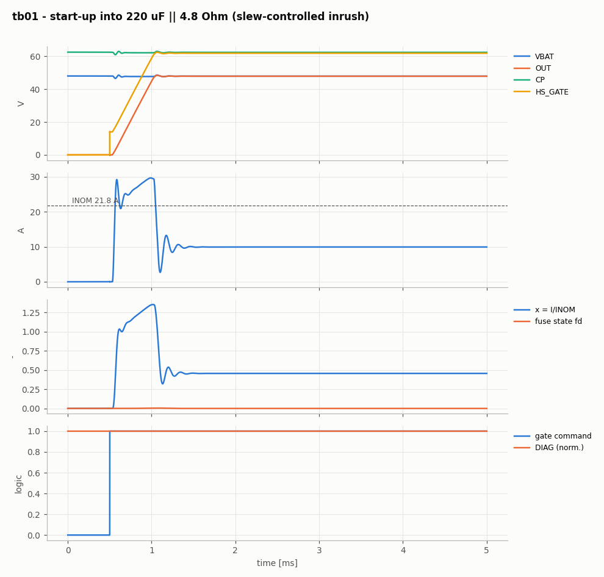

---

#### tb02: hard short circuit and firmware retry (`tb02_hard_short.cir`)

**What we simulate.** A chafed harness shorts the load connector to chassis while
the channel is on. This is the most violent event the eFuse sees. The current
rises at tens of A/µs, and the protection must open the switch within
microseconds. Interrupting hundreds of amperes in an inductive harness then
creates over-voltage on the battery side and negative voltage on the load side.
The bench also checks the firmware's view of the event: the fault latches, a
retry into a persistent short trips again, and the channel restarts once the
short is gone.

**Setup.** As tb01 (220 µF + 4.8 Ω, 10 A). A 5 mΩ switch (`Ssc`) shorts the load
node to ground.

| Time | Event |
|---|---|
| 0.5 ms | OUTCTL → 1, normal start-up |
| 3.0 ms | **short applied** at the load connector |
| 6.0 ms | `CLR` pulse (50 µs): MCU clears HSHT/FUSE_LATCH and retries |
| 9.0 ms | short removed |
| 10.0 ms | `CLR` pulse: restart |

**Signals in the plots.**
* *Zoom* (−10…+40 µs around the short):
  1. VBAT, OUT, FET gate and FET drain.
  2. FET/harness current and battery current, with the IHSC line.
  3. VGS of the FET.
  4. The HSHT latch, the gate command and DIAG.
* *Sequence* (0–12 ms): OUT and VBAT, FET current, and HSHT / FUSE_LATCH / DIAG.

**Expected behaviour.**
* **Current rise.** The short sits behind the 1 µH load harness. With 48 V across
  it, di/dt ≈ 48 V/1 µH ≈ 48 A/µs at first, decreasing as OUT sags. From 10 A to
  105.6 A therefore takes **~3 µs**.
* **Detection.** VSENSE > 105.6 mV must hold for `HSC_DLY` = 5 µs, so the latch
  sets about **3 + 5 = 8 µs** after the short.
* **Turn-off.** The latch removes the gate command, and the driver sinks 0.5 A
  from the gate. Because of the diode/RG_OFF path, C_SLEW discharges in µs. The
  current keeps rising until the FET actually turns off, so the **peak is well
  above the threshold**, at a few hundred amperes.
* **Energy in the inductances.** On the battery side, ½·L·I² in the 1 µH supply
  harness is pushed into the bus capacitor and TVS. VBAT must stay below 70 V
  (abs. max). On the load side, the harness current continues through the
  freewheel Schottky (OUT ≈ −1…−3 V) and decays with L/R ≈ 1 µH/15 mΩ ≈ 70 µs.
* **Gate protection.** OUT collapses to ~0 V while C_SLEW still holds the gate
  near 62 V. The 15 V gate-source zener must clamp VGS (rating ±20 V).
* **Retry.** After `CLR` the gate charges from 0 through RG_ON·C_SLEW, so the FET
  conducts after ~50 µs, the short is still there, and HSHT trips again. The
  second current peak is lower because the FET is still only partially enhanced.
* **Restart.** After the short is removed, a normal start-up (as tb01).

**Results.**

| Quantity | Expected | Simulated |
|---|---|---|
| VSENSE crosses 105.6 mV | ~3 µs after short | 3.2 µs |
| HSHT latch (= FET turn-off command) | ~8 µs | **<!--v {m('tb02_hard_short','dt_trip')*1e6:.1f}-->8.1<!--/v--> µs** |
| FET current peak | ≫ IHSC | <!--v {m('tb02_hard_short','ipk_fet'):.0f}-->342<!--/v--> A |
| battery current peak | < FET peak (Cbus supplies first) | <!--v {m('tb02_hard_short','ipk1'):.0f}-->230<!--/v--> A |
| VBAT peak | < 70 V | <!--v {m('tb02_hard_short','vbatpk'):.1f}-->64.5<!--/v--> V at 35 µs |
| FET VDS peak / VGS peak | < 100 V / < 20 V | <!--v {m('tb02_hard_short','vdspk'):.1f}-->66.6<!--/v--> V / <!--v {m('tb02_hard_short','vgsmax'):.1f}-->15.9<!--/v--> V |
| OUT minimum (freewheel) | −1…−3 V (> −10 V) | <!--v {u(m('tb02_hard_short','voutmin'),'.1f')}-->−3.2<!--/v--> V |
| retry: FET conducts / trips again | ~50 µs / ~100 µs after CLR | 57 µs / 99 µs |
| FUSE_LATCH set by HSHT | yes (datasheet 5.6) | yes |
| restart after short removed | OUT back to 48 V | OUT > 45 V 0.5 ms after CLR |

**Things to try.** Reduce `Cbus` to 10 µF and VBAT exceeds the 70 V rating
(tb25 shows <!--v {m('tb25_supply_clamp','vbatpk',2):.0f}-->99<!--/v--> V already with 22 µF and no TVS). Remove `Dzgs` from the module and watch VGS. Lower `HSC_CODE` to reduce the
peak current. Change the harness inductance and see how the peak current scales.


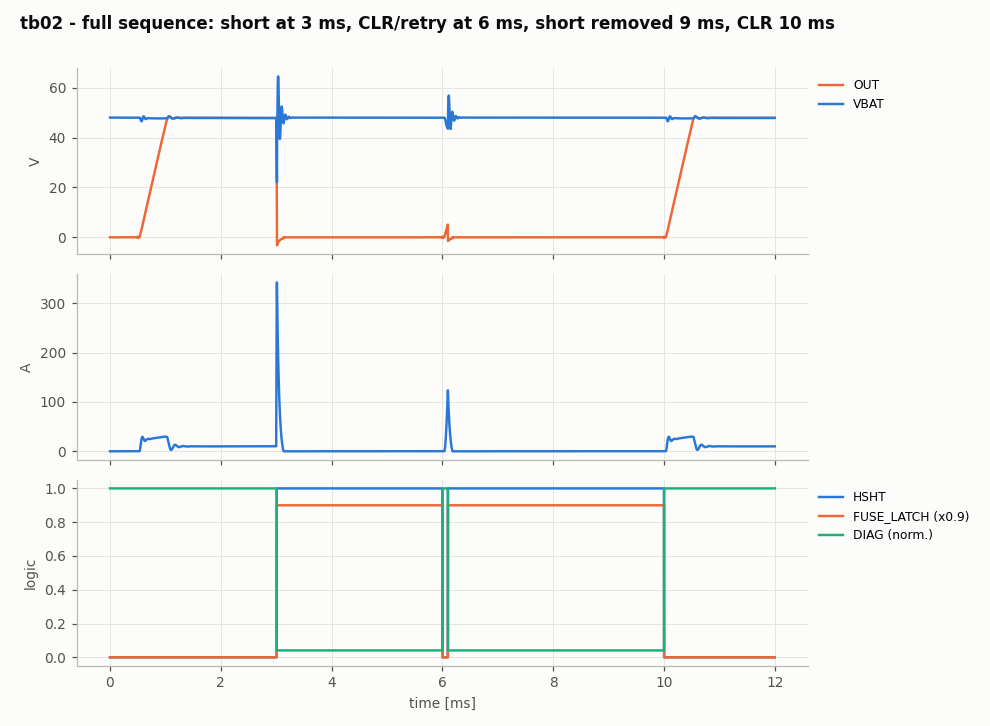

---

#### tb03: I²t (current-vs-time) curve characterisation (`tb03_i2t_curve.cir`)

**What we simulate.** This is the core of the eFuse: the time-to-trip as a
function of overload current. The bench measures it point by point and compares
it with the datasheet curve (DS13084 Fig. 4) and the reverse-engineered equation
([1.7.6](#176-the-efuse-i²t-curve)). It demonstrates that the model reproduces the
staircase shape: tNOM at INOM, halving at every step, with the last step at 61 µs.

**Setup.** The datasheet Fig. 4 settings: OVC_CODE 0 (VOC = 6 mV → INOM = 6 A),
HSC_CODE 15 (160 mV → IHSC = 160 A), tNOM = 1 s, so the widest window (15
steps). The load is an **ideal current source**, so the overload is exactly
defined. It is resistive below 5 V so that OUT is defined after the trip. The
VDS threshold is set to 1.8 V and the FET is well cooled, so only the fuse acts.

| Time | Event |
|---|---|
| 0.5 ms | OUTCTL → 1 |
| 5 ms | overload current `ILOAD` applied (step) |
| ≤ 1.1 s | FUSE_LATCH → trip time = t(FUSE_LATCH) − 5 ms |

`.step` runs 19 currents (6.06…150 A, dense near INOM where the steps are close
together) × `FUSE_MODE` 0/1 (stepwise / ideal), 38 runs in total (~35 s).

**Signals in the plot.** Log-log trip time vs VSENSE. The lines are the model
equations (stepwise in blue, ideal dashed). Circles and squares are the LTspice
results. The green crosses are the step corners digitised from the datasheet
Fig. 4. Dotted verticals mark VOC (no trip below) and VHSC (hard-short region).

**Expected behaviour.**
* x = I/INOM; stepwise t = tNOM/2^m with m = floor(log2(32·(x²−1))), ideal
  t = (tNOM/32)/(x²−1), both capped at tNOM.
* Just above INOM: t = tNOM = 1 s. Points at x = 1.125 and x = 1.2 fall on the
  **same step** (125 ms), which shows the staircase.
* At high current the trip time approaches the 61 µs sampling period. A real
  sampled device cannot react faster than ~one sample, so a fixed latency of a
  few tens of µs is expected to appear.

**Results** (selection; all 38 points are in the plot):

| ILOAD | x | m | stepwise expected | stepwise sim | ideal expected | ideal sim |
|---|---|---|---|---|---|---|
| 6.06 A | 1.01 | 0 | 1 s | <!--v {m('tb03_i2t_curve','ttrip'):.3f}-->1.000<!--/v--> s | 1 s | <!--v {m('tb03_i2t_curve','ttrip',1):.3f}-->1.000<!--/v--> s |
| 6.25 A | 1.04 | 1 | 0.5 s | <!--v {m('tb03_i2t_curve','ttrip',4):.3f}-->0.500<!--/v--> s | 0.367 s | <!--v {m('tb03_i2t_curve','ttrip',5):.3f}-->0.367<!--/v--> s |
| 6.75 A | 1.125 | 3 | 125 ms | <!--v {m('tb03_i2t_curve','ttrip',8)*1000:.1f}-->125.1<!--/v--> ms | 117.6 ms | <!--v {m('tb03_i2t_curve','ttrip',9)*1000:.1f}-->117.6<!--/v--> ms |
| 7.20 A | 1.20 | 3 | 125 ms | <!--v {m('tb03_i2t_curve','ttrip',10)*1000:.1f}-->125.1<!--/v--> ms | 71.0 ms | <!--v {m('tb03_i2t_curve','ttrip',11)*1000:.1f}-->71.1<!--/v--> ms |
| 12 A | 2.0 | 6 | 15.6 ms | <!--v {m('tb03_i2t_curve','ttrip',16)*1000:.1f}-->15.7<!--/v--> ms | 10.4 ms | <!--v {m('tb03_i2t_curve','ttrip',17)*1000:.1f}-->10.5<!--/v--> ms |
| 19.2 A | 3.2 | 8 | 3.91 ms | <!--v {m('tb03_i2t_curve','ttrip',20)*1000:.2f}-->3.96<!--/v--> ms | 3.38 ms | <!--v {m('tb03_i2t_curve','ttrip',21)*1000:.2f}-->3.43<!--/v--> ms |
| 45 A | 7.5 | 10 | 977 µs | <!--v {m('tb03_i2t_curve','ttrip',26)*1e+06:.0f}-->1008<!--/v--> µs | 566 µs | <!--v {m('tb03_i2t_curve','ttrip',27)*1e+06:.0f}-->612<!--/v--> µs |
| 102 A | 17 | 13 | 122 µs | <!--v {m('tb03_i2t_curve','ttrip',32)*1e+06:.0f}-->178<!--/v--> µs | 109 µs | <!--v {m('tb03_i2t_curve','ttrip',33)*1e+06:.0f}-->154<!--/v--> µs |
| 150 A | 25 | 14 | 61 µs | <!--v {m('tb03_i2t_curve','ttrip',36)*1e+06:.0f}-->108<!--/v--> µs | 50 µs | <!--v {m('tb03_i2t_curve','ttrip',37)*1e+06:.0f}-->93<!--/v--> µs |

The error is ≤ 1.4 % for t ≥ 2 ms. Below that, a constant ~40–50 µs latency from
the 61 µs averaging filter appears. The hard-short protection never acts
(150 A < 160 A).

**Things to try.** Reproduce Fig. 5 with `OVC_CODE=16 HSC_CODE=12 TNOM_CODE=25`
(tNOM = 51 s) and `.tran 60`. Use `TOL_T=0.9/1.1` for the ±10 % time tolerance.
Repeat a step overload twice with a pause in between to see the fuse memory
(`KCOOL`).

---

#### tb04: PWM load: does the fuse respond to RMS? (`tb04_pwm_rms.cir`)

**What we simulate.** Many 48 V loads are PWM-controlled: heaters, fans, pumps and
lamps behind a downstream driver. The eFuse then sees a pulsed current whose
*peak* can exceed INOM while its *heating effect* (RMS) does not. A melting fuse
responds to RMS naturally, and the datasheet describes the eFuse as acting on
the RMS (mean-square) value of the current as well. The bench checks that a pulsed load trips only
when I_RMS > INOM.

**Setup.** The eFuse stays on. A downstream low-side switch chops a 1.2 Ω load
(**~39 A peak**, x_on ≈ 1.8) at **200 Hz**. A 47 µF capacitor sits at the load.
The duty cycle is stepped: D = 0.25, 0.30, 0.35, 0.50. The PWM starts at 20 ms.

**Signals in the plot.**
1. The fuse state `fd` for each duty cycle. The thick bands are the 200 Hz
   fill-and-drain ripple. A trip occurs at fd = 1, after which fd decays (memory).
2. Detail of the eFuse current at D = 0.5: 5 ms period, current spikes when the
   switch closes (the 47 µF load capacitor recharges), and LC ringing of the
   harness with the load capacitor.

**Expected behaviour.** In the stepwise model a pulse at x_on ≈ 1.8 fills at
2^m = 64/tNOM (m = 6), and the off-time drains at 32·(1 − 0)/tNOM. The average
fill rate is

```
D·64 − (1 − D)·32   [1/tNOM]       → trip if > 0, trip time ≈ tNOM / rate
D = 0.25 : 16 − 24  = −8   → never trips     (I_RMS = 0.90·INOM)
D = 0.30 : 19.2 − 22.4 = −3.2 → never trips  (I_RMS = 0.98·INOM)
D = 0.35 : 22.4 − 20.8 = +1.6 → ~0.6 s        (I_RMS = 1.06·INOM)
D = 0.50 : 32 − 16  = +16  → 62.5 ms         (I_RMS = 1.27·INOM)
```

Near I_RMS ≈ INOM the net rate is a small difference of two large terms, so the
trip time there is long and very sensitive. This is physically correct: a wire at
its rated current heats up very slowly.

**Results.**

| D | measured I_RMS | fd peak | expected | simulated trip |
|---|---|---|---|---|
| 0.25 | <!--v {m('tb04_pwm_rms','irms'):.1f}-->19.6<!--/v--> A (0.90·INOM) | <!--v {m('tb04_pwm_rms','fdmax'):.3f}-->0.076<!--/v--> | no trip | no trip |
| 0.30 | <!--v {m('tb04_pwm_rms','irms',1):.1f}-->21.5<!--/v--> A (0.99·INOM) | <!--v {m('tb04_pwm_rms','fdmax',1):.3f}-->0.092<!--/v--> | no trip | no trip |
| 0.35 | <!--v {m('tb04_pwm_rms','irms',2):.1f}-->23.2<!--/v--> A (1.06·INOM) | 1 | ~0.6 s (sensitive) | <!--v {m('tb04_pwm_rms','ttrip',2):.2f}-->0.98<!--/v--> s |
| 0.50 | – | 1 | 62.5 ms | **<!--v {m('tb04_pwm_rms','ttrip',3)*1000:.1f}-->61.3<!--/v--> ms** |

The D = 0.35 case trips later than the simple estimate. The load capacitor and
harness smooth the current pulses (lower peaks, current flowing into the off-time),
and near the balance point a few percent of difference in heating changes the
trip time a lot.

**Things to try.** Run `FUSE_MODE=1` (the ideal curve trips almost exactly at
I_RMS = INOM). Change `FPWM` to 20 Hz: at D = 0.5 a single 25 ms pulse is longer
than the 15.6 ms trip time at x = 1.8, so the fuse trips within one pulse. Very
slow PWM is judged pulse by pulse, not by RMS. Raise the peak current (smaller
`Rpwm`) at constant RMS.


---

#### tb05: VDS desaturation and the 960 µs blanking (`tb05_vds_desat.cir`)

**What we simulate.** The VDS monitor protects the MOSFET from operating in its
linear region, where it dissipates VDS × I. During turn-on, VDS is large by
definition, so the monitor is **blanked for 960 µs**. This creates a hard design
constraint: the output must finish ramping within 0.96 ms, or the channel trips
at the end of the blanking time. The bench shows a design that respects the rule
and one that violates it.

**Setup.** Large capacitive load: 680 µF (10 mΩ) + 9.6 Ω (5 A). The gate slew
capacitor is stepped: `C_SLEW` = 47 nF (default) and 470 nF (10× slower).
VDS_CODE 14 → threshold 1.0 V.

| Time | Event |
|---|---|
| 0.5 ms | OUTCTL → 1 |
| 1.46 ms | end of VDS blanking (0.5 ms + 960 µs) |
| 10 ms | end |

**Signals in the plot.**
1. OUT for both cases.
2. VDS = V(drain) − V(OUT), with the blanking window (grey) and the 1.0 V
   threshold (dashed).
3. The VDS_MAX latch.

**Expected behaviour.**
* **47 nF**: ramp ≈ 0.5 ms (as tb01). At the end of blanking the FET is fully on,
  VDS ≈ I·RDS ≈ 5 A × 2 mΩ = 10 mV ≪ 1 V, so there is no trip. The inrush is
  ≈ 680 µF × ~100 V/ms ≈ 70–80 A: below IHSC, but large. It fills the fuse bucket
  noticeably and heats the FET by ½·C·V² ≈ 0.8 J, which is an SOA check.
* **470 nF**: dV/dt is 10× lower (~10 V/ms). After 960 µs OUT has reached only
  ~7 V, VDS ≈ 41 V > 1 V, so VDS_MAX latches after the 5 + 5 µs
  deglitch/delay, **≈ 970 µs after turn-on**. With the FET off, the 680 µF then
  discharges into the load (τ = 680 µF × 9.6 Ω = 6.5 ms).

**Results.**

| Quantity | C_SLEW = 47 nF | C_SLEW = 470 nF |
|---|---|---|
| OUT at 90 % | <!--v {(m('tb05_vds_desat','t90o')-0.5e-3)*1e3:.2f}-->0.50<!--/v--> ms after EN | never (stops at ~6.6 V) |
| VDS at end of blanking | <!--v {m('tb05_vds_desat','vds_b')*1e3:.0f}-->7<!--/v--> mV | <!--v {m('tb05_vds_desat','vds_b',1):.1f}-->41.3<!--/v--> V |
| VDS_MAX latch | no | **<!--v {m('tb05_vds_desat','dt_vds',1)*1e+06:.0f}-->970<!--/v--> µs after EN** |
| peak inrush | <!--v {m('tb05_vds_desat','ipk'):.1f}-->82.8<!--/v--> A | <!--v {m('tb05_vds_desat','ipk',1):.1f}-->7.7<!--/v--> A |
| fuse state `fd` peak | <!--v {m('tb05_vds_desat','fdmax'):.2f}-->0.11<!--/v--> | <!--v {m('tb05_vds_desat','fdmax',1):.0f}-->0<!--/v--> |
| FET junction peak (from 25 °C) | <!--v {m('tb05_vds_desat','tjmax'):.0f}-->60<!--/v--> °C | <!--v {m('tb05_vds_desat','tjmax',1):.0f}-->35<!--/v--> °C |

**Things to try.** Find the largest `Cload` that starts with 47 nF before IHSC
trips. The rule of thumb is C_max ≈ IHSC·0.96 ms/VBAT ≈ 2 mF; see
[1.8.2](#182-gate-slew-network-and-the-960-µs-rule). Raise `VDS_CODE` to 30 (1.8 V):
it does not help with 470 nF, because VDS is tens of volts. Watch `tfet` for SOA.

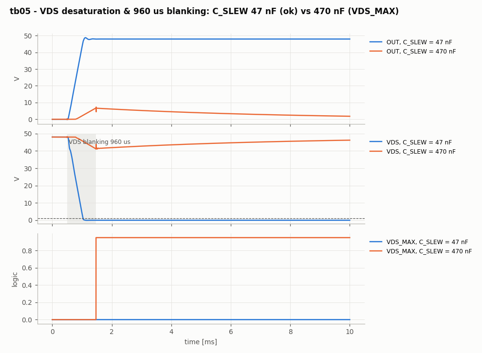

---

#### tb06: 48 V supply transients (`tb06_supply_transients.cir`)

**What we simulate.** A 48 V board net is not a stiff 48 V source. It sees
over-voltages from load dump and regenerative braking, slow sags when the
battery is weak, and deep drops. ISO 21780 / LV148 define voltage classes for
this. The bench checks how the channel behaves over a full profile: does the gate
drive stay adequate, where does it shut down, and does it recover by itself?

**Setup.** Channel on, 10 A resistive load (4.8 Ω) with 100 µF. The battery is a
PWL source (illustrative levels, not a certified test pulse):

| Time | VBAT | Meaning |
|---|---|---|
| 0–5 ms | 48 V | nominal |
| 6–15 ms | 54 V | upper limited range |
| 16–56 ms | 60 V | over-voltage (40 ms) |
| 57–62 ms | **70 V** | VNF1048F extended range (≤ 100 ms allowed) |
| 63–75 ms | 48 V | back to nominal |
| 75–95 ms | → 24 V | slow sag to the lower limited range |
| 95–125 ms | → **6 V** | minimum operating voltage of the VNF1048F |
| 125–135 ms | → **4 V** | below VS_USD = 4.5 V |
| 135–160 ms | → 48 V | recovery |

**Signals in the plot.**
1. VBAT and OUT.
2. VGS at the FET and VCP − VS (charge-pump headroom).
3. The UV shutdown flag, the gate command and DIAG.

**Expected behaviour.**
* **OUT follows VBAT** minus a few mV (10–15 A × ~3 mΩ). The eFuse is a switch,
  not a regulator: **it does not protect the load against over-voltage**. At 70 V
  the load sees 70 V. The VNF1048F has no over-voltage shutdown either.
* **VGS stays regulated** at ~13.4 V for VS > 10 V. On fast VBAT steps there are
  short dips or spikes, because the gate (held by C_SLEW to ground) lags OUT.
  On the falling 70 → 48 V step the gate-source zener clamps at ~15.5 V.
* **At 6 V** the charge pump can only make VS + 7…11 V (the model uses the mid
  value, 9 V), so VGS drops to ~8.6 V. That is still above the 6 V datasheet
  minimum and the 5 V VGS-UVLO threshold at this supply, so the FET stays fully on.
* **Below 4.5 V** (filtered 33 µs) everything turns off: UV flag set, DIAG low.
  On a ramp of 1 V/ms the 33 µs filter shifts the trip point by ~33 mV, to 4.47 V.
* **Recovery** at VS > 4.6 V (0.1 V hysteresis): UV is a real-time, non-latched
  fault, so the gate restarts automatically. It needs a short charge-pump
  re-start and then the normal slew ramp.

**Results.**

| Quantity | Expected | Simulated |
|---|---|---|
| VGS at 70 V | 12…15 V | <!--v {m('tb06_supply_transients','vgs_70v'):.2f}-->13.37<!--/v--> V |
| VGS peak (70 → 48 V step) | ≤ zener clamp | <!--v {m('tb06_supply_transients','vgs_pk'):.1f}-->15.5<!--/v--> V |
| VCP − VS at VS = 6 V | 7…11 V | <!--v {m('tb06_supply_transients','vcp_6v'):.2f}-->8.98<!--/v--> V |
| VGS at VS = 6 V | ≥ 6 V | <!--v {m('tb06_supply_transients','vgs_6v'):.2f}-->8.58<!--/v--> V |
| UV shutdown (falling) | 4.5 V − filter | <!--v {m('tb06_supply_transients','vbat_uv'):.2f}-->4.47<!--/v--> V |
| restart (rising) | 4.6 V | <!--v {m('tb06_supply_transients','v_rec'):.2f}-->4.58<!--/v--> V |
| latched faults over the profile | none | none |
| OUT at the end | 48 V | <!--v {m('tb06_supply_transients','vout_end'):.2f}-->47.87<!--/v--> V |

**Things to try.** Make the 4 V dip shorter than 33 µs: it is filtered and nothing
happens. Increase the load to see the droop at low VS. Replace the PWL with your
OEM's test pulses.


---

#### tb07: external MOSFET over-temperature via NTC (`tb07_ntc_overtemp.cir`)

**What we simulate.** A current just **below** INOM is "legal" for the fuse
logic, but it can still overheat the MOSFET in a hot environment with poor
cooling: under-hood, a sealed box, a failing thermal interface. The NTC on the
drain pad is the last line of defence. The bench checks the electro-thermal chain:
MOSFET losses → pad temperature → NTC resistance → bridge voltage → trip at the
programmed temperature. It also shows the latch-and-re-arm behaviour.

**Setup.** TAMB = 105 °C, deliberately poor cooling (RthCA = 40 K/W,
CthC = 0.15 J/K → τ = 6 s), continuous 23 A (2.087 Ω). OVC_CODE 15 →
INOM = 24.8 A, so **the fuse is not involved** (x = 0.93). NTC_CODE 4 →
VNTC threshold 70.38 mV ↔ 120 °C.

| Time | Event |
|---|---|
| 1 ms | OUTCTL → 1 |
| ~3 s | pad reaches 120 °C → NTC_OVT |
| 14 s | `CLR` pulse: re-arm |
| 20 s | end |

**Signals in the plot.**
1. FET junction and pad/NTC temperature, with the 120 °C line.
2. The bridge voltage VNTC = V(drain) − V(NTC), with the code-4 threshold.
3. The NTC_OVT latch, the gate command and DIAG.

**Expected behaviour.**
* FET losses P ≈ I²·RDS(on) ≈ 23² × 2 mΩ ≈ 1.06 W → steady pad temperature
  105 + 1.06 × 40 ≈ 147 °C, which would overheat the FET. Rising with τ = 6 s, the pad
  crosses 120 °C after ≈ −6 s·ln(1 − 15/42) ≈ **2.6 s**.
* The NTC at 120 °C is 623 Ω, so VNTC = 1.2 V·623/(10 k + 623) = **70.4 mV**. The
  threshold table and the NTC fit are consistent by construction (see 7.9).
* After the trip, the losses stop and the pad cools towards 105 °C.
* The NTC check is active only while the FET is on. A `CLR` at 14 s (pad ≈ 108 °C,
  below the threshold) re-arms the channel. It heats up again and re-trips after
  ~2.5 s. This is the expected behaviour of a latched protection with a persistent
  cause: firmware must limit its retries.
* The small junction spikes at each turn-on are the inrush energy into the
  100 µF output capacitor, deposited into the small junction heat capacity.

**Results.**

| Quantity | Expected | Simulated |
|---|---|---|
| time to trip | ≈ 2.6 s | <!--v {m('tb07_ntc_overtemp','t_ot'):.2f}-->3.09<!--/v--> s |
| pad temperature at trip | 120 °C | **<!--v {m('tb07_ntc_overtemp','tc_ot'):.1f}-->119.8<!--/v--> °C** |
| VNTC at trip | 70.38 mV ± 3 mV | <!--v {m('tb07_ntc_overtemp','vntc_ot')*1000:.2f}-->70.38<!--/v--> mV |
| pad temperature at CLR (14 s) | ~108 °C | <!--v {m('tb07_ntc_overtemp','tc_clr'):.1f}-->108.0<!--/v--> °C |
| re-trip after CLR | yes, ~2.5 s later | <!--v {m('tb07_ntc_overtemp','t_ot2'):.2f}-->16.53<!--/v--> s (<!--v {m('tb07_ntc_overtemp','t_ot2')-14:.1f}-->2.5<!--/v--> s) |
| fuse state `fd` | ~0 | <!--v {m('tb07_ntc_overtemp','fdmax'):.3f}-->0.001<!--/v--> |

**Things to try.** Change `NTC_CODE` (0 = 100 °C … 10 = 150 °C). Improve cooling
with `RTHCA` and see no trip. Make the current higher than INOM and see which
protection wins.


---

#### tb08: stand-by, low-current bypass and AUTO-ON wake-up (`tb08_standby_autoon.cir`)

**What we simulate.** In a parked vehicle, some loads (gateways, telematics,
always-on ECUs) must stay powered while the eFuse consumes almost nothing. The
VNF1048F turns off its charge pump and supplies these loads through a small
internal bypass switch. When such a load **wakes up** and needs real current, the
eFuse must take over by itself before the load browns out, and tell the MCU. The
bench checks this hand-over and the hold-up capacitance it requires.

**Setup.** `CPON` = 0 (Stand-by: charge pump off), OUTCTL = 0, BYPCTL = 1. The
load is 2.4 kΩ (20 mA sleep current) plus 9.6 Ω (5 A) switched in at wake-up,
with a 470 µF hold-up capacitor.

| Time | Event |
|---|---|
| 0–5 ms | sleeping: 20 mA through the bypass |
| 5 ms | **load wakes up** (5 A) |
| 15 ms | MCU sets OUTCTL = 1 (takes ownership) |
| 20 ms | MCU `CLR`: clears BYPASS_SAT → DIAG released |
| 25 ms | end |

**Signals in the plot.**
1. VBAT and OUT (zoomed 40–50 V).
2. VCP − VS and the VGS at the HS_GATE pin.
3. The load current.
4. Bypass on, AUTO-ON and DIAG.

**Expected behaviour.**
* Sleeping: OUT = 48 V − 20 mA × 7 Ω ≈ 47.86 V. Only the bypass conducts. CP = 0.
* At wake-up the bypass saturates at ~0.11 A. The hold-up capacitor supplies the
  rest: dV/dt ≈ 4.9 A/470 µF ≈ 10 V/ms. VS − VOUT reaches the 1.3 V bypass
  saturation threshold after ≈ 1.3 V/(10 V/ms) ≈ 0.12 ms, plus 5 µs deglitch,
  and then AUTO-ON fires.
* AUTO-ON turns the bypass off and starts the charge pump **from zero**. The
  gate can only rise once CP has charged (~470 nF × 14.5 V/30 mA ≈ 0.2 ms), so
  OUT keeps falling for a while and then recovers when the FET turns on.
* DIAG goes low at AUTO-ON (the wake-up flag) and stays low until the MCU clears
  it. The MCU sets OUTCTL **before** clearing. Clearing first would hand the load
  back to the bypass, which would saturate again.

**Results.**

| Quantity | Expected | Simulated |
|---|---|---|
| OUT while sleeping | ~47.86 V | 47.86 V |
| bypass current sleeping / max | 20 mA / ~0.11 A | 20 mA / 0.111 A |
| wake-up → AUTO-ON | ~0.12 ms | **<!--v {m('tb08_standby_autoon','dt_auto')*1e6:.0f}-->109<!--/v--> µs** |
| CP reaches VS + 6 V / VS + 14 V | ~0.2 ms after wake-up | 205 µs / 347 µs |
| OUT minimum (hold-up droop) | 48 − ΔV | <!--v {m('tb08_standby_autoon','vout_min'):.2f}-->45.73<!--/v--> V at 245 µs |
| DIAG after wake-up / after CLR | low / high | 0.13 V / 3.3 V |

**Things to try.** Reduce `Chold` to 47 µF and the load browns out deeper (ΔV ≈
I·t/C). Start with `CPON=1` (Unlocked mode, pump running) and the hand-over is
much faster. Move the CLR before 15 ms to see the hand-back problem.

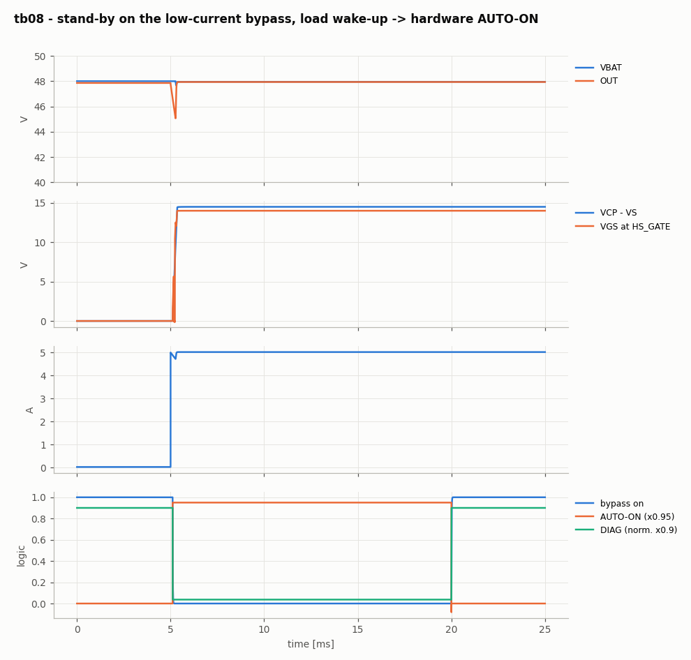

---

#### tb09: switching off an inductive load (`tb09_inductive_turnoff.cir`)

**What we simulate.** Solenoids, valves, relays and motor windings store energy
in their inductance. When the eFuse switches them off, the current cannot stop
instantly, so it forces OUT negative until it finds a path. The bench compares
the correct design (freewheel diode) with a missing diode, and quantifies what
the MOSFET and the VNF1048F OUT pin experience.

**Setup.** Load = 2 mH + 4.8 Ω (10 A, L/R = 0.42 ms) with 100 nF at OUT. The
freewheel Schottky is switched in or out via its series resistor (`FW` = 1:
1 mΩ, `FW` = 0: 1 GΩ). OUTCTL turns the channel on at 0.5 ms and **off at 10 ms**.

**Signals in the plot** (time relative to switch-off):
1. OUT.
2. VDS of the FET, with the 100 V avalanche line.
3. The inductor current, each for both cases.

**Expected behaviour.**
* **With freewheel**: OUT is clamped at −V_F (~0.5 V at 10 A). The current
  circulates through the diode and decays exponentially with τ = L/R = 0.42 ms,
  reaching 1 A after ≈ 2.3·τ ≈ 0.95 ms. The FET only sees the short switching
  transition (a few mJ).
* **Without freewheel**: the only path for the inductor current is *through the
  MOSFET in avalanche*. OUT is pulled down until VDS = BV ≈ 100 V, i.e.
  OUT ≈ 48 − 100 = **−52 V**. The inductor then discharges against ~52 V +
  I·R, and the current falls almost linearly to zero in ≈ L·I/V ≈ 0.3 ms. The FET
  absorbs ½·L·I² ≈ 100 mJ plus the energy the battery delivers during the
  avalanche. Afterwards L rings with the 100 nF at ≈ 11 kHz. **OUT at −52 V
  violates the VNF1048F rating** (−2 V DC, −10 V for 10 µs).

**Results.**

| Quantity | with freewheel | without freewheel |
|---|---|---|
| OUT minimum | <!--v {u(m('tb09_inductive_turnoff','vout_min',1),'.2f')}-->−0.55<!--/v--> V | <!--v {u(m('tb09_inductive_turnoff','vout_min',0),'.1f')}-->−52.5<!--/v--> V |
| VDS maximum | <!--v {m('tb09_inductive_turnoff','vds_max',1):.0f}-->49<!--/v--> V | <!--v {m('tb09_inductive_turnoff','vds_max'):.1f}-->100.4<!--/v--> V (avalanche) |
| current decay to 1 A | <!--v {(m('tb09_inductive_turnoff','t_decay',1)-10e-3)*1e3:.2f}-->0.93<!--/v--> ms (exponential) | <!--v {(m('tb09_inductive_turnoff','t_decay',0)-10e-3)*1e3:.2f}-->0.25<!--/v--> ms (linear, avalanche ≈ 270 µs) |
| energy in the FET | <!--v {m('tb09_inductive_turnoff','e_fet',1)*1000:.1f}-->2.4<!--/v--> mJ | **<!--v {m('tb09_inductive_turnoff','e_fet')*1000:.0f}-->120<!--/v--> mJ** |

**Things to try.** Increase L to 10 mH and compare with the FET's single-pulse
avalanche rating. Replace the Schottky with a TVS from OUT to GND to get faster
demagnetization with a limited negative voltage. That trade-off matters for
valves, which need a fast release.

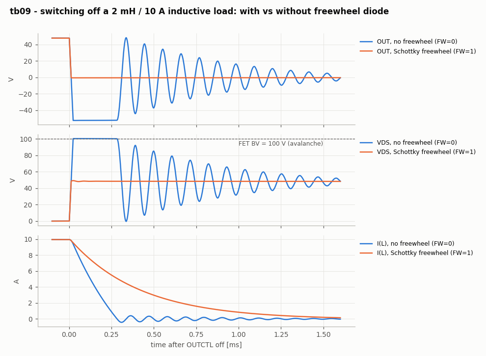

---

#### tb10: system context: a 48 V zonal power distribution unit (`tb10_zonal_system.cir`)

**What we simulate.** In a real vehicle several eFuse channels share one 48 V
bus. The key system property is **selectivity**: a fault in one branch must
disconnect only that branch, fast enough that the voltage dip does not reset or
brown out loads on the healthy branches. The bench puts two very different
channels on one bus and shorts one of them.

**Setup.**
* Battery: 48 V, 20 mΩ, main harness 2 µH / 5 mΩ, 220 µF + TVS at the PDU.
* **CH1**: OVC_CODE 22 (INOM 39.1 A), HSC_CODE 14 (IHSC 139.3 A), tNOM 5 s →
  48→12 V DC/DC modeled as a 1 kW **constant-power** load (I = P/V) with 470 µF
  input capacitance, UVLO on at 30 V / off at 26 V, and a 4.7 kΩ input bleeder.
* **CH2**: standard settings (INOM 21.8 A, IHSC 105.6 A) → fan motor 3.8 Ω +
  200 µH (12 A), 100 µF local capacitance, 1.5 µH harness.

| Time | Event |
|---|---|
| 1 ms | CH1 on → DC/DC input charges, DC/DC starts at 30 V |
| 4 ms | CH2 on (staggered to avoid simultaneous inrush) |
| 15 ms | **5 mΩ short at the end of the CH2 harness** |
| 20 ms | end |

**Signals in the plot.**
1. 48 V bus, DC/DC input (CH1) and motor node (CH2).
2. Channel currents.
3. DIAG of both channels and the DC/DC enable.

**Expected behaviour.**
* Start-up: CH1's inrush into 470 µF is large but stays below its 139 A HSC.
  The DC/DC enables at 30 V and then draws ~21 A. CH2's inrush is small.
* Short on CH2: its current rises behind 1.5 µH, crosses 105.6 A in a few µs, and
  trips after the 5 µs delay (≈ 9 µs in total). Until then the short draws
  hundreds of amperes **from the bus**, which dips. The bus capacitors and, through
  CH1's FET (which conducts in both directions when on), the DC/DC input
  capacitor support the bus. CH1's current briefly reverses.
* The DC/DC input is behind CH1's harness and 470 µF, so it dips much less than
  the bus and must stay above its 26 V UVLO. Constant-power loads draw *more*
  current when their voltage drops, so a long dip could collapse them.
* After CH2 opens, the main-harness inductance gives a small bus overshoot. CH1
  never sees an over-current, so no fault occurs on CH1.

**Results.**

| Quantity | Expected | Simulated |
|---|---|---|
| CH1 inrush peak / DC/DC enable | < 139 A / at 30 V | 84 A / 1.29 ms |
| CH1 steady current (1 kW at 47 V) | ~21 A | <!--v {m('tb10_zonal_system','idc_avg'):.1f}-->21.2<!--/v--> A |
| CH2 inrush / motor current | small / ~12 A | 20 A / 12.3 A |
| CH2 isolation time after the short | ~9 µs | **<!--v {m('tb10_zonal_system','dt_trip2')*1e6:.1f}-->9.1<!--/v--> µs** |
| CH2 peak current | ≫ IHSC | <!--v {m('tb10_zonal_system','ipk2'):.0f}-->320<!--/v--> A |
| bus minimum / time below 45 V | short dip | <!--v {m('tb10_zonal_system','vbus_min'):.1f}-->33.6<!--/v--> V / 20 µs |
| bus overshoot after opening | < 58 V (TVS) | <!--v {m('tb10_zonal_system','vbus_max'):.1f}-->50.6<!--/v--> V |
| DC/DC input minimum | > 26 V (UVLO) | <!--v {m('tb10_zonal_system','vdc_min'):.1f}-->42.3<!--/v--> V |
| CH1 faults / DC/DC stays enabled | none / yes | none / yes |

**A real effect this bench revealed.** In the first version, with CH1 off, the
IC's 1.3 mA OUT bias current (datasheet Tab. 4, "IOUT") slowly charged the DC/DC
input capacitor. Once it passed the 30 V UVLO, the constant-power load turned on,
pulled the voltage down, turned off again, and so on. In simulation this showed
up as a circuit with no DC solution; in hardware it would be a hiccup. The fix is
the input bleeder (4.7 kΩ → 6 V with the channel off), which a real DC/DC
needs for the same reason.

**Things to try.** Short CH1 instead (139 A threshold, more stored energy).
Remove CH1's 470 µF and see how deep the DC/DC input dips. Increase the
main-harness inductance and see the bus dip and overshoot grow. Add a third channel.
Replace the ideal source with the battery pack model: that is
[bat07](#bat07-48-v-pdu-fed-by-the-pack-selectivity-and-load-dump-bat07_pdn_48vcir),
which adds a generator and a battery disconnect (48 V load dump).


---

#### tb11: pre-charge by dV/dt control, the design window (`tb11_precharge_dvdt.cir`)

**What we simulate.** Method A of [section 1.9](#19-pre-charging-capacitive-loads):
the eFuse FET itself pre-charges the load while its gate ramps through RG_ON and
C_SLEW. tb01 and tb05 each showed one operating point. This bench maps the whole
design space, so you can see how much capacitance the method can handle and how
to pick C_SLEW.

**Setup.** Common setup, load = C_LOAD (10 mΩ ESR) + 4.7 kΩ bleeder (the load
itself is not running yet). 2-D sweep, 25 runs:
C_LOAD = 0.22 / 0.47 / 1 / 2.2 / 4.7 mF × C_SLEW = 22 / 47 / 68 / 100 / 220 nF.
OUTCTL → 1 at 0.5 ms, end at 3 ms.

**Signals in the plots.**
* Waveforms (C_LOAD = 1 mF, all five C_SLEW): OUT with the VDS blanking window
  (grey), load current with the IHSC line, and which fault latched.
* Window map: every run as a point at (C_LOAD, measured dV/dt). Green = pass
  (labelled with the peak inrush), red × = HSC trip, amber △ = VDS trip. The two
  dashed lines are the hand-calculated limits.

**Expected behaviour.**
* While OUT ramps, the FET is a source follower and dV/dt is set by the
  gate network alone: about (14 V − VGS,plateau)/(RG_ON·C_SLEW) ≈ 9–10 V/(2.2 kΩ·C_SLEW),
  measured 200 / 99 / 69 / 47 / 21 V/ms. It **does not depend on C_LOAD**.
* The inrush is C_LOAD·dV/dt: **HSC edge** at C_LOAD·dV/dt = IHSC = 105.6 A.
* OUT has to reach ~47 V (VDS < 1 V) before the blanking ends 960 µs after
  OUTCTL: **VDS edge** at dV/dt ≈ (48 − 6) V / (0.96 ms − delay) ≈ 46 V/ms. OUT
  starts at V0 ≈ 6 V, because the 1.3 mA off-state OUT current of the
  controller pre-biases it through the 4.7 kΩ bleeder.
* The two edges cross at C_LOAD ≈ 105.6 A / 46 V/ms ≈ **2.3 mF**. Above that no
  C_SLEW works. Below it the window widens as C_LOAD falls.
* FET energy in a passing run: ½·C·(VBAT − V0)², minus the small part burnt in the
  series resistances (half-energy rule, 9.1).

**Results (C_LOAD = 1 mF).**

| C_SLEW | dV/dt | Outcome | Peak current | Notes |
|---|---|---|---|---|
| 22 nF | ~200 V/ms | **HSC trip** <!--v {(m('tb11_precharge_dvdt','t_hsc',2)-0.5e-3)*1e6:.0f}-->67<!--/v--> µs after OUTCTL | <!--v {m('tb11_precharge_dvdt','ipk',2):.0f}-->125<!--/v--> A | OUT stops at <!--v {m('tb11_precharge_dvdt','vend',2):.0f}-->9<!--/v--> V |
| 47 nF | ~97 V/ms | **HSC trip** <!--v {(m('tb11_precharge_dvdt','t_hsc',7)-0.5e-3)*1e6:.0f}-->126<!--/v--> µs after OUTCTL | <!--v {m('tb11_precharge_dvdt','ipk',7):.0f}-->109<!--/v--> A | the module default is too fast for 1 mF |
| 68 nF | 65 V/ms | **pass**, OUT at 90 % after <!--v {(m('tb11_precharge_dvdt','t90',12)-0.5e-3)*1e3:.2f}-->0.63<!--/v--> ms | <!--v {m('tb11_precharge_dvdt','ipk',12):.0f}-->79<!--/v--> A | E_FET <!--v {m('tb11_precharge_dvdt','e_fet',12):.2f}-->0.79<!--/v--> J (½CΔV² = 0.88 J), FET 25 → <!--v {m('tb11_precharge_dvdt','tjmax',12):.0f}-->63<!--/v--> °C, fd <!--v {m('tb11_precharge_dvdt','fdmax',12):.2f}-->0.10<!--/v--> |
| 100 nF | 45 V/ms | **VDS trip** <!--v {(m('tb11_precharge_dvdt','t_vds',17)-0.5e-3)*1e6:.0f}-->970<!--/v--> µs after OUTCTL | <!--v {m('tb11_precharge_dvdt','ipk',17):.0f}-->53<!--/v--> A | OUT reached only <!--v {m('tb11_precharge_dvdt','vend',17):.1f}-->45.5<!--/v--> V, just outside the window |
| 220 nF | 21 V/ms | **VDS trip** <!--v {(m('tb11_precharge_dvdt','t_vds',22)-0.5e-3)*1e6:.0f}-->970<!--/v--> µs after OUTCTL | <!--v {m('tb11_precharge_dvdt','ipk',22):.0f}-->24<!--/v--> A | OUT at <!--v {m('tb11_precharge_dvdt','vend',22):.0f}-->23<!--/v--> V |

Over the whole map: the measured dV/dt varies by < 6 % between 0.22 and 1 mF for
a given C_SLEW (C_LOAD has no influence, as expected). **No C_SLEW passes at 2.2 or 4.7 mF.**
At 2.2 mF with 100 nF the inrush (104 A) is just below IHSC, but the ramp is too slow,
and the FET still heats from 25 to 104 °C before the VDS trip. The peak inrush
of the passing runs is 1.2–1.5× C·dV/dt. The extra is a first-conduction spike: the gate
is still on the steep start of its RC charge when the FET begins to conduct
from the pre-biased OUT.

**Design reading.** For a given C_LOAD, put dV/dt in the middle of the
window, including C tolerance: with 1 mF ± 20 %, 65 V/ms gives 1.2 mF × 65 V/ms × 1.25
≈ 98 A worst case, which is tight. That is why ~1 mF is the practical limit, and
why larger loads need a separate pre-charge path (tb12–tb14).

**Things to try.** Raise `HSC_CODE` to 14 (139 A) and watch the window grow
to the right. Lower `VBAT` to 36 V: the VDS edge drops and slower ramps pass.
Add a resistive load (as tb05) and see it eat into the HSC margin.

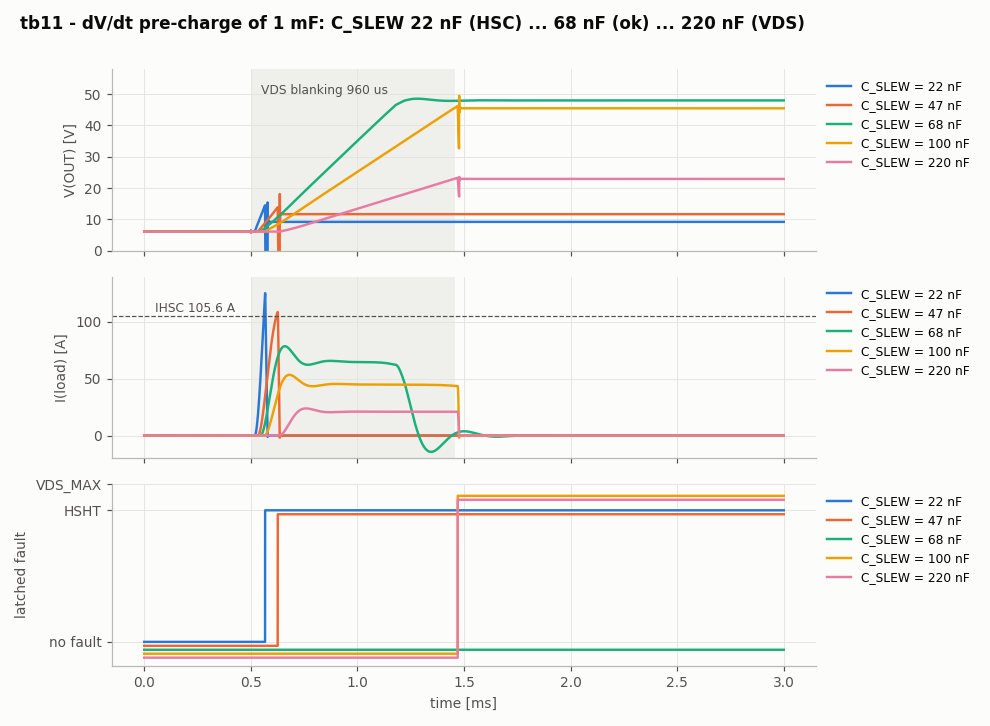


---

#### tb12: resistor pre-charge and the hand-over point (`tb12_precharge_resistor.cir`)

**What we simulate.** Method B: a 4.7 mF load, well beyond the dV/dt window,
is pre-charged through a resistor in parallel with the eFuse. Then the eFuse is
switched on. The open question is *when*. A firmware timer is the obvious
choice, so the bench steps the timer and shows what the residual voltage at
the hand-over does to the eFuse.

**Setup.** Common setup. Pre-charge path VBAT → switch (50 mΩ) → R_PRE = 4.7 Ω
→ OUT, so τ = R_PRE·C_LOAD = 22 ms. Load = 4.7 mF + 4.7 kΩ bleeder. The eFuse uses
the module defaults (C_SLEW 47 nF).

| Time | Event |
|---|---|
| 1 ms | pre-charge switch on |
| 1 ms + N·τ | OUTCTL → 1 (hand-over), stepped N = 1, 2, 3, 5 |
| hand-over + 2 ms | pre-charge switch off |

**Signals in the plot.**
1. V(load) for the four hand-over times.
2. FET current right after OUTCTL (measured across RSENSE), with IHSC.
3. Pre-charge resistor power and accumulated energy (5τ case).

**Expected behaviour.**
* V(load) = V0 + (VBAT − V0)(1 − e^(−t/τ)), with V0 ≈ 6.1 V (OUT pre-bias):
  32.6 V after 1τ, 42.2 V after 2τ, 45.9 V after 3τ, 47.7 V after 5τ.
* Resistor: peak current (VBAT − V0)/R ≈ 8.8 A, peak power (VBAT − V0)²/R ≈ 370 W,
  decaying with τ/2. Total energy ½·C·(VBAT − V0)² = 4.12 J (the half-energy
  rule, independent of R_PRE). Into an empty capacitor (V0 = 0) the peak would be
  VBAT²/R = 490 W.
* At the hand-over the gate charges from 0 V towards OUT + 14 V. When it reaches
  V(load) + VTH the FET conducts, and the residual ΔV drives a current of about
  ΔV / R_loop. With ΔV = 16 V or 6 V that is far above IHSC; with 2 V it is not.

**Results.**

| Hand-over | V(load) at hand-over | ΔV | FET peak current | Outcome |
|---|---|---|---|---|
| 1τ (22 ms) | <!--v {m('tb12_precharge_resistor','v_ho'):.1f}-->32.4<!--/v--> V | <!--v {m('tb12_precharge_resistor','dv_ho'):.1f}-->15.6<!--/v--> V | <!--v {m('tb12_precharge_resistor','ifet'):.0f}-->118<!--/v--> A | **HSC trip** <!--v {m('tb12_precharge_resistor','dt_hsc')*1e+06:.0f}-->108<!--/v--> µs after OUTCTL |
| 2τ (44 ms) | <!--v {m('tb12_precharge_resistor','v_ho',1):.1f}-->42.1<!--/v--> V | <!--v {m('tb12_precharge_resistor','dv_ho',1):.1f}-->5.9<!--/v--> V | <!--v {m('tb12_precharge_resistor','ifet',1):.0f}-->108<!--/v--> A | **HSC trip** <!--v {m('tb12_precharge_resistor','dt_hsc',1)*1e+06:.0f}-->137<!--/v--> µs after OUTCTL |
| 3τ (66 ms) | <!--v {m('tb12_precharge_resistor','v_ho',2):.1f}-->45.8<!--/v--> V | <!--v {m('tb12_precharge_resistor','dv_ho',2):.1f}-->2.2<!--/v--> V | <!--v {m('tb12_precharge_resistor','ifet',2):.0f}-->43<!--/v--> A | ok, OUT = 48 V |
| 5τ (110 ms) | <!--v {m('tb12_precharge_resistor','v_ho',3):.1f}-->47.6<!--/v--> V | <!--v {m('tb12_precharge_resistor','dv_ho',3):.2f}-->0.35<!--/v--> V | <!--v {m('tb12_precharge_resistor','ifet',3):.1f}-->6.9<!--/v--> A | ok, clean |

Pre-charge resistor: 8.8 A and 366 W peak, **4.05 J** in total. Both passing
points give the same effective loop resistance, ΔV/I ≈ **51 mΩ**, so the hand-over
current is predictable. IHSC is reached at ΔV ≈ 5.4 V, which sets the
hand-over threshold (≤ 2.7 V with a factor-2 margin, i.e. ≥ ~95 % at 48 V).

**Things to try.** Halve R_PRE: the time halves, the peak power doubles, and
the energy stays the same. Change `CL` by ±20 % with the timer fixed at 3τ_nom
and see the hand-over margin move (that is why tb13/tb14 hand over on
voltage). Add `C_SLEW=4.7n` to `X1` (a fast main switch): the residual inrush
is then limited only by the loop.


---

#### tb13: pre-charge methods compared (`tb13_precharge_methods.cir`)

**What we simulate.** The same 4.7 mF load pre-charged three ways at the
same ~10 A current level: a resistor (method B), a linear constant-current
regulator (C) and a switch-mode, inductor-limited path (D). The bench measures
the time each takes and the energy each loses, which tests the half-energy rule
of [1.9.1](#191-what-pre-charge-is-intuitively) directly.

**Setup.** Common setup, load 4.7 mF + 4.7 kΩ. The pre-charge paths sit between
VBAT and OUT, with 0 V ammeters at their input and output so the energy lost
in the path is E_in − E_out.

* METHOD 0: switch + 4.8 Ω (10 A peak).
* METHOD 1: ideal 10 A current regulator with 0.3 V compliance and 20 µs
  soft-start.
* METHOD 2: hysteretic buck. The switch turns on below 8 A and off above 12 A, with a
  100 µH inductor, a 100 V Schottky freewheel and a 10 µF local input capacitor.

The hand-over is voltage-based: eFuse on when V(load) > 95 % VBAT (both inputs
RC-filtered by 20 µs, as an ADC would see them), pre-charge path off 2 ms later.

**Signals in the plot.**
1. V(load) with the 95 % threshold.
2. Current into the load capacitor (the buck shows its 8–12 A ripple band).
3. Accumulated energy lost in the pre-charge element.

**Expected behaviour.** From V0 = 6.1 V to 45.6 V (95 %):
* resistor: t = τ·ln((48 − 6.1)/2.4) ≈ 2.86τ ≈ **65 ms**;
* constant current: t = C·ΔV/I = 4.7 mF × 39.5 V / 10 A = **18.6 ms**;
* buck: the same average current, so also **~18.6 ms**;
* energy lost, resistor and CC: ½·C·[(48 − 6.1)² − 2.4²] = **4.11 J**, identical
  even though the CC is 3.5× faster;
* buck: only conduction and diode losses. Because it converts power, the battery
  current is *lower* than the 10 A charging current while V(OUT) < VBAT.

**Results.**

| Quantity | Resistor | Constant current | Switch-mode |
|---|---|---|---|
| time to 95 % | <!--v {m('tb13_precharge_methods','t_pre')*1000:.1f}-->65.8<!--/v--> ms | <!--v {m('tb13_precharge_methods','t_pre',1)*1000:.1f}-->18.5<!--/v--> ms | <!--v {m('tb13_precharge_methods','t_pre',2)*1000:.1f}-->18.4<!--/v--> ms |
| energy lost in the pre-charge path | **<!--v {m('tb13_precharge_methods','e_loss'):.2f}-->4.08<!--/v--> J** | **<!--v {m('tb13_precharge_methods','e_loss',1):.2f}-->4.05<!--/v--> J** | **<!--v {m('tb13_precharge_methods','e_loss',2):.2f}-->0.11<!--/v--> J** |
| energy delivered to the capacitor | <!--v {m('tb13_precharge_methods','e_out'):.2f}-->4.83<!--/v--> J | <!--v {m('tb13_precharge_methods','e_out',1):.2f}-->4.89<!--/v--> J | <!--v {m('tb13_precharge_methods','e_out',2):.2f}-->5.44<!--/v--> J* |
| current into C: peak / average over the first 7 ms | <!--v {m('tb13_precharge_methods','iout_pk'):.1f}-->9.8<!--/v--> / <!--v {m('tb13_precharge_methods','iout_av'):.1f}-->7.1<!--/v--> A | <!--v {m('tb13_precharge_methods','iout_pk',1):.1f}-->10.0<!--/v--> / <!--v {m('tb13_precharge_methods','iout_av',1):.1f}-->10.0<!--/v--> A | <!--v {m('tb13_precharge_methods','iout_pk',2):.1f}-->12.0<!--/v--> / <!--v {m('tb13_precharge_methods','iout_av',2):.1f}-->10.0<!--/v--> A |
| average battery current (first 7 ms) | <!--v {m('tb13_precharge_methods','iin_av'):.1f}-->7.1<!--/v--> A | <!--v {m('tb13_precharge_methods','iin_av',1):.1f}-->10.0<!--/v--> A | **<!--v {m('tb13_precharge_methods','iin_av',2):.1f}-->3.5<!--/v--> A** |
| element power: peak / average | 377 / 62 W | 415 / 219 W | (losses only) |
| FET current at hand-over (ΔV ≈ 2.4 V) | <!--v {m('tb13_precharge_methods','ifet'):.0f}-->47<!--/v--> A | <!--v {m('tb13_precharge_methods','ifet',1):.0f}-->43<!--/v--> A | <!--v {m('tb13_precharge_methods','ifet',2):.0f}-->41<!--/v--> A |
| eFuse faults | none | none | none |

\* Includes the 2 ms after the hand-over in which the buck path still conducts
in parallel with the eFuse. The loss figure is not affected.

The buck switches at ~27 kHz in mid-charge (OUT ≈ 16 V). Its battery current of
3.5 A at 10 A output current is the power balance 16 V × 10 A ≈ 48 V × 3.4 A.

**Things to try.** Double the CC current: half the time, double the power, the
same energy. Replace R_PRE with 2.4 Ω: the same 4 J in half the time. Lower the
hysteresis band of the buck to 9–11 A and watch the switching frequency rise.

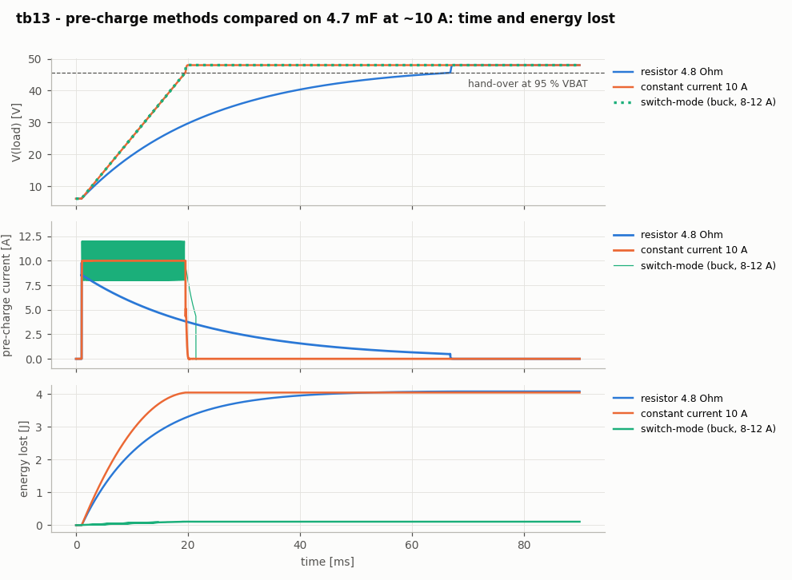

---

#### tb14: supervised pre-charge and fault cases (`tb14_precharge_faults.cir`)

**What we simulate.** A pre-charge that only works on a healthy load is not
a design. This bench adds the supervisor a real system needs (power-good
hand-over, early checkpoint, timeout, abort) and runs it into three faults next to
the normal case. The load is a 1 kW 48→12 V DC/DC (constant power, UVLO
30 / 26 V) behind 4.7 mF.

**Setup.** Resistor pre-charge as tb12 (4.7 Ω, τ = 22 ms). Supervisor (MCU):

| Rule | Value |
|---|---|
| start | pre-charge on at 1 ms |
| hand-over (power-good) | V(load) > 95 % VBAT → eFuse on, pre-charge off 2 ms later |
| checkpoint | at 1 ms + 1τ, V(load) must be > 40 % VBAT, otherwise abort |
| timeout | no power-good by 1 ms + 100 ms (~4.5τ) → abort |
| abort | latched: pre-charge off, eFuse never switched on |
| DC/DC enable | 5 ms after power-good (cases 0–2); case 3 ignores it |

Stepped cases: **0** normal; **1** hard short at the load (50 mΩ);
**2** leaky load (10 Ω, e.g. a damaged load or wet connector); **3** the DC/DC is
*not* gated by power-good and starts on its own UVLO.

**Signals in the plot.**
1. V(load) with the 95 % and 40 % thresholds; dotted lines = checkpoint and timeout.
2. Pre-charge resistor current.
3. DC/DC enable.
4. Abort latch per case, and power-good for the normal case.

**Expected behaviour.**
* Normal: power-good after ≈ 2.86τ ≈ 64 ms. The DC/DC starts 5 ms later and draws
  1 kW / 47.5 V ≈ 21 A through the eFuse.
* Short: V(load) stays at ~0.5 V (10 A × 50 mΩ) and fails the checkpoint at
  1τ. The resistor takes ≈ VBAT²/R_PRE × 22 ms ≈ **10 J**, about 2.5× the normal
  pre-charge, and the eFuse is never closed into the short.
* Leaky load: V(load) settles at the divider value 48 V × 10/(10 + 4.7) ≈ 32.7 V.
  That passes the checkpoint (~25 V at 1τ) but never reaches 95 %, so the timeout aborts.
* DC/DC not gated: at 30 V it starts and wants 1 kW / 30 V ≈ 33 A, while
  the resistor supplies (48 − 30)/4.7 ≈ 3.8 A. The capacitor drops to the 26 V UVLO in
  ~0.5 ms, the DC/DC stops, the capacitor recharges, and the cycle repeats. The 95 %
  threshold is never reached, so the timeout aborts.

**Results.**

| Case | V(load) at checkpoint | Outcome | When | R_PRE energy | eFuse |
|---|---|---|---|---|---|
| 0 normal | <!--v {m('tb14_precharge_faults','v_chk'):.1f}-->32.4<!--/v--> V | **power-good**, DC/DC on at <!--v {m('tb14_precharge_faults','t_dc1')*1000:.1f}-->70.5<!--/v--> ms, <!--v {m('tb14_precharge_faults','idc'):.1f}-->21.1<!--/v--> A | <!--v {(m('tb14_precharge_faults','t_pg')-1e-3)*1e3:.1f}-->64.5<!--/v--> ms | <!--v {m('tb14_precharge_faults','e_pre'):.2f}-->4.04<!--/v--> J | on, no fault |
| 1 short | <!--v {m('tb14_precharge_faults','v_chk',1):.2f}-->0.50<!--/v--> V | **abort at checkpoint** | <!--v {m('tb14_precharge_faults','dt_ab',1)*1000:.1f}-->22.1<!--/v--> ms | <!--v {m('tb14_precharge_faults','e_pre',1):.1f}-->10.3<!--/v--> J | never on |
| 2 leaky load | <!--v {m('tb14_precharge_faults','v_chk',2):.1f}-->24.9<!--/v--> V | **abort by timeout** (V = <!--v {m('tb14_precharge_faults','v_ab',2):.1f}-->32.4<!--/v--> V) | <!--v {m('tb14_precharge_faults','dt_ab',2)*1000:.0f}-->100<!--/v--> ms | <!--v {m('tb14_precharge_faults','e_pre',2):.1f}-->9.8<!--/v--> J | never on |
| 3 DC/DC not gated | <!--v {m('tb14_precharge_faults','v_chk',3):.1f}-->28.7<!--/v--> V | **hiccup**, ≈ 18 start/stop cycles (≈ 0.54 ms on, 4.7 ms period), then **abort by timeout** | <!--v {m('tb14_precharge_faults','dt_ab',3)*1000:.0f}-->100<!--/v--> ms | <!--v {m('tb14_precharge_faults','e_pre',3):.1f}-->9.9<!--/v--> J | never on |

(Times are measured from the start of the pre-charge.)

Two lessons. First, every fault case puts about **2.5×** the normal energy into the pre-charge
resistor, so the faults set the resistor rating, not the nominal pre-charge.
Without the checkpoint the short would run to the timeout: 470 W × 100 ms ≈ 47 J.
Second, case 3 makes the DC/DC itself oscillate. Downstream this is a 12 V rail
that browns out 18 times. The fix is a power-good gate on the load enable, not a
bigger resistor.

**Things to try.** Move the checkpoint to 0.5τ: a faster abort and less energy, but
check the margin against C_max at the lowest VBAT. Replace the 50 mΩ short with
2 Ω (a partial short) and see which rule catches it. Remove the abort latch
and let the MCU retry every 200 ms: the resistor energy accumulates.


---

#### Interview companion benches (tb15–tb36)

These benches were written for the
[interview guide](interview/pdn_48v_12v_interview_guide.md): each one isolates the
concept behind a question. The guide has the plots, the simulated numbers and the
prompts. They use the same model and common setup as tb01–tb14, are checked by
`tools/validate.py`, and are plotted by `tools/plot_results.py`. Some use the bare
`VNF1048F` with discrete FETs where the question needs access to the FET (tb22,
tb24, tb34, tb35). Parameters marked as illustrative in a bench header (wire
thermal model, cold-temperature shifts) are assumptions, not datasheet values.

| Bench | Topic | Guide |
|---|---|---|
| tb15_12v_vs_48v | 1 kW over 3 m at 12 V vs 48 V: current, wire loss, short current | A1 |
| tb16_thermal_memory | repetitive overload pulses, with and without I²t thermal memory, wire temperature | B1, H1, H4 |
| tb17_latch_vs_limit | latch-off vs linear current limiting into the same short | B2 |
| tb18_short_di_dt | hard short with 0.5…5 µH load harness: di/dt, trip delay, peak | B3, H1, H3 |
| tb19_turnoff_speed | gate turn-off path (RG_OFF) during a short | B3, B5 |
| tb20_sense_error | sensed-resistance error vs effective INOM and trip time | B4, E2 |
| tb21_inductive_clamp | avalanche vs freewheel vs zener demagnetization | B6 |
| tb22_parallel_fets | two FETs with different VGS(th): linear mode vs fully on; `EFUSE48_MOD` NPAR = 2 vs 1 (TFET per FET) | C1 |
| tb23_linear_soa | linear-mode pulse during dV/dt start-up at 85 °C, junction vs NTC | C1, E1 |
| tb24_back_to_back | back-driven motor: single FET vs back-to-back | C2 |
| tb25_supply_clamp | bus capacitance, TVS, TVS placement, freewheel during a short | A2, B3, C3, E2, J2 |
| tb26_hard_turn_on | hard switch-on vs dV/dt control into 1 mF | D1 |
| tb27_half_energy | charging 4.7 mF through 1…100 Ω | D2 |
| tb28_bypass_precharge | pre-charge attempt through the low-current bypass (AUTO-ON) | D3 |
| tb29_cross_short | 48 V harness touching a 12 V wire | C7, F1 |
| tb30_ground_fault | load ECU ground offset and ground loss | F2 |
| tb31_retry | retries into a permanent short and a persistent overload | G2 |
| tb32_hw_vs_fw | the same short handled by HSC, VDS monitor or firmware | G3 |
| tb33_design_exercise | the guide's design exercise (1 kW DC/DC, 2.64 mF) | I |
| tb34_cold_start | dV/dt start-up warm vs cold: which protection fires | J1 |
| tb35_field_return | sense-path crack, stuck-on FET, sneak path vs wire temperature | F3, H1, J5 |
| tb36_dcdc_hiccup_vs_efuse | real `DCDC48_12` behind a supervised 4.7 Ω pre-charge: UVLO hiccup vs the converter's output hiccup, no eFuse fault | J4 |

Three more figures in the guide are post-processed from tb02/tb03/tb05/tb07
(`iv_b2`, `iv_h2`, `iv_h4` in `tools/plot_results.py`): the time scales of the
protection layers, probe bandwidth and skew, and the wire curve vs the fuse curve.

---

#### Schematics

* **`demo_efuse48_module.asc`**: the tb02 scenario (start-up, short at 3 ms,
  retry, restart) drawn with the `EFUSE48_MOD` symbol in a battery/harness/load
  context. Use it as a template for your own system schematics. It reproduces
  the netlist bench exactly: HSHT at <!--v {m('demo_efuse48_module','t_trip')*1e3:.5f}-->3.00812<!--/v--> ms, <!--v {m('demo_efuse48_module','ipk'):.0f}-->342<!--/v--> A peak, VBAT <!--v {m('demo_efuse48_module','vbatpk'):.1f}-->64.5<!--/v--> V.
* **`app_vnf1048f_discrete.asc`**: the full discrete application around the
  `VNF1048F` symbol, as in DS13084 Fig. 16. It has the shunt, FET, slew network
  with fast turn-off diode, gate-source zener, NTC bridge with an editable pad
  temperature source `Vtpad`, charge-pump capacitor and DIAG pull-up. Scenario:
  10 A load, then a +20 A overload at 5 ms (30 A, x = 1.36 → m = 4). The fuse
  trips after **<!--v {m('app_vnf1048f_discrete','dt_fuse')*1e3:.1f}-->62.5<!--/v--> ms** (expected tNOM/2⁴ = 62.5 ms). The overload is removed
  at 75 ms, and a CLR at 80 ms restarts the channel. Use it as a template when
  you want to change the FET, the shunt or the gate network.


---

### 1.11 Assumptions, estimates and limitations

**[EST] values, not in the datasheet:**

| Item | Value used | Basis |
|---|---|---|
| Gate source / sink current | 0.2 A / 0.5 A | tON / tOFF with 80 nF |
| Charge-pump drive and output R | 30 mA, 10 Ω | 470 nF caps at 400 kHz; fast enough for the ≤ 100 µs bypass hand-over (tON_BYPOFF) |
| VCP at VS = 6 V | VS + 9 V | middle of the 7…11 V spec |
| VGS regulation | 14 V | inside the 12…15 V spec |
| Sense input bias currents | 300 / 420 µA | 75 % of the max values |
| Device thermal model | RthJA 26 K/W, τ = 1 s | Tab. 3 (2s2p) |
| Fuse cooling law | symmetric heat balance (`KCOOL` = 1) | consistent with the Fig. 4/5 curve and the RMS statement; the silicon's exact decrement is not published |
| VGS_LOW arming | after VGS first exceeds the threshold | datasheet wording "falls below" |
| NTC deglitch | 100 µs | datasheet range 10…500 µs |
| EF_FET100V, EF_TVS58V, EF_SCH100V | generic models | replace with the vendor models of your parts |

**Not modeled / simplified:**

* The SPI protocol, registers, watchdog, Locked/Unlocked/Stand-by state machine
  (only the stand-by charge-pump behaviour, via `CPON`), HWLO and DIS_OUT_MODE.
* Self-tests (current sense, VDS, stuck-on).
* Discrete ADC sampling. RC filters with the same time constants are used
  instead, so trip times are not quantized to 61 µs multiples.
* Tolerances. All values are typical, except where a parameter (`TOL_T`, `CS_GERR`,
  direct mV overrides) allows a corner analysis.
* Reverse current. The VNF1048F cannot keep the FET on with reverse current; the
  body diode conducts, and the model does the same.
* The FET temperature does not change its RDS(on) (the VDMOS model is isothermal).
  The thermal network drives only the NTC and `TFET`.
* EMC, the charge-pump ripple, and the flying capacitors (CP1/CP2 pins are not
  brought out).
* Pre-charge benches (tb12–tb14): the pre-charge switches are ideal `SW`
  elements, the constant-current regulator is a behavioural source with 20 µs
  soft-start, and the buck has an ideal hysteretic controller. The resistor and
  the linear element are not thermally modeled; check their pulse ratings
  against the energies the benches report.

---

### 1.12 Numerical notes and troubleshooting

* The DC operating point solves directly or with LTspice's normal Gmin stepping.
  Two deliberate choices keep it well-conditioned: the charge-pump current limit
  and the FET self-heating act only for `time > 0`. The thermal network therefore
  starts at ambient, and the pump starts in regulation.
* Logic is built from B-sources (0/1 V), deglitch filters and capacitor-held
  latches. No digital A-devices are used, so the model is portable.
  * **Deglitch filters** are first-order filters followed by a comparator
    (τ = T/ln 2): a condition that persists trips after exactly T, and shorter
    pulses charge the filter partially.
  * **The VDS blanking timer** is a normalized 1 F state, reset at every gate
    turn-off.
  * **Latches** are forced to reset in the DC operating point unless their set
    input is active, so the DC solution is unique.
  * **The fuse counter** stops smoothly at 1 instead of with a hard step.

  These replaced `idt()` timers and hard steps, following the
  [numerical guidance](#numerical-guidance-for-behavioural-models). The change
  moved the hard-short trip by about 0.1 µs (e.g. tb02 8.0 → 8.1 µs) and no
  check changed.
* Use a maximum time step of ≤ 1 µs around fast events (shorts) and ≤ 20–50 µs
  for long fuse simulations. The test benches show working values.
* "Voltage not found" in a `.meas` on an internal node means it is missing from
  `.save`, or the hierarchy prefix is wrong (`x1:` / `x1:xu:` / `u1:`; see 6.3).
* A floating output with a constant-power load can have **no DC solution**,
  because of the 1.3 mA OUT bias current (tb10). Add the load's real bleeder or
  UVLO behaviour.
* Ideal switches (`SW`) that step a current into the harness inductance cause
  sub-µs spikes in currents and voltages. Take peak `.meas` values after the
  first ~20 µs (tb12), and RC-filter the inputs of behavioural comparators the
  way an ADC would (tb13, tb14). Otherwise a single spike can set a latch.

---

### 1.13 Designing with the model: worked example

**Goal:** protect a 2.5 mm² 48 V feed to a 15 A (continuous) pump, with an
800 µF input capacitance and a firmware retry.

1. **RSENSE = 1 mΩ** → VSENSE = 15 mV nominal (±5 % accuracy region).
2. **INOM ≥ 1.1·Iload**: OVC_CODE 11 = 19.1 mV → INOM = 19.1 A.
3. **IHSC** above the inrush and below the FET/harness limit: HSC_CODE 12 =
   105.6 mV → 105.6 A (IHSC/INOM = 5.5 → 10 steps).
4. **Slew.** The ramp must be under 0.96 ms, so with 48 V take ≥ 60 V/ms.
   80 V/ms × 800 µF = 64 A < 105 A, but check it against the tb11 window. With
   +20 % capacitance (960 µF) and the 1.2–1.5× first-conduction spike, the peak
   becomes 90–115 A, which is too close to IHSC. C_SLEW = 68 nF (~65 V/ms, ramp
   ~0.65 ms) gives ~52 A nominal and ≤ 94 A worst case ✓, and still finishes
   inside the blanking time.
5. **tNOM** from the wire: the curve t = (tNOM/32)/(x² − 1) must stay below the
   wire's damage curve over INOM…IHSC. For example tNOM = 31 s (TNOM_CODE 15)
   gives 0.32 s (ideal) / 0.48 s (stepwise) at 2·INOM and 40 ms / 61 ms at 5·INOM.
6. Simulate: start from tb01 (start-up), tb03 (curve, replace the codes) and tb02
   (short), then check VBAT/VDS/VGS/OUT against the absolute maximum ratings.

---

## 2. Automotive battery model

A **generic, chemistry-agnostic behavioral model of an automotive battery**, made
to sit at the root of a power-distribution simulation: the 12 V starter battery,
a 24 V truck battery, or a 48 V mild-hybrid pack with its BMS. It follows the
same conventions as the [48 V eFuse](#11-how-an-efuse-works-an-intuitive-guide): one `.lib` file, LTspice symbols,
plain-netlist test benches, and checks of every bench against hand
calculations in `tools/validate.py`.

> **Scope.** This is an *equivalent-circuit* model: open-circuit voltage vs
> state of charge, a Thevenin impedance, charge counting and, for the pack
> version, a BMS-controlled disconnect switch. It does **not** model any
> chemistry (no lead-acid gassing, no lithium plating, no OCV hysteresis, no
> ageing). The default values are **engineering estimates [EST]** for a
> typical battery of each voltage class. For real design work, fit the
> parameters to your battery's data ([section 2.7](#27-fitting-the-parameters-to-a-real-battery)).

* [2.1 How a battery looks from the power network](#21-how-a-battery-looks-from-the-power-network)
* [2.2 What is modeled, and what is left out](#22-what-is-modeled-and-what-is-left-out)
* [2.3 Files](#23-files)
* [2.4 Quick start](#24-quick-start)
* [2.5 Pins, parameters and internal nodes](#25-pins-parameters-and-internal-nodes)
* [2.6 Equations, block by block](#26-equations-block-by-block)
* [2.7 Fitting the parameters to a real battery](#27-fitting-the-parameters-to-a-real-battery)
* [2.8 Test benches and results](#28-test-benches-and-results)
* [2.9 Assumptions, estimates and limitations](#29-assumptions-estimates-and-limitations)
* [2.10 Numerical notes](#210-numerical-notes)
* [2.11 Reference parameter sets from public data](#211-reference-parameter-sets-from-public-data)

### 2.1 How a battery looks from the power network

#### 2.1.1 What the rest of the vehicle actually sees

Seen from the power network, a battery is three things at once:

* **A voltage source whose value depends on how full it is.** The open-circuit
  voltage (OCV) rises with the state of charge (SOC). This sets the bus voltage
  window: a 12 V system lives between about 11.7 V (empty, at rest) and 12.9 V
  (full, at rest), and a 48 V pack between about 40 V and 52 V.
* **An impedance.** Any current drawn makes the terminal voltage sag. Part of
  the sag is instantaneous (the ohmic resistance R0). Part builds up over
  milliseconds and seconds (polarization), and part is a simple inductance
  that matters for microsecond events (short circuits, eFuse trips).
* **A very large but finite energy store.** Charge counting tracks the SOC.
  When the battery is empty its voltage collapses. When it is full it stops
  accepting charge, and its voltage rises instead.

A 48 V pack adds a **fourth** thing: a BMS that can **open the pack** (a contactor or
semiconductor switch) on over-voltage, under-voltage, overload or short circuit.
For the network this is a dramatic event: the bus suddenly loses its stiffest
element (see [bat07](#bat07-48-v-pdu-fed-by-the-pack-selectivity-and-load-dump-bat07_pdn_48vcir)).

#### 2.1.2 The equivalent circuit

```
          L_INT        I sense      R0'          R1'            R2'
   P ────/\/\/\/────────(Vi)──────/\/\/\──┬──/\/\/\──┬──┬──/\/\/\──┬──┐
   (+)  (cells,                          │           │  │          │  │
         busbars,                        └───||──────┘  └───||─────┘  │
         terminals)                       C1 = TAU1/R1'  C2 = TAU2/R2' │
                                                                      ( ) OCV(SOC)
   N ─────────────────────────────────────────────────────────────────┘
   (−)
                 SOC(t) = SOC0 − ∫ I dt / (3600 · CAP_AH)
```

The primed resistances are the 25 °C values scaled by temperature and SOC
([2.1.4](#214-cold-and-empty-why-the-voltage-dips-more)).

#### 2.1.3 Four time scales

The model is built around the time scales that matter in a power-distribution
simulation, from the fastest to the slowest:

| Time scale | Element | What it decides | Bench |
|---|---|---|---|
| ns … µs | `L_INT` (0.2 µH / 1 µH) | di/dt of a short circuit, the inductive kick when a switch opens, interaction with the eFuse's 5 µs hard-short detection | bat05, bat07 |
| µs … ms | `R0` | the instantaneous sag at a load step, the peak short-circuit current, the cranking inrush dip | bat02, bat04, bat05 |
| ms … s | `R1`/`TAU1`, `R2`/`TAU2` | how the voltage keeps sagging during a crank or a long load pulse, and how it recovers afterwards | bat02, bat04 |
| minutes … hours | `CAP_AH`, OCV(SOC) | bus voltage during a drive cycle, key-off drain, end of discharge, end of charge | bat01, bat06 |

In practice: for an eFuse or short-circuit study, R0 and L_INT matter and the
SOC is constant. For a cranking study, R0, RC1 and the temperature matter. For
an energy-management study over a drive cycle, the OCV curve and the capacity
matter.

#### 2.1.4 Cold and empty: why the voltage dips more

Battery resistance rises at low temperature and at low SOC, whatever the
chemistry. The model uses two generic factors on all three resistances:

* **Temperature**, Arrhenius-like: `FT = exp(TK_R·(1/T − 1/298 K))` with
  `TK_R = 1200 K`. That gives ×1.45 at 0 °C, ×1.97 at −18 °C and ×2.49 at
  −30 °C, and ×0.78 at +45 °C.
* **SOC**: `fs = 1 + KR_SOC·(1 − SOC)²` with `KR_SOC = 0.5`. That gives ×1.125
  at 50 % and ×1.5 when empty.

This is what makes the cold crank the worst case of a 12 V network: the same
starter dips the battery to 9.95 V at +25 °C but to 7.59 V at −30 °C
([bat04](#bat04-engine-crank-and-cold-cranking-amps-bat04_cold_crankcir)).

#### 2.1.5 The pack with a BMS

`BATTERY_BMS` wraps the same cells with what a 48 V (or 12 V lithium) pack
adds at its terminals:

```
   cells ──L_INT── bp ──[ main switch RSW_ON ]──┬── P
                    │   [ R_PRE, during T_PRE ]─┘
                    │      ↑ active clamp V_CLAMP across the switch
                  BMS: V(bp) filtered 1 ms → OV / UV
                       I(pack)            → OC (|I|) / SC (discharge)
                       latched → FLT = 3.3 V;  EN low clears, EN high re-closes
```

* **Protections.** Over-voltage (V_OV, T_OV), under-voltage (V_UV, T_UV),
  overload in both directions (I_OC, T_OC) and discharge short circuit (I_SC,
  T_SC). Each one is deglitched and then latched.
* **Switch.** It opens or closes within `T_SW`, 10 µs by default, like a
  MOSFET disconnect; set it to a few ms for a contactor. An active clamp at
  `V_CLAMP` absorbs the energy of the internal inductance when the pack breaks
  a short.
* **Pre-charge.** On an EN rising edge the pack first connects through `R_PRE`
  for `T_PRE`, then closes the main switch. Without it, closing onto several
  mF of bus capacitance can trip the pack's own short-circuit protection
  ([bat06](#bat06-bms-pre-charge-and-protections-bat06_bms_protectioncir)).

---

### 2.2 What is modeled, and what is left out

The selection criterion is: does it change a voltage or a current that another
device in the power network sees?

| Behaviour | Modeled? | Why |
|---|---|---|
| OCV vs SOC (generic curve, user end points) | **yes** | sets the bus voltage window and its drift |
| Charge counting, capacity, charge efficiency `ETA_CHG` | **yes** | drive cycles, key-off drain, end of discharge |
| End-of-discharge collapse, end-of-charge voltage rise | **yes** | the battery is not an infinite source/sink; CV chargers taper |
| Ohmic R0, two RC pairs, internal inductance | **yes** | load steps, cranking, short circuits, eFuse interaction |
| Temperature and SOC dependence of R | **yes** | cold crank, low-SOC start |
| Small-signal impedance (`.ac`) | **yes** | DC/DC input-filter and network-stability studies |
| BMS disconnect, OV/UV/OC/SC, pre-charge, clamp | **yes** (`BATTERY_BMS`) | pack opening is a network event (load dump, bus collapse) |
| 12 V / 24 V / 48 V class defaults | **yes** | one parameter `VNOM` |
| OCV hysteresis, gassing, Peukert, plating, ageing | no | chemistry-specific, second order for the network |
| Capacity loss at low temperature | no | an energy-budget effect; set `CAP_AH` for the temperature |
| Pack self-heating / thermal model | no | `TBAT` is a fixed parameter |
| Cell imbalance, balancing, per-cell monitoring | no | the BMS sees one pack voltage |
| Charge/discharge asymmetry of R | no | small at system level; see [2.9](#29-assumptions-estimates-and-limitations) |
| BMS communication, current limits (SOP), contactor arcing | no | out of scope; drive `EN` from your own logic |

---

### 2.3 Files

```
models/BATTERY_beh.lib        BATTERY, BATTERY_BMS, helpers (BAT_LATCH, BAT_DGL, BAT_DGLR)
symbols/BATTERY.asy           3-pin symbol  (P, N, SOC)
symbols/BATTERY_BMS.asy       5-pin symbol  (P, N, SOC, EN, FLT)
schematics/demo_battery.asc   12 V crank at -18 degC + 48 V pack: pre-charge, load, short
testbenches/bat01..bat07      test benches, section 2.8
docs/img/bat*.png             result plots (tools/plot_results.py)
```

The library is self-contained. It can be included next to `VNF1048F_beh.lib`
(bat07 does), and its helper subcircuits have their own names, so the two
libraries do not clash.

---

### 2.4 Quick start

```spice
.include ../models/BATTERY_beh.lib

* 12 V starter battery, defaults (70 Ah, 11.7..12.9 V, R0 2 mOhm), 80 % SOC, cold
X1 vbat 0 soc BATTERY VNOM=12 SOC0=0.8 TBAT=-18

* 24 V truck battery (two 12 V class batteries in series: voltages and R x 2)
X2 v24 0 soc24 BATTERY VNOM=24 CAP_AH=180

* 12 V lithium (LFP-like window) instead of the lead-acid-like default window
X3 v12 0 s3 BATTERY VNOM=12 CAP_AH=60 VOC_0=12.0 VOC_100=13.4 VOC_EOC=14.6 R0=1.5m

* 48 V pack with BMS, connected at t = 0, pre-charge used on later EN edges
X4 vpack 0 soc48 en flt BATTERY_BMS VNOM=48 SOC0=0.8 T_PRE=0.3 R_PRE=10
```

* **SOC pin.** It is an output: leave it unconnected (LTspice allows a floating
  B-source output) or use it to drive your energy-management logic. It is
  referred to `N`.
* **EN (BMS).** It is a logic input with a 1 MΩ pull-down, so tie it high
  (> 1.5 V) for a pack that is simply on. A pack with EN high at t = 0 starts
  connected. EN low opens the pack and clears a latched fault, and the next
  rising edge re-closes it (through the pre-charge if `T_PRE > 0`).
* **The battery's negative is `N`**, not node 0. You can float it, for
  example to study ground offsets, or stack batteries in series.
* The step-by-step use in a schematic or a netlist is in
  [Using the models in a new LTspice simulation](#using-the-models-in-a-new-ltspice-simulation).
  Measured reference sets (a real 12 V AGM battery and a real 48 V pack) are in
  [2.11](#211-reference-parameter-sets-from-public-data).

---

### 2.5 Pins, parameters and internal nodes

#### 2.5.1 `BATTERY` (3 pins)

| Pin | Direction | Meaning |
|---|---|---|
| `P` | power | positive terminal |
| `N` | power | negative terminal (local reference for all internal signals) |
| `SOC` | output | state of charge, 0…1 V = 0…100 % (clamped), referred to N |

| Parameter | Default (12 V / 48 V class) | Unit | Meaning |
|---|---|---|---|
| `VNOM` | 12 | V | voltage class: < 36 V → 12 V class scaled by VNOM/12; ≥ 36 V → 48 V class scaled by VNOM/48 |
| `SOC0` | 0.8 | – | initial SOC (0…1) |
| `TBAT` | 25 | °C | battery temperature (fixed during the run) |
| `CAP_AH` | 70 / 10 [EST] | Ah | capacity |
| `VOC_0` | 11.70 / 40.0 [EST] | V | OCV at SOC = 0 |
| `VOC_100` | 12.90 / 52.0 [EST] | V | OCV at SOC = 100 % |
| `VOC_EOC` | 15.0 / 55.0 [EST] | V | OCV at SOC = 100 % + `DSOC_END` (end-of-charge knee) |
| `DSOC_END` | 0.02 | – | width of the end-of-discharge / end-of-charge regions |
| `OCV_SHAPE` | 1 | – | 1 = generic curve (knees at both ends), 0 = straight line |
| `R0` | 2.0 m / 15 m [EST] | Ω | ohmic resistance at 25 °C, 100 % SOC |
| `R1`, `TAU1` | 0.8 m / 5 m, 20 ms [EST] | Ω, s | fast polarization |
| `R2`, `TAU2` | 0.7 m / 5 m, 20 s [EST] | Ω, s | slow polarization |
| `L_INT` | 0.2 µ / 1 µ [EST] | H | internal + terminal inductance |
| `TK_R` | 1200 [EST] | K | temperature coefficient of the resistances (Arrhenius-like) |
| `KR_SOC` | 0.5 [EST] | – | relative resistance increase at SOC = 0 |
| `ETA_CHG` | 1 | – | coulombic efficiency applied to the charging current |

Parameters left at **0** take the class default; set them to a positive
value to override. Voltages, resistances and the inductance scale with the
class factor (`VNOM/12` or `VNOM/48`); the capacity does not.

#### 2.5.2 `BATTERY_BMS` (5 pins)

| Pin | Direction | Meaning |
|---|---|---|
| `P`, `N` | power | pack terminals (after the disconnect switch) |
| `SOC` | output | as for `BATTERY` |
| `EN` | input | close command, logic > `VTH_LOGIC` = 1.5 V (ref. to N), 1 MΩ pull-down; low clears a latched fault |
| `FLT` | output | 3.3 V push-pull through 100 Ω (ref. to N), high = protection trip latched |

All `BATTERY` parameters are passed through (default `VNOM=48`), plus:

| Parameter | Default (12 V / 48 V class) | Unit | Meaning |
|---|---|---|---|
| `V_OV`, `T_OV` | 15.0 / 54.0, 100 ms [EST] | V, s | over-voltage trip (filtered cell voltage) |
| `V_UV`, `T_UV` | 10.5 / 36.0, 1 s [EST] | V, s | under-voltage trip |
| `I_OC`, `T_OC` | 800 / 350, 1 s [EST] | A, s | overload trip, both directions |
| `I_SC`, `T_SC` | 2500 / 1000, 100 µs [EST] | A, s | short-circuit trip, discharge |
| `RSW_ON`, `RSW_OFF` | 0.5 m / 1 m, 10 MΩ [EST] | Ω | disconnect switch |
| `T_SW` | 10 µs [EST] | s | switching time (first order, τ = T_SW/5) |
| `V_CLAMP` | 30 / 80 [EST] | V | active clamp across the switch (1 mΩ dynamic R) |
| `R_PRE`, `T_PRE` | 10 Ω, 0 (off) | Ω, s | pre-charge resistor and time |
| `VTH_LOGIC` | 1.5 | V | EN threshold |

The voltage defaults and `RSW_ON` scale with the class factor; the current
thresholds do not.

#### 2.5.3 Internal nodes you can probe

All are referred to `N`. Use `V(x1:s)` for an instance `X1`, or `V(x1:xc:s)`
inside a `BATTERY_BMS` (the cells are the sub-instance `Xc`).

| Node | Meaning |
|---|---|
| `s` | raw SOC (1 V = 100 %). It goes slightly below 0 or above 1 in the end regions. |
| `ocv` | open-circuit voltage [V] |
| `cell` | cell voltage after R0 and the RC pairs (before L_INT) [V] |
| `u1`, `u2` | polarization voltages of the RC pairs [V] |
| `fs`, `g` | SOC resistance factor, normalized OCV curve |
| `I(x1:Vi)` | battery current (> 0 = discharge) |
| BMS: `vm` | filtered voltage the BMS compares against V_OV / V_UV |
| BMS: `ov uv oc sc` | deglitched trip conditions (0/1) |
| BMS: `fl`, `on`, `m`, `pre`, `x` | fault latch, switch command, main-switch command, pre-charge path (0…1), switch state 0…1 |
| BMS: `I(x1:Vsw)` | pack current (> 0 = discharge) |

---

### 2.6 Equations, block by block

**Class defaults.** `KV = VNOM/12` for the 12 V class and `VNOM/48` for the
48 V class. Every default voltage, resistance and the inductance is the table
value × `KV`.

**Resistances.**

```
FT  = exp(TK_R · (1/(TBAT + 273.15) − 1/298.15))          temperature factor
fs  = 1 + KR_SOC · (1 − clamp(s, 0, 1))²                  SOC factor (dynamic)
R0' = R0·FT·fs      R1' = R1·FT·fs      R2' = R2·FT·fs
```

**State of charge.** With `I` the battery current (> 0 = discharge):

```
ds/dt = −I · (ETA_CHG if I < 0 else 1) / (3600 · CAP_AH),     s(0) = SOC0
SOC pin = clamp(s, 0, 1)
```

**Open-circuit voltage.** `g(SOC)` is a normalized monotonic curve through these points,
interpolated with a monotone cubic (PCHIP: value and slope continuous, see
[2.10](#210-numerical-notes)):

| SOC | 0 | 0.05 | 0.1 | 0.2 | 0.3 | 0.4 | 0.5 | 0.6 | 0.7 | 0.8 | 0.9 | 0.95 | 1 |
|---|---|---|---|---|---|---|---|---|---|---|---|---|---|
| g | 0 | 0.18 | 0.30 | 0.43 | 0.51 | 0.57 | 0.62 | 0.67 | 0.72 | 0.78 | 0.87 | 0.93 | 1 |

```
OCV = VOC_0 + (VOC_100 − VOC_0) · g(s)                          0 ≤ s ≤ 1
OCV = VOC_0 + S0·s + CLO·s²   (≥ 0)                             s < 0   (collapse)
OCV = VOC_100 + S1·d + CHI·d²,   d = s − 1                      1 < s < 1 + DSOC_END
OCV = VOC_EOC + SEND·(s − 1 − DSOC_END)                         beyond (end of charge)

S0 = (VOC_100 − VOC_0)·g'(0)      S1 = (VOC_100 − VOC_0)·g'(1)      (g'(0) = 4.2, g'(1) = 1.5)
CLO = (S0·DSOC_END − VOC_0)/DSOC_END²      CHI = (VOC_EOC − VOC_100 − S1·DSOC_END)/DSOC_END²
SEND = S1 + 2·CHI·DSOC_END
```

The end regions are what bound the energy. A load that keeps drawing current
from an empty battery drives the OCV to 0 V within 2 % of the capacity
(`DSOC_END`). A constant-voltage charger at `V_CV` drives the battery to the
SOC where the OCV equals `V_CV`, and the current then tapers to zero. Both end
regions are quadratics that continue the value and the slope of the curve at
SOC 0 and 1, so the OCV has no slope step anywhere (a step at SOC 1, from
1.8 V to 105 V per unit SOC in the 12 V class, is exactly what a CV charger
creeps across). `tools/bat_ocv.py` holds the complete curve (`ocv()`, and
`ocv_inv()` for `s_end`).

**Terminal voltage.**

```
du1/dt = (I·R1' − u1)/TAU1          du2/dt = (I·R2' − u2)/TAU2
V(P,N) = OCV − I·R0' − u1 − u2 − L_INT · dI/dt
```

**Small-signal impedance** (what `.ac` returns, see [2.10](#210-numerical-notes)):

```
Z(jω) = R0' + R1'/(1 + jωTAU1) + R2'/(1 + jωTAU2) + jωL_INT ∥ 100 Ω
```

A real battery also behaves like a very large capacitor,
`C_SOC = 3600·CAP_AH / (dOCV/dSOC)` (≈ 420 kF for the 12 V default). The
transient analysis includes it through the SOC state. The `.ac` analysis does
not, which only matters below ~10 mHz (12 V) / ~100 mHz (48 V).

**BMS.** The BMS voltage is `vm = V(bp,N)` through a 1 ms RC filter. Each
condition (`vm > V_OV`, `vm < V_UV`, `|I| > I_OC`, `I > I_SC`) drives a
first-order filter with τ = T/ln 2, followed by a 0.5 comparator. A condition
that persists therefore trips after exactly `T`, and shorter repeated pulses
add up partially. The trips set a latch: FLT goes high and the switch opens.
EN low resets the latch. A condition already present in the DC operating point
trips at the first time step (the latch cannot set during the DC solve: its
trip removes its own cause, which would leave no consistent DC solution). The
switch conductance is

```
G(x) = 1 / (RSW_ON · (RSW_OFF/RSW_ON)^(1 − x)) + pre/R_PRE,     τ_x = T_SW/5
pre  = on · limit((0.95 − x)·10, 0, 1)                          (make-before-break)
I_clamp = sgn(V)·max(|V| − V_CLAMP, 0) / 1 mΩ                   V = V(bs, P)
```

`pre` keeps the pre-charge resistor connected until the main switch is
already conducting (x = 0.85…0.95, where its resistance is below
~30 × RSW_ON), so the bus is never left on its capacitors during the
hand-over. The pre-charge timer restarts as soon as `on` drops: it counts up in
`T_PRE` and resets 1000× faster, so even a short EN low pulse is followed by a
full pre-charge (bat06 F).

---

### 2.7 Fitting the parameters to a real battery

| Parameter | How to get it |
|---|---|
| `CAP_AH` | rated capacity at the discharge rate you care about (C/20 for lead-acid ratings, 1C for lithium packs) |
| `VOC_0`, `VOC_100` | rest voltage (≥ 1 h rest) of an empty and a full battery; for a pack, cell OCV × number of series cells |
| `OCV_SHAPE` | 0 if the rest voltage is close to linear in SOC (lead-acid), 1 for a curve with knees at both ends |
| `R0` | instantaneous voltage step ΔV/ΔI at the edge of a current pulse (≤ 1 ms after the edge), at 25 °C and full charge: `R0 = ΔV/(ΔI·fs)`, divide by `fs(SOC)` of the SOC you measured at |
| `R1`, `TAU1` | the fast part of the sag during the first ~100 ms of the pulse (exponential fit) |
| `R2`, `TAU2` | the slow part (seconds), or the relaxation after the pulse |
| `TK_R` | from R0 at two temperatures: `TK_R = ln(R(T1)/R(T2)) / (1/T1 − 1/T2)` (kelvin) |
| `L_INT` | from \|Z\| at 10–100 kHz (impedance analyser), or ≈ 0.2 µH for a 12 V block battery with terminals, ≈ 0.5–2 µH for a pack with busbars, fuse and contactor |
| 12 V CCA check | with the fitted values, run bat04 part A with your CCA current: V(30 s) must stay ≥ 7.2 V |

The defaults reproduce a 12 V 70 Ah battery with about 700 A CCA (8.14 V after
30 s at −18 °C), and a 0.5 kWh 48 V pack with 10 kW-class pulse capability
(~17 mΩ ohmic at 50 % SOC).

---

### 2.8 Test benches and results

All values are simulated `.meas` results. `docs/VALIDATION.md` lists the
<!--v {m('summary','checks_battery'):.0f}-->51<!--/v--> battery checks next to the eFuse ones, each against a hand calculation or a
model equation. All of them pass.

#### bat01: capacity, OCV and SOC over a full cycle (`bat01_capacity_ocv.cir`)

**What we simulate.** A pulsed-OCV characterisation followed by a full
discharge and a CC-CV recharge, for the 12 V (70 Ah) and the 48 V (10 Ah)
defaults side by side. It checks the three slow behaviours: OCV(SOC), charge
counting, and the end-of-discharge / end-of-charge regions.

**Setup.** Nine 1C pulses of 360 s (10 % each), each followed by 600 s rest.
Then a 1C discharge to the cut-off (10.5 V / 36 V, measured through a 10 ms
filter), a rest until 9900 s, and a 1C CC-CV charge to 14.4 V / 53 V.

**Expected.** Each rest voltage equals the OCV table, because 600 s is 30 ×
TAU2. The SOC drops by exactly 10 % per pulse. The delivered capacity is ≈ the
rated one, since at 1C the cut-off is reached in the collapse region just
below 0 %. The CV phase ends where OCV = V_CV, i.e. at a raw SOC of 1.0169 /
1.0110, with the current tapering to zero.

| Quantity | Expected | 12 V class | 48 V class |
|---|---|---|---|
| rest voltage vs OCV table, max error (9 points) | 0 | 0.007 mV | 0.07 mV |
| SOC after 9 pulses | 0.1000 | 0.1000 | 0.1000 |
| delivered charge to cut-off / rated | ≈ 1 | <!--v {m('bat01_capacity_ocv','ah12')/3600/70:.3f}-->1.005<!--/v--> | <!--v {m('bat01_capacity_ocv','ah48')/3600/10:.3f}-->1.006<!--/v--> |
| raw SOC at cut-off | slightly < 0 | <!--v {u(m('bat01_capacity_ocv','s12_co'),'.4f')}-->−0.0053<!--/v--> | <!--v {u(m('bat01_capacity_ocv','s48_co'),'.4f')}-->−0.0058<!--/v--> |
| final raw SOC after CV | 1.0169 / 1.0110 | <!--v {m('bat01_capacity_ocv','s12_end'):.4f}-->1.0169<!--/v--> | <!--v {m('bat01_capacity_ocv','s48_end'):.4f}-->1.0110<!--/v--> |
| final charge current | → 0 | <!--v {abs(m('bat01_capacity_ocv','ich12_end'))*1e6:.2f}-->0.01<!--/v--> µA | <!--v {m('bat01_capacity_ocv','ich48_end')*1e6:.2f}-->0.04<!--/v--> µA |

**Things to try.** `OCV_SHAPE=0` (linear OCV). A larger `DSOC_END` gives a
softer end of charge and a longer CV taper. `ETA_CHG=0.95` makes recharging
take 5 % more charge.

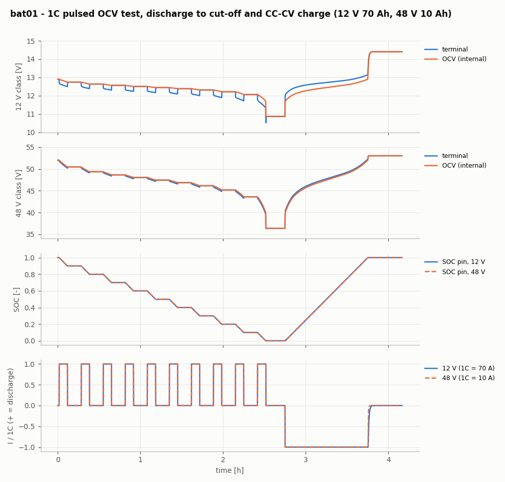
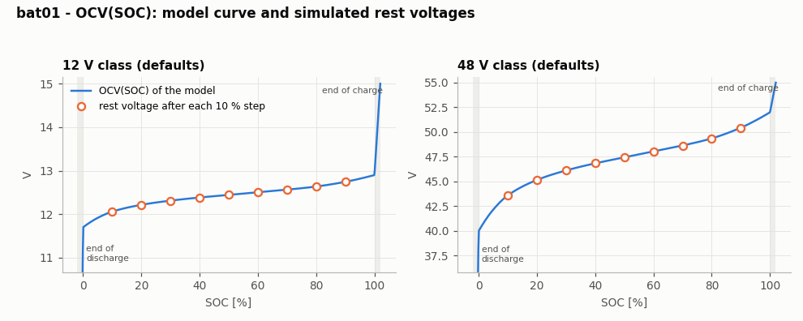

---

#### bat02: pulse resistance vs temperature (`bat02_pulse_temperature.cir`)

**What we simulate.** The classic HPPC-style pulse used to characterise a
battery's resistance: a 100 A, 10 s discharge pulse at 50 % SOC, stepped over
−30, −18, 0, +25 and +45 °C.

**Expected.** The step 0.5 ms after the edge is R0·FT·fs(0.5), plus 2.5 % of
R1 because RC1 has started. The drop after 10 s adds R1' (fully built up),
R2'(1 − e^−0.5) and the OCV drop of the 0.4 % SOC removed. The resistances
scale with FT(T).

| T | R0 12 V (sim / expected) | R(10 s) 12 V | R0 48 V (sim / expected) | R(10 s) 48 V |
|---|---|---|---|---|
| −30 °C | <!--v {m('bat02_pulse_temperature','r0_12')*1e3:.3f}-->5.647<!--/v--> / 5.646 mΩ | <!--v {m('bat02_pulse_temperature','r10_12')*1e3:.2f}-->8.64<!--/v--> mΩ | <!--v {m('bat02_pulse_temperature','r0_48')*1e3:.2f}-->42.28<!--/v--> / 42.28 mΩ | <!--v {m('bat02_pulse_temperature','r10_48')*1e3:.1f}-->63.8<!--/v--> mΩ |
| −18 °C | <!--v {m('bat02_pulse_temperature','r0_12',1)*1e3:.3f}-->4.477<!--/v--> / 4.477 mΩ | <!--v {m('bat02_pulse_temperature','r10_12',1)*1e3:.2f}-->6.85<!--/v--> mΩ | <!--v {m('bat02_pulse_temperature','r0_48',1)*1e3:.2f}-->33.52<!--/v--> / 33.52 mΩ | <!--v {m('bat02_pulse_temperature','r10_48',1)*1e3:.1f}-->50.9<!--/v--> mΩ |
| 0 °C | <!--v {m('bat02_pulse_temperature','r0_12',2)*1e3:.3f}-->3.284<!--/v--> / 3.284 mΩ | <!--v {m('bat02_pulse_temperature','r10_12',2)*1e3:.2f}-->5.03<!--/v--> mΩ | <!--v {m('bat02_pulse_temperature','r0_48',2)*1e3:.2f}-->24.59<!--/v--> / 24.59 mΩ | <!--v {m('bat02_pulse_temperature','r10_48',2)*1e3:.1f}-->37.8<!--/v--> mΩ |
| +25 °C | <!--v {m('bat02_pulse_temperature','r0_12',3)*1e3:.3f}-->2.272<!--/v--> / 2.272 mΩ | <!--v {m('bat02_pulse_temperature','r10_12',3)*1e3:.2f}-->3.49<!--/v--> mΩ | <!--v {m('bat02_pulse_temperature','r0_48',3)*1e3:.2f}-->17.05<!--/v--> / 17.01 mΩ | <!--v {m('bat02_pulse_temperature','r10_48',3)*1e3:.1f}-->26.6<!--/v--> mΩ |
| +45 °C | <!--v {m('bat02_pulse_temperature','r0_12',4)*1e3:.3f}-->1.764<!--/v--> / 1.764 mΩ | <!--v {m('bat02_pulse_temperature','r10_12',4)*1e3:.2f}-->2.71<!--/v--> mΩ | <!--v {m('bat02_pulse_temperature','r0_48',4)*1e3:.2f}-->13.21<!--/v--> / 13.21 mΩ | <!--v {m('bat02_pulse_temperature','r10_48',4)*1e3:.1f}-->21.1<!--/v--> mΩ |

R0 matches the formula within 0.2 % and R(10 s) within 0.6 % at every
temperature. R0(−30 °C)/R0(25 °C) = 2.485 = FT(−30 °C).

**Things to try.** Fit your own pulse data: change R0/R1/TAU1 until the edge
step and the first 100 ms match, then R2/TAU2 for the rest of the pulse.


---

#### bat03: output impedance (`bat03_impedance_ac.cir`)

**What we simulate.** The small-signal impedance |Z(f)| from 100 µHz to 10 MHz,
which is what a DC/DC input filter or a network stability analysis sees.

**Expected.** Three plateaus and a rise. R0'+R1'+R2' below TAU2 (8 mHz),
R0'+R1' between the two corners, R0' above TAU1 (8 Hz), then ωL_INT above
R0'/(2π·L_INT) ≈ 1.8 kHz (12 V) / 2.7 kHz (48 V), where the inductance starts
to dominate R0.

| f | 12 V sim | 12 V analytic | 48 V sim | 48 V analytic |
|---|---|---|---|---|
| 0.1 Hz | <!--v {m('bat03_impedance_ac','z12_100m')*1e3:.3f}-->3.156<!--/v--> mΩ | 3.156 mΩ | <!--v {m('bat03_impedance_ac','z48_100m')*1e3:.2f}-->22.54<!--/v--> mΩ | 22.55 mΩ |
| 100 Hz | <!--v {m('bat03_impedance_ac','z12_100')*1e3:.3f}-->2.256<!--/v--> mΩ | 2.256 mΩ | <!--v {m('bat03_impedance_ac','z48_100')*1e3:.2f}-->16.91<!--/v--> mΩ | 16.91 mΩ |
| 1 kHz | <!--v {m('bat03_impedance_ac','z12_1k')*1e3:.3f}-->2.574<!--/v--> mΩ | 2.574 mΩ | <!--v {m('bat03_impedance_ac','z48_1k')*1e3:.2f}-->17.99<!--/v--> mΩ | 17.99 mΩ |
| 100 kHz | <!--v {m('bat03_impedance_ac','z12_100k')*1e3:.1f}-->125.7<!--/v--> mΩ | 125.7 mΩ | <!--v {m('bat03_impedance_ac','z48_100k')*1e3:.1f}-->628.6<!--/v--> mΩ | 628.6 mΩ |

The maximum error over 0.1 Hz … 1 MHz is < 0.001 %. Below ~10 mHz the real
battery also shows the SOC "capacitor", which `.ac` does not include ([2.6](#26-equations-block-by-block)).

**Things to try.** Put the battery behind a harness model and the input filter
of a DC/DC converter, and check the filter's output impedance against the
converter's negative input resistance. The battery's L_INT and R0 set the
damping you get for free.

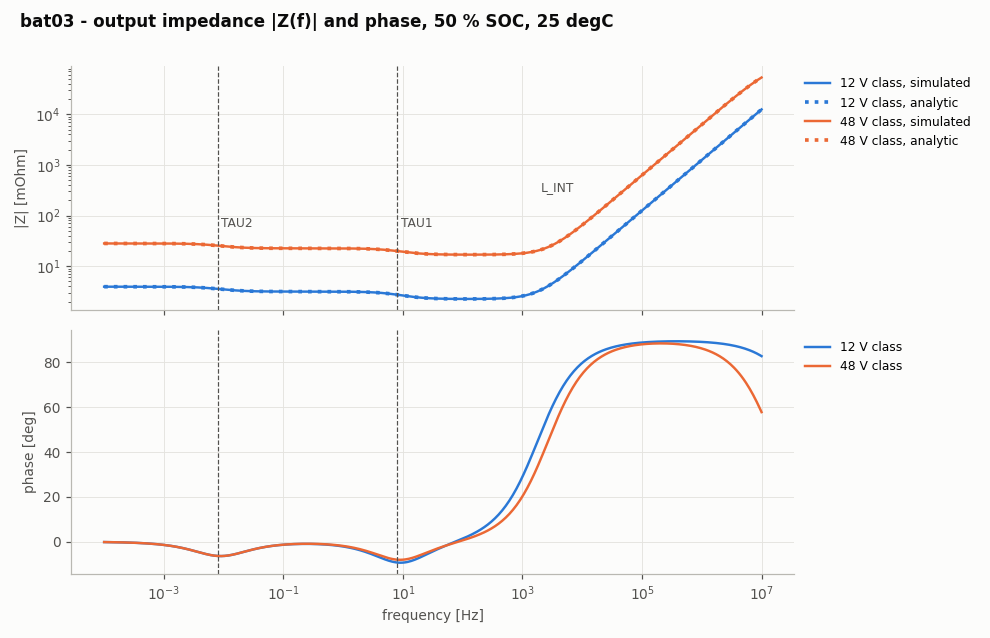

---

#### bat04: engine crank and cold cranking amps (`bat04_cold_crank.cir`)

**What we simulate.** The 12 V network's worst case: starting the engine on a
cold morning.

* Part A is a cold-cranking-amps (CCA) test in the style of SAE J537: 700 A
  for 30 s at −18 °C from full charge. The battery passes if V(30 s) ≥ 7.2 V.
* Parts B–D crank at +25 / −18 / −30 °C (SOC 80 %) with the same starter:
  1.5 mΩ + 1 µH cable, 6 mΩ armature, and a back-EMF that builds up with the
  engine speed (60 ms) and dips at every compression (10 Hz).

**Expected.** At the inrush (locked rotor, EMF ≈ 0) the battery and the
starter form a divider: V_min = OCV·7.6 mΩ/(R0' + 7.6 mΩ). The CCA voltage is
the OCV at the SOC reached after 30 s, minus 700 A × (R0' + R1' + R2'(1 −
e^−1.5)).

| Case | Expected | Simulated |
|---|---|---|
| CCA 700 A, V(30 s), −18 °C | 8.15 V (≥ 7.2 V) | <!--v {m('bat04_cold_crank','vcca'):.2f}-->8.14<!--/v--> V ✓ |
| crank +25 °C: V_min / I_peak | 9.96 V / 1311 A | <!--v {m('bat04_cold_crank','vmin_b'):.2f}-->9.95<!--/v--> V / <!--v {m('bat04_cold_crank','ipk_b'):.0f}-->1294<!--/v--> A |
| crank −18 °C: V_min / I_peak | 8.26 V / 1087 A | <!--v {m('bat04_cold_crank','vmin_c'):.2f}-->8.27<!--/v--> V / <!--v {m('bat04_cold_crank','ipk_c'):.0f}-->1074<!--/v--> A |
| crank −30 °C: V_min / I_peak | 7.58 V / 997 A | <!--v {m('bat04_cold_crank','vmin_d'):.2f}-->7.59<!--/v--> V / <!--v {m('bat04_cold_crank','ipk_d'):.0f}-->986<!--/v--> A |
| average voltage while cranking (+25 / −18 / −30 °C) | – | <!--v {m('bat04_cold_crank','vcr_b'):.2f}-->11.77<!--/v--> / <!--v {m('bat04_cold_crank','vcr_c'):.2f}-->11.29<!--/v--> / <!--v {m('bat04_cold_crank','vcr_d'):.2f}-->11.11<!--/v--> V |

The peak current is 1–1.5 % below the pure divider value because the back-EMF
and RC1 have started to build up by the time the current peaks. The ~30 V
spike when the starter disengages at 1.1 s is the cable inductance against
the bench's ideal switch. A real starter circuit clamps it (that is a load
dump of the starter circuit, not a battery effect).

**Things to try.** Lower `SOC0` to 0.4 and see the cold dip deepen further
(`fs`). Feed the battery voltage to the eFuse (12 V operation, tb15) or to an
ECU's UVLO and check that it rides through the crank profile.


---

#### bat05: bolted short circuit at the terminals (`bat05_short_circuit.cir`)

**What we simulate.** The largest current the battery can deliver. A 12 V
battery has no protection, so it is the harness fuse or eFuse that must
interrupt this. A 48 V pack opens itself.

**Setup.**
* A: a full 12 V battery shorted through 1 mΩ + 0.5 µH.
* B: a full 48 V pack with 470 µF across its terminals, shorted through 1 mΩ
  + 1 µH.

**Expected.**
* A: di/dt = OCV/(L_INT + 0.5 µH) = 18.4 A/µs, then the current settles with
  L/R ≈ 0.23 ms to OCV/(R0 + 1 mΩ + R1(1 − e^−t/TAU1)) ≈ 4.2 kA.
* B: the pack current crosses I_SC = 1 kA, the BMS opens T_SC = 100 µs later,
  and the clamp holds the switch at V_CLAMP while the inductive energy is
  absorbed.

| Quantity | Expected | Simulated |
|---|---|---|
| 12 V: current 2 µs after closing | 37.6 A (18.4 A/µs) | <!--v {m('bat05_short_circuit','ia_2us'):.1f}-->37.7<!--/v--> A |
| 12 V: current 2 ms after closing | 4194 A | <!--v {m('bat05_short_circuit','ia_3ms'):.0f}-->4215<!--/v--> A |
| 12 V: terminal voltage during the short | ~4 V | <!--v {m('bat05_short_circuit','va_3ms'):.2f}-->4.19<!--/v--> V |
| 48 V: I_SC crossing → FLT | 100 µs | <!--v {m('bat05_short_circuit','dt_sc')*1e6:.1f}-->100.1<!--/v--> µs |
| 48 V: pack current peak | ~2.2 kA | <!--v {m('bat05_short_circuit','ib_pk'):.0f}-->2197<!--/v--> A |
| 48 V: voltage across the switch | 80 V + 2.2 kA × 1 mΩ | <!--v {m('bat05_short_circuit','vsw_max'):.1f}-->82.1<!--/v--> V |
| 48 V: energy in the clamp | ½L_INT·I² × V_CL/(V_CL − V_bat) ≈ 7 J | <!--v {m('bat05_short_circuit','e_cl'):.1f}-->8.0<!--/v--> J |
| 48 V: current after opening / FLT | 0 / 3.3 V | <!--v {m('bat05_short_circuit','ib_end')*1e6:.0f}-->5<!--/v--> µA / 3.3 V |

**Things to try.** Set `T_SW=5m` to emulate a slower disconnect such as a
contactor. The current keeps rising during the opening (peak 2.45 kA instead of
2.2 kA), and the energy dissipated in the switch almost doubles (14.5 J instead
of 8.0 J). The clamp is no longer reached (74 V), because the slowly opening
switch absorbs the energy itself. Raise `I_SC` to see when the external
short-circuit protection (eFuse, pyrofuse) has to act first.

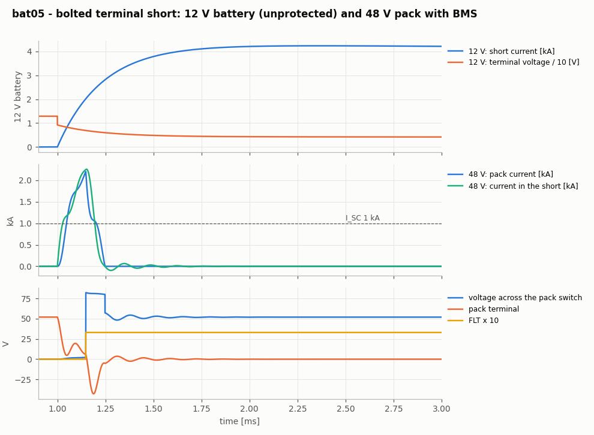

---

#### bat06: BMS, pre-charge and protections (`bat06_bms_protection.cir`)

**What we simulate.** Six 48 V packs, one scenario each:

* A / B: closing onto a 10 mF bus with and without pre-charge.
* C: overload, re-arm through EN, and a short overload that must not trip.
* D: deep discharge.
* E: a faulty charger.
* F: as A, then EN low for only 5 ms: the pre-charge must run again.

| Scenario | Expected | Simulated |
|---|---|---|
| A: pre-charge peak current | OCV/R_PRE = 4.94 A | <!--v {m('bat06_bms_protection','ipre_pk'):.2f}-->4.93<!--/v--> A |
| A: current step when the main switch closes after 0.5 s | small (bus ≈ OCV) | <!--v {m('bat06_bms_protection','iclose_pk'):.0f}-->28<!--/v--> A, no fault |
| B: no pre-charge, closing onto 10 mF | inrush > I_SC for > T_SC → SC trip | <!--v {m('bat06_bms_protection','ib_pk')/1e3:.2f}-->1.74<!--/v--> kA, trips after <!--v {(m('bat06_bms_protection','tb_flt')-0.1)*1e6:.0f}-->175<!--/v--> µs, bus left at <!--v {m('bat06_bms_protection','vb_end'):.0f}-->19<!--/v--> V |
| C: 0.1 Ω load (~405 A > I_OC): trip delay | T_OC = 1 s | <!--v {m('bat06_bms_protection','dt_oc'):.3f}-->1.000<!--/v--> s |
| C: EN low 3.0 s, high 3.5 s | fault cleared, pack re-closes | bus back at <!--v {m('bat06_bms_protection','vc_rearm'):.1f}-->49.2<!--/v--> V |
| C: second overload, 0.8 s | < T_OC: no trip | no trip (<!--v {m('bat06_bms_protection','ic_ol2'):.0f}-->404<!--/v--> A) |
| D: 100 A from 10 % SOC: delay after V < V_UV | T_UV = 1 s | <!--v {m('bat06_bms_protection','td_flt')-m('bat06_bms_protection','td_uv'):.3f}-->1.000<!--/v--> s, SOC <!--v {u(m('bat06_bms_protection','sd_flt')*100,'.1f')}-->−0.5<!--/v--> % |
| E: 56 V / 50 A charger from 95 %: delay after V > V_OV | T_OV = 0.1 s | <!--v {m('bat06_bms_protection','te_flt')-m('bat06_bms_protection','te_ov'):.3f}-->0.100<!--/v--> s, SOC <!--v {m('bat06_bms_protection','se_flt')*100:.1f}-->101.0<!--/v--> % |
| A: pre-charge path when the main switch is half closed (x = 0.5) | still on (make-before-break) | <!--v {m('bat06_bms_protection','pre_x50'):.2f}-->1.00<!--/v--> |
| F: re-close after a 5 ms EN low pulse | T_PRE = 0.5 s after EN returns | <!--v {m('bat06_bms_protection','dtf_re'):.3f}-->0.499<!--/v--> s |

Case B is the reason 48 V packs pre-charge: τ = (R0' + RSW_ON + ESR)·C ≈
0.2 ms keeps the inrush above 1 kA for longer than T_SC. In case D the pack
reaches the collapse region before tripping. At 10C the IR drop alone is 3.75 V,
so V_UV = 36 V is crossed only at the very end.

**Things to try.** Reduce `T_PRE` to 0.25 s (2.5 τ): the bus is then at 92 %
of the OCV instead of 99.3 % when the main switch closes, and the closing step
grows from 28 A to 156 A. Raise `T_SC` to 300 µs and case B no longer trips:
the 1.7 kA inrush is then accepted and the bus charges to the OCV.


---

#### bat07: 48 V PDU fed by the pack: selectivity and load dump (`bat07_pdn_48v.cir`)

**What we simulate.** The eFuse system bench [tb10](#tb10-system-context-a-48-v-zonal-power-distribution-unit-tb10_zonal_systemcir)
(two eFuse channels, a 1 kW DC/DC and a motor), now fed by the 48 V pack model
instead of an ideal source, plus a belt starter-generator (BSG) and a battery
disconnect.

| Time | Event |
|---|---|
| 1 ms / 4 ms | CH1 (DC/DC) and CH2 (motor) switch on |
| 15 ms | short circuit at the end of the CH2 harness |
| 25 ms | the BSG starts generating 60 A into the bus |
| 35 ms | the BMS opens the pack (EN low, e.g. a cell fault); the BSG regulator reacts with a 5 ms lag |

**Expected.**
* The eFuse isolates the short in ~5–10 µs, long before the pack sees its own
  I_SC: this is selectivity.
* With the BSG generating, the pack absorbs the excess current.
* When the pack opens, the bus loses its stiffest element. The excess current
  charges the bus capacitance at (60 A − loads)/C_bus, a few hundred V/ms,
  until the TVS clamps.

| Quantity | tb10 (ideal 48 V / 20 mΩ) | bat07 (pack model, SOC 80 %) |
|---|---|---|
| CH2 isolation time | <!--v {m('tb10_zonal_system','dt_trip2')*1e6:.2f}-->9.09<!--/v--> µs | <!--v {m('bat07_pdn_48v','dt_trip2')*1e6:.2f}-->8.96<!--/v--> µs |
| CH2 peak current | <!--v {m('tb10_zonal_system','ipk2'):.0f}-->320<!--/v--> A | <!--v {m('bat07_pdn_48v','ipk2'):.0f}-->328<!--/v--> A |
| bus minimum during the short | <!--v {m('tb10_zonal_system','vbus_min'):.1f}-->33.6<!--/v--> V | <!--v {m('bat07_pdn_48v','vbus_min'):.1f}-->34.1<!--/v--> V |
| DC/DC input minimum / stays enabled | <!--v {m('tb10_zonal_system','vdc_min'):.1f}-->42.3<!--/v--> V / yes | <!--v {m('bat07_pdn_48v','vdc_min'):.1f}-->43.2<!--/v--> V / yes |
| pack current peak during the short / BMS trip | – | <!--v {m('bat07_pdn_48v','ibat_pk'):.0f}-->83<!--/v--> A / no |
| pack current while the BSG generates | – | <!--v {u(m('bat07_pdn_48v','ibat_chg'),'.0f')}-->−40<!--/v--> A (charging) at <!--v {m('bat07_pdn_48v','vbus_chg'):.1f}-->50.2<!--/v--> V |
| bus reaches 58 V after the pack opens | – | <!--v {m('bat07_pdn_48v','dt_58')*1e6:.0f}-->124<!--/v--> µs |
| bus peak / TVS peak current | – | <!--v {m('bat07_pdn_48v','vbus_ld'):.1f}-->70.0<!--/v--> V / <!--v {m('bat07_pdn_48v','itvs_pk'):.0f}-->38<!--/v--> A |

The pack disconnect is the most severe event on the bench. The bus exceeds
58 V within about 0.1 ms and peaks at 70 V, the VNF1048F's absolute maximum
supply voltage (DS13084 Tab. 2). After that the generator-only bus oscillates (70 → 41 → 66 V),
because the BSG regulator is slow compared with the small bus capacitance.
This is why 48 V systems specify a fast de-excitation of the BSG and
size the TVS for a battery disconnect.

**Things to try.** Replace the behavioural DC/DC of CH1 with the 700 W
converter model: that is [dc08](#dc08-two-voltage-system-dc08_pdn_48v_12vcir),
which adds the 12 V battery and 12 V loads. Give the pack `T_SW=5m` (contactor) and compare. Add bus
capacitance and see the load-dump peak drop. Make the BSG regulator faster
(`Cgreg`) and see the oscillation go away.


#### Schematic: `demo_battery.asc`

The `BATTERY` and `BATTERY_BMS` symbols in one sheet: a 12 V battery at
−18 °C cranks a starter (minimum <!--v {m('demo_battery','v12min'):.2f}-->7.98<!--/v--> V), and a 48 V pack
pre-charges its bus, carries a load and trips on a short at 0.8 s
(FLT <!--v {m('demo_battery','dt_flt')*1e6:.0f}-->178<!--/v--> µs after the short, no fault during pre-charge or load).
Use it as a template for battery schematics.

---

### 2.9 Assumptions, estimates and limitations

**[EST] values** (defaults, not from a specific datasheet):

| Item | 12 V class | 48 V class | Basis |
|---|---|---|---|
| Capacity | 70 Ah | 10 Ah | typical starter battery; 0.5 kWh MHEV pack |
| OCV window | 11.70 … 12.90 V | 40.0 … 52.0 V | 12 V: rest voltage of a starter battery; 48 V: inside the LV148 / VDA 320 operating range (36 … 52 V) |
| End-of-charge OCV | 15.0 V at 102 % | 55.0 V at 102 % | sets where CV chargers stop |
| R0 / R1 / R2 at 25 °C | 2.0 / 0.8 / 0.7 mΩ | 15 / 5 / 5 mΩ | 12 V: ~700 A CCA; 48 V: 10 kW-class pack incl. busbars |
| TAU1 / TAU2 | 20 ms / 20 s | 20 ms / 20 s | generic polarization time constants |
| L_INT | 0.2 µH | 1 µH | block battery with terminals / pack with busbars, fuse, switch |
| TK_R, KR_SOC | 1200 K, 0.5 | 1200 K, 0.5 | ×2 at −18 °C, ×1.5 when empty |
| BMS thresholds | 15 / 10.5 V, 800 / 2500 A | 54 / 36 V, 350 / 1000 A | typical pack limits |
| BMS timing | T_OV 100 ms, T_UV 1 s, T_OC 1 s, T_SC 100 µs, T_SW 10 µs | same | semiconductor disconnect |

**Simplifications and limitations:**

* **One OCV curve shape for every chemistry.** Only the end points and the
  linear/curved choice are parameters. A table override is not exposed. To
  use a measured curve, edit `G_S`/`G_V` in `tools/bat_ocv.py`, run it, and paste
  the printed expression into the `Bg` source of the library.
* **R is the same for charge and discharge.** Lead-acid in particular accepts
  charge less readily than it delivers it. For a charging study, raise R2 (or
  shorten `DSOC_END`) to reproduce a measured charge acceptance.
* **`TBAT` is a constant.** There is no self-heating, and the capacity does not
  depend on temperature. For a cold-start energy budget, reduce `CAP_AH`.
* **The BMS sees one pack voltage.** There is no cell imbalance, and OV/UV use
  the pack voltage through a 1 ms filter. Trips are latched until EN goes low,
  and there is no automatic retry.
* **The switch is a smooth conductance with a clamp,** not a contactor with an
  arc. `T_SW` sets the speed.
* **`.ac` excludes the SOC capacitance term** (below ~10 … 100 mHz),
  see [2.10](#210-numerical-notes).

---

### 2.10 Numerical notes

The battery spans time constants from nanoseconds (L_INT) to hours
(capacity). These choices keep it fast and robust; all seven benches run in
2–6 s:

* **No `idt()`.** Charge counting, the polarization voltages and the switch
  state are voltages on normalized 1 F capacitors (`du/dt = …`). An `idt()`
  version produced correct results but forced microsecond steps over hours
  of simulation (GB-size raw files).
* **No physical farad-size capacitors.** The RC pairs would need 25 F … 28 kF.
  Their state is held in the normalized `u1`/`u2` variables instead, which
  avoids a stiff time-step control.
* **Initial conditions.** The SOC state and the switch state are held at their
  initial values only in the DC operating point (`time = 0`). In `.ac`,
  `time` is also 0, so the SOC is frozen there. That is why the `.ac`
  impedance excludes `C_SOC`.
* **Deterministic DC solution.** The fault latch is forced to reset in the DC
  operating point unless a trip condition is already active. A regenerative
  latch otherwise has two valid DC solutions, and Newton may pick the
  "tripped" one.
* **No slope steps in the OCV curve.** The first version used a piecewise-linear
  `table()`. When a DC/DC charged the battery slowly ([section 3](#3-dcdc-converter-model-48-v-to-12-v-700-w), dc04),
  the SOC crept across a breakpoint (SOC0 = 0.1) and the time step collapsed.
  Even the 10⁻⁷ mismatch left by 6-digit polynomial coefficients was enough. The
  curve is now a C¹ monotone cubic through the same points, with full-precision
  coefficients generated by `tools/bat_ocv.py`. It passes through the same
  table points, so all values at 0, 5, 10, 20 … 100 % are unchanged.
* **Ideal current source straight into the battery.** The L_INT inductor then
  rings numerically (trapezoidal ringing). Every real network has bus
  capacitance, and the benches put a capacitor with some ESR (0.1 Ω) across the
  terminals.
* **Filter the inputs of your behavioural comparators.** A current step
  through L_INT and the capacitor ESR makes a µs dip at the terminals. The
  bat01 tester measures through a 10 ms filter, the same advice as for the
  eFuse benches (section 1.12).
* **Max time step.** For short circuits use ≤ 0.2–0.5 µs (bat05, bat07). For
  cranking use ~1 ms. For drive cycles over hours, seconds are fine (bat01 uses
  2 s).


### 2.11 Reference parameter sets from public data

`models/REFERENCE_SETS_beh.lib` contains parameter sets of real products, fitted
to their public data. Each set is a wrapper subcircuit with the pins of the base
model and its own symbol (`symbols/<SET>.asy`); include the library together
with `BATTERY_beh.lib` (the DC/DC set also needs `DCDC48_12_beh.lib`). The
parameters that describe the use case are passed through: `SOC0`, `TBAT`,
`ETA_CHG`, `L_INT` (both sets) and `T_PRE`, `R_PRE`, `VTH_LOGIC` (the BMS
pack); the fitted product data are fixed. In the library, every value is marked
[PUB] (from the source), [FIT] (fitted to a published criterion) or [EST]
(estimate). The manufacturers did not provide or review these sets.

| Set | Product and source | Published data used | Fitted / estimated |
|---|---|---|---|
| `BAT12_VARTA_E39` (P N SOC) | Varta Silver Dynamic AGM E39, 12 V 70 Ah, datasheet | 70 Ah, CCA 760 A (EN) | R0/R1/R2 fitted so that 760 A at −18 °C holds 7.5 V after 10 s (the EN 50342-1 cold-cranking pass level, to be checked against the revision you use: a battery that just meets its rating; no internal resistance is published); OCV window and time constants [EST] |
| `BAT48_A123_8AH` (P N SOC EN FLT) | A123 "UltraPhosphate" 48 V 0.4 kWh pack, SAE 2018-01-0433 (US EPA) | LiFePO₄ 14 s, 8 Ah, ohmic resistance 8–10 mΩ, operating window 36–52 V | R0 fitted to 9 mΩ at the terminals at 50 % SOC; LiFePO₄ OCV window, polarization and BMS currents [EST]; the paper's higher charge resistance is not represented |

Checked in `ref01_reference_sets.cir`:

| Check | Published | Simulated |
|---|---|---|
| Varta: 760 A, −18 °C, voltage after 10 s | ≥ 7.5 V (EN 50342-1) | <!--v {m('ref01_reference_sets','va1_10'):.2f}-->7.50<!--/v--> V |
| Varta: 20 h capacity (3.5 A to 10.5 V) | 70 Ah | <!--v {m('ref01_reference_sets','ah_a2')/3600:.1f}-->70.4<!--/v--> Ah |
| A123: 1C capacity to the 36 V limit | 8 Ah | <!--v {m('ref01_reference_sets','ah_b1')/3600:.2f}-->8.06<!--/v--> Ah |
| A123: ohmic resistance at 50 % SOC | 8–10 mΩ | <!--v {m('ref01_reference_sets','r0_b2')*1e3:.2f}-->8.96<!--/v--> mΩ |

```spice
.include ../models/BATTERY_beh.lib
.include ../models/REFERENCE_SETS_beh.lib
X1 v12 0 soc12 BAT12_VARTA_E39 SOC0=0.8 TBAT=-18
X2 v48 0 soc48 en48 flt48 BAT48_A123_8AH SOC0=0.5
```

---

## 3. DC/DC converter model (48 V to 12 V, 700 W)

An **averaged behavioral model of a 700 W 48/12 V automotive buck converter**,
the device that links the 48 V and 12 V networks of a mild-hybrid vehicle and
replaces the 12 V alternator. It is the third device of the library, after the
[48 V eFuse](#11-how-an-efuse-works-an-intuitive-guide) and the [battery](#2-automotive-battery-model), and follows the same
conventions: one `.lib` file, an LTspice symbol, plain-netlist test benches, and
regression checks in `tools/validate.py` against hand calculations.

> **Scope.** This is an *averaged* model. It represents what the rest of the
> network sees:
> * the regulated output with its loop dynamics;
> * the current limit and the hiccup;
> * the input power drawn, with its negative input resistance;
> * the losses;
> * the start-up, UVLO and OVP behaviour.
>
> It does not switch, so there is no ripple, EMC or phase interleaving. The
> default values are **engineering estimates [EST]** for a typical 700 W
> converter. Replace them with your converter's data.

* [3.1 How a DC/DC looks from the power network](#31-how-a-dcdc-looks-from-the-power-network)
* [3.2 What is modeled, and what is left out](#32-what-is-modeled-and-what-is-left-out)
* [3.3 Files and quick start](#33-files-and-quick-start)
* [3.4 Pins, parameters and internal nodes](#34-pins-parameters-and-internal-nodes)
* [3.5 Equations, block by block](#35-equations-block-by-block)
* [3.6 Test benches and results](#36-test-benches-and-results)
* [3.7 Assumptions, estimates and limitations](#37-assumptions-estimates-and-limitations)
* [3.8 Numerical notes](#38-numerical-notes)
* [3.9 Reference parameter set from public data](#39-reference-parameter-set-from-public-data)

### 3.1 How a DC/DC looks from the power network

#### 3.1.1 Two faces

* **On the 12 V side it is a regulated voltage source with a current limit.**
  It holds VOUT = 14.0 V, an alternator-like setpoint that charges the 12 V
  battery, until the load asks for more than its limit
  (I_LIM = 1.1 × 700 W / 14 V = 55 A). Then it becomes a **current source** at
  55 A, and the 12 V battery supplies or absorbs the difference. With a 12 V
  battery on the output this is the *normal* state for a while after every
  start, because a battery at 12.6 V OCV would accept far more than 55 A at
  14 V.
* **On the 48 V side it is a constant-power load.** It draws
  I_in = (P_out + P_loss)/V_in. When V_in falls, I_in rises (20.2 A at 36 V
  against 13.6 A at 54 V for 700 W). Its incremental input resistance is
  therefore **negative**: dI/dV = −P/V², about −6.4 Ω at 350 W. A negative
  resistance can undamp an LC input filter or a long harness and make it
  oscillate (section [3.1.4](#314-why-a-regulated-converter-can-oscillate-with-its-input-filter)).

#### 3.1.2 Inside the model

```
 VIN ──┬── CIN (470 uF, 15 mOhm)                      VOUT ──┬── COUT (2.2 mF, 3 mOhm)
       └── I_in = (VOUT·il + P_loss)/VIN                     ├── 100 Ohm internal pre-load
                                                             └── il (averaged inductor current)
   UVLO 30/26 V ─┐                                   il ◄── current loop (FCI 30 kHz)
   OVP 60/58 V ──┤ run ── soft-start ─► vref ──► PI (FC 3 kHz) ─► limit 0..I_LIM (dropout)
   EN ───────────┤                        ▲                          │
   hiccup ───────┘                        └──────── VOUT ◄───────────┘
```

* **Voltage loop.** A PI controller with crossover FC = 3 kHz (with COUT
  alone) and its integral zero at FC/4. It commands the inductor current
  through an inner current loop with 30 kHz bandwidth.
* **Current limit.** The command is clamped between 0 and I_LIM. The lower
  clamp at 0 is diode emulation: the converter never sinks current from the
  12 V side, unless `BIDIR=1`. In dropout (low V_in) the upper limit is reduced
  so that VOUT ≤ 0.95·V_in − I·20 mΩ.
* **Hiccup.** In current limit with VOUT below 50 % of VSET (a hard short) for
  1 ms, the converter switches off for 50 ms and restarts with soft-start.
* **Losses.** P_loss = P0 + RLOSS·I² + KSW·V_in·I (fixed, conduction,
  switching). This gives 95.9 % at 700 W from 48 V and 80 % at 35 W.

#### 3.1.3 Start-up in a vehicle

At key-on the 48 V side comes up, for example through the eFuse channel that
feeds the DC/DC. The converter waits for its input to pass the UVLO (30 V),
then ramps its reference over T_SS = 5 ms. The 12 V net is already held by the
12 V battery, so the output is **pre-biased**. The converter must not pull it
down, and it starts delivering current only when the reference passes the
battery voltage (dc03). From then on it charges the battery at its current
limit.

#### 3.1.4 Why a regulated converter can oscillate with its input filter

The input of a regulated converter behaves like a resistor of −V²/P. Together
with the harness inductance L_s and the input capacitance C, it forms a
parallel LC whose only positive damping is the series resistances. The
network is stable roughly while

```
R_s·C + ESR·C  >  L_s · P/V²        (damping beats the negative conductance)
```

This is Middlebrook's criterion in its simplest form: the source's output
impedance must stay well below |Z_in| = V²/P. With an electrolytic input
capacitor (470 µF) on a 2 µH feed, the margin is large. With only 22 µF of
ceramics on a 10 µH feed, it is negative: the bus oscillates at
1/(2π√(L_s·C)) ≈ 10.7 kHz until the converter's own UVLO or OVP intervenes
(dc07). A series-RC damper (R ≈ √(L_s/C), C_d ≫ C) restores stability.

---

### 3.2 What is modeled, and what is left out

| Behaviour | Modeled? | Why |
|---|---|---|
| Output regulation, PI voltage loop + current loop | **yes** | load-step response, output impedance, interaction with the 12 V battery |
| Current limit, hiccup on a hard short, dropout | **yes** | battery charging, 12 V shorts, low-input behaviour |
| Power balance on the input (constant-power load) | **yes** | 48 V current at low voltage, negative input resistance, filter stability |
| Losses (P0, I², V·I) | **yes** | efficiency over load and V_in, thermal budget |
| CIN, COUT with ESR | **yes** | eFuse inrush, hold-up, damping |
| Input UVLO and OVP with hysteresis | **yes** | cranking/dips on the 48 V side, load dump |
| Enable, soft-start, pre-biased start, power good | **yes** | start-up sequencing with the 12 V battery |
| Bidirectional operation (`BIDIR=1`) | **yes** (optional) | 12 V → 48 V support modes |
| Switching ripple, EMC, interleaving | no | averaged model |
| Output OVP, thermal derating, over-temperature | no | add them in your system logic if needed |
| LIN/CAN setpoint and current-limit commands | no | set `VSET` / `ILIM` per simulation |
| Separate 48 V / 12 V grounds | no | one GND pin |

---

### 3.3 Files and quick start

```
models/DCDC48_12_beh.lib       DCDC48_12 and helper (DC_LATCH)
symbols/DCDC48_12.asy          5-pin symbol (VIN, VOUT, GND, EN, PG)
schematics/demo_dcdc.asc       48 V feed -> DC/DC -> 12 V battery + switched PTC load
testbenches/dc01..dc08         test benches, section 3.6
```

```spice
.include ../models/DCDC48_12_beh.lib
* defaults: 14.0 V, 700 W (55 A limit), UVLO 30/26 V, OVP 60/58 V, soft-start 5 ms
X1 vin v12 0 en pg DCDC48_12
* a 1 kW / 13.5 V variant with a slower loop and a 12 V-side short behaviour of your own
X2 vin v12b 0 en pg2 DCDC48_12 VSET=13.5 PRATED=1000 FC=1.5k T_HIC_OFF=200m
```

* **The converter is off in the DC operating point and soft-starts at
  t = 0** if EN is high and V_in is above the UVLO, as at key-on. Start load
  events after ~6 ms. For `.ac`, set `DCRUN=1` so that it is running in the
  operating point (dc06).
* **Do not load the output with an ideal DC current source at t = 0.** The
  output then has no DC path apart from the 100 Ω pre-load, and the DC solution
  is ill-defined. Ramp current-source loads in after start-up (the benches do),
  or use resistive or battery loads.
* **Including the library switches the simulation to Gear integration**
  (`.options method=gear`, see [3.8](#38-numerical-notes)); a later
  `.options method=trap` line overrides it.
* **Fed from an eFuse channel?** The eFuse's ~1.3 mA OUT bias current is larger
  than the converter's 1 mA stand-by current. Add the input bleeder your real
  design has (dc08 uses 4.7 kΩ, as tb10), or the "off" input charges up.

---

### 3.4 Pins, parameters and internal nodes

| Pin | Direction | Meaning |
|---|---|---|
| `VIN` | power | 48 V input (internal CIN) |
| `VOUT` | power | 12 V output (internal COUT; 100 Ω pre-load while running, `IOUT_OFF` when off) |
| `GND` | power | common ground |
| `EN` | input | enable, logic > 1.5 V, 1 MΩ pull-down |
| `PG` | output | 3.3 V through 100 Ω: running, soft-start finished and VOUT > 90 % of VSET |

PG reads low while a discharged 12 V battery holds VOUT below 12.6 V in
current limit (dc08).

| Parameter | Default [EST] | Unit | Meaning |
|---|---|---|---|
| `VSET` | 14.0 | V | output setpoint |
| `PRATED` | 700 | W | rated output power |
| `ILIM` | 0 → 1.1·PRATED/VSET = 55 | A | output current limit |
| `VIN_ON`, `VIN_OFF` | 30, 26 | V | input UVLO (start / stop) |
| `VIN_OVP`, `VOVP_HYS` | 60, 2 | V | input OVP (stop / restart at 58 V) |
| `T_SS` | 5 m | s | soft-start ramp |
| `FC`, `FCI` | 3 k, 30 k | Hz | voltage-loop crossover, current-loop bandwidth |
| `COUT`, `ESR_OUT` | 2.2 m, 3 m | F, Ω | output capacitance |
| `CIN`, `ESR_IN` | 470 µ, 15 m | F, Ω | input capacitance |
| `P0`, `RLOSS`, `KSW` | 6, 4 m, 5 m | W, Ω, W/(V·A) | loss model |
| `IQ_OFF` | 1 m | A | input current when off |
| `IOUT_OFF` | 100 µ | A | output current when off (drawn from a 12 V battery at key-off) |
| `DMAX`, `RDROP` | 0.95, 20 m | –, Ω | dropout |
| `V_HIC`, `T_HIC_DET`, `T_HIC_OFF` | 0.5, 1 m, 50 m | –, s, s | hiccup |
| `BIDIR` | 0 | – | 1 = bidirectional (sinks down to −ILIM) |
| `DCRUN` | 0 | – | 1 = running in the DC operating point (needed for `.ac`) |
| `VTH_LOGIC` | 1.5 | V | EN threshold |

**Internal nodes** (probe as `V(x1:<node>)`):

| Node | Meaning |
|---|---|
| `il` | averaged inductor current (A) |
| `vref` | reference (V) |
| `icr` | current command before the limits (A) |
| `imax` | upper limit (A) |
| `xi` | integrator state (A) |
| `run` | converter running (0/1) |
| `uvok` | input above the UVLO (0/1) |
| `ovp` | input over-voltage active (0/1) |
| `hic` | hiccup off-time active (0/1) |
| `h` | hiccup timer (0…1) |
| `tss` | soft-start timer (s) |
| `ploss` | losses (W) |

---

### 3.5 Equations, block by block

**Loop.**

```
KP = 2π·FC·COUT          KI = KP·2π·FC/4          τi = 1/(2π·FCI)
e  = vref − VOUT
icr = KP·e + xi,        dxi/dt = KI·e + 2π·FC·(icl − icr)        (back-calculation anti-windup)
icl = limit(icr, imin, imax),   imin = −BIDIR·ILIM,   imax = limit((DMAX·VIN − VOUT)/RDROP, 0, ILIM)
dil/dt = (icl − il)/τi,         output current = il into COUT ∥ 100 Ω ∥ load
```

**Input.**

```
P_loss = P0·run + RLOSS·il² + KSW·VIN·|il|
I_in   = (VOUT·il + P_loss)/VIN  (+ IQ_OFF when off)
dI_in/dVIN = −P_in/VIN² + KSW·|il|/VIN       (≈ −0.157 S at 25 A, 48 V)
```

**Impedances** (what `.ac` returns, dc06):

```
Zout(s) = 1 / ( 1/(ESR_OUT + 1/(s·COUT)) + 1/R_load' + (KP + KI/s)/(1 + s·τi) )
Zin(s)  = 1 / ( 1/(ESR_IN + 1/(s·CIN)) + dI_in/dVIN )
```

**Sequencing.**

```
run  = EN · (VIN above UVLO, latched 30/26 V) · not OVP (60/58 V) · not hiccup · (t > 0 or DCRUN)
vref = run · VSET · limit(tss/T_SS, 0, 1)        tss rises at 1 V/s while running, resets when stopped
hiccup: fault = run · (icr ≥ imax − 1 % ILIM) · (VOUT < V_HIC·VSET)
        timer h: +1/T_HIC_DET during a fault, off at h = 1, −1/T_HIC_OFF while off, restart at h = 0
```

---

### 3.6 Test benches and results

All values are simulated `.meas` results. Every check in `docs/VALIDATION.md`
compares against a formula, a design threshold, or an independent simulation
of the linear loop written in Python.

#### dc01: efficiency and input current (`dc01_efficiency.cir`)

V_in = 36 / 48 / 54 V × load 2.5…50 A (35…700 W), steady state.

| P_out | η at 36 V | η at 48 V | η at 54 V | I_in at 36 V | I_in at 48 V | I_in at 54 V |
|---|---|---|---|---|---|---|
| 35 W | <!--v {100*m('dc01_efficiency','pout',0)/m('dc01_efficiency','pin',0):.1f}-->80.5<!--/v--> % | <!--v {100*m('dc01_efficiency','pout',1)/m('dc01_efficiency','pin',1):.1f}-->80.2<!--/v--> % | <!--v {100*m('dc01_efficiency','pout',2)/m('dc01_efficiency','pin',2):.1f}-->80.1<!--/v--> % | <!--v {m('dc01_efficiency','iin',0):.2f}-->1.21<!--/v--> A | <!--v {m('dc01_efficiency','iin',1):.2f}-->0.91<!--/v--> A | <!--v {m('dc01_efficiency','iin',2):.2f}-->0.81<!--/v--> A |
| 140 W | <!--v {100*m('dc01_efficiency','pout',6)/m('dc01_efficiency','pin',6):.1f}-->93.2<!--/v--> % | <!--v {100*m('dc01_efficiency','pout',7)/m('dc01_efficiency','pin',7):.1f}-->92.8<!--/v--> % | <!--v {100*m('dc01_efficiency','pout',8)/m('dc01_efficiency','pin',8):.1f}-->92.6<!--/v--> % | <!--v {m('dc01_efficiency','iin',6):.2f}-->4.17<!--/v--> A | <!--v {m('dc01_efficiency','iin',7):.2f}-->3.14<!--/v--> A | <!--v {m('dc01_efficiency','iin',8):.2f}-->2.80<!--/v--> A |
| 280 W | <!--v {100*m('dc01_efficiency','pout',9)/m('dc01_efficiency','pin',9):.1f}-->95.5<!--/v--> % | <!--v {100*m('dc01_efficiency','pout',10)/m('dc01_efficiency','pin',10):.1f}-->95.1<!--/v--> % | <!--v {100*m('dc01_efficiency','pout',11)/m('dc01_efficiency','pin',11):.1f}-->94.9<!--/v--> % | <!--v {m('dc01_efficiency','iin',9):.2f}-->8.14<!--/v--> A | <!--v {m('dc01_efficiency','iin',10):.2f}-->6.13<!--/v--> A | <!--v {m('dc01_efficiency','iin',11):.2f}-->5.46<!--/v--> A |
| 560 W | <!--v {100*m('dc01_efficiency','pout',15)/m('dc01_efficiency','pin',15):.1f}-->96.3<!--/v--> % | <!--v {100*m('dc01_efficiency','pout',16)/m('dc01_efficiency','pin',16):.1f}-->95.9<!--/v--> % | <!--v {100*m('dc01_efficiency','pout',17)/m('dc01_efficiency','pin',17):.1f}-->95.7<!--/v--> % | <!--v {m('dc01_efficiency','iin',15):.1f}-->16.2<!--/v--> A | <!--v {m('dc01_efficiency','iin',16):.1f}-->12.2<!--/v--> A | <!--v {m('dc01_efficiency','iin',17):.1f}-->10.8<!--/v--> A |
| 700 W | <!--v {100*m('dc01_efficiency','pout',18)/m('dc01_efficiency','pin',18):.1f}-->96.3<!--/v--> % | <!--v {100*m('dc01_efficiency','pout',19)/m('dc01_efficiency','pin',19):.1f}-->95.9<!--/v--> % | <!--v {100*m('dc01_efficiency','pout',20)/m('dc01_efficiency','pin',20):.1f}-->95.7<!--/v--> % | <!--v {m('dc01_efficiency','iin',18):.1f}-->20.2<!--/v--> A | <!--v {m('dc01_efficiency','iin',19):.1f}-->15.2<!--/v--> A | <!--v {m('dc01_efficiency','iin',20):.1f}-->13.5<!--/v--> A |

* **Agreement with the loss model:** within 5·10⁻⁶ percentage points.
* **Regulation:** VOUT = 14.000 V at every point, because the loop
  integrates.
* **Input voltage:** efficiency falls slightly with V_in, since switching
  losses scale with V_in·I.

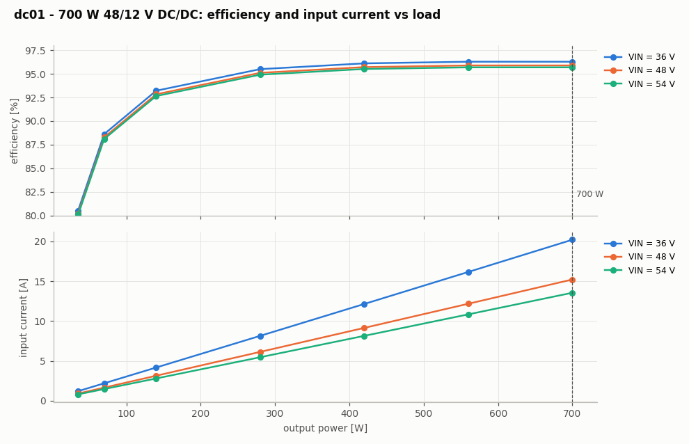

#### dc02: load steps (`dc02_load_transient.cir`)

| Case | Result | Reference |
|---|---|---|
| COUT only, +25 A in 25 µs | <!--v {m('dc02_load_transient','va_min'):.3f}-->13.563<!--/v--> V minimum, <!--v {m('dc02_load_transient','va_max'):.3f}-->14.437<!--/v--> V after the release, back within 0.1 % in <!--v {(m('dc02_load_transient','ta_set')-8e-3)*1e3:.2f}-->0.68<!--/v--> ms | linear loop: 13.563 V (first order: ΔI/(2π·FC·COUT) = 0.60 V) |
| COUT only, +45 A | <!--v {m('dc02_load_transient','vb_min'):.3f}-->13.217<!--/v--> V; the command reaches I_LIM = 55 A | current limit |
| 12 V battery (SOC 80 %) on the output, +25 A | the converter stays at 55 A; the battery's charging current drops from <!--v {u(m('dc02_load_transient','ibc0')*-1,'.1f')}-->50.3<!--/v--> A to <!--v {u(m('dc02_load_transient','ibc1')*-1,'.1f')}-->25.3<!--/v--> A; the 12 V net moves by <!--v {(m('dc02_load_transient','vc0')-m('dc02_load_transient','vc1'))*1e3:.0f}-->74<!--/v--> mV | 25 A × (R0′ + R1′(1 − e^−0.1) + 1 mΩ) = 78 mV |

With a battery on the output, the DC/DC sets the *current* and the battery
sets the *voltage*. Load steps on the 12 V net are absorbed by the battery's
impedance, not by the converter's loop.

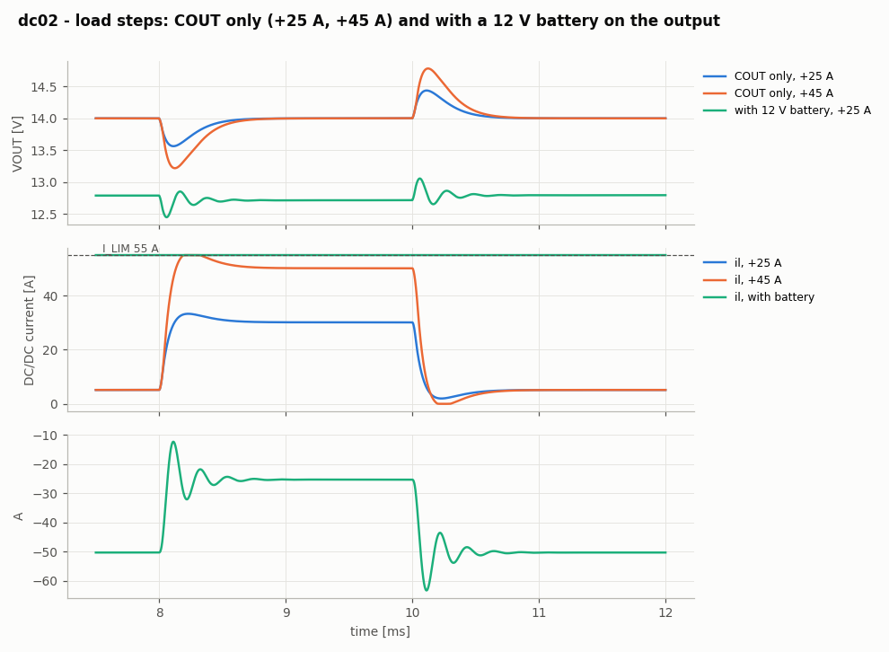

#### dc03: start-up (`dc03_startup.cir`)

| Case | Result | Expected |
|---|---|---|
| 2 Ω load: VOUT at T_SS/2 | <!--v {m('dc03_startup','va_half'):.2f}-->6.99<!--/v--> V | VSET/2 |
| PG after EN | <!--v {(m('dc03_startup','tpga')-1e-3)*1e3:.2f}-->5.00<!--/v--> ms | T_SS |
| pre-biased 12.44 V battery: minimum inductor current / input current | 0 A / <!--v {m('dc03_startup','iinb_min')*1e3:.2f}-->1.05<!--/v--> mA (stand-by) | no reverse current |
| pre-biased: delivery starts after EN | <!--v {(m('dc03_startup','tb_on')-1e-3)*1e3:.2f}-->4.32<!--/v--> ms | T_SS·12.44/14 = 4.44 ms |
| `BIDIR=1`, output pulled to 14.5 V through 50 mΩ | sinks <!--v {u(m('dc03_startup','ilc_end')*-1,'.2f')}-->9.86<!--/v--> A, input current <!--v {u(m('dc03_startup','iinc_end'),'.2f')}-->−2.69<!--/v--> A | 10 A − pre-load; P_in/V_in |
| disabled converter, 12 V battery on the output (key-off) | battery drain <!--v {m('dc03_startup','ibd_off')*1e3:.3f}-->0.101<!--/v--> mA | `IOUT_OFF` = 0.1 mA |

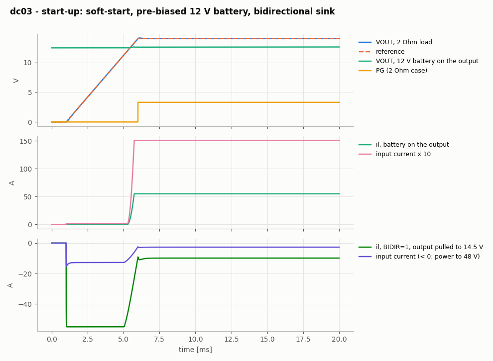

#### dc04: output short and overload (`dc04_short_overload.cir`)

| Case | Result | Expected |
|---|---|---|
| hard short: current | <!--v {m('dc04_short_overload','ia_sc'):.0f}-->55<!--/v--> A (VOUT <!--v {m('dc04_short_overload','va_sc'):.2f}-->0.27<!--/v--> V) | I_LIM |
| short → switch-off | <!--v {m('dc04_short_overload','dt_off1')*1e3:.3f}-->1.005<!--/v--> ms | T_HIC_DET |
| off time / retry period | <!--v {m('dc04_short_overload','dt_offtime')*1e3:.1f}-->50.0<!--/v--> ms / <!--v {m('dc04_short_overload','dt_period')*1e3:.1f}-->51.3<!--/v--> ms | T_HIC_OFF; + ramp to the limit + 1 ms |
| average current in hiccup | <!--v {m('dc04_short_overload','ia_avg'):.1f}-->1.2<!--/v--> A | ≈ 55 A × 1.3/51 |
| short removed | VOUT back at 14 V, PG at <!--v {m('dc04_short_overload','tpga_rec')*1e3:.1f}-->168.7<!--/v--> ms | next retry + T_SS |
| discharged 12 V battery (SOC 10 %) | 55 A continuously, no hiccup, VOUT <!--v {m('dc04_short_overload','vb_avg'):.2f}-->12.33<!--/v--> V | VOUT > 50 % of VSET |

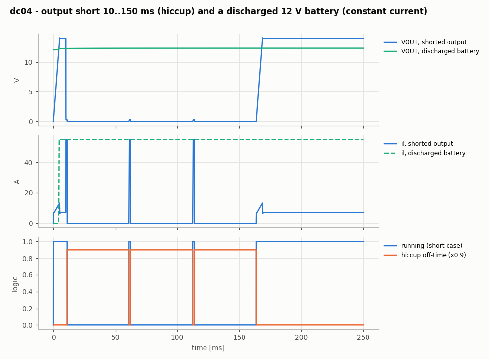

#### dc05: input transients (`dc05_input_transients.cir`)

A 392 W load with the input profile 48 → 36 → 20 → 48 → 54 → 64 → 54 V.

| Quantity | Result | Expected |
|---|---|---|
| UVLO off / on | <!--v {m('dc05_input_transients','v_uvoff'):.2f}-->25.99<!--/v--> V / <!--v {m('dc05_input_transients','v_uvon'):.2f}-->30.01<!--/v--> V | 26 / 30 V |
| OVP trip / restart | <!--v {m('dc05_input_transients','v_ovp'):.2f}-->60.01<!--/v--> V / <!--v {m('dc05_input_transients','v_ovr'):.2f}-->57.99<!--/v--> V | 60 / 58 V |
| input current at 36 V / 54 V (steady) | <!--v {m('dc05_input_transients','iin36'):.2f}-->11.34<!--/v--> / <!--v {m('dc05_input_transients','iin54'):.2f}-->7.61<!--/v--> A | P_in/V_in = 11.34 / 7.61 A |
| output after each event | soft-start back to 14.0 V | – |

The ratio I_in(36 V)/I_in(54 V) = 1.49 is the constant-power behaviour that
makes the 48 V current *rise* during a dip.

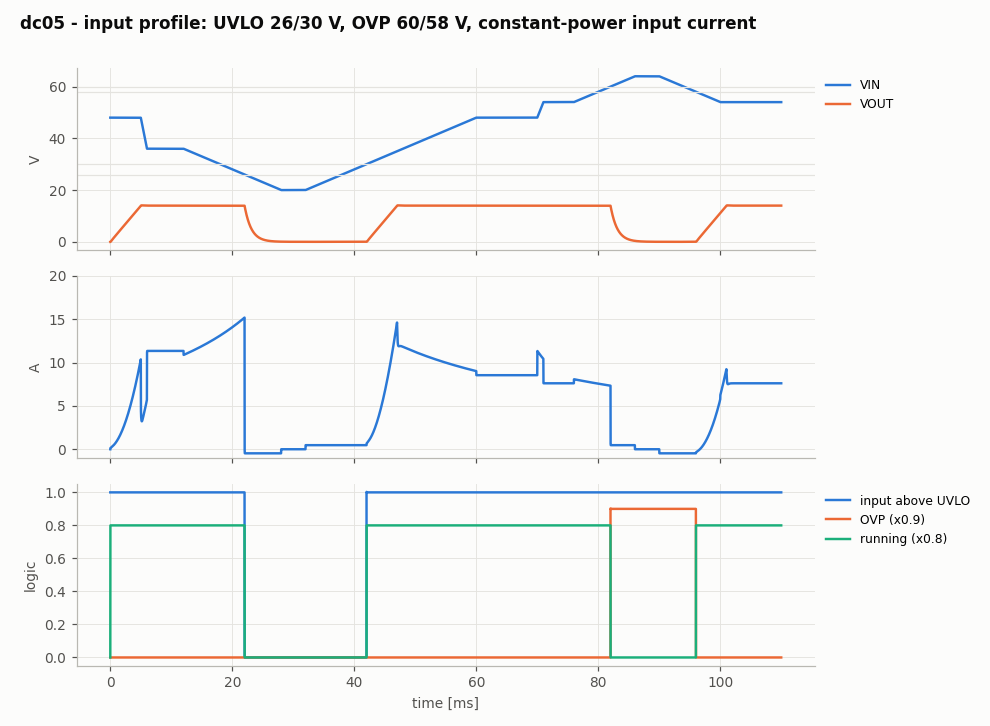

#### dc06: output and input impedance (`dc06_impedance_ac.cir`)

25 A load, V_in 48 V, `DCRUN=1`.

| f | \|Zout\| | f | \|Zin\| |
|---|---|---|---|
| 10 Hz | <!--v {m('dc06_impedance_ac','zo_10')*1e3:.2f}-->0.32<!--/v--> mΩ | 10 Hz | <!--v {m('dc06_impedance_ac','zi_10'):.2f}-->6.28<!--/v--> Ω, Re = <!--v {u(m('dc06_impedance_ac','zr_10'),'.2f')}-->−6.17<!--/v--> Ω |
| 100 Hz | <!--v {m('dc06_impedance_ac','zo_100')*1e3:.2f}-->3.20<!--/v--> mΩ | 100 Hz | <!--v {m('dc06_impedance_ac','zi_100'):.2f}-->3.00<!--/v--> Ω |
| 1 kHz | <!--v {m('dc06_impedance_ac','zo_1k')*1e3:.1f}-->21.4<!--/v--> mΩ | 1 kHz | <!--v {m('dc06_impedance_ac','zi_1k'):.3f}-->0.339<!--/v--> Ω |
| 3 kHz | <!--v {m('dc06_impedance_ac','zo_3k')*1e3:.1f}-->18.6<!--/v--> mΩ | 10 kHz | <!--v {m('dc06_impedance_ac','zi_10k')*1e3:.0f}-->37<!--/v--> mΩ |
| 10 kHz | <!--v {m('dc06_impedance_ac','zo_10k')*1e3:.1f}-->7.4<!--/v--> mΩ | | |
| 100 kHz | <!--v {m('dc06_impedance_ac','zo_100k')*1e3:.1f}-->3.1<!--/v--> mΩ (ESR) | | |

* **Accuracy:** both match the closed-form expressions of section 3.5 within
  0.03 %.
* **Zout:** near 0 at DC (integrator), with a peak of ~21 mΩ around the
  crossover.
* **Zin:** a negative resistance of −6.4 Ω below ~100 Hz (−6.17 Ω with CIN in
  parallel at 10 Hz), and CIN above.

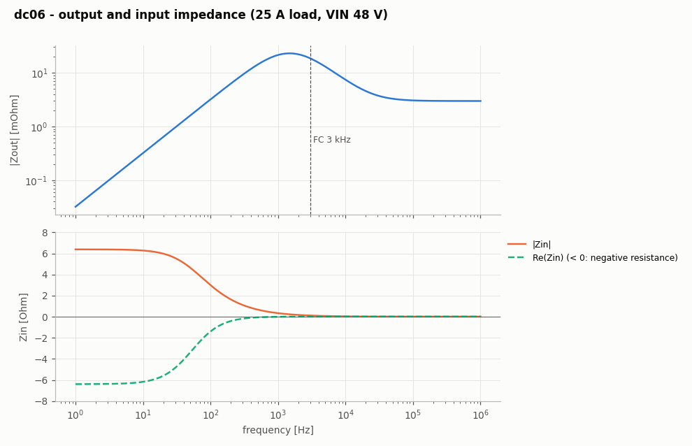

#### dc07: input-filter stability (`dc07_input_filter_stability.cir`)

25 A load fed through R_s = 10 mΩ and L_s.

| Case | Eigenvalue of the linearized filter + CPL | Simulated |
|---|---|---|
| A: 2 µH, 470 µF / 15 mΩ | Re = −6091 s⁻¹ (stable) | settles, no ripple |
| B: 10 µH, 22 µF ceramic / 2 mΩ | Re = **+2968 s⁻¹** at 10.7 kHz (unstable) | grows during soft-start to <!--v {m('dc07_input_filter_stability','vpp_b'):.0f}-->30<!--/v--> V p-p; the peaks trip the 60 V OVP and the 12 V output collapses to ~6 V |
| C: B + 220 µF / 0.68 Ω damper | Re = −7359 s⁻¹ (stable) | settles, VOUT <!--v {m('dc07_input_filter_stability','vout_c'):.2f}-->13.83<!--/v--> V minimum at the load step |

This is the classic "the DC/DC works on the bench supply and oscillates in the
car" case. The bench supply is stiff; a long harness with ceramic-only input
capacitance is not.


#### dc08: two-voltage system (`dc08_pdn_48v_12v.cir`)

The 48 V pack (BATTERY_BMS) → main harness → bus → eFuse CH1 → DC/DC → 12 V
harness → 12 V battery (SOC 70 %) + 10 A base load. CH2 feeds the 48 V motor of
tb10.

| Event | Result |
|---|---|
| CH1 on at 1 ms | eFuse inrush <!--v {m('dc08_pdn_48v_12v','ich1_pk'):.0f}-->57<!--/v--> A into CIN (no fault); the DC/DC starts at <!--v {m('dc08_pdn_48v_12v','vin_dcrun'):.1f}-->31.0<!--/v--> V (UVLO 30 V + filter) after <!--v {(m('dc08_pdn_48v_12v','t_dcrun')-1e-3)*1e3:.2f}-->0.33<!--/v--> ms |
| steady state | DC/DC at its 55 A limit; the 12 V battery charges at <!--v {u(m('dc08_pdn_48v_12v','ibat12_ss')*-1,'.1f')}-->44.7<!--/v--> A; CH1 carries <!--v {m('dc08_pdn_48v_12v','ich1_ss'):.1f}-->15.1<!--/v--> A; the pack delivers <!--v {m('dc08_pdn_48v_12v','ibat48_ss'):.1f}-->27.9<!--/v--> A in total |
| +40 A PTC on 12 V at 20 ms | the DC/DC stays at 55 A; the battery charging current drops to <!--v {u(m('dc08_pdn_48v_12v','ibat12_ph')*-1,'.1f')}-->2.9<!--/v--> A; the 12 V net goes <!--v {m('dc08_pdn_48v_12v','v12_ss'):.2f}-->12.66<!--/v--> → <!--v {m('dc08_pdn_48v_12v','v12_ph'):.2f}-->12.57<!--/v--> V |
| short on the 48 V motor branch at 30 ms | CH2 isolates in <!--v {m('dc08_pdn_48v_12v','dt_trip2')*1e6:.1f}-->9.2<!--/v--> µs; the 48 V bus dips to <!--v {m('dc08_pdn_48v_12v','vbus_min'):.1f}-->34.1<!--/v--> V; the DC/DC input stays ≥ <!--v {m('dc08_pdn_48v_12v','vdc_min'):.1f}-->43.4<!--/v--> V and the converter keeps running; the 12 V net changes by <!--v {abs(m('dc08_pdn_48v_12v','v12_min')-m('dc08_pdn_48v_12v','v12_pre'))*1e3:.1f}-->0.5<!--/v--> mV; no pack or CH1 fault |

A fault on the 48 V side stays invisible to the 12 V net, as long as the
eFuse clears it in microseconds and the DC/DC input capacitance bridges the
dip.


#### Schematic: `demo_dcdc.asc`

The `DCDC48_12` symbol fed from a 48 V source through a feed harness, charging
a 12 V battery with a switched PTC load: the converter runs at its current limit
(<!--v {m('demo_dcdc','il_cl'):.1f}-->55.0<!--/v--> A out, <!--v {m('demo_dcdc','iin'):.1f}-->15.3<!--/v--> A from the 48 V feed), and the 12 V net sits at
<!--v {m('demo_dcdc','v12_ptc'):.2f}-->12.52<!--/v--> V while the PTC is on. Use it as a template for DC/DC schematics.

---

### 3.7 Assumptions, estimates and limitations

| Item | Default | Basis [EST] |
|---|---|---|
| Setpoint, rating | 14.0 V, 700 W | alternator-like 12 V charging voltage; typical MHEV DC/DC |
| Current limit | 110 % of rated | typical |
| Efficiency | 95.9 % at 700 W / 48 V, 80 % at 5 % load | 95–97 % class |
| Loop | FC 3 kHz, PI zero FC/4, current loop 30 kHz | typical average-current-mode design, ~70° phase margin |
| CIN / COUT | 470 µF / 2.2 mF | electrolytic + ceramic banks |
| UVLO / OVP | 30/26 V, 60/58 V | inside the LV148 / ISO 21780 ranges (check your standard revision) |
| Hiccup | 50 % VSET, 1 ms detect, 50 ms off | typical |
| Pre-load | 100 Ω (140 mA, 2 W) on the output while running; 0.1 mA when off | feedback divider + control supply; also a numerical need ([3.8](#38-numerical-notes)) |

**Limitations:**
* **Averaged model.** There is no switching ripple and no EMC. The current
  loop is a first-order lag, and the input power balance is instantaneous, so
  the constant-power behaviour holds up to all frequencies. A real converter's
  input impedance changes above the current-loop bandwidth.
* **No temperature.** There is no thermal model and no derating, and the
  losses do not depend on temperature.
* **The current limit is a hard clamp,** with no foldback and no
  cycle-by-cycle peak-current details.
* **Hiccup is the only output-short behaviour.** For a latch-off converter,
  set a very long `T_HIC_OFF`.
* **`.ac` needs `DCRUN=1`.** The integrator and the soft-start timer use
  DC-operating-point initializers, like the battery model.

---

### 3.8 Numerical notes

The converter combines a fast loop (µs), saturations, logic and long events
(tens of ms). Getting it to run reliably in LTspice took several deliberate
choices. They are listed here because each one was a real failure first:

* **Gear integration.** `DCDC48_12_beh.lib` contains `.options method=gear`
  (accuracy and speed impact on the eFuse benches: see
  [Numerical guidance](#numerical-guidance-for-behavioural-models)).
  With the default trapezoidal method, some combinations of instances stalled
  (time steps of 10⁻¹⁰…10⁻¹⁵ s) after the fast logic events of the hiccup and
  current limit. Which combination stalled depended even on the `.save` list.
  Gear removed every case.
* **Off in the DC operating point.** A converter that is already in current
  limit in the DC solution (EN high, a battery on the output) starts the
  transient from an inconsistent saturated state. Starting from "off" (DC
  operating point trivial) and soft-starting at t = 0 is robust. `DCRUN=1`
  restores the running operating point for `.ac`.
* **No `min()`/`max()` in the loop.** With them, the DC operating point of a
  running converter failed and the transient stalled at light load. `limit()`
  is used instead.
* **The integrator is reset when stopped.** Back-calculation would otherwise
  hold it as the balance of two ~10⁶ A/s terms, which is very sensitive to the
  operating point (it stalled dc08 at t = 0+).
* **No state may rest on a kink.** The soft-start timer settles in the
  proportional (not clamped) part of its rate. The hiccup uses one timer
  state that moves monotonically through its thresholds, instead of a
  deglitch filter driven back by its own result, which raced at the
  threshold. The 100 Ω pre-load keeps the current command away from the 0 A
  clamp at no load.
* **The battery model had to change for the same reason.** Its OCV(SOC)
  curve was a piecewise-linear `table()`. A battery charged slowly by the
  DC/DC crept across a table breakpoint and stalled the time step. Even a
  10⁻⁷ step in value left by 6-digit coefficients was enough. The curve is now
  a C¹ monotone cubic through the same points, with full-precision
  coefficients (`tools/bat_ocv.py`).


### 3.9 Reference parameter set from public data

`DCDC_TOSHIBA_RD210` in `models/REFERENCE_SETS_beh.lib` (pins VIN VOUT GND EN PG)
is the buck direction of the Toshiba RD210 reference design, *Automotive 3kW
48V-12V Bidirectional DC-DC Converter Reference Guide* (RD210-RGUIDE-02):

* **Published:** input 24–54 V (48 V typical), output 12 V (11.85–12.15 V),
  3 kW, 4 phases at 200 kHz, efficiency 91.3 % at 3 kW (48 → 12 V).
* **Fitted:** the loss model, to 91.3 % at 3 kW: P0 15 W, RLOSS 2.73 mΩ,
  KSW 8.33 mW/(V·A). The split between the three terms is an estimate, because
  only one efficiency point is published as a number.
* **Estimated:** the UVLO (26 / 23 V), the OVP (56 / 54 V), the loop and the
  capacitances (COUT 10 mF, CIN 2.2 mF). The boost direction is not
  characterised.
* **Set by the wrapper:** `VSET=12`, `PRATED=3000` (so `ILIM` = 275 A). Passed
  through: `VSET`, `DCRUN`, `BIDIR`, `ILIM`, `T_SS`, `VTH_LOGIC`. Symbol:
  `symbols/DCDC_TOSHIBA_RD210.asy`.

Checked in `ref02_reference_dcdc.cir`:

| Check | Published | Simulated |
|---|---|---|
| efficiency at 3 kW, 48 → 12 V | 91.3 % | <!--v {100*m('ref02_reference_dcdc','eta_c'):.2f}-->91.26<!--/v--> % |
| output voltage at 3 kW | 11.85–12.15 V | <!--v {m('ref02_reference_dcdc','vo_c'):.2f}-->12.00<!--/v--> V |
| regulation at 24 V input | input 24–54 V | <!--v {m('ref02_reference_dcdc','vo_24'):.2f}-->12.00<!--/v--> V; stops at <!--v {m('ref02_reference_dcdc','vin_off'):.1f}-->23.0<!--/v--> V |

```spice
.include ../models/BATTERY_beh.lib
.include ../models/DCDC48_12_beh.lib
.include ../models/REFERENCE_SETS_beh.lib
X1 vin v12 0 en pg DCDC_TOSHIBA_RD210
```

---

## 4. References

* STMicroelectronics, *VNF1048F – High-side switch controller with intelligent
  fuse protection for 12 V, 24 V and 48 V automotive applications*, datasheet
  DS13084 Rev 6, May 2022: product page https://www.st.com/en/automotive-analog-and-power/vnf1048f.html
* STMicroelectronics, EV-VNF1048F evaluation board: https://www.st.com/en/evaluation-tools/ev-vnf1048f.html
* ST newsroom, *Automotive high-side switch controller with flexible diagnostics
  and protection* (STi2Fuse family introduction).
* ISO 21780 / VDA 320 (LV148): 48 V on-board power supply, voltage classes
  (used for illustrative levels in tb06; check the current standard for real limits).
* Related part: VNF1248F (same family, different feature set). The model structure
  applies, but check the thresholds in its own datasheet.
* SAE J537, *Storage Batteries* (cold cranking amps test, used in bat04).
* EN 50342-1, *Lead-acid starter batteries — Part 1: General requirements and
  methods of test* (cold cranking test: 7.5 V after 10 s, used for the Varta
  reference set).
* Varta Automotive, *Silver Dynamic AGM E39 (ETN 570 901 076)* product data
  sheet: 12 V, 70 Ah, 760 A EN (reference set `BAT12_VARTA_E39`).
* S. D. Lee, J. Cherry, M. Safoutin, J. McDonald, M. Olechiw (US EPA),
  *Modeling and Validation of 48 V Mild Hybrid Lithium-Ion Battery Pack*, SAE
  Technical Paper 2018-01-0433, doi:10.4271/2018-01-0433:
  https://www.epa.gov/sites/production/files/2018-10/documents/sae-paper-2018-01-0433.pdf
  (reference set `BAT48_A123_8AH`).
* Toshiba Electronic Devices & Storage, *Automotive 3kW 48V-12V Bidirectional
  DC-DC Converter Reference Guide*, RD210-RGUIDE-02 (reference set
  `DCDC_TOSHIBA_RD210`).
* R. D. Middlebrook, *Input filter considerations in design and application of
  switching regulators*, IEEE IAS Annual Meeting, 1976 (negative input
  resistance and filter stability, dc06/dc07).
