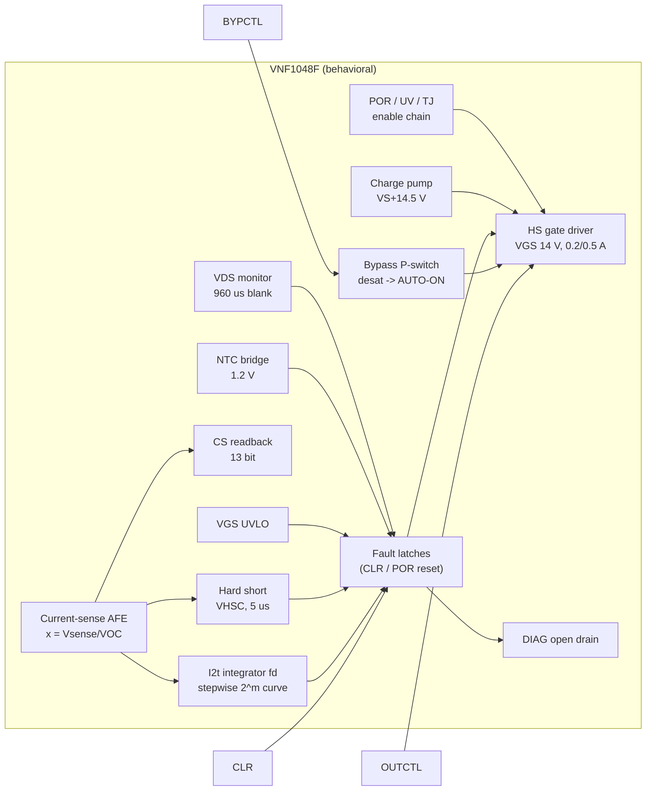

# 48 V automotive eFuse: behavioral LTspice model (ST VNF1048F reference)

A detailed **behavioral LTspice model of a 48 V automotive electronic fuse**, using
the STMicroelectronics **VNF1048F** as the reference part ("High-side switch
controller with intelligent fuse protection for 12 V, 24 V and 48 V automotive
applications", datasheet DS13084 Rev 6). The repository also has fourteen
validated test benches (four of them on pre-charging capacitive loads), two
ready-to-run schematics and a scripted regression that checks 80 simulation
results against the datasheet and against hand calculations.

> **Disclaimer.** This is an independent, **unofficial** model. STMicroelectronics
> did not provide, review or endorse it. It was built from the public datasheet.
> Where the datasheet gives no number, an engineering estimate is used and
> marked **[EST]** (see [Assumptions and estimates](#11-assumptions-estimates-and-limitations)).
> Use it for architecture studies, protection coordination and harness/load
> interaction. Do not use it in place of ST's own models, the latest datasheet or
> hardware validation.

---

## Contents

1. [How an eFuse works: an intuitive guide](#1-how-an-efuse-works-an-intuitive-guide)
2. [What is modeled](#2-what-is-modeled)
3. [Repository layout](#3-repository-layout)
4. [Quick start](#4-quick-start)
5. [The reference device in one page](#5-the-reference-device-in-one-page)
6. [Model architecture and pins](#6-model-architecture-and-pins)
7. [Block-by-block description (with equations)](#7-block-by-block-description)
8. [EFUSE48_MOD: the complete channel and the external-component design](#8-efuse48_mod-complete-channel-and-external-component-design)
9. [Pre-charging capacitive loads](#9-pre-charging-capacitive-loads)
10. [Test benches and results](#10-test-benches-and-results)
11. [Assumptions, estimates and limitations](#11-assumptions-estimates-and-limitations)
12. [Numerical notes and troubleshooting](#12-numerical-notes-and-troubleshooting)
13. [Designing with the model: worked example](#13-designing-with-the-model-worked-example)
14. [References](#14-references)

---

## 1. How an eFuse works: an intuitive guide

This section is for electronic engineers who know power MOSFETs and op-amps but
have not worked with electronic fuses. It explains what the circuit does and why,
and points to the model parameter that controls each behaviour. The equations
are in [section 7](#7-block-by-block-description).

### 1.1 The job: protect the wire, not the load

A conventional fuse protects the **wire harness and the PCB copper**, not the
load. Any conductor heats up with I²·R and cools to its surroundings. If the
current stays too high for too long, the insulation degrades, carbonizes and can
start a fire. A melting fuse is a thermal replica of the wire: it heats with I²
and opens before the wire is damaged. The characteristic number is its
**I²t** (A²s), the "melting energy".

Melting fuses have well-known weaknesses:

* they are one-shot, and you have to physically replace them;
* their tolerance is wide, so the wire must be oversized;
* they cannot tell a harmless inrush (charging a capacitor) from a real overload;
* at 48 V they have to break arcs, which is far harder than at 12 V.

An **eFuse** replaces the melting element with a **MOSFET switch + a current
measurement + logic** that *computes* the wire heating in real time and opens the
switch electronically. It is resettable and programmable, reports what happened
(DIAG pin, current readback), and adds protections a melting fuse cannot have:
microsecond short-circuit response and switch self-monitoring.

### 1.2 The power path: shunt, MOSFET and charge pump

```
 Battery 48 V ──[ RSENSE 1 mΩ ]──┬──── D ┌─────────┐ S ──── OUT ──harness──► load
                                 │       │ N-MOSFET│
               ISNS_P   ISNS_N ──┘       └────┬────┘
                  │        │                  G
                  └──┬─────┘                  │
                 ┌───┴──────── VNF1048F ──────┴───────────┐
                 │ current sense   gate driver (VGS 14 V) │
                 │ fuse logic      charge pump (VS+14.5 V)│
                 └────────────────────────────────────────┘
```

* **The switch** is an N-channel MOSFET in the positive line (*high side*), so the
  load stays referenced to chassis ground. In the model it is `M1`
  (`FET100V_2M`: 100 V, ~2 mΩ). An N-channel device has lower resistance and is
  cheaper than a P-channel one. To turn it on, though, the gate must be about
  10–15 V **above the source**, and with the switch on the source sits at battery
  voltage. The gate therefore has to be driven *above the battery*.
* **The charge pump** generates that voltage: VCP = VS + 14.5 V ≈ 62.5 V at 48 V
  (`VCP_REG`). The gate driver takes charge from it and regulates
  VGS ≈ 14 V (`VGS_ON`). It sources ~0.2 A to turn on (`IG_SRC`) and sinks ~0.5 A
  to turn off (`IG_SNK`). Switching off simply means shorting gate to source.
* **The current measurement** uses a 1 mΩ shunt (`RSENSE`) before the MOSFET.
  The controller reads the small differential voltage
  **VSENSE = I × RSENSE**, which is 10 mV at 10 A, on top of a 48 V common mode.
  All current thresholds in the device are therefore specified in **millivolts
  of VSENSE**, and you choose amperes through RSENSE:

  ```
  INOM (max continuous current) = VOC_THRS / RSENSE   e.g. OVC_CODE 13 → 21.8 mV / 1 mΩ = 21.8 A
  IHSC (hard-short threshold)   = VHSC_THRS / RSENSE  e.g. HSC_CODE 12 → 105.6 mV / 1 mΩ = 105.6 A
  ```

  A larger RSENSE gives better resolution at low current but more loss: at 20 A,
  1 mΩ dissipates 0.4 W. The measured value is also reported back (`CS` pin =
  VSENSE, 13 bit), so the MCU can read the load current.

### 1.3 Three layers of protection, three time scales

Think of the protections as three nested safety nets, each fast enough for its
own kind of fault:

| Layer | Fault it handles | Reaction time | Model parameter | Test bench |
|---|---|---|---|---|
| **Fuse emulation (I²t)** | overload: too much current for too long | ms … minutes | `OVC_CODE`, `TNOM_CODE`, node `fd` | tb03, tb04 |
| **Hard short** | short circuit: current shooting up | ~5 µs | `HSC_CODE`, `HSC_DLY` | tb02, tb10 |
| **Switch self-monitoring** | the MOSFET itself is in trouble | µs … ms | `VDS_CODE`, `NTC_CODE`, VGS UVLO | tb05, tb07 |

#### Layer 1: the fuse emulation as a bucket of heat

Picture a **bucket** that represents the heat stored in the wire. In the model
the bucket level is the node **`fd`**: 0 = cold, 1 = full = trip.

* Current **above INOM** pours water in, faster the higher the current
  (∝ I² − INOM², the excess heating).
* Current **below INOM** lets water drain out, because the wire cools.
* When the bucket is full, the MOSFET is switched off and the fault is latched
  (`fusel`).

The size of the bucket is set by **tNOM** (`TNOM_CODE`, tNOM = 2·code + 1 s),
which is the trip time at a current just above INOM. Larger tNOM means a bigger
bucket and a more tolerant fuse, matched to a thicker wire with more thermal mass.
The ST silicon rounds the fill rate to powers of two, so the curve looks like a
staircase (DS13084 Fig. 4, reproduced in tb03). For INOM = 21.8 A and tNOM = 1 s:

| Load current | I/INOM | Trip time (tNOM = 1 s) | Trip time scales with |
|---|---|---|---|
| 21.8 A | ≤ 1.00 | never | – |
| 22.9 A | 1.05 | 0.5 s | × tNOM |
| 26.2 A | 1.2 | 125 ms | × tNOM |
| 32.7 A | 1.5 | 31 ms | × tNOM |
| 43.6 A | 2 | 15.6 ms | × tNOM |
| 65.4 A | 3 | 3.9 ms | × tNOM |
| 104.6 A | 4.8 | 2 ms | × tNOM |
| > 105.6 A | > IHSC/INOM | **~5 µs: hard short (layer 2)** | – |

With TNOM_CODE = 15 (tNOM = 31 s) every time in the table is 31 times longer.
The bucket picture explains three behaviours that confuse newcomers:

* **Inrush is ignored.** Charging a 220 µF input capacitor at 30 A for 0.5 ms
  pours in only a spoonful (tb01: `fd` peaks at 0.005), so no trip occurs, even
  though the current is above INOM.
* **PWM loads are judged by their RMS current.** A load chopped at 40 A peak
  fills the bucket during the on-time and drains it during the off-time. The net
  level rises only if the *RMS* current exceeds INOM. tb04 shows that 25 % and
  30 % duty never trip, while 35 % and 50 % do.
* **The fuse remembers.** Right after a trip the bucket is still full and needs
  about tNOM/32 to empty. If the MCU re-enables too early, the next trip comes
  much sooner. This is intentional: the wire is still hot.

#### Layer 2: hard short circuit

In a real short the current is limited only by the battery and wiring
inductance. With 2 µH of harness at 48 V it rises at 48 V / 2 µH = **24 A/µs**, so
within 10 µs it can reach several hundred amperes. The bucket logic, which
averages over 61 µs (`T_SAMP`), is too slow for that. A separate comparator
watches VSENSE directly. If it exceeds VHSC (`HSC_CODE`) for 5 µs (`HSC_DLY`),
the MOSFET is switched off at once and `hsht` is latched. tb02 shows a 105.6 A
threshold being crossed and the switch opening 8 µs after the short. The peak
reaches ~340 A because the current keeps rising during the delay and the
turn-off. Size the MOSFET's pulse rating and the input TVS/capacitors for that
peak, not for the threshold.

#### Layer 3: watching the switch itself

The MOSFET is only safe when it is either **fully on** (tiny VDS, little power)
or **fully off**. Any state in between dissipates P = VDS × I, which is
48 V × 50 A = 2.4 kW, and destroys it in milliseconds. The controller therefore
checks the switch continuously:

* **VDS desaturation** (`VDS_CODE`, 0.3–1.8 V). When the switch is on, VDS must be
  small (2 mΩ × 20 A = 40 mV). If VDS exceeds the threshold, the MOSFET is not
  fully on (weak gate, overload, damaged die), and it is switched off (`vdsmax`).
  During turn-on VDS is necessarily large, so the check is **blanked for 960 µs**
  (`VDS_BLK`) after every turn-on. That is why the output must finish ramping up
  within ~1 ms (tb05).
* **Gate under-voltage** (`vgslow`): if VGS drops below ~8.5 V the MOSFET is no
  longer fully enhanced. This can come from charge-pump problems, a gate leak or
  low battery.
* **MOSFET temperature** (`NTC_CODE`, 100–150 °C): a 10 kΩ NTC on the drain pad,
  read through a 1.2 V bridge. A slow overload just below INOM in a hot
  environment can still overheat a poorly cooled MOSFET, and the NTC catches it
  (tb07: trip at 119.8 °C for a 120 °C setting).
* **Controller temperature** (`TTSD`, 175 °C) and **battery under-voltage**
  (`VS_USD`, 4.5 V). Below that voltage the gate cannot be driven reliably, so the
  device turns everything off and restarts on its own when the battery recovers
  (tb06).

### 1.4 Latch-off, not current limiting

The VNF1048F **never limits the current linearly**: it does not hold the MOSFET
half-on at a fixed current. At 48 V that would mean kilowatts in the MOSFET. Every
protection simply **turns the switch off and latches the fault**, so the channel
stays off. The decision to retry belongs to the MCU, which reads the fault
over SPI and clears it. In the model, SPI is replaced by three logic pins:

* `OUTCTL`: "switch on / off" (the normal command);
* `CLR`: "clear the latched faults". If the fault is still there, the device
  trips again immediately, as in tb02 where a retry into a short trips in 5 µs;
* `DIAG`: an open-drain flag that goes low on any fault, a quick hardware
  interrupt for the MCU. `CS` reports the measured current.

### 1.5 Turning on gently: inrush and the slew network

Most 48 V loads (DC/DC converters, inverters, ECUs) have large input
capacitors. If the MOSFET turns on in microseconds, the capacitor charges almost
instantly, the inrush current is enormous, and the hard-short protection trips.
The fix is to **ramp the output voltage slowly**. In `EFUSE48_MOD` a resistor
(`RG_ON`, 2.2 kΩ) and a capacitor from gate to ground (`C_SLEW`, 47 nF) limit how
fast the gate, and therefore OUT, can rise: about 80–100 V/ms (97 V/ms in tb01), so
48 V takes ~0.5 ms.
The inrush current is then I = C_LOAD × dV/dt, e.g. 220 µF × 97 V/ms ≈ 21 A
on top of the load current (tb01: 30 A peak with the 10 A load). Two limits pull in opposite directions:

* **too fast** → inrush above IHSC → hard-short trip;
* **too slow** → the ramp is still running when the 960 µs VDS blanking ends →
  desaturation trip (tb05 with C_SLEW = 470 nF).

A diode around `RG_ON` (`RG_OFF` path) makes the **turn-off** fast even though
the turn-on is slow. A short has to be interrupted in microseconds.

This slow ramp is one way to **pre-charge** the load capacitance. It only works
up to about 1–2 mF. Larger capacitances need a separate pre-charge path; see
[section 9](#9-pre-charging-capacitive-loads) and benches tb11–tb14.

### 1.6 Turning off hard: where the energy goes

Every wire has inductance, and a current in an inductance stores energy, ½·L·I².
When the eFuse interrupts a current, that energy has to go somewhere:

* **Battery side**: the harness inductance pushes VBAT *up*. Bulk capacitance
  and a TVS keep it below the 70 V rating (tb02: 64 V with 100 µF; 88 V with
  only 10 µF).
* **Load side**: the load or harness inductance pulls OUT *below ground*. A
  freewheel Schottky from GND to OUT gives the current a path. Without it, OUT goes
  to −52 V and the MOSFET avalanches (tb09).

### 1.7 Sleeping: the low-current bypass

When the vehicle is parked, the charge pump alone would drain the battery
(~8 mA, `IQ_ON`). In stand-by the pump is off (`CPON` = 0) and a small internal
switch (~7 Ω, ~0.1 A max, `RBYP`/`IBYP_SAT`) keeps always-on loads supplied, at
about 150 µA (`IQ_STBY`) of controller consumption. If the load suddenly wakes up and
draws more than the bypass can deliver, the voltage across the bypass rises
above ~1.3 V (`VBYP_SAT`). The controller then turns the main MOSFET on **by
itself** (AUTO-ON, node `autoon`) and pulls DIAG low to wake the MCU (tb08).

### 1.8 Putting it together: a channel's life in the test benches

| Situation | What the eFuse does | Key parameters | Bench |
|---|---|---|---|
| Key-on, load with 220 µF input | slow ramp, inrush tolerated | `RG_ON`, `C_SLEW`, `VDS_BLK` | tb01 |
| Normal operation at 10 A | switch fully on, current reported on CS | `RSENSE`, `VGS_ON` | tb01 |
| Motor stalls at 1.5 × INOM | bucket fills, trip after 31 ms × tNOM | `OVC_CODE`, `TNOM_CODE` | tb03 |
| PWM heater | trips only if I_RMS > INOM | `OVC_CODE`, `TNOM_CODE` | tb04 |
| Harness chafes through, short to chassis | off in ~8 µs, faulty branch only | `HSC_CODE` | tb02, tb10 |
| Load too capacitive / ramp too slow | VDS trip after 960 µs | `VDS_CODE`, `C_SLEW` | tb05 |
| Battery sags or over-voltage | follows down to ~6 V, UV off at 4.5 V, auto-restart | `VS_USD` | tb06 |
| Hot under-hood, poor cooling | NTC trip at the set temperature | `NTC_CODE` | tb07 |
| Parked car, ECU wakes up | bypass → AUTO-ON | `CPON`, `VBYP_SAT` | tb08 |
| Solenoid switched off | energy into the freewheel diode | (external Schottky) | tb09 |
| Key-on with 1 mF: how fast may OUT ramp? | dV/dt window between HSC and VDS blanking | `C_SLEW`, `HSC_CODE` | tb11 |
| Key-on with 4.7 mF (inverter, big DC/DC) | resistor pre-charge, then eFuse hand-over | (external pre-charge path) | tb12, tb13 |
| Pre-charge into a shorted or leaky load | supervisor aborts, eFuse never closes | (pre-charge supervisor) | tb14 |

---

## 2. What is modeled

| Function (datasheet section) | Modeled behaviour |
|---|---|
| Supply, POR, battery under-voltage (5.1, Tab. 4) | POR 2.3/2.5 V, UV shutdown 4.5 V with 0.1 V hysteresis and a 33 µs filter, automatic restart, supply currents |
| Charge pump (Tab. 11) | VCP = VS + 14.5 V (VS > 10 V), reduced at low VS, finite drive, CP_LOW detection (VS+6.0/5.6 V, 60 µs filter) |
| HS gate driver (Tab. 12) | VGS regulated to ~14 V, ~0.2 A source / 0.5 A sink (from tON 4 µs and tOFF 2.6 µs at 80 nF), 20 V clamp |
| Current-sense amplifier and ADC (Tab. 13) | unidirectional high-side shunt sense, 13-bit / 160 mV readback (`CS` pin), input bias currents |
| **Hard short-circuit latch-off** (5.5, Tab. 15) | 16 SPI thresholds, 20 to 160 mV, 5 µs delay, latched, sets FUSE_LATCH too |
| **Current-vs-time latch-off: eFuse I²t** (3, 5.6, Tab. 16, Fig. 4/5) | the **exact stepwise ST curve**, recovered from Fig. 4/5 (see [7.6](#76-the-efuse-i²t-curve)): 32 INOM thresholds, tNOM 1 to 511 s, RMS behaviour with PWM, thermal memory after a trip |
| External FET desaturation (5.4, Tab. 14) | VDS = V(ISNS_N) − V(OUT), 31 thresholds 0.3 to 1.8 V, **960 µs blanking at turn-on**, 5 µs deglitch + 5 µs delay, latched |
| Gate under-voltage VGS_LOW (Tab. 12, SR#1) | 8.5 V (VS > 10 V) / 5 V (VS = 6 V), 8 µs deglitch, latched |
| External FET over-temperature via NTC (5.3, Tab. 17) | 1.2 V reference bridge, 16 threshold codes (100 to 150 °C), deglitch, latched, NTC model fitted to the thresholds |
| Device thermal shutdown (5.2, Tab. 9) | TJ = TAMB + RthJA·P, 175 °C / 15 °C hysteresis, real-time |
| Low-current bypass and AUTO-ON (5.7, Tab. 18) | ~7 Ω P-switch VS→OUT, ~0.1 A saturation, desat ~1.3 V for 5 µs → external FET on by hardware, DIAG low (wake-up) |
| DIAG pin (Tab. 8) | open drain, low on any shutdown fault, CP_LOW or wake-up |
| Fault clearing (SPI "read & clear") | `CLR` logic pin. Faults are re-armed, and if the fault persists the channel re-trips. |

Not modeled: the SPI protocol itself, watchdog, Locked/Unlocked state machine,
self-tests, HWLO, ADC sample timing (filters are used instead). See [11](#11-assumptions-estimates-and-limitations).

---

## 3. Repository layout

```
efuse/
├── README.md                     this file
├── models/
│   └── VNF1048F_beh.lib          the model library (all subcircuits + device models)
├── symbols/                      LTspice symbols (canonical copy)
│   ├── VNF1048F.asy              14-pin controller
│   ├── EFUSE48_MOD.asy           9-pin complete eFuse channel
│   └── NTC10K_ST.asy             NTC thermistor with temperature input
├── schematics/                   ready-to-run schematics (symbols copied alongside)
│   ├── demo_efuse48_module.asc   module in a 48 V harness: start-up, short, retry
│   └── app_vnf1048f_discrete.asc full discrete application (DS13084 Fig. 16 + slew network)
├── testbenches/                  tb01..tb14 netlists (.cir), see section 10
├── docs/
│   ├── img/                      result plots (generated)
│   └── VALIDATION.md             pass/fail report vs datasheet (generated)
└── tools/
    ├── run_ltspice.sh            batch runner (native LTspice or macOS CrossOver build)
    ├── ltraw.py                  .raw / .log reader (numpy)
    ├── plot_results.py           regenerates docs/img/*.png
    ├── validate.py               regenerates docs/VALIDATION.md, exit code = failures
    ├── make_symbols.py           regenerates the .asy symbols
    └── make_schematics.py        regenerates the demo .asc schematics
```

---

## 4. Quick start

### In the LTspice GUI

* Open any `testbenches/*.cir` (File → Open, file type "Netlists") and press Run.
  Each test bench `.include`s `../models/VNF1048F_beh.lib`.
* Or open `schematics/demo_efuse48_module.asc` or `schematics/app_vnf1048f_discrete.asc`.
  The symbols sit next to the schematics, so they are found automatically.
* To use the model in your own schematic, copy `symbols/*.asy` next to the
  schematic (or into your LTspice `lib/sym` folder) and add a SPICE directive
  `.include <path>/VNF1048F_beh.lib`.

### From the command line (full regression)

```bash
tools/run_ltspice.sh testbenches/*.cir schematics/*.asc   # ~3 min for all 16
python3 tools/validate.py                                 # -> docs/VALIDATION.md, 80 checks
python3 tools/plot_results.py                             # -> docs/img/*.png
```

`run_ltspice.sh` detects the macOS LTspice 24/26 build, which is a CrossOver/Wine
bundle, and runs `LTspice.exe -b` through its bundled `wine`. On Windows or Linux
it falls back to `LTspice -b`, so adapt the path if needed. The Python tools need
`numpy` and `matplotlib`.

### Minimal instantiation

```spice
.include ../models/VNF1048F_beh.lib
* complete channel: VBAT OUT GND EN BYP CLR DIAG CS TFET
X1 vbat out 0 en byp clr diag cs tfet EFUSE48_MOD RSENSE=1m OVC_CODE=13 HSC_CODE=12
+ VDS_CODE=14 NTC_CODE=4 TNOM_CODE=0
* -> INOM = 21.8 mV/1 mOhm = 21.8 A, IHSC = 105.6 A, VDS_THR = 1.0 V, NTC 120 degC, tNOM = 1 s
```

or the bare controller with your own FET, shunt and NTC:

```spice
XU vs cp vs drn hsg out ntc ntcm 0 diag en byp clr cs VNF1048F OVC_CODE=13 HSC_CODE=12 VDS_CODE=14
```

---

## 5. The reference device in one page

The VNF1048F is **not a switch with an integrated power stage**. It is a
**controller for an external N-channel MOSFET** in high-side configuration.
ST calls it the first member of its *STi2Fuse* family. Key datasheet values used by
the model:

| Item | Value (DS13084 Rev 6) |
|---|---|
| Operating supply | 6 to 60 V (48 V typ.), extended 70 V for ≤ 100 ms, abs. max 70 V |
| UV shutdown / POR | 4.5 V (+0.1 V hyst., 33 µs filter) / 2.5 V on, 2.3 V off |
| Charge pump | VS + 13.5…15.5 V (VS > 10 V), VS + 7…11 V at VS = 6 V, 400 kHz |
| Gate driver | VGS(on) 12…15 V, VGS max 20 V, tON 4 µs, tOFF 2.6 µs (80 nF), QG max 800 nC |
| Current sense | 0…160 mV differential, CM 0…70 V, 13-bit ADC, ±3 % above 20 mV |
| Hard short threshold | 16 steps 20…160 mV (±5 %), 5 µs delay |
| Over-current (I²t) threshold | 32 steps 6…89.3 mV, tNOM 1…511 s, sampling 61 µs, time tolerance ±10 % |
| VDS monitor | 0.30…1.80 V, 50 mV steps, 960 µs blanking at FET start-up, 5 µs deglitch + 5 µs delay |
| NTC monitor | VBG = 1.2 V bridge with RT_REF = 10 kΩ, 100…150 °C thresholds |
| Thermal shutdown | 175 °C (160…190), 15 °C hysteresis |
| Bypass P-switch | 4…10 Ω, ~100 mA, desat threshold ~1.3 V → AUTO-ON |
| Suggested parts (Fig. 16) | RSENSE 1 mΩ, CP/CP1/CP2 470 nF, CVS1 20 µF, CVS2 100 nF, RGB 47 kΩ, RT_REF 10 kΩ, RPU 4.7 kΩ |

All protections act as **latch-off**. There is no linear current limiting: the
FET is switched off and the MCU re-arms the channel over SPI by clearing the
latched bit.

---

## 6. Model architecture and pins



### 6.1 `VNF1048F` (controller), 14 pins

| # | Pin | Type | Function |
|---|---|---|---|
| 1 | `VS` | power | battery supply (also the bypass P-switch source) |
| 2 | `CP` | power | charge-pump output. Connect the 470 nF reservoir from CP to VS. |
| 3 | `ISNS_P` | analog in | shunt, battery side |
| 4 | `ISNS_N` | analog in | shunt, FET drain side (also the VDS-monitor reference and the NTC bridge reference) |
| 5 | `HS_GATE` | analog out | gate driver output |
| 6 | `OUT` | analog | FET source / load (driver return, bypass output) |
| 7 | `NTC` | analog in | NTC bridge input (NTC between ISNS_N/drain and NTC) |
| 8 | `NTC_M` | analog out | ISNS_N − 1.2 V (bottom of the bridge, via RT_REF) |
| 9 | `GND` | power | ground |
| 10 | `DIAG` | open drain | low = fault / CP_LOW / wake-up |
| 11 | `OUTCTL` | logic in | **replaces SPI CR#1.OUTCTL** (1 = FET on) |
| 12 | `BYPCTL` | logic in | **replaces SPI CR#1.BYPASSCTL** (1 = bypass on) |
| 13 | `CLR` | logic in | **replaces SPI "read & clear" of SR#1** (high = clear latched faults) |
| 14 | `CS` | analog out | **replaces SR#2 CURR_SENSE**: V(CS) = quantized VSENSE [V], I = V(CS)/RSENSE |

Logic inputs switch at 1.5 V (3.3 V / 5 V CMOS) and have 1 MΩ to GND.

### 6.2 Parameters

Thresholds are set with the **same register codes as the SPI fields**, so a value
that works in simulation maps 1:1 onto the firmware configuration.

| Parameter | Default | Meaning |
|---|---|---|
| `OVC_CODE` | 10 | CR#2.OVC_THR, 0..31 → VOC_THRS (Tab. 16): 6, 7.2, 8.7, 10.4, 11.8, 13, 13.8, 14.8, 15.8, 16.8, 17.9, 19.1, 20.4, 21.8, 23.3, 24.8, 26.5, 28.2, 30.1, 32.2, 34.3, 36.6, 39.1, 41.7, 44.5, 47.5, 50.6, 54, 61.3, 69.5, 78.8, 89.3 mV. **INOM = VOC_THRS / RSENSE** |
| `HSC_CODE` | 10 | CR#2.HSHT_THR, 0..15 → VHSC_THRS (Tab. 15): 20, 23, 26.4, 30.3, 34.8, 40, 45.9, 52.8, 60.6, 69.6, 80, 91.9, 105.6, 121.3, 139.3, 160 mV. **IHSC = VHSC_THRS / RSENSE** |
| `VDS_CODE` | 10 | CR#2.VDS_THR, 0..30 → 0.30 + 0.05·code V |
| `NTC_CODE` | 4 | CR#3.NTC_THR, 0..10 → 110.92 … 37.50 mV (100 … 150 °C in 5 °C steps). 11..15 = 37.5 mV. |
| `TNOM_CODE` | 0 | CR#2.T_NOM, 0..255 → **tNOM = 2·code + 1 s** |
| `VOC_MV`, `HSC_MV`, `VDS_MV`, `VNTC_MV`, `TNOM_S` | 0 | direct overrides in mV / s (used when > 0) |
| `FUSE_MODE` | 0 | 0 = ST stepwise curve (as the silicon), 1 = ideal continuous curve |
| `TOL_T` | 1 | trip-time multiplier, for corner analysis (datasheet ±10 % → 0.9 / 1.1) |
| `KCOOL` | 1 | cooling-rate factor of the fuse memory (1 = symmetric heat balance) |
| `T_SAMP` | 61u | fuse current averaging window (tI_SAMPLING) |
| `CPON` | 1 | 1 = Unlocked/Locked mode (charge pump running), 0 = Stand-by (CP off until AUTO-ON or OUTCTL) |
| `VGS_ON`, `IG_SRC`, `IG_SNK` | 14, 0.2, 0.5 | gate drive regulation [V], source / sink current [A] **[EST]** |
| `VCP_REG`, `ICP_MAX`, `RCP` | 14.5, 30m, 10 | charge pump: regulation above VS, current capability **[EST]**, output R **[EST]** |
| `HSC_DLY`, `VDS_DGL`, `VDS_DLY`, `VDS_BLK`, `VGU_DGL`, `UV_FLT`, `NTC_DGL`, `CP_FLT`, `BYP_DGL` | 5u, 5u, 5u, 960u, 8u, 33u, 100u, 60u, 5u | timing (datasheet; NTC_DGL is "10…500 µs", 100 µs chosen) |
| `VS_USD`, `VS_USD_HYS` | 4.5, 0.1 | UV threshold and hysteresis |
| `VBYP_SAT`, `RBYP`, `IBYP_SAT` | 1.3, 7, 0.12 | bypass switch |
| `TTSD`, `TTSD_HYS`, `TAMB`, `RTHJA`, `P_EXT` | 175, 15, 25, 26, 0 | device thermal (P_EXT adds external heating to the IC) |
| `IQ_ON`, `IQ_STBY`, `IOUT_B`, `ISNSP_B`, `ISNSN_B` | 8m, 150u, 1.3m, 300u, 420u | supply and pin bias currents |
| `CS_GERR` | 0 | gain error of the CS readback (e.g. 0.03 = +3 %) |

### 6.3 Internal nodes you can probe

All logic nodes are 0/1 V. Path syntax: netlist instance `X1` of the controller
→ `V(x1:fd)`. Inside the module (`X1 … EFUSE48_MOD`) the IC is `XU`, so use
`V(x1:xu:fd)`. In a schematic on LTspice 24+, instance `U1` → `V(u1:fd)` or
`V(u1:xu:fd)` (LTspice XVII: `V(xu1:…)`). **`.meas` only sees internal nodes
that are listed in a `.save` statement.**

| Node | Meaning (SPI equivalent) |
|---|---|
| `gcmd` | HS gate driver commanded on (SR#1.OUTST) |
| `bycmd`, `byp` | bypass commanded on (SR#1.BYPASSST) / smoothed |
| `hsht` | hard short latched (SR#1.HSHT) |
| `fusel` | current-vs-time latched (SR#1.FUSE_LATCH) |
| `fd` | **fuse state** 0…1, trip at 1 (the "VIP-fuse counter") |
| `xa` | x = I/INOM averaged over 61 µs |
| `ovc` | real-time over-current warning (GSB.OVC) |
| `vdsmax` | VDS desaturation latched (SR#1.VDS_MAX) |
| `vgslow` | gate under-voltage latched (SR#1.VGS_LOW) |
| `ntcovt` | external FET over-temperature latched (SR#1.NTC_OVT) |
| `uv` | battery under-voltage, real-time (SR#1.VS_UV) |
| `devovt`, `tj` | device over-temperature (SR#1.DEV_OVT), junction temperature [°C] |
| `cplow`, `cpok` | charge pump low (SR#1.CP_LOW) / CP above threshold |
| `autoon` | bypass desaturation → AUTO-ON (SR#1.BYPASS_SAT, GSB.AUTOON) |
| `flt` | OR of the latched shutdown faults |
| `ton` | time since HS turn-on (VDS blanking timer) |
| `porok`, `cpen` | out of POR / charge pump enabled |

Module-level nodes (`EFUSE48_MOD`): `drn` (FET drain = ISNS_N), `g` (FET gate),
`hsg` (HS_GATE pin), `cp`, `ntc`, `ntcm`, `tjf` (FET junction °C), `tcf` (pad/NTC °C).

---

## 7. Block-by-block description

### 7.1 Supply, POR and under-voltage

* POR: the device is in reset below 2.3 V and leaves it above 2.5 V. POR clears
  every latch and the fuse memory `fd`, which matches "registers loaded with
  default values".
* UV: `VS < 4.5 V` sustained for 33 µs → `uv` = 1. Gate, bypass and charge pump
  turn off. `VS > 4.6 V` → `uv` clears and the channel **restarts by itself**,
  because UV is a real-time bit and not latched.
* Supply current: `IQ_STBY` + `IQ_ON` when the charge pump runs, plus the pump's
  input current.

### 7.2 Charge pump

```
VCP_target = VS + min(VCP_REG, 9 V + 1.375·(VS − 6 V))      (14.5 V for VS ≥ 10 V, 9 V at 6 V)
I_CP       = ICP_MAX · tanh((VCP_target − V(CP)) / (ICP_MAX·RCP))
```

The model is a regulated source with output resistance `RCP` and current limit
`ICP_MAX`, charging the external CP capacitor (470 nF CP–VS). CP_LOW is set when
CP < VS + 5.6 V for 60 µs (released above VS + 6.0 V) and disables the gate
driver (DIAG low). With the mid-spec curve used here (VS + 9 V at 6 V), the pump
still provides ~VS + 7 V at 4.6 V. In tb06, therefore, the FET is switched off by the
4.5 V UV shutdown and not by CP_LOW. A weaker pump (`ICP_MAX`, `VCP_REG`) or a heavy
gate load can make CP_LOW act first. The datasheet only guarantees operation
down to 6 V.

### 7.3 Gate driver

```
I_src = IG_SRC · clip((VGS_ON − V(HS_GATE,OUT))/0.5 V) · clip(V(CP,HS_GATE)/0.5 V)   from CP
I_snk = IG_SNK · clip(V(HS_GATE,OUT)/1 V)                                         to OUT
```

This gives a current-limited, VGS-regulated push-pull referred to OUT, with a
20 V clamp HS_GATE→OUT, a diode HS_GATE→CP and a 200 kΩ passive pull-down.
IG_SRC/IG_SNK come from tON = 4 µs (0.5→10 V) and tOFF = 2.6 µs with 80 nF:
80 nF·9.5 V/4 µs ≈ 0.19 A and 80 nF·14 V/2.6 µs ≈ 0.43 A **[EST]**.

### 7.4 Current-sense front end and CS readback

`VSENSE = max(V(ISNS_P) − V(ISNS_N), 0)` (unidirectional). Three paths:

* **fast** (0.5 µs RC) for the hard-short comparator (0.9 MS/s ADC),
* **x = VSENSE/VOC** averaged with τ = `T_SAMP`/2 (≈ the 61 µs fuse sampling window),
* **CS readback**: 200 µs low-pass (2.4 kS/s refresh), quantized to
  160 mV/8192 = 19.5 µV, optional gain error `CS_GERR`.

### 7.5 Hard short-circuit latch-off

`VSENSE > VHSC` while the FET is commanded on, sustained for `HSC_DLY` = 5 µs,
latches `hsht`. Per datasheet section 5.6 it also sets `fusel`. Note that the current keeps
rising during the 5 µs, limited only by the loop inductance. tb02 shows 105.6 A
threshold → 340 A peak with 2 µH of harness.

### 7.6 The eFuse I²t curve

The datasheet text says the curve is "an optimized stepwise function", that
`tNOM` is the trip time at INOM ("the first step"), and that the number of steps
is 15 for VOC = 6 mV / VHSC = 160 mV and 9 for 26.5 / 105.6 mV. It does **not**
give the step values. They were recovered by digitising **Figure 4 and Figure 5**:

* the time levels **halve at every step**: t = tNOM, tNOM/2, tNOM/4, … The 15th
  step in Fig. 4 is 1 s/2¹⁴ = **61 µs, exactly tI_SAMPLING**;
* the step edges fall at **x = √(1 + 2ᵐ/32)** (x = I/INOM). From Fig. 4 (VOC = 6 mV):
  6.18, 6.36, 6.71, 7.35, 8.49, 10.4, 13.4, 18.0, 24.7, 34.5, 48.4, 68.1, 96.2,
  136 mV. All 15 edges match the figure to within reading accuracy, and Fig. 5
  (VOC = 26.5 mV, 9 steps, tNOM ≈ 51 s) matches as well.

This is the inverse of a classic **heat-balance (adiabatic + constant loss)
wire model**:

```
ideal:      t(x) = (tNOM/32) / (x² − 1)        capped at tNOM (x close to 1)
stepwise:   t(x) = tNOM / 2^m ,  m = floor(log2(32·(x² − 1))),  m ≥ 0
equivalent: dE/dt ∝ I² − INOM² ,  trip at  E = INOM²·tNOM/32
```

The model integrates a normalized fuse state `fd` (0 → 1) on a 1 F capacitor:

```
x > 1 :  dfd/dt = k(x) / (tNOM · TOL_T)       k = 2^m (FUSE_MODE 0)  or  max(1, 32(x²−1)) (FUSE_MODE 1)
x < 1 :  dfd/dt = −KCOOL · 32 · (1 − x²) / tNOM      (cooling, fd ≥ 0)
trip  :  fd ≥ 1 while the FET is on  →  FUSE_LATCH
```

Consequences, all visible in the test benches:

* **No trip at I ≤ INOM, ever.**
* **PWM loads trip on RMS.** The averaged rate is 32·(⟨x²⟩ − 1), so the channel
  trips only if I_RMS > INOM (tb04). This is what the datasheet describes as "the
  eFuse calculates the mean square root of the current". The stepwise quantization
  makes the silicon slightly more tolerant than ideal RMS.
* **Thermal memory.** After a trip `fd` = 1 decays in ≈ tNOM/32 at zero current.
  Re-arming earlier gives a shorter trip time, as the datasheet warns ("user can
  expect that trip time will be lower than expected").
* **Inrush.** Capacitor charging is ignored as long as its I²t is small compared
  with INOM²·tNOM/32 (tb01: fd = 0.005 for a 30 A / 0.5 ms inrush).


### 7.7 VDS desaturation

`VDS = V(ISNS_N) − V(OUT)` (FET only; the shunt is upstream). The condition is
armed `VDS_BLK` = 960 µs after each HS turn-on and must persist for 5 + 5 µs.
The result is latched. **Design consequence: the output must finish ramping
within ~0.96 ms** (see [8.2](#82-gate-slew-network-and-the-960-µs-rule)).

### 7.8 Gate under-voltage (VGS_LOW)

The threshold is 8.5 V for VS > 10 V and 5 V at VS = 6 V (interpolated). The
monitor arms once VGS has exceeded the threshold after turn-on (the "falls below"
wording) and trips if VGS stays below it for 8 µs. The result is latched.

### 7.9 External FET over-temperature (NTC)

The bridge works as on the silicon: `NTC_M` = V(ISNS_N) − 1.2 V and
`VNTC = V(ISNS_N) − V(NTC) = 1.2 V · RNTC/(RT_REF + RNTC)`. Trip when VNTC < VNTC_THRS
(for `NTC_DGL`) while the FET is on. The result is latched.

`NTC10K_ST` is a Steinhart–Hart fit (A = 9.0308e-4, B = 2.4423e-4, C = 2.5784e-7)
through R25 = 10 kΩ and the 11 resistances implied by the ST thresholds with
RT_REF = 10 kΩ. It reproduces 100…150 °C to within ±0.06 °C, so a threshold code
in the model means the same temperature as on the bench with the recommended NTC
(B57232V5103F360 class). It is implemented as a ln R(T) table for robust convergence.

### 7.10 Low-current bypass and AUTO-ON

A P-switch VS→OUT, modeled as `I = IBYP_SAT·tanh(V/(RBYP·IBYP_SAT))`, i.e. 7 Ω
saturating at ~0.12 A, with a body diode OUT→VS. It keeps sleeping loads alive
with the charge pump off (`CPON` = 0). If VS − VOUT > 1.3 V for 5 µs while the FET
is off, the controller sets `autoon`. Then the bypass turns off, the charge pump
starts and the **FET is switched on by hardware** regardless of OUTCTL. In
stand-by (`CPON` = 0) DIAG is pulled low to signal the wake-up. CLR clears it.
The bypass must not be used to charge loads.

### 7.11 Latches, clear and DIAG

`EF_LATCH` is a set-dominant SR latch that holds its state on a capacitor and
regenerates to 0/1. It starts deterministically at 0. `CLR` (or POR) resets all
latched faults. Because set dominates, a fault still present re-latches at once.
For example, CLR into a persistent short makes the FET turn on and the HSC trip
again 5 µs later, which is how a firmware retry behaves (tb02).

---

## 8. EFUSE48_MOD: complete channel and external-component design

`EFUSE48_MOD VBAT OUT GND EN BYP CLR DIAG CS TFET` packages one channel as in
DS13084 Fig. 16, plus a gate slew network:

```
VBAT ──RSENSE──┬── drain [FET100V_2M ×NPAR] source ── OUT
  │            │                gate ─┬─ RG_ON (2.2k) ── HS_GATE
  │ CVS 100n   NTC 10k (pad)          ├─ D ─ RG_OFF (10 Ω) ── HS_GATE   (fast turn-off)
  │ CCP 470n   │                      ├─ C_SLEW (47 nF) ── GND           (dV/dt control)
  │ (CP–VBAT)  RT_REF 10k ── NTC_M    ├─ RGB 47k ── OUT
  │                                   └─ 15 V zener ── OUT              (gate protection)
  DIAG pull-up 4.7 kΩ to 3.3 V (internal), TFET = FET junction temperature [°C]
```

Extra parameters: `RSENSE`, `RG_ON`, `C_SLEW`, `RG_OFF`, `NPAR` (FETs in parallel),
and the FET thermal network `TAMB`, `RTHJC`, `RTHCA`, `CTHJ`, `CTHC`. FET power is
P = VDS·ID into a 2-stage RC network. The NTC sees the pad temperature.

### 8.1 Choosing the thresholds

```
INOM = VOC_THRS(OVC_CODE) / RSENSE          IHSC = VHSC_THRS(HSC_CODE) / RSENSE
t_trip(I) = tNOM / 2^floor(log2(32((I/INOM)² − 1)))      for INOM < I < IHSC
```

The usable fuse window is IHSC/INOM ≤ 26.7 (6 mV vs 160 mV). Keep VSENSE at
nominal load above ~10 mV, where the sense accuracy is ±5 % or better.

### 8.2 Gate slew network and the 960 µs rule

Without slew control the driver switches the FET in ~µs. Into a capacitive load
the inrush is then limited only by the loop resistance, so the HSC trips. The
module sets the output slew with RG_ON and C_SLEW to ground:

```
dVout/dt ≈ (VGS_ON − VGS_plateau) / (RG_ON · (C_SLEW + Cgd))  ≈ 9 V / (2.2k · 50 nF) ≈ 85 V/ms
t_ramp  ≈ VBAT / (dV/dt)  ≈ 0.6 ms        I_inrush ≈ C_LOAD · dV/dt
```

Two limits apply at the same time:

* `t_ramp` < **VDS_BLK = 960 µs**. Otherwise VDS (still tens of volts) trips the
  desaturation protection at the end of the blanking time (tb05, C_SLEW = 470 nF).
* `I_inrush` < IHSC, the FET has to survive the SOA of the ramp, and the inrush
  I²t has to stay small with respect to the fuse.

So with this controller the maximum load capacitance scales roughly as
C_LOAD,max ≈ IHSC · 0.96 ms / VBAT, about 2 mF for a 105 A HSC at 48 V before
margins. tb11 maps this window: with margins the practical limit is ~1–1.5 mF.
For larger capacitances, raise IHSC (if the FET and harness allow it) or
pre-charge the load through a separate path ([section 9](#9-pre-charging-capacitive-loads)).

Two more parts in the module are design lessons from the test benches:

* **Fast turn-off path.** The diode plus RG_OFF bypass RG_ON, so a short is
  interrupted in µs rather than through the 100 µs RG·C time constant.
* **Gate–source zener (15 V).** In a hard short OUT collapses while C_SLEW still
  holds the gate at ~62 V. Without the clamp the FET would see VGS ≫ 20 V
  (tb02: 15.9 V with the clamp).

### 8.3 Board-level protection seen in the benches

* **Input bulk capacitance and TVS.** Interrupting ~230 A from 1 µH of supply
  harness gives an inductive kick. With 10 µF of bus capacitance VBAT reached 88 V,
  above the 70 V absolute maximum. With 100 µF (+ TVS) it stays at 64 V (tb02).
* **Freewheel Schottky OUT→GND.** It is mandatory for inductive loads and long
  harnesses. Without it OUT goes to −52 V, the FET avalanches with ~120 mJ, and the
  VNF1048F OUT pin rating (−2 V DC, −10 V for 10 µs) is violated (tb09).

---

## 9. Pre-charging capacitive loads

Almost every 48 V load has a large capacitor at its input: DC/DC converters,
traction or e-compressor inverters, electric power steering, ECUs with bulk
capacitance. Before such a load is connected to the battery, that capacitor
has to be **pre-charged**. This section explains why, compares the ways of
doing it and lists the design considerations. Benches tb11–tb14
([section 10](#10-test-benches-and-results)) put numbers on each point.

### 9.1 What pre-charge is, intuitively

Think of the load capacitor as an empty tank and the battery as a water main
under pressure. If you open the big main valve (the eFuse MOSFET) at once, the
water rushes in limited only by the pipe friction (the loop resistance). At 48 V
the loop is battery + harness + shunt + FET + capacitor ESR, about 30 mΩ, so an
empty capacitor would try to draw 48 V / 30 mΩ ≈ **1.5 kA**. For the first
microseconds a discharged capacitor is electrically **a short circuit**.

**Pre-charging** means filling the tank slowly through a small, controlled
path first, and opening the main valve only when the levels are (almost) equal.
Then the main switch closes with almost no voltage across it, and almost no
current flows at that instant.

Why it matters in an eFuse system:

* **False trips.** The eFuse cannot tell an empty capacitor from a short. An
  uncontrolled inrush crosses IHSC and the channel latches off (tb11, tb12).
* **Stress in the element that limits the current.** Whatever limits the
  inrush (FET, resistor, current regulator) has to absorb a lot of energy in a
  short time (see below).
* **Supply-side disturbance.** A large inrush pulls the 48 V bus down for every
  other load on it (tb10 shows how a short does the same).
* **Connector and relay contacts.** Closing a mechanical contact onto an empty
  capacitor makes it arc and can weld it. eFuses avoid this, but many 48 V systems
  also have a battery disconnect switch or relay.

#### The half-energy rule: you cannot avoid the heat, only move it

There is one fact that dominates every pre-charge design. When you charge a
capacitor from a constant voltage source through **any** resistive or linear
element, that element dissipates **exactly as much energy as the capacitor
stores**:

```
charge drawn from the battery     Q = C·VBAT
energy delivered by the battery   E_bat = Q·VBAT = C·VBAT²
energy stored in the capacitor    E_C   = ½·C·VBAT²
energy turned into heat           E_loss = E_bat − E_C = ½·C·VBAT²
(starting from V0 instead of 0:   E_loss = ½·C·(VBAT − V0)² )
```

The value of the resistor, the current limit, the ramp rate and the time all
drop out. A 4.7 mF capacitor charged to 48 V stores **5.4 J**, so the pre-charge
element turns 5.4 J into heat every time, whether it is a 1 Ω or a 100 Ω
resistor, a MOSFET ramping in 1 ms or a current source taking 20 ms. The
method decides only **where** the heat goes (FET, resistor), **how fast** (peak
power) and **how long** the event lasts. For comparison: dumped adiabatically into the
junction of the model's FET (thermal capacitance 0.02 J/K, [EST]) those 5.4 J
would mean +270 K. The FET survives tb01/tb11 only because the energy is smaller
and spread over a time in which the heat can reach the case.

The only way around the half-energy rule is to limit the current with an
**inductor** instead of a resistance, as a switch-mode converter does
(method D below, tb13: 0.11 J lost instead of 4 J).

The same formula with V0 explains the **hand-over**. If the main switch closes
while ΔV is still left across it, the remaining charge flows through the loop
resistance with a peak current of about ΔV / R_loop and dissipates ½·C·ΔV².
Pre-charging to 95 % (ΔV = 2.4 V) leaves only 0.25 % of the energy for the main
switch. tb12 shows what happens when the hand-over comes too early.

### 9.2 Ways of doing it

```
 A  dV/dt control of the main switch          B  resistor + bypass switch

 VBAT ─RSENSE─ D[FET]S ─── OUT ── C_LOAD                ┌──[S_PRE]──[R_PRE]──┐
                  G                           VBAT ─────┤                    ├── OUT ── C_LOAD
                  ├── RG_ON ── HS_GATE                  └─────[ eFuse ]──────┘
                  └── C_SLEW ── GND           S_PRE on → V(OUT) ≥ 95 % → eFuse on → S_PRE off


 C  constant-current (linear) pre-charge     D  switch-mode (inductor-limited) pre-charge

          ┌──[ I_PRE regulator ]──┐                   ┌──[S]──┬──[ L ]──┐
 VBAT ────┤                       ├── OUT   VBAT ─────┤       │         ├── OUT
          └───────[ eFuse ]───────┘                   │       ▲ D       │
                                                      │      GND        │
                                                      └────[ eFuse ]────┘
```

**A. dV/dt (slew-rate) control of the main switch** (tb01, tb05, tb11). The
eFuse FET itself is the pre-charge element. Its gate is ramped slowly (RG_ON,
C_SLEW), the FET works as a source follower, and OUT follows the gate at a
constant dV/dt. The inrush is a constant I = C_LOAD·dV/dt, and the ramp takes
VBAT/(dV/dt). It needs no extra parts, but the FET dissipates the full ½·C·V² in linear
mode, and with the VNF1048F the method sits in a **window** with two edges:
fast enough to finish within the 960 µs VDS blanking, slow enough to keep
C·dV/dt below IHSC. That window closes at ~2 mF and is comfortable only up to
~1 mF (tb11).

**B. Resistor + bypass switch** (tb12, tb14). A small switch (a small
P-MOSFET, a low-current high-side driver channel, a relay) and a pre-charge
resistor in parallel with the main switch. The capacitor charges with
τ = R_PRE·C_LOAD and reaches 95 % after 3τ and 99 % after 4.6τ. Then the main switch
closes and the pre-charge switch opens. It is simple, robust and well understood
(it is the standard method for high-voltage traction batteries), and the heat
goes into a resistor, not the FET. The drawbacks: it is slow, the
current is highest at the start (peak power VBAT²/R_PRE), the final voltage is
approached only asymptotically, and the resistor must be rated for the pulse
energy and for the fault cases (9.3). A PTC thermistor as R_PRE limits itself
if the load is shorted.

**C. Constant-current (linear) pre-charge** (tb13). A current regulator, i.e. a
MOSFET in a current loop, charges the capacitor with a constant current, so the
voltage rises linearly and the time is t = C·ΔV/I. For the same peak current it is
about 3.5× faster than a resistor to 95 %. The energy lost is still ½·C·V², but
it is now dumped at a high, almost constant power (VBAT·I at the start) for the
whole charge. A long linear-mode pulse at high VDS is the hardest
SOA case for a MOSFET, so this needs a FET specified for linear operation and a
heatsink.

**D. Switch-mode pre-charge** (tb13). The current is limited by an inductor: a
switch, a freewheel diode and L form a buck converter (here with hysteretic 8–12 A
current control). The inductor stores energy and hands it on instead of turning
it into heat, so the loss is only the conduction and switching losses
(0.11 J instead of 4 J in tb13). The battery current is also lower than the
charging current (power, not current, is conserved). The cost is more parts,
switching noise (EMC) and control. Many 48 V architectures already have this
hardware: the bidirectional 48 V/12 V DC/DC converter can pre-charge the 48 V
bus from the 12 V side before the main switch closes.

**Other methods, not simulated here.**

* *Pulsed (PWM) switching of the main switch without an inductor*: the average
  current is limited, but each pulse must stay below IHSC and the ½·C·V² loss
  remains. It has the losses of method A plus the trip risk of every pulse.
* *NTC inrush limiters*: simple, but they work only when cold and are slow to
  recover, so they suit mains equipment better than vehicles.
* *Soft-start inside the load*: the load's own input stage limits its
  inrush, e.g. an active inrush limiter in the DC/DC. Then the eFuse can switch fast,
  but you depend on every load being designed that way.
* *Why not the VNF1048F low-current bypass?* It saturates at ~0.12 A, which would
  take C·V/I = 4.7 mF·48 V/0.12 A ≈ 1.9 s. More importantly, once VS − OUT
  exceeds ~1.3 V for 5 µs, the controller reads it as a load wake-up and turns
  the main FET on by itself (AUTO-ON, tb08). The bypass immediately hands over
  to method A, so it is not a pre-charge path.

**The methods compared** on the same 4.7 mF load at about 10 A (tb13, with tb11 for
method A at 1 mF):

| Method | Time to 95 % | Energy lost | Peak / average power in the element | Extra parts | Practical C range | Bench |
|---|---|---|---|---|---|---|
| A dV/dt (1 mF, 65 V/ms) | 0.66 ms | 0.79 J (FET) | 2.7 kW / 1.3 kW in the FET | none | ≲ 1–1.5 mF | tb11 |
| B resistor 4.8 Ω | 65.8 ms | 4.08 J | 377 W / 62 W | switch + R | any (time ∝ C) | tb12–14 |
| C constant current 10 A | 18.5 ms | 4.05 J | 415 W / 219 W | linear FET + loop | any, SOA-limited | tb13 |
| D switch-mode, 10 A avg | 18.4 ms | 0.11 J | (switching losses) | switch, L, diode, control | any | tb13 |

### 9.3 Design considerations

1. **Size the energy, not only the current.** Every pre-charge dissipates
   ½·C·(VBAT − V0)² (5.4 J for 4.7 mF from 0 V). Check the element against its
   **single-pulse** rating at the actual pulse length: the pulse-load curve of the
   resistor, or the FET's transient thermal impedance and SOA at the VDS it actually
   sees. Then check the **repetitive** case: key cycles, retries and pre-charge
   aborts in quick succession all add heat.
2. **The fault case sizes the pre-charge element.** Into a shorted load a
   resistor dissipates VBAT²/R_PRE (470 W for 4.7 Ω) for as long as the
   pre-charge is allowed to run. tb14: 10.3 J by the checkpoint at 1τ, against
   4 J for a normal pre-charge. Without the early checkpoint, the 100 ms timeout
   alone would let ~47 J into the resistor. **Fail fast**: check that V(OUT) is
   rising after a fraction of the expected time.
3. **Hand over on voltage, not on time.** A fixed timer assumes a known C, VBAT,
   V0 and load. A comparator on the voltage across the main switch
   (VBAT − VOUT < ΔV_max) works for any capacitance tolerance, battery voltage
   or residual charge (hot restart). For the main switch,
   I_handover ≈ ΔV/R_loop must stay well below IHSC. In tb12, R_loop,eff ≈ 51 mΩ, so
   IHSC = 105.6 A is reached at ΔV ≈ 5.4 V: 2τ (5.9 V) trips, 3τ (2.2 V, 43 A) and
   95 % (2.4 V) are fine, and 98 % or more leaves comfortable margin.
4. **Supervise the pre-charge and give it an outcome.** A robust sequence has
   (a) an early **checkpoint** (V(OUT) above x % after ~1τ) that catches shorts,
   (b) a **timeout** that catches leaky loads, an oversized C or a load that
   switched on, (c) an **abort** that opens the pre-charge path, latches and reports,
   and (d) a rule never to close the main switch after an abort (tb14). The pre-charge is
   also a cheap **load diagnostic**: a short or a leak is found at 10 A
   instead of at 300 A (compare tb02).
5. **Keep the load off until power-good.** A resistive load forms a divider
   with R_PRE (final voltage VBAT·R_L/(R_L + R_PRE), tb14 "leaky load"). A
   **constant-power** load (DC/DC, inverter) is worse: it draws *more* current
   as its voltage falls. If it starts on its own UVLO in the middle of the
   pre-charge, the pre-charge path cannot supply it. The capacitor collapses, the load
   stops, the capacitor recharges, and the cycle repeats (tb14: 18 start/stop cycles in 80 ms).
   Gate the load enable with the power-good of the pre-charge supervisor.
6. **Design for the capacitance tolerance and for all the capacitance.**
   Electrolytic capacitors are typically −20/+20 % or worse, lose capacitance with
   age and cold, and every ECU on the branch adds its own input capacitance. With
   method A the inrush scales directly with C (keep the worst case inside the
   tb11 window). With methods B–D the time scales with C (set the timeout for
   C_max and the checkpoint for C_min). The measured pre-charge time is a free
   estimate of C, useful for detecting capacitor degradation.
7. **Respect the eFuse protections during pre-charge.** The inrush counts towards
   the I²t bucket (tb11: fd = 0.10 for 1 mF). The HSC has to clear the peak, not
   the average: with a pre-biased output the first-conduction spike is
   1.2–1.5× C·dV/dt (tb11). The VDS monitor is blanked for only 960 µs. And the
   pre-charge path bypasses all of these protections (point 8).
8. **The pre-charge path is a sneak path around the fuse.** It sits in parallel
   with the protected switch. If its switch sticks closed, or the MCU leaves it on, the
   harness is fed through R_PRE without any eFuse protection. Its current must
   be limited by design to a value the wire tolerates (VBAT/R_PRE = 10 A here), the
   resistor must survive or fail safe (fusible or PTC type), and its state should
   be monitored. It must also open when the eFuse trips, so it does not keep
   feeding the fault.
9. **Mind the supply side.** The inrush also flows through the battery and the
   main harness: 100 A through 20 mΩ is a 2 V dip for every other load on the bus.
   Stagger the pre-charge of large loads (tb10 staggers CH1 and CH2).
10. **Expect ringing at the end of a fast pre-charge.** The harness inductance
    and C_LOAD form a resonant circuit. When a fast ramp stops, the current overshoots
    and rings (tb11: −12 A after the 1 mF ramp). Capacitor ESR and the bleeder
    damp it.

### 9.4 Choosing a method

| Load capacitance / use | Suggested method | Watch out for |
|---|---|---|
| up to ~1 mF (with tolerances) | A: dV/dt with `C_SLEW` in the middle of the tb11 window | FET SOA and Tj, first-conduction spike vs IHSC |
| ~1–20 mF, pre-charge occasionally (key-on) | B: resistor + switch, supervised (tb12, tb14) | resistor pulse and fault energy, hand-over ΔV, sneak path |
| large C, fast or frequent start-up | C: constant current, if the FET SOA allows | long linear-mode pulse at high VDS |
| very large C, or efficiency matters | D: switch-mode (often the existing bidirectional DC/DC) | EMC, control, fault handling |

Sizing formulas in one place:

```
any resistive / linear method   E_loss = ½·C·(VBAT − V0)²         (per event)
A  dV/dt                        I = C·dV/dt,  t = VBAT/(dV/dt),  P_FET,peak ≈ VBAT·I
                                window:  (VBAT − V0)/(t_BLK − t_d) < dV/dt < IHSC/(k·C),  k ≈ 1.2–1.5
B  resistor                     τ = R·C,  t95 ≈ 3τ,  t99 ≈ 4.6τ,  I_peak = VBAT/R,  P_peak = VBAT²/R
                                fault (short) energy = VBAT²/R · t_detect
C  constant current             t = C·ΔV/I,  P_peak = VBAT·I,  P_avg = E_loss/t
hand-over                       I_ho ≈ ΔV/R_loop  <  IHSC/2,   E_ho = ½·C·ΔV²
```

---

## 10. Test benches and results

Each bench is a plain netlist in `testbenches/` and can be opened directly in
LTspice. The write-ups below have the same structure:

* **What we simulate**: the real-world situation and why it matters.
* **Setup**: the circuit and the stimulus timeline.
* **Signals in the plot**: what each trace is.
* **Expected behaviour**: a hand calculation from the datasheet and circuit values.
* **Results**: simulated vs expected.
* **Things to try**: parameters worth changing to explore the behaviour.

All numbers are simulated values from the `.meas` statements
(`docs/VALIDATION.md`: **80/80 checks pass**).

**Common setup** unless noted: 48 V battery with 10 mΩ internal resistance and
1 µH supply harness, 100 µF bus capacitance (+ 58 V TVS), RSENSE = 1 mΩ,
OVC_CODE 13 (**INOM = 21.8 A**), HSC_CODE 12 (**IHSC = 105.6 A**), VDS_CODE 14
(VDS threshold 1.0 V), TNOM_CODE 0 (**tNOM = 1 s**), load harness 1 µH / 10 mΩ,
100 V freewheel Schottky from GND to OUT.

**Reading the plots.** Logic signals are 0/1. DIAG is shown normalized (V/3.3 V,
so 1 = high = no fault). Where logic traces would overlap, some are scaled by
×0.95 or ×0.9 (noted in the legend) so every line stays visible. Internal node
names (`gcmd`, `fd`, `hsht`, …) are listed in [6.3](#63-internal-nodes-you-can-probe).

---

### tb01: start-up into a capacitive load (`tb01_startup_inrush.cir`)

**What we simulate.** The most common event in a channel's life is switching on
a load that has a large input capacitor, as DC/DC converters, inverters and ECUs
do. This is also the most common source of false trips. The bench checks that
the channel ramps the output in a controlled way, that the inrush current does
**not** trip the fuse, and that the steady state (gate drive, charge pump,
current readback) matches the datasheet.

**Setup.** Load = 220 µF (20 mΩ ESR) in parallel with 4.8 Ω (10 A at 48 V),
behind the 1 µH load harness. The channel uses the module's default slew network
(RG_ON = 2.2 kΩ, C_SLEW = 47 nF).

| Time | Event |
|---|---|
| 0 | battery on, charge pump already running (`CPON` = 1, Unlocked mode), FET off |
| 0.5 ms | OUTCTL (`en`) → 1 |
| 5 ms | end |

**Signals in the plot.**
1. VBAT, OUT, CP (charge-pump output) and HS_GATE (driver pin).
2. Load current through the harness, with the INOM line.
3. `x = I/INOM` (61 µs average) and the fuse state `fd` (the "heat bucket").
4. The gate command and DIAG.

**Expected behaviour.**
* The HS_GATE pin jumps to OUT + 14 V (`VGS_ON`) at once. The real FET gate
  follows more slowly through RG_ON·C_SLEW, so OUT starts to rise after the gate
  reaches the threshold, a few tens of µs later.
* While OUT ramps, the FET is a source follower. The ramp rate is set by the
  current through RG_ON charging C_SLEW: (14 V − ~5 V)/2.2 kΩ ≈ 4 mA into ~50 nF,
  which gives **≈ 80–100 V/ms**.
* Inrush = C·dV/dt + load current ≈ 220 µF × 97 V/ms + up to 10 A ≈ **30 A**.
  That is above INOM (x ≈ 1.35) but lasts only ~0.5 ms. The bucket fills by
  ≈ (0.5 ms × 2^m)/tNOM, about 0.5 %, so no trip is expected.
* The FET dissipates about ½·C·V² ≈ 0.25 J during the ramp. Charging a
  capacitor through a linear element always costs as much energy as it stores.
* Steady state: VCP = VS + 14.5 V (spec 13.5…15.5 V). VGS at the FET = 14 V
  minus the RG_ON/RGB divider ≈ 13.4 V (spec 12…15 V). CS = 10 A × 1 mΩ = 10 mV.

**Results.**

| Quantity | Expected | Simulated |
|---|---|---|
| delay EN → OUT starts rising | tens of µs | 39 µs |
| OUT 10 → 90 % ramp | ~0.5 ms | 0.40 ms (97 V/ms) |
| peak inrush | ~30 A, < IHSC | 29.7 A |
| fuse state `fd` peak | ≪ 1 | 0.005 |
| latched faults / DIAG | none / high | none / 3.3 V |
| VCP − VS (steady, minimum during ramp) | 14.5 V | 14.50 V (14.44 V) |
| VGS at FET | 12…15 V | 13.37 V |
| CS readback | 10 mV ± 5 % | 9.94 mV |

**Things to try.** Increase `Cload` to 1–2 mF and see the inrush approach IHSC.
Change `C_SLEW` and see the ramp/inrush trade-off (connects to tb05). Set
`CPON=0` to include the charge-pump start-up time in the turn-on delay.


---

### tb02: hard short circuit and firmware retry (`tb02_hard_short.cir`)

**What we simulate.** A chafed harness shorts the load connector to chassis while
the channel is on. This is the most violent event the eFuse sees. The current
rises at tens of A/µs, and the protection must open the switch within
microseconds. Interrupting hundreds of amperes in an inductive harness then
creates over-voltage on the battery side and negative voltage on the load side.
The bench also checks the firmware's view of the event: the fault latches, a
retry into a persistent short trips again, and the channel restarts once the
short is gone.

**Setup.** As tb01 (220 µF + 4.8 Ω, 10 A). A 5 mΩ switch (`Ssc`) shorts the load
node to ground.

| Time | Event |
|---|---|
| 0.5 ms | OUTCTL → 1, normal start-up |
| 3.0 ms | **short applied** at the load connector |
| 6.0 ms | `CLR` pulse (50 µs): MCU clears HSHT/FUSE_LATCH and retries |
| 9.0 ms | short removed |
| 10.0 ms | `CLR` pulse: restart |

**Signals in the plots.**
* *Zoom* (−10…+40 µs around the short):
  1. VBAT, OUT, FET gate and FET drain.
  2. FET/harness current and battery current, with the IHSC line.
  3. VGS of the FET.
  4. The HSHT latch, the gate command and DIAG.
* *Sequence* (0–12 ms): OUT and VBAT, FET current, and HSHT / FUSE_LATCH / DIAG.

**Expected behaviour.**
* **Current rise.** The short sits behind the 1 µH load harness. With 48 V across
  it, di/dt ≈ 48 V/1 µH ≈ 48 A/µs at first, decreasing as OUT sags. From 10 A to
  105.6 A therefore takes **~3 µs**.
* **Detection.** VSENSE > 105.6 mV must hold for `HSC_DLY` = 5 µs, so the latch
  sets about **3 + 5 = 8 µs** after the short.
* **Turn-off.** The latch removes the gate command, and the driver sinks 0.5 A
  from the gate. Because of the diode/RG_OFF path, C_SLEW discharges in µs. The
  current keeps rising until the FET actually turns off, so the **peak is well
  above the threshold**, at a few hundred amperes.
* **Energy in the inductances.** On the battery side, ½·L·I² in the 1 µH supply
  harness is pushed into the bus capacitor and TVS. VBAT must stay below 70 V
  (abs. max). On the load side, the harness current continues through the
  freewheel Schottky (OUT ≈ −1…−3 V) and decays with L/R ≈ 1 µH/15 mΩ ≈ 70 µs.
* **Gate protection.** OUT collapses to ~0 V while C_SLEW still holds the gate
  near 62 V. The 15 V gate-source zener must clamp VGS (rating ±20 V).
* **Retry.** After `CLR` the gate charges from 0 through RG_ON·C_SLEW, so the FET
  conducts after ~50 µs, the short is still there, and HSHT trips again. The
  second current peak is lower because the FET is still only partially enhanced.
* **Restart.** After the short is removed, a normal start-up (as tb01).

**Results.**

| Quantity | Expected | Simulated |
|---|---|---|
| VSENSE crosses 105.6 mV | ~3 µs after short | 3.2 µs |
| HSHT latch (= FET turn-off command) | ~8 µs | **8.0 µs** |
| FET current peak | ≫ IHSC | 340 A at 12.6 µs |
| battery current peak | < FET peak (Cbus supplies first) | 227 A at 19.8 µs |
| VBAT peak | < 70 V | 64.4 V at 35 µs |
| FET VDS peak / VGS peak | < 100 V / < 20 V | 66.5 V / 15.9 V |
| OUT minimum (freewheel) | −1…−3 V (> −10 V) | −3.2 V |
| retry: FET conducts / trips again | ~50 µs / ~100 µs after CLR | 57 µs / 99 µs |
| FUSE_LATCH set by HSHT | yes (datasheet 5.6) | yes |
| restart after short removed | OUT back to 48 V | OUT > 45 V 0.5 ms after CLR |

**Things to try.** Reduce `Cbus` to 10 µF and VBAT exceeds the 70 V rating
(88 V). Remove `Dzgs` from the module and watch VGS. Lower `HSC_CODE` to reduce the
peak current. Change the harness inductance and see how the peak current scales.


---

### tb03: I²t (current-vs-time) curve characterisation (`tb03_i2t_curve.cir`)

**What we simulate.** This is the core of the eFuse: the time-to-trip as a
function of overload current. The bench measures it point by point and compares
it with the datasheet curve (DS13084 Fig. 4) and the reverse-engineered equation
([7.6](#76-the-efuse-i²t-curve)). It demonstrates that the model reproduces the
staircase shape: tNOM at INOM, halving at every step, with the last step at 61 µs.

**Setup.** The datasheet Fig. 4 settings: OVC_CODE 0 (VOC = 6 mV → INOM = 6 A),
HSC_CODE 15 (160 mV → IHSC = 160 A), tNOM = 1 s, so the widest window (15
steps). The load is an **ideal current source**, so the overload is exactly
defined. It is resistive below 5 V so that OUT is defined after the trip. The
VDS threshold is set to 1.8 V and the FET is well cooled, so only the fuse acts.

| Time | Event |
|---|---|
| 0.5 ms | OUTCTL → 1 |
| 5 ms | overload current `ILOAD` applied (step) |
| ≤ 1.1 s | FUSE_LATCH → trip time = t(FUSE_LATCH) − 5 ms |

`.step` runs 19 currents (6.06…150 A, dense near INOM where the steps are close
together) × `FUSE_MODE` 0/1 (stepwise / ideal), 38 runs in total (~35 s).

**Signals in the plot.** Log-log trip time vs VSENSE. The lines are the model
equations (stepwise in blue, ideal dashed). Circles and squares are the LTspice
results. The green crosses are the step corners digitised from the datasheet
Fig. 4. Dotted verticals mark VOC (no trip below) and VHSC (hard-short region).

**Expected behaviour.**
* x = I/INOM; stepwise t = tNOM/2^m with m = floor(log2(32·(x²−1))), ideal
  t = (tNOM/32)/(x²−1), both capped at tNOM.
* Just above INOM: t = tNOM = 1 s. Points at x = 1.125 and x = 1.2 fall on the
  **same step** (125 ms), which shows the staircase.
* At high current the trip time approaches the 61 µs sampling period. A real
  sampled device cannot react faster than ~one sample, so a fixed latency of a
  few tens of µs is expected to appear.

**Results** (selection; all 38 points are in the plot):

| ILOAD | x | m | stepwise expected | stepwise sim | ideal expected | ideal sim |
|---|---|---|---|---|---|---|
| 6.06 A | 1.01 | 0 | 1 s | 1.000 s | 1 s | 1.000 s |
| 6.25 A | 1.04 | 1 | 0.5 s | 0.500 s | 0.367 s | 0.367 s |
| 6.75 A | 1.125 | 3 | 125 ms | 125.1 ms | 117.6 ms | 117.6 ms |
| 7.20 A | 1.20 | 3 | 125 ms | 125.1 ms | 71.0 ms | 71.1 ms |
| 12 A | 2.0 | 6 | 15.6 ms | 15.7 ms | 10.4 ms | 10.5 ms |
| 19.2 A | 3.2 | 8 | 3.91 ms | 3.96 ms | 3.38 ms | 3.43 ms |
| 45 A | 7.5 | 10 | 977 µs | 1008 µs | 566 µs | 612 µs |
| 102 A | 17 | 13 | 122 µs | 177 µs | 109 µs | 154 µs |
| 150 A | 25 | 14 | 61 µs | 108 µs | 50 µs | 93 µs |

The error is ≤ 1.4 % for t ≥ 2 ms. Below that, a constant ~40–50 µs latency from
the 61 µs averaging filter appears. The hard-short protection never acts
(150 A < 160 A).

**Things to try.** Reproduce Fig. 5 with `OVC_CODE=16 HSC_CODE=12 TNOM_CODE=25`
(tNOM = 51 s) and `.tran 60`. Use `TOL_T=0.9/1.1` for the ±10 % time tolerance.
Repeat a step overload twice with a pause in between to see the fuse memory
(`KCOOL`).

---

### tb04: PWM load: does the fuse respond to RMS? (`tb04_pwm_rms.cir`)

**What we simulate.** Many 48 V loads are PWM-controlled: heaters, fans, pumps and
lamps behind a downstream driver. The eFuse then sees a pulsed current whose
*peak* can exceed INOM while its *heating effect* (RMS) does not. A melting fuse
responds to RMS naturally, and the datasheet states that the eFuse "calculates
the mean square of the current". The bench checks that a pulsed load trips only
when I_RMS > INOM.

**Setup.** The eFuse stays on. A downstream low-side switch chops a 1.2 Ω load
(**~39 A peak**, x_on ≈ 1.8) at **200 Hz**. A 47 µF capacitor sits at the load.
The duty cycle is stepped: D = 0.25, 0.30, 0.35, 0.50. The PWM starts at 20 ms.

**Signals in the plot.**
1. The fuse state `fd` for each duty cycle. The thick bands are the 200 Hz
   fill-and-drain ripple. A trip occurs at fd = 1, after which fd decays (memory).
2. Detail of the eFuse current at D = 0.5: 5 ms period, current spikes when the
   switch closes (the 47 µF load capacitor recharges), and LC ringing of the
   harness with the load capacitor.

**Expected behaviour.** In the stepwise model a pulse at x_on ≈ 1.8 fills at
2^m = 64/tNOM (m = 6), and the off-time drains at 32·(1 − 0)/tNOM. The average
fill rate is

```
D·64 − (1 − D)·32   [1/tNOM]       → trip if > 0, trip time ≈ tNOM / rate
D = 0.25 : 16 − 24  = −8   → never trips     (I_RMS = 0.90·INOM)
D = 0.30 : 19.2 − 22.4 = −3.2 → never trips  (I_RMS = 0.98·INOM)
D = 0.35 : 22.4 − 20.8 = +1.6 → ~0.6 s        (I_RMS = 1.06·INOM)
D = 0.50 : 32 − 16  = +16  → 62.5 ms         (I_RMS = 1.27·INOM)
```

Near I_RMS ≈ INOM the net rate is a small difference of two large terms, so the
trip time there is long and very sensitive. This is physically correct: a wire at
its rated current heats up very slowly.

**Results.**

| D | measured I_RMS | fd peak | expected | simulated trip |
|---|---|---|---|---|
| 0.25 | 19.6 A (0.90·INOM) | 0.076 | no trip | no trip |
| 0.30 | 21.5 A (0.99·INOM) | 0.092 | no trip | no trip |
| 0.35 | 23.2 A (1.06·INOM) | 1 | ~0.6 s (sensitive) | 0.98 s |
| 0.50 | – | 1 | 62.5 ms | **61.3 ms** |

The D = 0.35 case trips later than the simple estimate. The load capacitor and
harness smooth the current pulses (lower peaks, current flowing into the off-time),
and near the balance point a few percent of difference in heating changes the
trip time a lot.

**Things to try.** Run `FUSE_MODE=1` (the ideal curve trips almost exactly at
I_RMS = INOM). Change `FPWM` to 20 Hz: at D = 0.5 a single 25 ms pulse is longer
than the 15.6 ms trip time at x = 1.8, so the fuse trips within one pulse. Very
slow PWM is judged pulse by pulse, not by RMS. Raise the peak current (smaller
`Rpwm`) at constant RMS.


---

### tb05: VDS desaturation and the 960 µs blanking (`tb05_vds_desat.cir`)

**What we simulate.** The VDS monitor protects the MOSFET from operating in its
linear region, where it dissipates VDS × I. During turn-on, VDS is large by
definition, so the monitor is **blanked for 960 µs**. This creates a hard design
constraint: the output must finish ramping within 0.96 ms, or the channel trips
at the end of the blanking time. The bench shows a design that respects the rule
and one that violates it.

**Setup.** Large capacitive load: 680 µF (10 mΩ) + 9.6 Ω (5 A). The gate slew
capacitor is stepped: `C_SLEW` = 47 nF (default) and 470 nF (10× slower).
VDS_CODE 14 → threshold 1.0 V.

| Time | Event |
|---|---|
| 0.5 ms | OUTCTL → 1 |
| 1.46 ms | end of VDS blanking (0.5 ms + 960 µs) |
| 10 ms | end |

**Signals in the plot.**
1. OUT for both cases.
2. VDS = V(drain) − V(OUT), with the blanking window (grey) and the 1.0 V
   threshold (dashed).
3. The VDS_MAX latch.

**Expected behaviour.**
* **47 nF**: ramp ≈ 0.5 ms (as tb01). At the end of blanking the FET is fully on,
  VDS ≈ I·RDS ≈ 5 A × 2 mΩ = 10 mV ≪ 1 V, so there is no trip. The inrush is
  ≈ 680 µF × ~100 V/ms ≈ 70–80 A: below IHSC, but large. It fills the fuse bucket
  noticeably and heats the FET by ½·C·V² ≈ 0.8 J, which is an SOA check.
* **470 nF**: dV/dt is 10× lower (~10 V/ms). After 960 µs OUT has reached only
  ~7 V, VDS ≈ 41 V > 1 V, so VDS_MAX latches after the 5 + 5 µs
  deglitch/delay, **≈ 970 µs after turn-on**. With the FET off, the 680 µF then
  discharges into the load (τ = 680 µF × 9.6 Ω = 6.5 ms).

**Results.**

| Quantity | C_SLEW = 47 nF | C_SLEW = 470 nF |
|---|---|---|
| OUT at 90 % | 0.50 ms after EN | never (stops at ~6.6 V) |
| VDS at end of blanking | 7 mV | 41.3 V |
| VDS_MAX latch | no | **970 µs after EN** |
| peak inrush | 82.8 A | 7.7 A |
| fuse state `fd` peak | 0.11 | 0 |
| FET junction peak (from 25 °C) | 60 °C | 35 °C |

**Things to try.** Find the largest `Cload` that starts with 47 nF before IHSC
trips. The rule of thumb is C_max ≈ IHSC·0.96 ms/VBAT ≈ 2 mF; see
[8.2](#82-gate-slew-network-and-the-960-µs-rule). Raise `VDS_CODE` to 30 (1.8 V):
it does not help with 470 nF, because VDS is tens of volts. Watch `tfet` for SOA.


---

### tb06: 48 V supply transients (`tb06_supply_transients.cir`)

**What we simulate.** A 48 V board net is not a stiff 48 V source. It sees
over-voltages from load dump and regenerative braking, slow sags when the
battery is weak, and deep drops. ISO 21780 / LV148 define voltage classes for
this. The bench checks how the channel behaves over a full profile: does the gate
drive stay adequate, where does it shut down, and does it recover by itself?

**Setup.** Channel on, 10 A resistive load (4.8 Ω) with 100 µF. The battery is a
PWL source (illustrative levels, not a certified test pulse):

| Time | VBAT | Meaning |
|---|---|---|
| 0–5 ms | 48 V | nominal |
| 6–15 ms | 54 V | upper limited range |
| 16–56 ms | 60 V | over-voltage (40 ms) |
| 57–62 ms | **70 V** | VNF1048F extended range (≤ 100 ms allowed) |
| 63–75 ms | 48 V | back to nominal |
| 75–95 ms | → 24 V | slow sag to the lower limited range |
| 95–125 ms | → **6 V** | minimum operating voltage of the VNF1048F |
| 125–135 ms | → **4 V** | below VS_USD = 4.5 V |
| 135–160 ms | → 48 V | recovery |

**Signals in the plot.**
1. VBAT and OUT.
2. VGS at the FET and VCP − VS (charge-pump headroom).
3. The UV shutdown flag, the gate command and DIAG.

**Expected behaviour.**
* **OUT follows VBAT** minus a few mV (10–15 A × ~3 mΩ). The eFuse is a switch,
  not a regulator: **it does not protect the load against over-voltage**. At 70 V
  the load sees 70 V. The VNF1048F has no over-voltage shutdown either.
* **VGS stays regulated** at ~13.4 V for VS > 10 V. On fast VBAT steps there are
  short dips or spikes, because the gate (held by C_SLEW to ground) lags OUT.
  On the falling 70 → 48 V step the gate-source zener clamps at ~15.5 V.
* **At 6 V** the charge pump can only make VS + 7…11 V (the model uses the mid
  value, 9 V), so VGS drops to ~8.6 V. That is still above the 6 V datasheet
  minimum and the 5 V VGS-UVLO threshold at this supply, so the FET stays fully on.
* **Below 4.5 V** (filtered 33 µs) everything turns off: UV flag set, DIAG low.
  On a ramp of 1 V/ms the 33 µs filter shifts the trip point by ~33 mV, to 4.47 V.
* **Recovery** at VS > 4.6 V (0.1 V hysteresis): UV is a real-time, non-latched
  fault, so the gate restarts automatically. It needs a short charge-pump
  re-start and then the normal slew ramp.

**Results.**

| Quantity | Expected | Simulated |
|---|---|---|
| VGS at 70 V | 12…15 V | 13.37 V |
| VGS peak (70 → 48 V step) | ≤ zener clamp | 15.5 V |
| VCP − VS at VS = 6 V | 7…11 V | 8.98 V |
| VGS at VS = 6 V | ≥ 6 V | 8.58 V |
| UV shutdown (falling) | 4.5 V − filter | 4.47 V |
| restart (rising) | 4.6 V | 4.60 V |
| latched faults over the profile | none | none |
| OUT at the end | 48 V | 47.87 V |

**Things to try.** Make the 4 V dip shorter than 33 µs: it is filtered and nothing
happens. Increase the load to see the droop at low VS. Replace the PWL with your
OEM's test pulses.


---

### tb07: external MOSFET over-temperature via NTC (`tb07_ntc_overtemp.cir`)

**What we simulate.** A current just **below** INOM is "legal" for the fuse
logic, but it can still overheat the MOSFET in a hot environment with poor
cooling: under-hood, a sealed box, a failing thermal interface. The NTC on the
drain pad is the last line of defence. The bench checks the electro-thermal chain:
MOSFET losses → pad temperature → NTC resistance → bridge voltage → trip at the
programmed temperature. It also shows the latch-and-re-arm behaviour.

**Setup.** TAMB = 105 °C, deliberately poor cooling (RthCA = 40 K/W,
CthC = 0.15 J/K → τ = 6 s), continuous 23 A (2.087 Ω). OVC_CODE 15 →
INOM = 24.8 A, so **the fuse is not involved** (x = 0.93). NTC_CODE 4 →
VNTC threshold 70.38 mV ↔ 120 °C.

| Time | Event |
|---|---|
| 1 ms | OUTCTL → 1 |
| ~3 s | pad reaches 120 °C → NTC_OVT |
| 14 s | `CLR` pulse: re-arm |
| 20 s | end |

**Signals in the plot.**
1. FET junction and pad/NTC temperature, with the 120 °C line.
2. The bridge voltage VNTC = V(drain) − V(NTC), with the code-4 threshold.
3. The NTC_OVT latch, the gate command and DIAG.

**Expected behaviour.**
* FET losses P ≈ I²·RDS(on) ≈ 23² × 2 mΩ ≈ 1.06 W → steady pad temperature
  105 + 1.06 × 40 ≈ 147 °C, which would overheat the FET. Rising with τ = 6 s, the pad
  crosses 120 °C after ≈ −6 s·ln(1 − 15/42) ≈ **2.6 s**.
* The NTC at 120 °C is 623 Ω, so VNTC = 1.2 V·623/(10 k + 623) = **70.4 mV**. The
  threshold table and the NTC fit are consistent by construction (see 7.9).
* After the trip, the losses stop and the pad cools towards 105 °C.
* The NTC check is active only while the FET is on. A `CLR` at 14 s (pad ≈ 108 °C,
  below the threshold) re-arms the channel. It heats up again and re-trips after
  ~2.5 s. This is the expected behaviour of a latched protection with a persistent
  cause: firmware must limit its retries.
* The small junction spikes at each turn-on are the inrush energy into the
  100 µF output capacitor, deposited into the small junction heat capacity.

**Results.**

| Quantity | Expected | Simulated |
|---|---|---|
| time to trip | ≈ 2.6 s | 3.09 s |
| pad temperature at trip | 120 °C | **119.8 °C** |
| VNTC at trip | 70.38 mV ± 3 mV | 70.38 mV |
| pad temperature at CLR (14 s) | ~108 °C | 108.0 °C |
| re-trip after CLR | yes, ~2.5 s later | 16.53 s (2.5 s) |
| fuse state `fd` | ~0 | 0.001 |

**Things to try.** Change `NTC_CODE` (0 = 100 °C … 10 = 150 °C). Improve cooling
with `RTHCA` and see no trip. Make the current higher than INOM and see which
protection wins.


---

### tb08: stand-by, low-current bypass and AUTO-ON wake-up (`tb08_standby_autoon.cir`)

**What we simulate.** In a parked vehicle, some loads (gateways, telematics,
always-on ECUs) must stay powered while the eFuse consumes almost nothing. The
VNF1048F turns off its charge pump and supplies these loads through a small
internal bypass switch. When such a load **wakes up** and needs real current, the
eFuse must take over by itself before the load browns out, and tell the MCU. The
bench checks this hand-over and the hold-up capacitance it requires.

**Setup.** `CPON` = 0 (Stand-by: charge pump off), OUTCTL = 0, BYPCTL = 1. The
load is 2.4 kΩ (20 mA sleep current) plus 9.6 Ω (5 A) switched in at wake-up,
with a 470 µF hold-up capacitor.

| Time | Event |
|---|---|
| 0–5 ms | sleeping: 20 mA through the bypass |
| 5 ms | **load wakes up** (5 A) |
| 15 ms | MCU sets OUTCTL = 1 (takes ownership) |
| 20 ms | MCU `CLR`: clears BYPASS_SAT → DIAG released |
| 25 ms | end |

**Signals in the plot.**
1. VBAT and OUT (zoomed 40–50 V).
2. VCP − VS and the VGS at the HS_GATE pin.
3. The load current.
4. Bypass on, AUTO-ON and DIAG.

**Expected behaviour.**
* Sleeping: OUT = 48 V − 20 mA × 7 Ω ≈ 47.86 V. Only the bypass conducts. CP = 0.
* At wake-up the bypass saturates at ~0.11 A. The hold-up capacitor supplies the
  rest: dV/dt ≈ 4.9 A/470 µF ≈ 10 V/ms. VS − VOUT reaches the 1.3 V bypass
  saturation threshold after ≈ 1.3 V/(10 V/ms) ≈ 0.12 ms, plus 5 µs deglitch,
  and then AUTO-ON fires.
* AUTO-ON turns the bypass off and starts the charge pump **from zero**. The
  gate can only rise once CP has charged (~470 nF × 14.5 V/30 mA ≈ 0.2 ms), so
  OUT keeps falling for a while and then recovers when the FET turns on.
* DIAG goes low at AUTO-ON (the wake-up flag) and stays low until the MCU clears
  it. The MCU sets OUTCTL **before** clearing. Clearing first would hand the load
  back to the bypass, which would saturate again.

**Results.**

| Quantity | Expected | Simulated |
|---|---|---|
| OUT while sleeping | ~47.86 V | 47.86 V |
| bypass current sleeping / max | 20 mA / ~0.11 A | 20 mA / 0.111 A |
| wake-up → AUTO-ON | ~0.12 ms | **108 µs** |
| CP reaches VS + 6 V / VS + 14 V | ~0.2 ms after wake-up | 205 µs / 347 µs |
| OUT minimum (hold-up droop) | 48 − ΔV | 45.26 V at 245 µs |
| DIAG after wake-up / after CLR | low / high | 0.13 V / 3.3 V |

**Things to try.** Reduce `Chold` to 47 µF and the load browns out deeper (ΔV ≈
I·t/C). Start with `CPON=1` (Unlocked mode, pump running) and the hand-over is
much faster. Move the CLR before 15 ms to see the hand-back problem.


---

### tb09: switching off an inductive load (`tb09_inductive_turnoff.cir`)

**What we simulate.** Solenoids, valves, relays and motor windings store energy
in their inductance. When the eFuse switches them off, the current cannot stop
instantly, so it forces OUT negative until it finds a path. The bench compares
the correct design (freewheel diode) with a missing diode, and quantifies what
the MOSFET and the VNF1048F OUT pin experience.

**Setup.** Load = 2 mH + 4.8 Ω (10 A, L/R = 0.42 ms) with 100 nF at OUT. The
freewheel Schottky is switched in or out via its series resistor (`FW` = 1:
1 mΩ, `FW` = 0: 1 GΩ). OUTCTL turns the channel on at 0.5 ms and **off at 10 ms**.

**Signals in the plot** (time relative to switch-off):
1. OUT.
2. VDS of the FET, with the 100 V avalanche line.
3. The inductor current, each for both cases.

**Expected behaviour.**
* **With freewheel**: OUT is clamped at −V_F (~0.5 V at 10 A). The current
  circulates through the diode and decays exponentially with τ = L/R = 0.42 ms,
  reaching 1 A after ≈ 2.3·τ ≈ 0.95 ms. The FET only sees the short switching
  transition (a few mJ).
* **Without freewheel**: the only path for the inductor current is *through the
  MOSFET in avalanche*. OUT is pulled down until VDS = BV ≈ 100 V, i.e.
  OUT ≈ 48 − 100 = **−52 V**. The inductor then discharges against ~52 V +
  I·R, and the current falls almost linearly to zero in ≈ L·I/V ≈ 0.3 ms. The FET
  absorbs ½·L·I² ≈ 100 mJ plus the energy the battery delivers during the
  avalanche. Afterwards L rings with the 100 nF at ≈ 11 kHz. **OUT at −52 V
  violates the VNF1048F rating** (−2 V DC, −10 V for 10 µs).

**Results.**

| Quantity | with freewheel | without freewheel |
|---|---|---|
| OUT minimum | −0.55 V | −52.5 V |
| VDS maximum | 49 V | 100.4 V (avalanche) |
| current decay to 1 A | 0.93 ms (exponential) | 0.25 ms (linear, avalanche 268 µs) |
| energy in the FET | 2.4 mJ | **120 mJ** |

**Things to try.** Increase L to 10 mH and compare with the FET's single-pulse
avalanche rating. Replace the Schottky with a TVS from OUT to GND to get faster
demagnetization with a limited negative voltage. That trade-off matters for
valves, which need a fast release.


---

### tb10: system context: a 48 V zonal power distribution unit (`tb10_zonal_system.cir`)

**What we simulate.** In a real vehicle several eFuse channels share one 48 V
bus. The key system property is **selectivity**: a fault in one branch must
disconnect only that branch, fast enough that the voltage dip does not reset or
brown out loads on the healthy branches. The bench puts two very different
channels on one bus and shorts one of them.

**Setup.**
* Battery: 48 V, 20 mΩ, main harness 2 µH / 5 mΩ, 220 µF + TVS at the PDU.
* **CH1**: OVC_CODE 22 (INOM 39.1 A), HSC_CODE 14 (IHSC 139.3 A), tNOM 5 s →
  48→12 V DC/DC modeled as a 1 kW **constant-power** load (I = P/V) with 470 µF
  input capacitance, UVLO on at 30 V / off at 26 V, and a 4.7 kΩ input bleeder.
* **CH2**: standard settings (INOM 21.8 A, IHSC 105.6 A) → fan motor 3.8 Ω +
  200 µH (12 A), 100 µF local capacitance, 1.5 µH harness.

| Time | Event |
|---|---|
| 1 ms | CH1 on → DC/DC input charges, DC/DC starts at 30 V |
| 4 ms | CH2 on (staggered to avoid simultaneous inrush) |
| 15 ms | **5 mΩ short at the end of the CH2 harness** |
| 20 ms | end |

**Signals in the plot.**
1. 48 V bus, DC/DC input (CH1) and motor node (CH2).
2. Channel currents.
3. DIAG of both channels and the DC/DC enable.

**Expected behaviour.**
* Start-up: CH1's inrush into 470 µF is large but stays below its 139 A HSC.
  The DC/DC enables at 30 V and then draws ~21 A. CH2's inrush is small.
* Short on CH2: its current rises behind 1.5 µH, crosses 105.6 A in a few µs, and
  trips after the 5 µs delay (≈ 9 µs in total). Until then the short draws
  hundreds of amperes **from the bus**, which dips. The bus capacitors and, through
  CH1's FET (which conducts in both directions when on), the DC/DC input
  capacitor support the bus. CH1's current briefly reverses.
* The DC/DC input is behind CH1's harness and 470 µF, so it dips much less than
  the bus and must stay above its 26 V UVLO. Constant-power loads draw *more*
  current when their voltage drops, so a long dip could collapse them.
* After CH2 opens, the main-harness inductance gives a small bus overshoot. CH1
  never sees an over-current, so no fault occurs on CH1.

**Results.**

| Quantity | Expected | Simulated |
|---|---|---|
| CH1 inrush peak / DC/DC enable | < 139 A / at 30 V | 84 A / 1.29 ms |
| CH1 steady current (1 kW at 47 V) | ~21 A | 21.2 A |
| CH2 inrush / motor current | small / ~12 A | 20 A / 12.3 A |
| CH2 isolation time after the short | ~9 µs | **9.0 µs** |
| CH2 peak current | ≫ IHSC | 318 A |
| bus minimum / time below 45 V | short dip | 33.7 V / 20 µs |
| bus overshoot after opening | < 58 V (TVS) | 50.6 V |
| DC/DC input minimum | > 26 V (UVLO) | 42.4 V |
| CH1 faults / DC/DC stays enabled | none / yes | none / yes |

**A real effect this bench revealed.** In the first version, with CH1 off, the
IC's 1.3 mA OUT bias current (datasheet Tab. 4, "IOUT") slowly charged the DC/DC
input capacitor. Once it passed the 30 V UVLO, the constant-power load turned on,
pulled the voltage down, turned off again, and so on. In simulation this showed
up as a circuit with no DC solution; in hardware it would be a hiccup. The fix is
the input bleeder (4.7 kΩ → 6 V with the channel off), which a real DC/DC
needs for the same reason.

**Things to try.** Short CH1 instead (139 A threshold, more stored energy).
Remove CH1's 470 µF and see how deep the DC/DC input dips. Increase the
main-harness inductance and see the bus dip and overshoot grow. Add a third channel.


---

### tb11: pre-charge by dV/dt control, the design window (`tb11_precharge_dvdt.cir`)

**What we simulate.** Method A of [section 9](#9-pre-charging-capacitive-loads):
the eFuse FET itself pre-charges the load while its gate ramps through RG_ON and
C_SLEW. tb01 and tb05 each showed one operating point. This bench maps the whole
design space, so you can see how much capacitance the method can handle and how
to pick C_SLEW.

**Setup.** Common setup, load = C_LOAD (10 mΩ ESR) + 4.7 kΩ bleeder (the load
itself is not running yet). 2-D sweep, 25 runs:
C_LOAD = 0.22 / 0.47 / 1 / 2.2 / 4.7 mF × C_SLEW = 22 / 47 / 68 / 100 / 220 nF.
OUTCTL → 1 at 0.5 ms, end at 3 ms.

**Signals in the plots.**
* Waveforms (C_LOAD = 1 mF, all five C_SLEW): OUT with the VDS blanking window
  (grey), load current with the IHSC line, and which fault latched.
* Window map: every run as a point at (C_LOAD, measured dV/dt). Green = pass
  (labelled with the peak inrush), red × = HSC trip, amber △ = VDS trip. The two
  dashed lines are the hand-calculated limits.

**Expected behaviour.**
* While OUT ramps, the FET is a source follower and dV/dt is set by the
  gate network alone: about (14 V − VGS,plateau)/(RG_ON·C_SLEW) ≈ 9–10 V/(2.2 kΩ·C_SLEW),
  measured 200 / 99 / 69 / 47 / 21 V/ms. It **does not depend on C_LOAD**.
* The inrush is C_LOAD·dV/dt: **HSC edge** at C_LOAD·dV/dt = IHSC = 105.6 A.
* OUT has to reach ~47 V (VDS < 1 V) before the blanking ends 960 µs after
  OUTCTL: **VDS edge** at dV/dt ≈ (48 − 6) V / (0.96 ms − delay) ≈ 46 V/ms. OUT
  starts at V0 ≈ 6 V, because the 1.3 mA off-state OUT current of the
  controller pre-biases it through the 4.7 kΩ bleeder.
* The two edges cross at C_LOAD ≈ 105.6 A / 46 V/ms ≈ **2.3 mF**. Above that no
  C_SLEW works. Below it the window widens as C_LOAD falls.
* FET energy in a passing run: ½·C·(VBAT − V0)², minus the small part burnt in the
  series resistances (half-energy rule, 9.1).

**Results (C_LOAD = 1 mF).**

| C_SLEW | dV/dt | Outcome | Peak current | Notes |
|---|---|---|---|---|
| 22 nF | ~200 V/ms | **HSC trip** 67 µs after OUTCTL | 125 A | OUT stops at 9 V |
| 47 nF | ~97 V/ms | **HSC trip** 126 µs after OUTCTL | 109 A | the module default is too fast for 1 mF |
| 68 nF | 65 V/ms | **pass**, OUT at 95 % after 0.66 ms | 79 A | E_FET 0.79 J (½CΔV² = 0.88 J), FET 25 → 63 °C, fd 0.10 |
| 100 nF | 45 V/ms | **VDS trip** 970 µs after OUTCTL | 54 A | OUT reached only 45.5 V, just outside the window |
| 220 nF | 21 V/ms | **VDS trip** 970 µs after OUTCTL | 24 A | OUT at 23 V |

Over the whole map: the measured dV/dt varies by < 6 % between 0.22 and 1 mF for
a given C_SLEW (C_LOAD has no influence, as expected). **No C_SLEW passes at 2.2 or 4.7 mF.**
At 2.2 mF with 100 nF the inrush (104 A) is just below IHSC, but the ramp is too slow,
and the FET still heats from 25 to 104 °C before the VDS trip. The peak inrush
of the passing runs is 1.2–1.5× C·dV/dt. The extra is a first-conduction spike: the gate
is still on the steep start of its RC charge when the FET begins to conduct
from the pre-biased OUT.

**Design reading.** For a given C_LOAD, put dV/dt in the middle of the
window, including C tolerance: with 1 mF ± 20 %, 65 V/ms gives 1.2 mF × 65 V/ms × 1.25
≈ 98 A worst case, which is tight. That is why ~1 mF is the practical limit, and
why larger loads need a separate pre-charge path (tb12–tb14).

**Things to try.** Raise `HSC_CODE` to 14 (139 A) and watch the window grow
to the right. Lower `VBAT` to 36 V: the VDS edge drops and slower ramps pass.
Add a resistive load (as tb05) and see it eat into the HSC margin.


---

### tb12: resistor pre-charge and the hand-over point (`tb12_precharge_resistor.cir`)

**What we simulate.** Method B: a 4.7 mF load, well beyond the dV/dt window,
is pre-charged through a resistor in parallel with the eFuse. Then the eFuse is
switched on. The open question is *when*. A firmware timer is the obvious
choice, so the bench steps the timer and shows what the residual voltage at
the hand-over does to the eFuse.

**Setup.** Common setup. Pre-charge path VBAT → switch (50 mΩ) → R_PRE = 4.7 Ω
→ OUT, so τ = R_PRE·C_LOAD = 22 ms. Load = 4.7 mF + 4.7 kΩ bleeder. The eFuse uses
the module defaults (C_SLEW 47 nF).

| Time | Event |
|---|---|
| 1 ms | pre-charge switch on |
| 1 ms + N·τ | OUTCTL → 1 (hand-over), stepped N = 1, 2, 3, 5 |
| hand-over + 2 ms | pre-charge switch off |

**Signals in the plot.**
1. V(load) for the four hand-over times.
2. FET current right after OUTCTL (measured across RSENSE), with IHSC.
3. Pre-charge resistor power and accumulated energy (5τ case).

**Expected behaviour.**
* V(load) = V0 + (VBAT − V0)(1 − e^(−t/τ)), with V0 ≈ 6.1 V (OUT pre-bias):
  32.6 V after 1τ, 42.2 V after 2τ, 45.9 V after 3τ, 47.7 V after 5τ.
* Resistor: peak current (VBAT − V0)/R ≈ 8.8 A, peak power (VBAT − V0)²/R ≈ 370 W,
  decaying with τ/2. Total energy ½·C·(VBAT − V0)² = 4.12 J (the half-energy
  rule, independent of R_PRE). Into an empty capacitor (V0 = 0) the peak would be
  VBAT²/R = 490 W.
* At the hand-over the gate charges from 0 V towards OUT + 14 V. When it reaches
  V(load) + VTH the FET conducts, and the residual ΔV drives a current of about
  ΔV / R_loop. With ΔV = 16 V or 6 V that is far above IHSC; with 2 V it is not.

**Results.**

| Hand-over | V(load) at hand-over | ΔV | FET peak current | Outcome |
|---|---|---|---|---|
| 1τ (22 ms) | 32.4 V | 15.6 V | 117 A | **HSC trip** 108 µs after OUTCTL |
| 2τ (44 ms) | 42.1 V | 5.9 V | 108 A | **HSC trip** 137 µs after OUTCTL |
| 3τ (66 ms) | 45.8 V | 2.2 V | 43 A | ok, OUT = 48 V |
| 5τ (110 ms) | 47.6 V | 0.35 V | 6.9 A | ok, clean |

Pre-charge resistor: 8.8 A and 366 W peak, **4.05 J** in total. Both passing
points give the same effective loop resistance, ΔV/I ≈ **51 mΩ**, so the hand-over
current is predictable. IHSC is reached at ΔV ≈ 5.4 V, which sets the
hand-over threshold (≤ 2.7 V with a factor-2 margin, i.e. ≥ ~95 % at 48 V).

**Things to try.** Halve R_PRE: the time halves, the peak power doubles, and
the energy stays the same. Change `CL` by ±20 % with the timer fixed at 3τ_nom
and see the hand-over margin move (that is why tb13/tb14 hand over on
voltage). Add `C_SLEW=4.7n` to `X1` (a fast main switch): the residual inrush
is then limited only by the loop.


---

### tb13: pre-charge methods compared (`tb13_precharge_methods.cir`)

**What we simulate.** The same 4.7 mF load pre-charged three ways at the
same ~10 A current level: a resistor (method B), a linear constant-current
regulator (C) and a switch-mode, inductor-limited path (D). The bench measures
the time each takes and the energy each loses, which tests the half-energy rule
of [9.1](#91-what-pre-charge-is-intuitively) directly.

**Setup.** Common setup, load 4.7 mF + 4.7 kΩ. The pre-charge paths sit between
VBAT and OUT, with 0 V ammeters at their input and output so the energy lost
in the path is E_in − E_out.

* METHOD 0: switch + 4.8 Ω (10 A peak).
* METHOD 1: ideal 10 A current regulator with 0.3 V compliance and 20 µs
  soft-start.
* METHOD 2: hysteretic buck. The switch turns on below 8 A and off above 12 A, with a
  100 µH inductor, a 100 V Schottky freewheel and a 10 µF local input capacitor.

The hand-over is voltage-based: eFuse on when V(load) > 95 % VBAT (both inputs
RC-filtered by 20 µs, as an ADC would see them), pre-charge path off 2 ms later.

**Signals in the plot.**
1. V(load) with the 95 % threshold.
2. Current into the load capacitor (the buck shows its 8–12 A ripple band).
3. Accumulated energy lost in the pre-charge element.

**Expected behaviour.** From V0 = 6.1 V to 45.6 V (95 %):
* resistor: t = τ·ln((48 − 6.1)/2.4) ≈ 2.86τ ≈ **65 ms**;
* constant current: t = C·ΔV/I = 4.7 mF × 39.5 V / 10 A = **18.6 ms**;
* buck: the same average current, so also **~18.6 ms**;
* energy lost, resistor and CC: ½·C·[(48 − 6.1)² − 2.4²] = **4.11 J**, identical
  even though the CC is 3.5× faster;
* buck: only conduction and diode losses. Because it converts power, the battery
  current is *lower* than the 10 A charging current while V(OUT) < VBAT.

**Results.**

| Quantity | Resistor | Constant current | Switch-mode |
|---|---|---|---|
| time to 95 % | 65.8 ms | 18.5 ms | 18.4 ms |
| energy lost in the pre-charge path | **4.08 J** | **4.05 J** | **0.11 J** |
| energy delivered to the capacitor | 4.83 J | 4.89 J | 5.44 J* |
| current into C: peak / average over the first 7 ms | 9.8 / 7.1 A | 10.0 / 10.0 A | 12.0 / 10.0 A |
| average battery current (first 7 ms) | 7.1 A | 10.0 A | **3.5 A** |
| element power: peak / average | 377 / 62 W | 415 / 219 W | (losses only) |
| FET current at hand-over (ΔV ≈ 2.4 V) | 47 A | 43 A | 41 A |
| eFuse faults | none | none | none |

\* Includes the 2 ms after the hand-over in which the buck path still conducts
in parallel with the eFuse. The loss figure is not affected.

The buck switches at ~27 kHz in mid-charge (OUT ≈ 16 V). Its battery current of
3.5 A at 10 A output current is the power balance 16 V × 10 A ≈ 48 V × 3.4 A.

**Things to try.** Double the CC current: half the time, double the power, the
same energy. Replace R_PRE with 2.4 Ω: the same 4 J in half the time. Lower the
hysteresis band of the buck to 9–11 A and watch the switching frequency rise.


---

### tb14: supervised pre-charge and fault cases (`tb14_precharge_faults.cir`)

**What we simulate.** A pre-charge that only works on a healthy load is not
a design. This bench adds the supervisor a real system needs (power-good
hand-over, early checkpoint, timeout, abort) and runs it into three faults next to
the normal case. The load is a 1 kW 48→12 V DC/DC (constant power, UVLO
30 / 26 V) behind 4.7 mF.

**Setup.** Resistor pre-charge as tb12 (4.7 Ω, τ = 22 ms). Supervisor (MCU):

| Rule | Value |
|---|---|
| start | pre-charge on at 1 ms |
| hand-over (power-good) | V(load) > 95 % VBAT → eFuse on, pre-charge off 2 ms later |
| checkpoint | at 1 ms + 1τ, V(load) must be > 40 % VBAT, otherwise abort |
| timeout | no power-good by 1 ms + 100 ms (~4.5τ) → abort |
| abort | latched: pre-charge off, eFuse never switched on |
| DC/DC enable | 5 ms after power-good (cases 0–2); case 3 ignores it |

Stepped cases: **0** normal; **1** hard short at the load (50 mΩ);
**2** leaky load (10 Ω, e.g. a damaged load or wet connector); **3** the DC/DC is
*not* gated by power-good and starts on its own UVLO.

**Signals in the plot.**
1. V(load) with the 95 % and 40 % thresholds; dotted lines = checkpoint and timeout.
2. Pre-charge resistor current.
3. DC/DC enable.
4. Abort latch per case, and power-good for the normal case.

**Expected behaviour.**
* Normal: power-good after ≈ 2.86τ ≈ 64 ms. The DC/DC starts 5 ms later and draws
  1 kW / 47.5 V ≈ 21 A through the eFuse.
* Short: V(load) stays at ~0.5 V (10 A × 50 mΩ) and fails the checkpoint at
  1τ. The resistor takes ≈ VBAT²/R_PRE × 22 ms ≈ **10 J**, about 2.5× the normal
  pre-charge, and the eFuse is never closed into the short.
* Leaky load: V(load) settles at the divider value 48 V × 10/(10 + 4.7) ≈ 32.7 V.
  That passes the checkpoint (~25 V at 1τ) but never reaches 95 %, so the timeout aborts.
* DC/DC not gated: at 30 V it starts and wants 1 kW / 30 V ≈ 33 A, while
  the resistor supplies (48 − 30)/4.7 ≈ 3.8 A. The capacitor drops to the 26 V UVLO in
  ~0.5 ms, the DC/DC stops, the capacitor recharges, and the cycle repeats. The 95 %
  threshold is never reached, so the timeout aborts.

**Results.**

| Case | V(load) at checkpoint | Outcome | When | R_PRE energy | eFuse |
|---|---|---|---|---|---|
| 0 normal | 32.4 V | **power-good**, DC/DC on at 70.5 ms, 21.1 A | 64.5 ms | 4.04 J | on, no fault |
| 1 short | 0.50 V | **abort at checkpoint** | 22.1 ms | 10.3 J | never on |
| 2 leaky load | 24.9 V | **abort by timeout** (V = 32.4 V) | 100 ms | 9.8 J | never on |
| 3 DC/DC not gated | 28.7 V | **hiccup**, 18 start/stop cycles (~0.54 ms on, 4.7 ms period), then **abort by timeout** | 100 ms | 9.9 J | never on |

(Times are measured from the start of the pre-charge.)

Two lessons. First, every fault case puts about **2.5×** the normal energy into the pre-charge
resistor, so the faults set the resistor rating, not the nominal pre-charge.
Without the checkpoint the short would run to the timeout: 470 W × 100 ms ≈ 47 J.
Second, case 3 makes the DC/DC itself oscillate. Downstream this is a 12 V rail
that browns out 18 times. The fix is a power-good gate on the load enable, not a
bigger resistor.

**Things to try.** Move the checkpoint to 0.5τ: a faster abort and less energy, but
check the margin against C_max at the lowest VBAT. Replace the 50 mΩ short with
2 Ω (a partial short) and see which rule catches it. Remove the abort latch
and let the MCU retry every 200 ms: the resistor energy accumulates.


---

### Schematics

* **`demo_efuse48_module.asc`**: the tb02 scenario (start-up, short at 3 ms,
  retry, restart) drawn with the `EFUSE48_MOD` symbol in a battery/harness/load
  context. Use it as a template for your own system schematics. It reproduces
  the netlist bench exactly: HSHT at 3.00799 ms, 340 A peak, VBAT 64.4 V.
* **`app_vnf1048f_discrete.asc`**: the full discrete application around the
  `VNF1048F` symbol, as in DS13084 Fig. 16. It has the shunt, FET, slew network
  with fast turn-off diode, gate-source zener, NTC bridge with an editable pad
  temperature source `Vtpad`, charge-pump capacitor and DIAG pull-up. Scenario:
  10 A load, then a +20 A overload at 5 ms (30 A, x = 1.36 → m = 4). The fuse
  trips after **62.5 ms = tNOM/2⁴** (expected 62.5 ms). The overload is removed
  at 75 ms, and a CLR at 80 ms restarts the channel. Use it as a template when
  you want to change the FET, the shunt or the gate network.


---

## 11. Assumptions, estimates and limitations

**[EST] values, not in the datasheet:**

| Item | Value used | Basis |
|---|---|---|
| Gate source / sink current | 0.2 A / 0.5 A | tON / tOFF with 80 nF |
| Charge-pump drive and output R | 30 mA, 10 Ω | 470 nF caps at 400 kHz; fast enough for the ≤ 100 µs bypass hand-over (tON_BYPOFF) |
| VCP at VS = 6 V | VS + 9 V | middle of the 7…11 V spec |
| VGS regulation | 14 V | inside the 12…15 V spec |
| Sense input bias currents | 300 / 420 µA | 75 % of the max values |
| Device thermal model | RthJA 26 K/W, τ = 1 s | Tab. 3 (2s2p) |
| Fuse cooling law | symmetric heat balance (`KCOOL` = 1) | consistent with the Fig. 4/5 curve and the RMS statement; the silicon's exact decrement is not published |
| VGS_LOW arming | after VGS first exceeds the threshold | datasheet wording "falls below" |
| NTC deglitch | 100 µs | datasheet range 10…500 µs |
| FET100V_2M, TVS_58V, SCH_100V | generic models | replace with the vendor models of your parts |

**Not modeled / simplified:**

* The SPI protocol, registers, watchdog, Locked/Unlocked/Stand-by state machine
  (only the stand-by charge-pump behaviour, via `CPON`), HWLO and DIS_OUT_MODE.
* Self-tests (current sense, VDS, stuck-on).
* Discrete ADC sampling. RC filters with the same time constants are used
  instead, so trip times are not quantized to 61 µs multiples.
* Tolerances. All values are typical, except where a parameter (`TOL_T`, `CS_GERR`,
  direct mV overrides) allows a corner analysis.
* Reverse current. The VNF1048F cannot keep the FET on with reverse current; the
  body diode conducts, and the model does the same.
* The FET temperature does not change its RDS(on) (the VDMOS model is isothermal).
  The thermal network drives only the NTC and `TFET`.
* EMC, the charge-pump ripple, and the flying capacitors (CP1/CP2 pins are not
  brought out).
* Pre-charge benches (tb12–tb14): the pre-charge switches are ideal `SW`
  elements, the constant-current regulator is a behavioural source with 20 µs
  soft-start, and the buck has an ideal hysteretic controller. The resistor and
  the linear element are not thermally modeled; check their pulse ratings
  against the energies the benches report.

---

## 12. Numerical notes and troubleshooting

* The DC operating point solves directly or with LTspice's normal Gmin stepping.
  Two deliberate choices keep it well-conditioned: the charge-pump current limit
  and the FET self-heating act only for `time > 0`. The thermal network therefore
  starts at ambient, and the pump starts in regulation.
* Logic is built from B-sources (0/1 V), `idt()`-based deglitch timers, which reset
  when the condition drops, and capacitor-held latches. No digital A-devices are
  used, so the model is portable.
* Use a maximum time step of ≤ 1 µs around fast events (shorts) and ≤ 20–50 µs
  for long fuse simulations. The test benches show working values.
* "Voltage not found" in a `.meas` on an internal node means it is missing from
  `.save`, or the hierarchy prefix is wrong (`x1:` / `x1:xu:` / `u1:`; see 6.3).
* A floating output with a constant-power load can have **no DC solution**,
  because of the 1.3 mA OUT bias current (tb10). Add the load's real bleeder or
  UVLO behaviour.
* Ideal switches (`SW`) that step a current into the harness inductance cause
  sub-µs spikes in currents and voltages. Take peak `.meas` values after the
  first ~20 µs (tb12), and RC-filter the inputs of behavioural comparators the
  way an ADC would (tb13, tb14). Otherwise a single spike can set a latch.

---

## 13. Designing with the model: worked example

**Goal:** protect a 2.5 mm² 48 V feed to a 15 A (continuous) pump, with an
800 µF input capacitance and a firmware retry.

1. **RSENSE = 1 mΩ** → VSENSE = 15 mV nominal (±5 % accuracy region).
2. **INOM ≥ 1.1·Iload**: OVC_CODE 11 = 19.1 mV → INOM = 19.1 A.
3. **IHSC** above the inrush and below the FET/harness limit: HSC_CODE 12 =
   105.6 mV → 105.6 A (IHSC/INOM = 5.5 → 10 steps).
4. **Slew.** The ramp must be under 0.96 ms, so with 48 V take ≥ 60 V/ms.
   80 V/ms × 800 µF = 64 A < 105 A, but check it against the tb11 window. With
   +20 % capacitance (960 µF) and the 1.2–1.5× first-conduction spike, the peak
   becomes 90–115 A, which is too close to IHSC. C_SLEW = 68 nF (~65 V/ms, ramp
   ~0.65 ms) gives ~52 A nominal and ≤ 94 A worst case ✓, and still finishes
   inside the blanking time.
5. **tNOM** from the wire: the curve t = (tNOM/32)/(x² − 1) must stay below the
   wire's damage curve over INOM…IHSC. For example tNOM = 31 s (TNOM_CODE 15)
   gives 0.32 s (ideal) / 0.48 s (stepwise) at 2·INOM and 40 ms / 61 ms at 5·INOM.
6. Simulate: start from tb01 (start-up), tb03 (curve, replace the codes) and tb02
   (short), then check VBAT/VDS/VGS/OUT against the absolute maximum ratings.

---

## 14. References

* STMicroelectronics, *VNF1048F – High-side switch controller with intelligent
  fuse protection for 12 V, 24 V and 48 V automotive applications*, datasheet
  DS13084 Rev 6, May 2022: product page https://www.st.com/en/automotive-analog-and-power/vnf1048f.html
* STMicroelectronics, EV-VNF1048F evaluation board: https://www.st.com/en/evaluation-tools/ev-vnf1048f.html
* ST newsroom, *Automotive high-side switch controller with flexible diagnostics
  and protection* (STi2Fuse family introduction).
* ISO 21780 / VDA 320 (LV148): 48 V on-board power supply, voltage classes
  (used for illustrative levels in tb06; check the current standard for real limits).
* Related part: VNF1248F (same family, different feature set). The model structure
  applies, but check the thresholds in its own datasheet.
