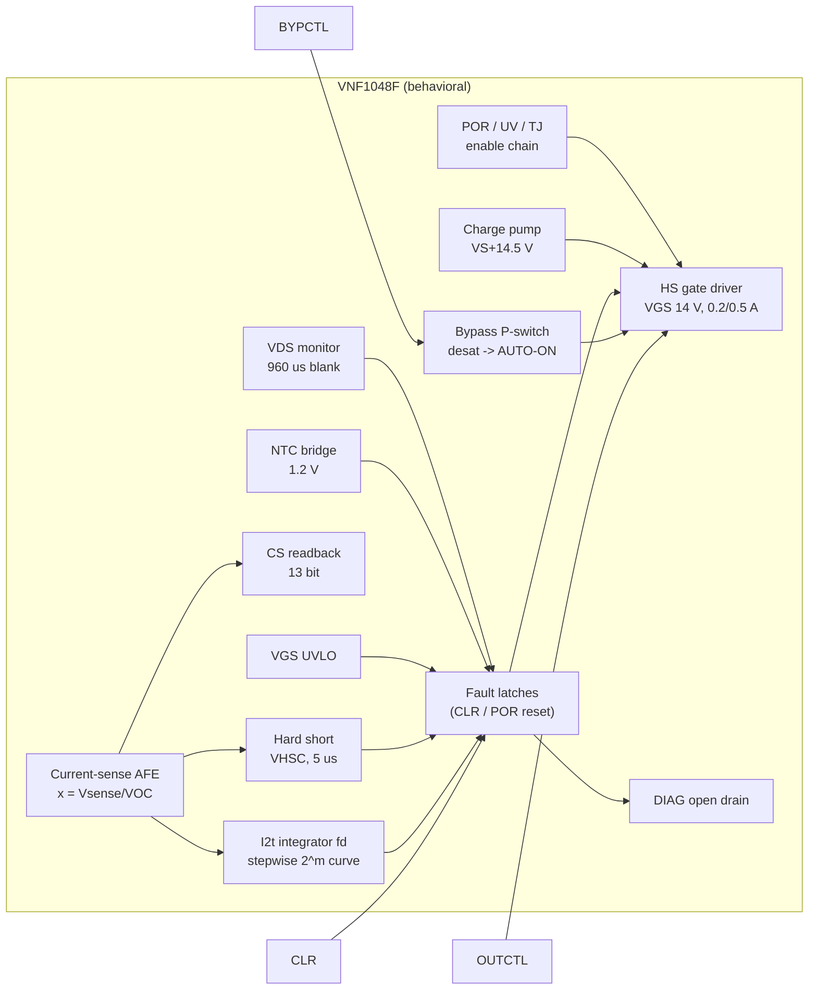

# 48 V automotive eFuse: behavioral LTspice model (ST VNF1048F reference)

A detailed **behavioral LTspice model of a 48 V automotive electronic fuse**, using
the STMicroelectronics **VNF1048F** as the reference part ("High-side switch
controller with intelligent fuse protection for 12 V, 24 V and 48 V automotive
applications", datasheet DS13084 Rev 6). The repository also has ten validated
test benches, two ready-to-run schematics and a scripted regression that checks
47 simulation results against the datasheet.

> **Disclaimer.** This is an independent, **unofficial** model. STMicroelectronics
> did not provide, review or endorse it. It was built from the public datasheet.
> Where the datasheet gives no number, an engineering estimate is used and
> marked **[EST]** (see [Assumptions and estimates](#10-assumptions-estimates-and-limitations)).
> Use it for architecture studies, protection coordination and harness/load
> interaction. Do not use it in place of ST's own models, the latest datasheet or
> hardware validation.

---

## Contents

1. [How an eFuse works: an intuitive guide](#1-how-an-efuse-works-an-intuitive-guide)
2. [What is modeled](#2-what-is-modeled)
3. [Repository layout](#3-repository-layout)
4. [Quick start](#4-quick-start)
5. [The reference device in one page](#5-the-reference-device-in-one-page)
6. [Model architecture and pins](#6-model-architecture-and-pins)
7. [Block-by-block description (with equations)](#7-block-by-block-description)
8. [EFUSE48_MOD: the complete channel and the external-component design](#8-efuse48_mod-complete-channel-and-external-component-design)
9. [Test benches and results](#9-test-benches-and-results)
10. [Assumptions, estimates and limitations](#10-assumptions-estimates-and-limitations)
11. [Numerical notes and troubleshooting](#11-numerical-notes-and-troubleshooting)
12. [Designing with the model: worked example](#12-designing-with-the-model-worked-example)
13. [References](#13-references)

---

## 1. How an eFuse works: an intuitive guide

This section is for electronic engineers who know power MOSFETs and op-amps but
have not worked with electronic fuses. It explains what the circuit does and why,
and points to the model parameter that controls each behaviour. The equations
are in [section 7](#7-block-by-block-description).

### 1.1 The job: protect the wire, not the load

A conventional fuse protects the **wire harness and the PCB copper**, not the
load. Any conductor heats up with I²·R and cools to its surroundings. If the
current stays too high for too long, the insulation degrades, carbonizes and can
start a fire. A melting fuse is a thermal replica of the wire: it heats with I²
and opens before the wire is damaged. The characteristic number is its
**I²t** (A²s), the "melting energy".

Melting fuses have well-known weaknesses:

* they are one-shot, and you have to physically replace them;
* their tolerance is wide, so the wire must be oversized;
* they cannot tell a harmless inrush (charging a capacitor) from a real overload;
* at 48 V they have to break arcs, which is far harder than at 12 V.

An **eFuse** replaces the melting element with a **MOSFET switch + a current
measurement + logic** that *computes* the wire heating in real time and opens the
switch electronically. It is resettable and programmable, reports what happened
(DIAG pin, current readback), and adds protections a melting fuse cannot have:
microsecond short-circuit response and switch self-monitoring.

### 1.2 The power path: shunt, MOSFET and charge pump

```
 Battery 48 V ──[ RSENSE 1 mΩ ]──┬──── D ┌─────────┐ S ──── OUT ──harness──► load
                                 │       │ N-MOSFET│
               ISNS_P   ISNS_N ──┘       └────┬────┘
                  │        │                  G
                  └──┬─────┘                  │
                 ┌───┴──────── VNF1048F ──────┴───────────┐
                 │ current sense   gate driver (VGS 14 V) │
                 │ fuse logic      charge pump (VS+14.5 V)│
                 └────────────────────────────────────────┘
```

* **The switch** is an N-channel MOSFET in the positive line (*high side*), so the
  load stays referenced to chassis ground. In the model it is `M1`
  (`FET100V_2M`: 100 V, ~2 mΩ). An N-channel device has lower resistance and is
  cheaper than a P-channel one. To turn it on, though, the gate must be about
  10–15 V **above the source**, and with the switch on the source sits at battery
  voltage. The gate therefore has to be driven *above the battery*.
* **The charge pump** generates that voltage: VCP = VS + 14.5 V ≈ 62.5 V at 48 V
  (`VCP_REG`). The gate driver takes charge from it and regulates
  VGS ≈ 14 V (`VGS_ON`). It sources ~0.2 A to turn on (`IG_SRC`) and sinks ~0.5 A
  to turn off (`IG_SNK`). Switching off simply means shorting gate to source.
* **The current measurement** uses a 1 mΩ shunt (`RSENSE`) before the MOSFET.
  The controller reads the small differential voltage
  **VSENSE = I × RSENSE**, which is 10 mV at 10 A, on top of a 48 V common mode.
  All current thresholds in the device are therefore specified in **millivolts
  of VSENSE**, and you choose amperes through RSENSE:

  ```
  INOM (max continuous current) = VOC_THRS / RSENSE   e.g. OVC_CODE 13 → 21.8 mV / 1 mΩ = 21.8 A
  IHSC (hard-short threshold)   = VHSC_THRS / RSENSE  e.g. HSC_CODE 12 → 105.6 mV / 1 mΩ = 105.6 A
  ```

  A larger RSENSE gives better resolution at low current but more loss: at 20 A,
  1 mΩ dissipates 0.4 W. The measured value is also reported back (`CS` pin =
  VSENSE, 13 bit), so the MCU can read the load current.

### 1.3 Three layers of protection, three time scales

Think of the protections as three nested safety nets, each fast enough for its
own kind of fault:

| Layer | Fault it handles | Reaction time | Model parameter | Test bench |
|---|---|---|---|---|
| **Fuse emulation (I²t)** | overload: too much current for too long | ms … minutes | `OVC_CODE`, `TNOM_CODE`, node `fd` | tb03, tb04 |
| **Hard short** | short circuit: current shooting up | ~5 µs | `HSC_CODE`, `HSC_DLY` | tb02, tb10 |
| **Switch self-monitoring** | the MOSFET itself is in trouble | µs … ms | `VDS_CODE`, `NTC_CODE`, VGS UVLO | tb05, tb07 |

#### Layer 1: the fuse emulation as a bucket of heat

Picture a **bucket** that represents the heat stored in the wire. In the model
the bucket level is the node **`fd`**: 0 = cold, 1 = full = trip.

* Current **above INOM** pours water in, faster the higher the current
  (∝ I² − INOM², the excess heating).
* Current **below INOM** lets water drain out, because the wire cools.
* When the bucket is full, the MOSFET is switched off and the fault is latched
  (`fusel`).

The size of the bucket is set by **tNOM** (`TNOM_CODE`, tNOM = 2·code + 1 s),
which is the trip time at a current just above INOM. Larger tNOM means a bigger
bucket and a more tolerant fuse, matched to a thicker wire with more thermal mass.
The ST silicon rounds the fill rate to powers of two, so the curve looks like a
staircase (DS13084 Fig. 4, reproduced in tb03). For INOM = 21.8 A and tNOM = 1 s:

| Load current | I/INOM | Trip time (tNOM = 1 s) | Trip time scales with |
|---|---|---|---|
| 21.8 A | ≤ 1.00 | never | – |
| 22.9 A | 1.05 | 0.5 s | × tNOM |
| 26.2 A | 1.2 | 125 ms | × tNOM |
| 32.7 A | 1.5 | 31 ms | × tNOM |
| 43.6 A | 2 | 15.6 ms | × tNOM |
| 65.4 A | 3 | 3.9 ms | × tNOM |
| 104.6 A | 4.8 | 2 ms | × tNOM |
| > 105.6 A | > IHSC/INOM | **~5 µs: hard short (layer 2)** | – |

With TNOM_CODE = 15 (tNOM = 31 s) every time in the table is 31 times longer.
The bucket picture explains three behaviours that confuse newcomers:

* **Inrush is ignored.** Charging a 220 µF input capacitor at 30 A for 0.5 ms
  pours in only a spoonful (tb01: `fd` peaks at 0.005), so no trip occurs, even
  though the current is above INOM.
* **PWM loads are judged by their RMS current.** A load chopped at 40 A peak
  fills the bucket during the on-time and drains it during the off-time. The net
  level rises only if the *RMS* current exceeds INOM. tb04 shows that 25 % and
  30 % duty never trip, while 35 % and 50 % do.
* **The fuse remembers.** Right after a trip the bucket is still full and needs
  about tNOM/32 to empty. If the MCU re-enables too early, the next trip comes
  much sooner. This is intentional: the wire is still hot.

#### Layer 2: hard short circuit

In a real short the current is limited only by the battery and wiring
inductance. With 2 µH of harness at 48 V it rises at 48 V / 2 µH = **24 A/µs**, so
within 10 µs it can reach several hundred amperes. The bucket logic, which
averages over 61 µs (`T_SAMP`), is too slow for that. A separate comparator
watches VSENSE directly. If it exceeds VHSC (`HSC_CODE`) for 5 µs (`HSC_DLY`),
the MOSFET is switched off at once and `hsht` is latched. tb02 shows a 105.6 A
threshold being crossed and the switch opening 8 µs after the short. The peak
reaches ~340 A because the current keeps rising during the delay and the
turn-off. Size the MOSFET's pulse rating and the input TVS/capacitors for that
peak, not for the threshold.

#### Layer 3: watching the switch itself

The MOSFET is only safe when it is either **fully on** (tiny VDS, little power)
or **fully off**. Any state in between dissipates P = VDS × I, which is
48 V × 50 A = 2.4 kW, and destroys it in milliseconds. The controller therefore
checks the switch continuously:

* **VDS desaturation** (`VDS_CODE`, 0.3–1.8 V). When the switch is on, VDS must be
  small (2 mΩ × 20 A = 40 mV). If VDS exceeds the threshold, the MOSFET is not
  fully on (weak gate, overload, damaged die), and it is switched off (`vdsmax`).
  During turn-on VDS is necessarily large, so the check is **blanked for 960 µs**
  (`VDS_BLK`) after every turn-on. That is why the output must finish ramping up
  within ~1 ms (tb05).
* **Gate under-voltage** (`vgslow`): if VGS drops below ~8.5 V the MOSFET is no
  longer fully enhanced. This can come from charge-pump problems, a gate leak or
  low battery.
* **MOSFET temperature** (`NTC_CODE`, 100–150 °C): a 10 kΩ NTC on the drain pad,
  read through a 1.2 V bridge. A slow overload just below INOM in a hot
  environment can still overheat a poorly cooled MOSFET, and the NTC catches it
  (tb07: trip at 119.8 °C for a 120 °C setting).
* **Controller temperature** (`TTSD`, 175 °C) and **battery under-voltage**
  (`VS_USD`, 4.5 V). Below that voltage the gate cannot be driven reliably, so the
  device turns everything off and restarts on its own when the battery recovers
  (tb06).

### 1.4 Latch-off, not current limiting

The VNF1048F **never limits the current linearly**: it does not hold the MOSFET
half-on at a fixed current. At 48 V that would mean kilowatts in the MOSFET. Every
protection simply **turns the switch off and latches the fault**, so the channel
stays off. The decision to retry belongs to the MCU, which reads the fault
over SPI and clears it. In the model, SPI is replaced by three logic pins:

* `OUTCTL`: "switch on / off" (the normal command);
* `CLR`: "clear the latched faults". If the fault is still there, the device
  trips again immediately, as in tb02 where a retry into a short trips in 5 µs;
* `DIAG`: an open-drain flag that goes low on any fault, a quick hardware
  interrupt for the MCU. `CS` reports the measured current.

### 1.5 Turning on gently: inrush and the slew network

Most 48 V loads (DC/DC converters, inverters, ECUs) have large input
capacitors. If the MOSFET turns on in microseconds, the capacitor charges almost
instantly, the inrush current is enormous, and the hard-short protection trips.
The fix is to **ramp the output voltage slowly**. In `EFUSE48_MOD` a resistor
(`RG_ON`, 2.2 kΩ) and a capacitor from gate to ground (`C_SLEW`, 47 nF) limit how
fast the gate, and therefore OUT, can rise: about 85 V/ms, so 48 V takes ~0.6 ms.
The inrush current is then I = C_LOAD × dV/dt, e.g. 220 µF × 85 V/ms ≈ 19 A
on top of the load current (tb01: 30 A peak with the 10 A load). Two limits pull in opposite directions:

* **too fast** → inrush above IHSC → hard-short trip;
* **too slow** → the ramp is still running when the 960 µs VDS blanking ends →
  desaturation trip (tb05 with C_SLEW = 470 nF).

A diode around `RG_ON` (`RG_OFF` path) makes the **turn-off** fast even though
the turn-on is slow. A short has to be interrupted in microseconds.

### 1.6 Turning off hard: where the energy goes

Every wire has inductance, and a current in an inductance stores energy, ½·L·I².
When the eFuse interrupts a current, that energy has to go somewhere:

* **Battery side**: the harness inductance pushes VBAT *up*. Bulk capacitance
  and a TVS keep it below the 70 V rating (tb02: 64 V with 100 µF; 88 V with
  only 10 µF).
* **Load side**: the load or harness inductance pulls OUT *below ground*. A
  freewheel Schottky from GND to OUT gives the current a path. Without it, OUT goes
  to −52 V and the MOSFET avalanches (tb09).

### 1.7 Sleeping: the low-current bypass

When the vehicle is parked, the charge pump alone would drain the battery
(~8 mA, `IQ_ON`). In stand-by the pump is off (`CPON` = 0) and a small internal
switch (~7 Ω, ~0.1 A max, `RBYP`/`IBYP_SAT`) keeps always-on loads supplied, at
about 150 µA (`IQ_STBY`) of controller consumption. If the load suddenly wakes up and
draws more than the bypass can deliver, the voltage across the bypass rises
above ~1.3 V (`VBYP_SAT`). The controller then turns the main MOSFET on **by
itself** (AUTO-ON, node `autoon`) and pulls DIAG low to wake the MCU (tb08).

### 1.8 Putting it together: a channel's life in the test benches

| Situation | What the eFuse does | Key parameters | Bench |
|---|---|---|---|
| Key-on, load with 220 µF input | slow ramp, inrush tolerated | `RG_ON`, `C_SLEW`, `VDS_BLK` | tb01 |
| Normal operation at 10 A | switch fully on, current reported on CS | `RSENSE`, `VGS_ON` | tb01 |
| Motor stalls at 1.5 × INOM | bucket fills, trip after 31 ms × tNOM | `OVC_CODE`, `TNOM_CODE` | tb03 |
| PWM heater | trips only if I_RMS > INOM | `OVC_CODE`, `TNOM_CODE` | tb04 |
| Harness chafes through, short to chassis | off in ~8 µs, faulty branch only | `HSC_CODE` | tb02, tb10 |
| Load too capacitive / ramp too slow | VDS trip after 960 µs | `VDS_CODE`, `C_SLEW` | tb05 |
| Battery sags or over-voltage | follows down to ~6 V, UV off at 4.5 V, auto-restart | `VS_USD` | tb06 |
| Hot under-hood, poor cooling | NTC trip at the set temperature | `NTC_CODE` | tb07 |
| Parked car, ECU wakes up | bypass → AUTO-ON | `CPON`, `VBYP_SAT` | tb08 |
| Solenoid switched off | energy into the freewheel diode | (external Schottky) | tb09 |

---

## 2. What is modeled

| Function (datasheet section) | Modeled behaviour |
|---|---|
| Supply, POR, battery under-voltage (5.1, Tab. 4) | POR 2.3/2.5 V, UV shutdown 4.5 V with 0.1 V hysteresis and a 33 µs filter, automatic restart, supply currents |
| Charge pump (Tab. 11) | VCP = VS + 14.5 V (VS > 10 V), reduced at low VS, finite drive, CP_LOW detection (VS+6.0/5.6 V, 60 µs filter) |
| HS gate driver (Tab. 12) | VGS regulated to ~14 V, ~0.2 A source / 0.5 A sink (from tON 4 µs and tOFF 2.6 µs at 80 nF), 20 V clamp |
| Current-sense amplifier and ADC (Tab. 13) | unidirectional high-side shunt sense, 13-bit / 160 mV readback (`CS` pin), input bias currents |
| **Hard short-circuit latch-off** (5.5, Tab. 15) | 16 SPI thresholds, 20 to 160 mV, 5 µs delay, latched, sets FUSE_LATCH too |
| **Current-vs-time latch-off: eFuse I²t** (3, 5.6, Tab. 16, Fig. 4/5) | the **exact stepwise ST curve**, recovered from Fig. 4/5 (see [7.6](#76-the-efuse-i²t-curve)): 32 INOM thresholds, tNOM 1 to 511 s, RMS behaviour with PWM, thermal memory after a trip |
| External FET desaturation (5.4, Tab. 14) | VDS = V(ISNS_N) − V(OUT), 31 thresholds 0.3 to 1.8 V, **960 µs blanking at turn-on**, 5 µs deglitch + 5 µs delay, latched |
| Gate under-voltage VGS_LOW (Tab. 12, SR#1) | 8.5 V (VS > 10 V) / 5 V (VS = 6 V), 8 µs deglitch, latched |
| External FET over-temperature via NTC (5.3, Tab. 17) | 1.2 V reference bridge, 16 threshold codes (100 to 150 °C), deglitch, latched, NTC model fitted to the thresholds |
| Device thermal shutdown (5.2, Tab. 9) | TJ = TAMB + RthJA·P, 175 °C / 15 °C hysteresis, real-time |
| Low-current bypass and AUTO-ON (5.7, Tab. 18) | ~7 Ω P-switch VS→OUT, ~0.1 A saturation, desat ~1.3 V for 5 µs → external FET on by hardware, DIAG low (wake-up) |
| DIAG pin (Tab. 8) | open drain, low on any shutdown fault, CP_LOW or wake-up |
| Fault clearing (SPI "read & clear") | `CLR` logic pin. Faults are re-armed, and if the fault persists the channel re-trips. |

Not modeled: the SPI protocol itself, watchdog, Locked/Unlocked state machine,
self-tests, HWLO, ADC sample timing (filters are used instead). See [10](#10-assumptions-estimates-and-limitations).

---

## 3. Repository layout

```
efuse/
├── README.md                     this file
├── models/
│   └── VNF1048F_beh.lib          the model library (all subcircuits + device models)
├── symbols/                      LTspice symbols (canonical copy)
│   ├── VNF1048F.asy              14-pin controller
│   ├── EFUSE48_MOD.asy           9-pin complete eFuse channel
│   └── NTC10K_ST.asy             NTC thermistor with temperature input
├── schematics/                   ready-to-run schematics (symbols copied alongside)
│   ├── demo_efuse48_module.asc   module in a 48 V harness: start-up, short, retry
│   └── app_vnf1048f_discrete.asc full discrete application (DS13084 Fig. 16 + slew network)
├── testbenches/                  tb01..tb10 netlists (.cir), see section 9
├── docs/
│   ├── img/                      result plots (generated)
│   └── VALIDATION.md             pass/fail report vs datasheet (generated)
└── tools/
    ├── run_ltspice.sh            batch runner (native LTspice or macOS CrossOver build)
    ├── ltraw.py                  .raw / .log reader (numpy)
    ├── plot_results.py           regenerates docs/img/*.png
    ├── validate.py               regenerates docs/VALIDATION.md, exit code = failures
    ├── make_symbols.py           regenerates the .asy symbols
    └── make_schematics.py        regenerates the demo .asc schematics
```

---

## 4. Quick start

### In the LTspice GUI

* Open any `testbenches/*.cir` (File → Open, file type "Netlists") and press Run.
  Each test bench `.include`s `../models/VNF1048F_beh.lib`.
* Or open `schematics/demo_efuse48_module.asc` or `schematics/app_vnf1048f_discrete.asc`.
  The symbols sit next to the schematics, so they are found automatically.
* To use the model in your own schematic, copy `symbols/*.asy` next to the
  schematic (or into your LTspice `lib/sym` folder) and add a SPICE directive
  `.include <path>/VNF1048F_beh.lib`.

### From the command line (full regression)

```bash
tools/run_ltspice.sh testbenches/*.cir schematics/*.asc   # ~100 s for all 12
python3 tools/validate.py                                 # -> docs/VALIDATION.md, 47 checks
python3 tools/plot_results.py                             # -> docs/img/*.png
```

`run_ltspice.sh` detects the macOS LTspice 24/26 build, which is a CrossOver/Wine
bundle, and runs `LTspice.exe -b` through its bundled `wine`. On Windows or Linux
it falls back to `LTspice -b`, so adapt the path if needed. The Python tools need
`numpy` and `matplotlib`.

### Minimal instantiation

```spice
.include ../models/VNF1048F_beh.lib
* complete channel: VBAT OUT GND EN BYP CLR DIAG CS TFET
X1 vbat out 0 en byp clr diag cs tfet EFUSE48_MOD RSENSE=1m OVC_CODE=13 HSC_CODE=12
+ VDS_CODE=14 NTC_CODE=4 TNOM_CODE=0
* -> INOM = 21.8 mV/1 mOhm = 21.8 A, IHSC = 105.6 A, VDS_THR = 1.0 V, NTC 120 degC, tNOM = 1 s
```

or the bare controller with your own FET, shunt and NTC:

```spice
XU vs cp vs drn hsg out ntc ntcm 0 diag en byp clr cs VNF1048F OVC_CODE=13 HSC_CODE=12 VDS_CODE=14
```

---

## 5. The reference device in one page

The VNF1048F is **not a switch with an integrated power stage**. It is a
**controller for an external N-channel MOSFET** in high-side configuration.
ST calls it the first member of its *STi2Fuse* family. Key datasheet values used by
the model:

| Item | Value (DS13084 Rev 6) |
|---|---|
| Operating supply | 6 to 60 V (48 V typ.), extended 70 V for ≤ 100 ms, abs. max 70 V |
| UV shutdown / POR | 4.5 V (+0.1 V hyst., 33 µs filter) / 2.5 V on, 2.3 V off |
| Charge pump | VS + 13.5…15.5 V (VS > 10 V), VS + 7…11 V at VS = 6 V, 400 kHz |
| Gate driver | VGS(on) 12…15 V, VGS max 20 V, tON 4 µs, tOFF 2.6 µs (80 nF), QG max 800 nC |
| Current sense | 0…160 mV differential, CM 0…70 V, 13-bit ADC, ±3 % above 20 mV |
| Hard short threshold | 16 steps 20…160 mV (±5 %), 5 µs delay |
| Over-current (I²t) threshold | 32 steps 6…89.3 mV, tNOM 1…511 s, sampling 61 µs, time tolerance ±10 % |
| VDS monitor | 0.30…1.80 V, 50 mV steps, 960 µs blanking at FET start-up, 5 µs deglitch + 5 µs delay |
| NTC monitor | VBG = 1.2 V bridge with RT_REF = 10 kΩ, 100…150 °C thresholds |
| Thermal shutdown | 175 °C (160…190), 15 °C hysteresis |
| Bypass P-switch | 4…10 Ω, ~100 mA, desat threshold ~1.3 V → AUTO-ON |
| Suggested parts (Fig. 16) | RSENSE 1 mΩ, CP/CP1/CP2 470 nF, CVS1 20 µF, CVS2 100 nF, RGB 47 kΩ, RT_REF 10 kΩ, RPU 4.7 kΩ |

All protections act as **latch-off**. There is no linear current limiting: the
FET is switched off and the MCU re-arms the channel over SPI by clearing the
latched bit.

---

## 6. Model architecture and pins



### 6.1 `VNF1048F` (controller), 14 pins

| # | Pin | Type | Function |
|---|---|---|---|
| 1 | `VS` | power | battery supply (also the bypass P-switch source) |
| 2 | `CP` | power | charge-pump output. Connect the 470 nF reservoir from CP to VS. |
| 3 | `ISNS_P` | analog in | shunt, battery side |
| 4 | `ISNS_N` | analog in | shunt, FET drain side (also the VDS-monitor reference and the NTC bridge reference) |
| 5 | `HS_GATE` | analog out | gate driver output |
| 6 | `OUT` | analog | FET source / load (driver return, bypass output) |
| 7 | `NTC` | analog in | NTC bridge input (NTC between ISNS_N/drain and NTC) |
| 8 | `NTC_M` | analog out | ISNS_N − 1.2 V (bottom of the bridge, via RT_REF) |
| 9 | `GND` | power | ground |
| 10 | `DIAG` | open drain | low = fault / CP_LOW / wake-up |
| 11 | `OUTCTL` | logic in | **replaces SPI CR#1.OUTCTL** (1 = FET on) |
| 12 | `BYPCTL` | logic in | **replaces SPI CR#1.BYPASSCTL** (1 = bypass on) |
| 13 | `CLR` | logic in | **replaces SPI "read & clear" of SR#1** (high = clear latched faults) |
| 14 | `CS` | analog out | **replaces SR#2 CURR_SENSE**: V(CS) = quantized VSENSE [V], I = V(CS)/RSENSE |

Logic inputs switch at 1.5 V (3.3 V / 5 V CMOS) and have 1 MΩ to GND.

### 6.2 Parameters

Thresholds are set with the **same register codes as the SPI fields**, so a value
that works in simulation maps 1:1 onto the firmware configuration.

| Parameter | Default | Meaning |
|---|---|---|
| `OVC_CODE` | 10 | CR#2.OVC_THR, 0..31 → VOC_THRS (Tab. 16): 6, 7.2, 8.7, 10.4, 11.8, 13, 13.8, 14.8, 15.8, 16.8, 17.9, 19.1, 20.4, 21.8, 23.3, 24.8, 26.5, 28.2, 30.1, 32.2, 34.3, 36.6, 39.1, 41.7, 44.5, 47.5, 50.6, 54, 61.3, 69.5, 78.8, 89.3 mV. **INOM = VOC_THRS / RSENSE** |
| `HSC_CODE` | 10 | CR#2.HSHT_THR, 0..15 → VHSC_THRS (Tab. 15): 20, 23, 26.4, 30.3, 34.8, 40, 45.9, 52.8, 60.6, 69.6, 80, 91.9, 105.6, 121.3, 139.3, 160 mV. **IHSC = VHSC_THRS / RSENSE** |
| `VDS_CODE` | 10 | CR#2.VDS_THR, 0..30 → 0.30 + 0.05·code V |
| `NTC_CODE` | 4 | CR#3.NTC_THR, 0..10 → 110.92 … 37.50 mV (100 … 150 °C in 5 °C steps). 11..15 = 37.5 mV. |
| `TNOM_CODE` | 0 | CR#2.T_NOM, 0..255 → **tNOM = 2·code + 1 s** |
| `VOC_MV`, `HSC_MV`, `VDS_MV`, `VNTC_MV`, `TNOM_S` | 0 | direct overrides in mV / s (used when > 0) |
| `FUSE_MODE` | 0 | 0 = ST stepwise curve (as the silicon), 1 = ideal continuous curve |
| `TOL_T` | 1 | trip-time multiplier, for corner analysis (datasheet ±10 % → 0.9 / 1.1) |
| `KCOOL` | 1 | cooling-rate factor of the fuse memory (1 = symmetric heat balance) |
| `T_SAMP` | 61u | fuse current averaging window (tI_SAMPLING) |
| `CPON` | 1 | 1 = Unlocked/Locked mode (charge pump running), 0 = Stand-by (CP off until AUTO-ON or OUTCTL) |
| `VGS_ON`, `IG_SRC`, `IG_SNK` | 14, 0.2, 0.5 | gate drive regulation [V], source / sink current [A] **[EST]** |
| `VCP_REG`, `ICP_MAX`, `RCP` | 14.5, 30m, 10 | charge pump: regulation above VS, current capability **[EST]**, output R **[EST]** |
| `HSC_DLY`, `VDS_DGL`, `VDS_DLY`, `VDS_BLK`, `VGU_DGL`, `UV_FLT`, `NTC_DGL`, `CP_FLT`, `BYP_DGL` | 5u, 5u, 5u, 960u, 8u, 33u, 100u, 60u, 5u | timing (datasheet; NTC_DGL is "10…500 µs", 100 µs chosen) |
| `VS_USD`, `VS_USD_HYS` | 4.5, 0.1 | UV threshold and hysteresis |
| `VBYP_SAT`, `RBYP`, `IBYP_SAT` | 1.3, 7, 0.12 | bypass switch |
| `TTSD`, `TTSD_HYS`, `TAMB`, `RTHJA`, `P_EXT` | 175, 15, 25, 26, 0 | device thermal (P_EXT adds external heating to the IC) |
| `IQ_ON`, `IQ_STBY`, `IOUT_B`, `ISNSP_B`, `ISNSN_B` | 8m, 150u, 1.3m, 300u, 420u | supply and pin bias currents |
| `CS_GERR` | 0 | gain error of the CS readback (e.g. 0.03 = +3 %) |

### 6.3 Internal nodes you can probe

All logic nodes are 0/1 V. Path syntax: netlist instance `X1` of the controller
→ `V(x1:fd)`. Inside the module (`X1 … EFUSE48_MOD`) the IC is `XU`, so use
`V(x1:xu:fd)`. In a schematic on LTspice 24+, instance `U1` → `V(u1:fd)` or
`V(u1:xu:fd)` (LTspice XVII: `V(xu1:…)`). **`.meas` only sees internal nodes
that are listed in a `.save` statement.**

| Node | Meaning (SPI equivalent) |
|---|---|
| `gcmd` | HS gate driver commanded on (SR#1.OUTST) |
| `bycmd`, `byp` | bypass commanded on (SR#1.BYPASSST) / smoothed |
| `hsht` | hard short latched (SR#1.HSHT) |
| `fusel` | current-vs-time latched (SR#1.FUSE_LATCH) |
| `fd` | **fuse state** 0…1, trip at 1 (the "VIP-fuse counter") |
| `xa` | x = I/INOM averaged over 61 µs |
| `ovc` | real-time over-current warning (GSB.OVC) |
| `vdsmax` | VDS desaturation latched (SR#1.VDS_MAX) |
| `vgslow` | gate under-voltage latched (SR#1.VGS_LOW) |
| `ntcovt` | external FET over-temperature latched (SR#1.NTC_OVT) |
| `uv` | battery under-voltage, real-time (SR#1.VS_UV) |
| `devovt`, `tj` | device over-temperature (SR#1.DEV_OVT), junction temperature [°C] |
| `cplow`, `cpok` | charge pump low (SR#1.CP_LOW) / CP above threshold |
| `autoon` | bypass desaturation → AUTO-ON (SR#1.BYPASS_SAT, GSB.AUTOON) |
| `flt` | OR of the latched shutdown faults |
| `ton` | time since HS turn-on (VDS blanking timer) |
| `porok`, `cpen` | out of POR / charge pump enabled |

Module-level nodes (`EFUSE48_MOD`): `drn` (FET drain = ISNS_N), `g` (FET gate),
`hsg` (HS_GATE pin), `cp`, `ntc`, `ntcm`, `tjf` (FET junction °C), `tcf` (pad/NTC °C).

---

## 7. Block-by-block description

### 7.1 Supply, POR and under-voltage

* POR: the device is in reset below 2.3 V and leaves it above 2.5 V. POR clears
  every latch and the fuse memory `fd`, which matches "registers loaded with
  default values".
* UV: `VS < 4.5 V` sustained for 33 µs → `uv` = 1. Gate, bypass and charge pump
  turn off. `VS > 4.6 V` → `uv` clears and the channel **restarts by itself**,
  because UV is a real-time bit and not latched.
* Supply current: `IQ_STBY` + `IQ_ON` when the charge pump runs, plus the pump's
  input current.

### 7.2 Charge pump

```
VCP_target = VS + min(VCP_REG, 9 V + 1.375·(VS − 6 V))      (14.5 V for VS ≥ 10 V, 9 V at 6 V)
I_CP       = ICP_MAX · tanh((VCP_target − V(CP)) / (ICP_MAX·RCP))
```

The model is a regulated source with output resistance `RCP` and current limit
`ICP_MAX`, charging the external CP capacitor (470 nF CP–VS). CP_LOW is set when
CP < VS + 5.6 V for 60 µs (released above VS + 6.0 V) and disables the gate
driver (DIAG low). At VS ≈ 5 V the pump can no longer hold VS + 5.6 V, so CP_LOW
switches the FET off **before** the 4.5 V UV threshold (visible in tb06). The
datasheet only guarantees operation down to 6 V.

### 7.3 Gate driver

```
I_src = IG_SRC · clip((VGS_ON − V(HS_GATE,OUT))/0.5 V) · clip(V(CP,HS_GATE)/0.5 V)   from CP
I_snk = IG_SNK · clip(V(HS_GATE,OUT)/1 V)                                         to OUT
```

This gives a current-limited, VGS-regulated push-pull referred to OUT, with a
20 V clamp HS_GATE→OUT, a diode HS_GATE→CP and a 200 kΩ passive pull-down.
IG_SRC/IG_SNK come from tON = 4 µs (0.5→10 V) and tOFF = 2.6 µs with 80 nF:
80 nF·9.5 V/4 µs ≈ 0.19 A and 80 nF·14 V/2.6 µs ≈ 0.43 A **[EST]**.

### 7.4 Current-sense front end and CS readback

`VSENSE = max(V(ISNS_P) − V(ISNS_N), 0)` (unidirectional). Three paths:

* **fast** (0.5 µs RC) for the hard-short comparator (0.9 MS/s ADC),
* **x = VSENSE/VOC** averaged with τ = `T_SAMP`/2 (≈ the 61 µs fuse sampling window),
* **CS readback**: 200 µs low-pass (2.4 kS/s refresh), quantized to
  160 mV/8192 = 19.5 µV, optional gain error `CS_GERR`.

### 7.5 Hard short-circuit latch-off

`VSENSE > VHSC` while the FET is commanded on, sustained for `HSC_DLY` = 5 µs,
latches `hsht`. Per datasheet section 5.6 it also sets `fusel`. Note that the current keeps
rising during the 5 µs, limited only by the loop inductance. tb02 shows 105.6 A
threshold → 340 A peak with 2 µH of harness.

### 7.6 The eFuse I²t curve

The datasheet text says the curve is "an optimized stepwise function", that
`tNOM` is the trip time at INOM ("the first step"), and that the number of steps
is 15 for VOC = 6 mV / VHSC = 160 mV and 9 for 26.5 / 105.6 mV. It does **not**
give the step values. They were recovered by digitising **Figure 4 and Figure 5**:

* the time levels **halve at every step**: t = tNOM, tNOM/2, tNOM/4, … The 15th
  step in Fig. 4 is 1 s/2¹⁴ = **61 µs, exactly tI_SAMPLING**;
* the step edges fall at **x = √(1 + 2ᵐ/32)** (x = I/INOM). From Fig. 4 (VOC = 6 mV):
  6.18, 6.36, 6.71, 7.35, 8.49, 10.4, 13.4, 18.0, 24.7, 34.5, 48.4, 68.1, 96.2,
  136 mV. All 15 edges match the figure to within reading accuracy, and Fig. 5
  (VOC = 26.5 mV, 9 steps, tNOM ≈ 51 s) matches as well.

This is the inverse of a classic **heat-balance (adiabatic + constant loss)
wire model**:

```
ideal:      t(x) = (tNOM/32) / (x² − 1)        capped at tNOM (x close to 1)
stepwise:   t(x) = tNOM / 2^m ,  m = floor(log2(32·(x² − 1))),  m ≥ 0
equivalent: dE/dt ∝ I² − INOM² ,  trip at  E = INOM²·tNOM/32
```

The model integrates a normalized fuse state `fd` (0 → 1) on a 1 F capacitor:

```
x > 1 :  dfd/dt = k(x) / (tNOM · TOL_T)       k = 2^m (FUSE_MODE 0)  or  max(1, 32(x²−1)) (FUSE_MODE 1)
x < 1 :  dfd/dt = −KCOOL · 32 · (1 − x²) / tNOM      (cooling, fd ≥ 0)
trip  :  fd ≥ 1 while the FET is on  →  FUSE_LATCH
```

Consequences, all visible in the test benches:

* **No trip at I ≤ INOM, ever.**
* **PWM loads trip on RMS.** The averaged rate is 32·(⟨x²⟩ − 1), so the channel
  trips only if I_RMS > INOM (tb04). This is what the datasheet describes as "the
  eFuse calculates the mean square root of the current". The stepwise quantization
  makes the silicon slightly more tolerant than ideal RMS.
* **Thermal memory.** After a trip `fd` = 1 decays in ≈ tNOM/32 at zero current.
  Re-arming earlier gives a shorter trip time, as the datasheet warns ("user can
  expect that trip time will be lower than expected").
* **Inrush.** Capacitor charging is ignored as long as its I²t is small compared
  with INOM²·tNOM/32 (tb01: fd = 0.005 for a 30 A / 0.5 ms inrush).


### 7.7 VDS desaturation

`VDS = V(ISNS_N) − V(OUT)` (FET only; the shunt is upstream). The condition is
armed `VDS_BLK` = 960 µs after each HS turn-on and must persist for 5 + 5 µs.
The result is latched. **Design consequence: the output must finish ramping
within ~0.96 ms** (see [8.2](#82-gate-slew-network-and-the-960-µs-rule)).

### 7.8 Gate under-voltage (VGS_LOW)

The threshold is 8.5 V for VS > 10 V and 5 V at VS = 6 V (interpolated). The
monitor arms once VGS has exceeded the threshold after turn-on (the "falls below"
wording) and trips if VGS stays below it for 8 µs. The result is latched.

### 7.9 External FET over-temperature (NTC)

The bridge works as on the silicon: `NTC_M` = V(ISNS_N) − 1.2 V and
`VNTC = V(ISNS_N) − V(NTC) = 1.2 V · RNTC/(RT_REF + RNTC)`. Trip when VNTC < VNTC_THRS
(for `NTC_DGL`) while the FET is on. The result is latched.

`NTC10K_ST` is a Steinhart–Hart fit (A = 9.0308e-4, B = 2.4423e-4, C = 2.5784e-7)
through R25 = 10 kΩ and the 11 resistances implied by the ST thresholds with
RT_REF = 10 kΩ. It reproduces 100…150 °C to within ±0.06 °C, so a threshold code
in the model means the same temperature as on the bench with the recommended NTC
(B57232V5103F360 class). It is implemented as a ln R(T) table for robust convergence.

### 7.10 Low-current bypass and AUTO-ON

A P-switch VS→OUT, modeled as `I = IBYP_SAT·tanh(V/(RBYP·IBYP_SAT))`, i.e. 7 Ω
saturating at ~0.12 A, with a body diode OUT→VS. It keeps sleeping loads alive
with the charge pump off (`CPON` = 0). If VS − VOUT > 1.3 V for 5 µs while the FET
is off, the controller sets `autoon`. Then the bypass turns off, the charge pump
starts and the **FET is switched on by hardware** regardless of OUTCTL. In
stand-by (`CPON` = 0) DIAG is pulled low to signal the wake-up. CLR clears it.
The bypass must not be used to charge loads.

### 7.11 Latches, clear and DIAG

`EF_LATCH` is a set-dominant SR latch that holds its state on a capacitor and
regenerates to 0/1. It starts deterministically at 0. `CLR` (or POR) resets all
latched faults. Because set dominates, a fault still present re-latches at once.
For example, CLR into a persistent short makes the FET turn on and the HSC trip
again 5 µs later, which is how a firmware retry behaves (tb02).

---

## 8. EFUSE48_MOD: complete channel and external-component design

`EFUSE48_MOD VBAT OUT GND EN BYP CLR DIAG CS TFET` packages one channel as in
DS13084 Fig. 16, plus a gate slew network:

```
VBAT ──RSENSE──┬── drain [FET100V_2M ×NPAR] source ── OUT
  │            │                gate ─┬─ RG_ON (2.2k) ── HS_GATE
  │ CVS 100n   NTC 10k (pad)          ├─ D ─ RG_OFF (10 Ω) ── HS_GATE   (fast turn-off)
  │ CCP 470n   │                      ├─ C_SLEW (47 nF) ── GND           (dV/dt control)
  │ (CP–VBAT)  RT_REF 10k ── NTC_M    ├─ RGB 47k ── OUT
  │                                   └─ 15 V zener ── OUT              (gate protection)
  DIAG pull-up 4.7 kΩ to 3.3 V (internal), TFET = FET junction temperature [°C]
```

Extra parameters: `RSENSE`, `RG_ON`, `C_SLEW`, `RG_OFF`, `NPAR` (FETs in parallel),
and the FET thermal network `TAMB`, `RTHJC`, `RTHCA`, `CTHJ`, `CTHC`. FET power is
P = VDS·ID into a 2-stage RC network. The NTC sees the pad temperature.

### 8.1 Choosing the thresholds

```
INOM = VOC_THRS(OVC_CODE) / RSENSE          IHSC = VHSC_THRS(HSC_CODE) / RSENSE
t_trip(I) = tNOM / 2^floor(log2(32((I/INOM)² − 1)))      for INOM < I < IHSC
```

The usable fuse window is IHSC/INOM ≤ 26.7 (6 mV vs 160 mV). Keep VSENSE at
nominal load above ~10 mV, where the sense accuracy is ±5 % or better.

### 8.2 Gate slew network and the 960 µs rule

Without slew control the driver switches the FET in ~µs. Into a capacitive load
the inrush is then limited only by the loop resistance, so the HSC trips. The
module sets the output slew with RG_ON and C_SLEW to ground:

```
dVout/dt ≈ (VGS_ON − VGS_plateau) / (RG_ON · (C_SLEW + Cgd))  ≈ 9 V / (2.2k · 50 nF) ≈ 85 V/ms
t_ramp  ≈ VBAT / (dV/dt)  ≈ 0.6 ms        I_inrush ≈ C_LOAD · dV/dt
```

Two limits apply at the same time:

* `t_ramp` < **VDS_BLK = 960 µs**. Otherwise VDS (still tens of volts) trips the
  desaturation protection at the end of the blanking time (tb05, C_SLEW = 470 nF).
* `I_inrush` < IHSC, the FET has to survive the SOA of the ramp, and the inrush
  I²t has to stay small with respect to the fuse.

So with this controller the maximum load capacitance scales roughly as
C_LOAD,max ≈ IHSC · 0.96 ms / VBAT, about 2 mF for a 105 A HSC at 48 V before
margins. For larger capacitances, increase RSENSE·IHSC or pre-charge the load.

Two more parts in the module are design lessons from the test benches:

* **Fast turn-off path.** The diode plus RG_OFF bypass RG_ON, so a short is
  interrupted in µs rather than through the 100 µs RG·C time constant.
* **Gate–source zener (15 V).** In a hard short OUT collapses while C_SLEW still
  holds the gate at ~62 V. Without the clamp the FET would see VGS ≫ 20 V
  (tb02: 15.9 V with the clamp).

### 8.3 Board-level protection seen in the benches

* **Input bulk capacitance and TVS.** Interrupting ~230 A from 1 µH of supply
  harness gives an inductive kick. With 10 µF of bus capacitance VBAT reached 88 V,
  above the 70 V absolute maximum. With 100 µF (+ TVS) it stays at 64 V (tb02).
* **Freewheel Schottky OUT→GND.** It is mandatory for inductive loads and long
  harnesses. Without it OUT goes to −52 V, the FET avalanches with ~120 mJ, and the
  VNF1048F OUT pin rating (−2 V DC, −10 V for 10 µs) is violated (tb09).

---

## 9. Test benches and results

All values below come from `docs/VALIDATION.md` (generated, **47/47 checks pass**).
Base configuration unless noted: 48 V battery (10 mΩ, 1 µH), 100 µF bus,
RSENSE 1 mΩ, OVC_CODE 13 (**INOM 21.8 A**), HSC_CODE 12 (**IHSC 105.6 A**),
VDS_CODE 14 (1.0 V), TNOM_CODE 0 (tNOM 1 s), 1 µH / 10 mΩ load harness.

### tb01: start-up and inrush (`tb01_startup_inrush.cir`)
220 µF + 4.8 Ω (10 A). OUT ramps in ~0.5 ms with a 29.7 A inrush peak. The
inrush passes through the I²t window (fd peaks at only 0.005) and nothing
trips. VCP − VS = 14.50 V, VGS(FET) = 13.4 V. CS reads 9.94 mV (10 A·1 mΩ, −0.6 %).


### tb02: hard short circuit (`tb02_hard_short.cir`)
5 mΩ short at the load connector at 3 ms, MCU retry (CLR) at 6 ms, short removed
at 9 ms, CLR at 10 ms. HSHT latches **8.0 µs** after the short: 3 µs to reach
105.6 A at ~30 A/µs, plus the 5 µs delay. The FET current peaks at ~340 A (load
capacitor via the harness), the battery current at 227 A, VBAT at 64.4 V, VDS at
66.5 V, VGS at 15.9 V (zener), and OUT at −3.2 V (freewheel). The retry trips
again, and after the short is removed CLR restarts the channel.


### tb03: I²t curve characterisation (`tb03_i2t_curve.cir`)
VOC 6 mV, VHSC 160 mV, tNOM 1 s (= DS13084 Fig. 4). 19 constant overload
currents × 2 FUSE_MODEs. Stepwise mode matches tNOM/2ᵐ within **1.4 %** (t ≥ 2 ms).
The ideal mode matches (tNOM/32)/(x²−1) within 1.5 %. Below ~1 ms the ADC-like
latency of one 61 µs window adds ~40 µs, as on the silicon (fastest step: 108 µs
vs 61 µs nominal). See the figure in [7.6](#76-the-efuse-i²t-curve).

### tb04: PWM load and RMS behaviour (`tb04_pwm_rms.cir`)
The eFuse stays on while a downstream switch chops a ~40 A load at 200 Hz.
D = 0.25 (I_RMS 0.90·INOM) and D = 0.30 (0.98·INOM) never trip. D = 0.35
(1.06·INOM) trips after 0.98 s, and D = 0.50 (1.27·INOM) after **61 ms**,
against 62.5 ms predicted from the heat balance 0.5·64 − 0.5·32 = 16/tNOM.


### tb05: VDS desaturation and blanking (`tb05_vds_desat.cir`)
680 µF load with C_SLEW = 47 nF ramps in 0.6 ms (83 A inrush) and stays on.
With C_SLEW = 470 nF the ramp would take ~6 ms, and VDS_MAX latches **970 µs**
after turn-on (960 µs blanking + 10 µs). This is the design rule from [8.2](#82-gate-slew-network-and-the-960-µs-rule).


### tb06: 48 V supply transients (`tb06_supply_transients.cir`)
An ISO 21780 / LV148-style profile (illustrative levels): 54 V, 60 V for 40 ms,
70 V for 5 ms (extended range), a dip to 24 V, 6 V (minimum operating) and 4 V.
OUT follows VBAT. At 6 V the charge pump gives VS + 8.98 V and VGS = 8.6 V
(spec ≥ 6 V). The UV shutdown triggers at 4.47 V on the falling ramp (4.5 V plus
the 33 µs filter). No fault latches, and the channel restarts automatically.


### tb07: external FET over-temperature via NTC (`tb07_ntc_overtemp.cir`)
TAMB 105 °C, RthCA 40 K/W, 23 A (below INOM = 24.8 A at OVC_CODE 15). The pad
heats up and NTC_OVT latches at **119.8 °C / VNTC = 70.38 mV** (code 4 = 120 °C).
The FET cools down, a CLR at 14 s re-arms the channel at 108 °C, and it heats
again and re-trips, which is the expected latch-off behaviour.


### tb08: stand-by, bypass and AUTO-ON (`tb08_standby_autoon.cir`)
CPON = 0 (stand-by), bypass on, 20 mA sleep current (OUT = 47.86 V via ~7 Ω).
When the load wakes up and draws 5 A, the 470 µF hold-up drops by 1.3 V in
~100 µs and AUTO-ON fires (108 µs). The charge pump starts from zero, the FET
turns on, and OUT dips to 45.3 V before recovering. DIAG stays low (wake-up flag)
until the MCU sets OUTCTL and clears with CLR.


### tb09: inductive load turn-off (`tb09_inductive_turnoff.cir`)
2 mH / 10 A switched off. With the Schottky freewheel OUT = −0.55 V and the
current decays with L/R. Without it OUT goes to −52 V, VDS clamps at the 100 V
avalanche, and the FET absorbs 120 mJ.


### tb10: system context, 48 V zonal PDU (`tb10_zonal_system.cir`)
Two channels on one bus: CH1 feeds a 1 kW constant-power 48→12 V DC/DC
(470 µF, UVLO 30/26 V), CH2 a 12 A fan motor. CH2 is shorted at 15 ms and
isolates in **9.0 µs** (318 A peak). The bus dips to 33.7 V for a few µs, the
DC/DC input never drops below 42.4 V, CH1 records no fault, and the DC/DC stays
enabled. Only the faulty branch is disconnected.

The bench also exposed a real effect. With CH1 off, the IC's 1.3 mA OUT bias
current charged the DC/DC input. Without a bleeder, the constant-power load
then enabled itself, which would cause a hiccup in hardware. The bench therefore
includes a 4.7 kΩ input bleeder.


### Schematics
* `demo_efuse48_module.asc`: the tb02 scenario drawn with the `EFUSE48_MOD`
  symbol. It reproduces the tb02 trip time exactly (3.00799 ms).
* `app_vnf1048f_discrete.asc`: the full discrete application around the
  `VNF1048F` symbol (shunt, FET, slew network, NTC bridge with an editable pad
  temperature source `Vtpad`, DIAG pull-up). A 30 A overload (x = 1.36) trips
  after **62.5 ms = tNOM/2⁴**, and CLR restarts the channel.

---

## 10. Assumptions, estimates and limitations

**[EST] values, not in the datasheet:**

| Item | Value used | Basis |
|---|---|---|
| Gate source / sink current | 0.2 A / 0.5 A | tON / tOFF with 80 nF |
| Charge-pump drive and output R | 30 mA, 10 Ω | 470 nF caps at 400 kHz; fast enough for the ≤ 100 µs bypass hand-over (tON_BYPOFF) |
| VCP at VS = 6 V | VS + 9 V | middle of the 7…11 V spec |
| VGS regulation | 14 V | inside the 12…15 V spec |
| Sense input bias currents | 300 / 420 µA | 75 % of the max values |
| Device thermal model | RthJA 26 K/W, τ = 1 s | Tab. 3 (2s2p) |
| Fuse cooling law | symmetric heat balance (`KCOOL` = 1) | consistent with the Fig. 4/5 curve and the RMS statement; the silicon's exact decrement is not published |
| VGS_LOW arming | after VGS first exceeds the threshold | datasheet wording "falls below" |
| NTC deglitch | 100 µs | datasheet range 10…500 µs |
| FET100V_2M, TVS_58V, SCH_100V | generic models | replace with the vendor models of your parts |

**Not modeled / simplified:**

* The SPI protocol, registers, watchdog, Locked/Unlocked/Stand-by state machine
  (only the stand-by charge-pump behaviour, via `CPON`), HWLO and DIS_OUT_MODE.
* Self-tests (current sense, VDS, stuck-on).
* Discrete ADC sampling. RC filters with the same time constants are used
  instead, so trip times are not quantized to 61 µs multiples.
* Tolerances. All values are typical, except where a parameter (`TOL_T`, `CS_GERR`,
  direct mV overrides) allows a corner analysis.
* Reverse current. The VNF1048F cannot keep the FET on with reverse current; the
  body diode conducts, and the model does the same.
* The FET temperature does not change its RDS(on) (the VDMOS model is isothermal).
  The thermal network drives only the NTC and `TFET`.
* EMC, the charge-pump ripple, and the flying capacitors (CP1/CP2 pins are not
  brought out).

---

## 11. Numerical notes and troubleshooting

* The DC operating point solves directly or with LTspice's normal Gmin stepping.
  Two deliberate choices keep it well-conditioned: the charge-pump current limit
  and the FET self-heating act only for `time > 0`. The thermal network therefore
  starts at ambient, and the pump starts in regulation.
* Logic is built from B-sources (0/1 V), `idt()`-based deglitch timers, which reset
  when the condition drops, and capacitor-held latches. No digital A-devices are
  used, so the model is portable.
* Use a maximum time step of ≤ 1 µs around fast events (shorts) and ≤ 20–50 µs
  for long fuse simulations. The test benches show working values.
* "Voltage not found" in a `.meas` on an internal node means it is missing from
  `.save`, or the hierarchy prefix is wrong (`x1:` / `x1:xu:` / `u1:`; see 6.3).
* A floating output with a constant-power load can have **no DC solution**,
  because of the 1.3 mA OUT bias current (tb10). Add the load's real bleeder or
  UVLO behaviour.

---

## 12. Designing with the model: worked example

**Goal:** protect a 2.5 mm² 48 V feed to a 15 A (continuous) pump, with an
800 µF input capacitance and a firmware retry.

1. **RSENSE = 1 mΩ** → VSENSE = 15 mV nominal (±5 % accuracy region).
2. **INOM ≥ 1.1·Iload**: OVC_CODE 11 = 19.1 mV → INOM = 19.1 A.
3. **IHSC** above the inrush and below the FET/harness limit: HSC_CODE 12 =
   105.6 mV → 105.6 A (IHSC/INOM = 5.5 → 10 steps).
4. **Slew.** The ramp must be under 0.96 ms, so with 48 V take ≥ 60 V/ms.
   80 V/ms × 800 µF = 64 A < 105 A ✓ (RG_ON 2.2 kΩ, C_SLEW 47…56 nF).
5. **tNOM** from the wire: the curve t = (tNOM/32)/(x² − 1) must stay below the
   wire's damage curve over INOM…IHSC. For example tNOM = 31 s (TNOM_CODE 15)
   gives 0.32 s (ideal) / 0.48 s (stepwise) at 2·INOM and 40 ms / 61 ms at 5·INOM.
6. Simulate: start from tb01 (start-up), tb03 (curve, replace the codes) and tb02
   (short), then check VBAT/VDS/VGS/OUT against the absolute maximum ratings.

---

## 13. References

* STMicroelectronics, *VNF1048F – High-side switch controller with intelligent
  fuse protection for 12 V, 24 V and 48 V automotive applications*, datasheet
  DS13084 Rev 6, May 2022: product page https://www.st.com/en/automotive-analog-and-power/vnf1048f.html
* STMicroelectronics, EV-VNF1048F evaluation board: https://www.st.com/en/evaluation-tools/ev-vnf1048f.html
* ST newsroom, *Automotive high-side switch controller with flexible diagnostics
  and protection* (STi2Fuse family introduction).
* ISO 21780 / VDA 320 (LV148): 48 V on-board power supply, voltage classes
  (used for illustrative levels in tb06; check the current standard for real limits).
* Related part: VNF1248F (same family, different feature set). The model structure
  applies, but check the thresholds in its own datasheet.
