# Interview guide: eFuse-based 48 V automotive PDU (HW engineer)

A question bank for assessing a hardware engineer's knowledge of eFuse-based
power distribution units (PDUs) for 48 V automotive systems, including the
battery the PDU is connected to. It covers both design and validation.

## How to use this guide

* **Levels.** Each question has a level:
  * **L1, fundamentals.** Every candidate for the role should answer these.
  * **L2, designer.** Has designed or owned an eFuse channel or PDU.
  * **L3, expert.** Can lead the architecture, the safety concept and the validation strategy.
* **Drill down.** Ask the main question open-ended first. Then use the
  *follow-ups* to see whether the knowledge goes beyond the first answer. The
  *expected answer* lists the points a strong answer covers. A candidate does
  not need all of them, but should hit the core ones without prompting.
* **Red flags.** Each block lists answers that show a real gap, as opposed to
  forgotten details.
* **Numbers.** The figures in the expected answers are typical orders of magnitude, not
  pass/fail criteria. A candidate who reasons correctly with slightly different numbers is fine.
  Values from standards (ISO 21780, LV 148) should be checked against the
  revision your project uses.
* **Simulation support.** Every question ends with a **Simulation** block: the test
  bench that reproduces the concept, its plot, the key simulated numbers, and a
  prompt for showing the waveform to the candidate. Benches tb01–tb14 are
  described in the README; tb15–tb35 were written for this guide; bat01–bat07
  (12 V battery, 48 V pack with BMS) are described in
  [README section 14](../README.md#14-automotive-battery-model) and dc01–dc08 (700 W 48/12 V DC/DC) in
  [README section 15](../README.md#15-dcdc-converter-model-48-v-to-12-v-700-w). The map below lists them. The numbers come
  from behavioural models with typical values (see the README, section 11,
  sections 14.9 and 15.7). Use them to check a candidate's reasoning and orders of
  magnitude, not as pass/fail limits.

Suggested format, 90–120 min:

| Part | Content | Time |
|---|---|---|
| 1 | Background and a project the candidate owned (they drive it, you drill) | 15 min |
| 2 | Technical questions, sections A–H (pick per level) | 45–60 min |
| 3 | Design exercise (section I) | 20–30 min |
| 4 | Debug scenarios (section J) | 10–15 min |

A scoring sheet is at the end.

### Simulation map

| Question | Bench(es) | What the simulation shows |
|---|---|---|
| A1 | tb15 | 1 kW at 12 V vs 48 V: current, wire loss, short current |
| A2 | tb06, tb25 | 48 V supply profile; bus overshoot when a short is interrupted |
| A3 | tb10, bat07 | selectivity: one channel shorted, the other rides through; the pack BMS does not trip |
| A4 | bat02, bat03, bat05 | battery/pack impedance vs temperature and frequency; short at the pack terminals |
| A5 | bat07 | the pack opens while the generator feeds the bus: 48 V load dump |
| B1 | tb03, tb04, tb16 | I²t curve, RMS response, thermal memory vs wire temperature |
| B2 | tb02/03/05/07, tb17 | time scales of the layers; latch-off vs current limiting |
| B3 | tb02, tb18, tb19, tb25 | the first 20 µs; effect of harness L and of turn-off speed |
| B4 | tb20 | sense error → effective INOM and trip time |
| B5 | tb06, tb08, tb19 | gate drive vs VS, stand-by, fast turn-off path |
| B6 | tb09, tb21 | avalanche vs freewheel vs zener clamp |
| C1 | tb22, tb23 | linear-mode pulse and SOA; parallel FETs do not share |
| C2 | tb24 | reverse current: single FET vs back-to-back |
| C3 | tb25, bat07 | bus capacitance, TVS and its placement, freewheel; TVS energy at a battery disconnect |
| C4 | dc01, dc02, dc04, dc05, dc08 | the 48/12 V DC/DC as a channel load: constant power, inrush, UVLO, current limit, 12 V battery |
| C5 | dc06, dc07 | negative input resistance; harness + input filter stability, damping |
| D1 | tb26 | hard switch-on vs dV/dt control into 1 mF |
| D2 | tb27, tb13 | half-energy rule for R = 1…100 Ω |
| D3 | tb11, tb13, tb28 | dV/dt window, methods, bypass + AUTO-ON |
| D4 | tb12, tb14 | hand-over point, supervision and fault energy |
| D5 | bat06 | pack pre-charge onto a 10 mF bus: full, shortened, none (SC trip) |
| E1 | tb23, tb07 | junction vs NTC: fast pulse vs slow heating |
| E2 | tb25, tb20 | TVS loop inductance, copper in the Kelvin path |
| F1 | tb29 | 48 V to 12 V cross-short, low and high impedance |
| F2 | tb30 | ground offset and ground loss |
| F3, J5 | tb35 | stuck-on FET, sense crack, sneak path, wire temperature |
| G2 | tb31 | retries into a short and into an overload |
| G3 | tb32 | hardware HSC vs VDS monitor vs firmware |
| H1 | tb03, tb06, tb14, tb16, tb18, tb35 | which bench covers which part of the validation plan |
| H2 | tb02 (post-processed) | probe bandwidth, saturation and skew |
| H3 | tb18 | trip delay vs set-up inductance |
| H4 | tb03, tb16 (post-processed) | wire damage curve vs fuse curve with tolerance |
| I | tb33 | the design exercise, simulated |
| J1 | tb34 | cold start-up: which protection fired |
| J2 | tb25 | controller over-stress while the FET survives |
| J3, J4 | tb04, tb14 | PWM RMS trip; DC/DC hiccup without an eFuse fault |
| J6 | bat04 | 12 V crank at +25 / −18 / −30 °C, CCA test |
| J7 | dc07 | DC/DC input oscillating on a long feed with ceramic-only input capacitance |

To regenerate everything:

```bash
tools/run_ltspice.sh testbenches/*.cir      # simulations
python3 tools/validate.py                   # checks, including those for tb15-tb35
python3 tools/plot_results.py               # plots in docs/img/
```

---

## A. 48 V system context

### A1. Why 48 V, and what changes compared with 12 V? (L1)

**Expected answer**
* Power: 4× the voltage means 4× the power at the same current, or ¼ of the current for the same
  power. I²R losses fall ~16×, wiring gets smaller and lighter, and high-power loads become
  possible (e-compressor, active suspension, steer-by-wire, e-turbo, heaters,
  mild-hybrid starter-generator).
* Still below the **60 V DC** limit where high-voltage safety measures
  (touch protection, isolation monitoring, orange cables) start, so no HV
  protection concept is needed.
* Consequences for protection:
  * **DC arcs are sustained** at 48 V, so mechanical fuses, relays
    and connectors that open under load arc much more severely.
  * Larger stored energy in the capacitances and in the harness inductance (½CV², ½LI²).
  * Component ratings: transients plus inductive kicks need ~80–100 V parts.
  * Two-voltage systems create **48 V-to-12 V short** and ground-offset failure modes.

**Follow-ups**
* "Why not 60 V or more?" The margin to the 60 V limit has to cover over-voltage transients.
* "What is the problem with a 48 V relay or blade fuse?" Arc sustainment, contact erosion,
  welding; a fuse has to be rated for DC breaking at that voltage.

**Red flags:** thinks 48 V is "just 12 V × 4"; does not know the 60 V
limit; ignores arcing.

**Simulation:** [`tb15`](../testbenches/tb15_12v_vs_48v.cir), 1 kW DC/DC over a 3 m feed, no protection device.

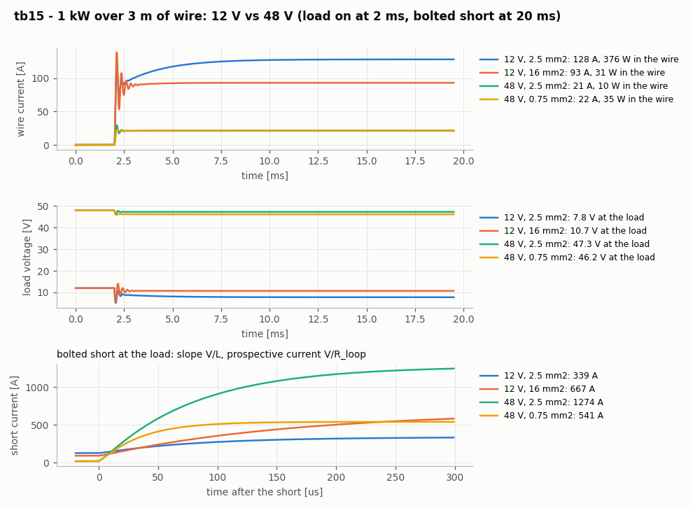

| | 12 V, 2.5 mm² | 12 V, 16 mm² | 48 V, 2.5 mm² | 48 V, 0.75 mm² |
|---|---|---|---|---|
| wire current | 128 A | 93 A | 21 A | 22 A |
| voltage at the load | 7.8 V | 10.7 V | 47.3 V | 46.2 V |
| loss in the wire | 376 W | 31 W | 10 W | 35 W |
| prospective short current | 0.34 kA | 0.67 kA | 1.27 kA | 0.54 kA |

* At 12 V the 2.5 mm² feed does not work: 27 % of the input power is lost in
  the wire and the load sees 7.8 V. Even 6.4× the copper (16 mm²) still loses
  3× more than 48 V on 2.5 mm². 48 V on 0.75 mm² loses about as much as 12 V on
  16 mm², with ~20× less copper.
* The price: on the same wire the 48 V short current is ~4× higher and rises
  ~4× faster (V/L), so the protection has to act sooner.
* *Show the plot and ask:* "Why is the 12 V current 128 A and not 1 kW / 12 V =
  83 A?" Expected: a constant-power load draws more current as its voltage
  falls, so the wire drop and the loss grow with each other.

### A2. What voltage ranges does a 48 V component have to handle? (L2)

**Expected answer (approximate, ISO 21780 / LV 148 / VDA 320)**
* Unrestricted operating range roughly **36–52 V**.
* Limited operation outside it: an upper limited range to ~54 V and a lower limited
  range down to ~24 V, where functions may be degraded.
* Over-voltage transients up to ~58 V (e.g. load dump, or the generator after a load
  disconnect). The 60 V limit must not be exceeded.
* Below a storage/protection threshold (around 20 V) functions are switched off.
* Tests for **48 V/12 V cross-shorts**, ground loss and ground offset, and
  superimposed ripple.
* Derives the consequence: the controller and FET ratings need margin (e.g. a 70 V abs-max controller,
  100 V FET), and the UV/OV behaviour has to be specified per range (on, degraded, off,
  automatic restart).

**Follow-ups**
* "Which component in your channel sets the upper limit?" Typically the controller
  VS abs-max (the VNF1048F is 70 V) and the TVS clamp voltage relative to it.
* "How do you guarantee < 60 V when you interrupt a short?" Bus capacitance plus TVS,
  sized from ½·L·I² of the supply harness (see B6).

**Red flags:** no idea a dedicated 48 V standard exists; applies ISO 16750-2
12 V pulses as is.

**Simulation:** [`tb06`](../testbenches/tb06_supply_transients.cir) (the
voltage profile) and [`tb25`](../testbenches/tb25_supply_clamp.cir) (the follow-up on staying below 60/70 V).

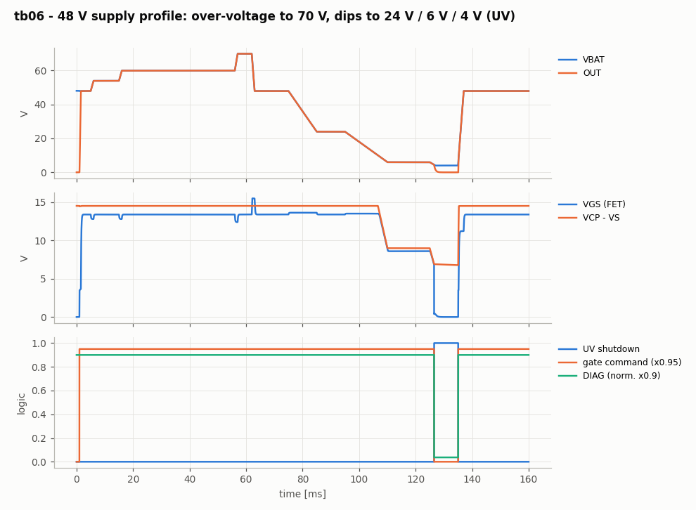

* tb06 runs the channel through 54 V, 60 V for 40 ms, 70 V, a sag to 24 V, 6 V
  and 4 V. Nothing latches. VGS stays at 13.4 V up to 70 V and is still 8.6 V at
  VS = 6 V. Below 4.47 V the device shuts down and it restarts by itself.
* Interrupting the tb02 short with 100 µF + TVS peaks the bus at 64.5 V. With
  only 22 µF and no TVS it reaches 98.6 V (tb25, see C3).
* *Show tb06 and ask:* "The profile goes to 70 V, above the 60 V limit of the
  standard. Why would you test that, and which part of your channel sets the
  limit?" Expected: margin to the controller abs-max (VNF1048F VS 70 V) and to
  what the clamp actually reaches at the peak current.

### A3. Zonal architecture: what is the role of the PDU and of each eFuse channel? (L2)

**Expected answer**
* Zonal controllers and PDUs distribute power and protect the wiring of each branch,
  replacing a fuse/relay box with eFuses that are smart, resettable and diagnosable.
* The PDU protects the **wire** (not the load), switches loads on and off, measures the current,
  reports faults, provides **selectivity** (only the faulty branch opens), and
  supports power modes: sleep, wake-up and load shedding.
* Interfaces to the MCU and network (SPI/CAN/Ethernet), firmware fault handling (retry
  counters, latch-off), and degradation strategies.

**Follow-ups**
* "What does selectivity mean electrically?" The downstream channel must trip
  before the upstream one, and fast enough that the bus dip does not reset healthy loads
  (tb10 in this repository).
* "What is the benefit of resettable protection for the wiring?" A smaller margin
  between fuse and wire, so lighter wire, and no service visit for a nuisance trip.
* "Selectivity also has an upstream side. What must not trip?" The battery pack's
  own short-circuit protection (BMS, pyrofuse). Its threshold and delay must sit
  above anything a branch short makes it see. Most of a branch short's first
  microseconds come from the bus capacitance, not from the pack.

**Simulation:** [`tb10`](../testbenches/tb10_zonal_system.cir), two channels on one bus, short on channel 2.

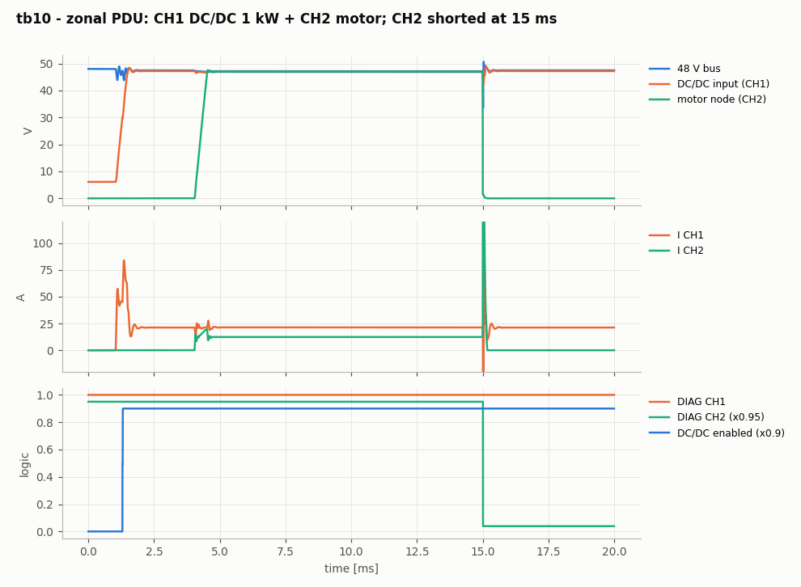

* CH2 is isolated 9.0 µs after the short (318 A peak). The 48 V bus dips to
  33.7 V for about 20 µs and overshoots to 50.6 V. The DC/DC on CH1 sees at least
  42.4 V (UVLO 26 V), so it stays on, and CH1 logs no fault.
* *Show the plot and ask:* "The bus fell to 34 V. Why did the DC/DC not drop out,
  and what would make it drop out?" Expected: its input capacitance bridges a
  20 µs dip. A slower trip (longer harness, VDS-only or firmware protection, see
  G3), a weaker battery or a smaller input capacitor would break the selectivity.
* [`bat07`](../testbenches/bat07_pdn_48v.cir) repeats the bench with the 48 V
  pack model (SOC 80 %) instead of the ideal source: CH2 trips in 8.9 µs, the bus
  dips to 34.1 V, and the pack current peaks at only **83 A** while 327 A flows
  into the short. The pack's BMS (I_SC 1 kA for 100 µs) does not trip.
* *Ask:* "Where do the other 240 A come from?" Expected: the bus and input
  capacitors next to the PDU. The pack sits behind 2 µH of main harness and
  cannot deliver that di/dt.

### A4. What does the 48 V battery look like from the PDU, and which battery do you design for? (L2)

**Expected answer**
* Not an ideal voltage source:
  * an **open-circuit voltage that depends on SOC**, roughly 40–52 V for a
    48 V pack, inside the 36–52 V operating range;
  * an **internal resistance**: an instant ohmic part plus polarization that
    builds up over ms and s;
  * an **internal inductance** (cells, busbars, fuse, contactor), ~1 µH;
  * for a pack, its own **BMS and disconnect switch**.
* The resistance rises strongly when **cold** (×2 at −18 °C, ×2.5 at −30 °C)
  and at **low SOC**.
* Two worst cases, used for different things:
  * **strong battery** (warm, full): the largest short current and di/dt. Size
    the FET, HSC, TVS and harness for it.
  * **weak battery** (cold, low SOC): the deepest bus dips at load steps and
    shorts. Check the UV ride-through and the selectivity with it.
* Above a few kHz the source impedance is inductive. This matters for DC/DC
  input-filter stability and for how fast a short current rises.

**Follow-ups**
* "Why can't you validate the HSC with a lab supply alone?" Its current limit
  and slow control loop (ms) replace the battery's low impedance; the short
  current then depends on the output capacitors. Use a battery, a capacitor
  bank or a low-impedance battery emulator (see H1).
* "Your tb10-style simulation uses an ideal source with 20 mΩ. Good enough?"
  For µs events, roughly yes. For a cold crank, a long overload or a pack
  disconnect, no: you need the SOC, the polarization and the BMS.

**Red flags:** treats the battery as an ideal source; designs the short-circuit
protection for a cold, weak battery; has never thought about the pack's own
protection.

**Simulation:** [`bat02`](../testbenches/bat02_pulse_temperature.cir) (100 A
pulse at 50 % SOC vs temperature),
[`bat03`](../testbenches/bat03_impedance_ac.cir) (|Z(f)|) and
[`bat05`](../testbenches/bat05_short_circuit.cir) (terminal short), 48 V pack
defaults.

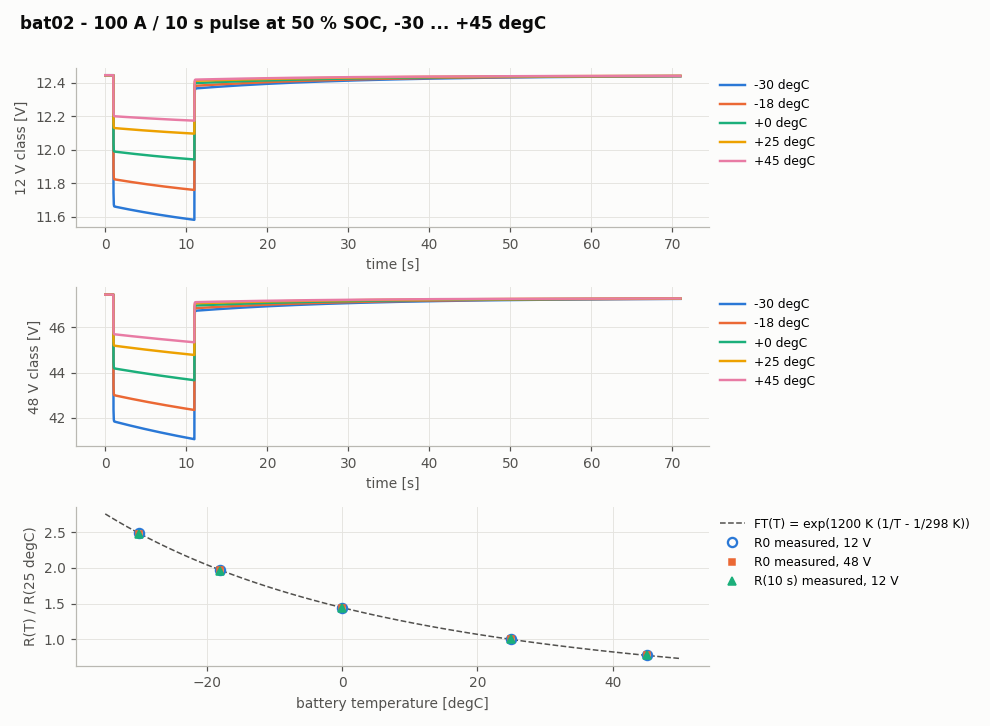

| 48 V pack, 50 % SOC | +25 °C | −18 °C | −30 °C |
|---|---|---|---|
| R0 (step 0.5 ms after the edge) | 17.0 mΩ | 33.5 mΩ | 42.3 mΩ |
| R after 10 s | 26.7 mΩ | 51.0 mΩ | 63.8 mΩ |
| instant drop at a 100 A step | 1.7 V | 3.4 V | 4.2 V |

* |Z| is 22.5 mΩ at 0.1 Hz, 16.9 mΩ at 100 Hz, and becomes inductive above
  R0/(2π·L) ≈ 2.7 kHz (629 mΩ at 100 kHz).
* A bolted short at the full pack's terminals (1 µH external) rises at ~26 A/µs
  and reaches 2.2 kA by the time the BMS opens (100 µs after crossing 1 kA).
* *Show bat02 and ask:* "Which of these curves do you use to size the TVS, and
  which to check that the DC/DC rides through a branch short?" Expected: the
  +25/+45 °C battery for the energy and peak current, the −30 °C one for the dips.

### A5. The 48 V pack opens while the starter-generator is charging it. What happens on the bus? (L2–L3)

**Expected answer**
* The bus loses its stiffest element. The generator's excess current (generator
  minus loads) now charges only the bus capacitance:
  dV/dt = ΔI/C_bus, hundreds of V/ms with a few hundred µF.
* The generator's voltage regulation is far too slow (ms) to stop it. Within
  ~100 µs only passive or hardware measures can act: the TVS / active clamps, the
  bus capacitance, and a fast hardware de-excitation or phase short of the
  machine.
* This is the 48 V "load dump". The standard's over-voltage range (~58 V, < 60 V)
  and the 70 V absolute maximum of parts such as the VNF1048F are at stake.
* Mitigations:
  * BSG fast de-excitation or an active short circuit of the machine;
  * TVS sized for the full excess current until the generator has stopped,
    not only for a harness kick;
  * more bus capacitance;
  * BMS pre-warning over the network before a planned opening;
  * a contactor-opening strategy coordinated with the generator.

**Follow-ups**
* "After the clamp, the bus oscillates. Why?" The generator now regulates a
  small capacitance alone, with a regulator designed for the battery's
  impedance: the loop is underdamped.
* "Who else opens the battery path?" A blown pyrofuse or main fuse, a loose
  terminal, or a BMS reacting to a cell fault.

**Red flags:** expects the generator control to handle it; sizes the TVS only for
a short interruption; says the battery "just stops charging".

**Simulation:** [`bat07`](../testbenches/bat07_pdn_48v.cir). The BSG feeds 60 A
from 25 ms and its regulator reacts with a 5 ms lag; the BMS opens the pack at 35 ms.

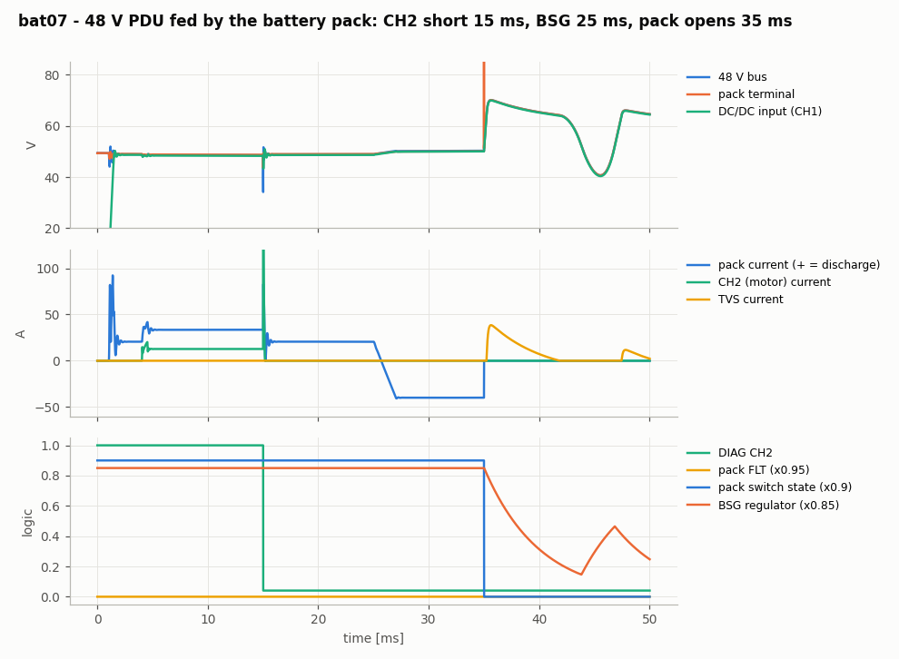

* Before the disconnect the pack absorbs 40 A at a 50.2 V bus.
* After it, the bus passes 58 V in **124 µs** (~60 V/ms ≈ 40 A into ~0.7 mF),
  and the TVS clamps it at **70.0 V** with 38 A. Then the generator-only bus
  oscillates: 70 → 41 → 66 V.
* *Show the plot and ask:* "The regulator reacted. Why did it not help, and what
  has to act in the first 100 µs?" Expected: ΔI/C is far faster than any
  regulation loop. Only the clamp, the capacitance or a hardware de-excitation
  are fast enough.

---

## B. eFuse fundamentals and protection functions

### B1. What does a fuse protect, and how does an eFuse emulate it? (L1)

**Expected answer**
* The fuse protects the **wire harness and PCB copper** from overheating
  (insulation damage, smoke, fire), not the load.
* The wire heats with I²·R and cools to ambient; its damage limit is a time-current
  curve. A melting fuse is a thermal replica (I²t).
* An eFuse measures the current and computes a **heat balance**
  (dE/dt ∝ I² − I_nom²) in hardware or firmware. It trips when the
  "virtual wire temperature" reaches a threshold, so it has **thermal memory**: it
  cools down when the current falls.
* The I²t curve must lie **below the wire damage curve** and **above the
  load's normal profile** (inrush, motor start, PWM RMS).

**Follow-ups**
* "PWM load at 40 A peak, 25 % duty, I_nom 21.8 A: does it trip?" It depends on
  the RMS: √0.25 × 40 = 20 A < I_nom, so no trip with a symmetric heat
  balance (tb04).
* "Why is thermal memory important?" Repetitive overloads: without it, a load
  that restarts every few seconds could overheat the wire.

**Red flags:** says "the eFuse protects the ECU"; thinks of the I²t as
an instantaneous current threshold.

**Simulation:** [`tb03`](../testbenches/tb03_i2t_curve.cir) (the curve),
[`tb04`](../testbenches/tb04_pwm_rms.cir) (PWM and RMS) and [`tb16`](../testbenches/tb16_thermal_memory.cir)
(thermal memory and the wire).

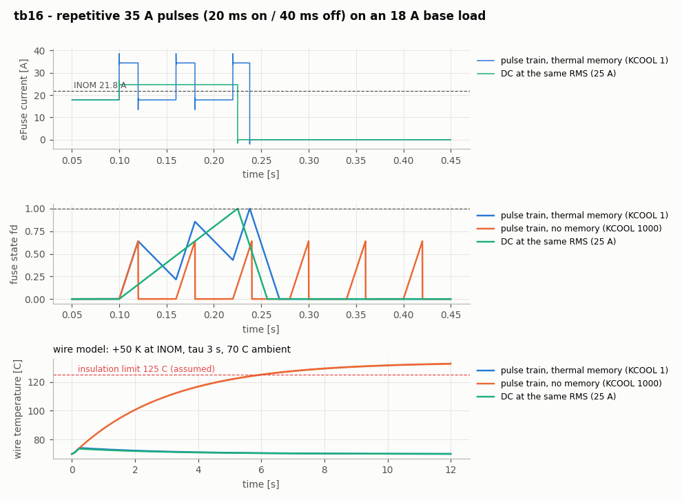

* tb04 (the PWM follow-up): 40 A peak at 25 % duty gives I_RMS = 19.6 A, so no
  trip. At 35 % (23.2 A RMS) it trips after 0.98 s.
* tb16: 35 A pulses (20 ms on, 40 ms off) on an 18 A base load. A single pulse
  is shorter than the 31 ms trip time at x = 1.6, but the RMS of the train is
  ~25 A > INOM.

| eFuse | trips | wire temperature |
|---|---|---|
| thermal memory (symmetric heat balance) | after 0.238 s, in the 3rd pulse | ~74 °C, then cools |
| DC current at the same RMS (25 A) | after 0.225 s | ~74 °C, then cools |
| no memory (counter resets below INOM) | never | 133 °C and rising (125 °C limit) |

* With memory the pulse train trips like its RMS-equivalent DC current. That is
  what the wire "sees".
* *Show the fd panel and ask:* "Why does the blue fuse state ramp down between
  pulses but not to zero? What happens to the wire with the orange behaviour?"

### B2. List the protection layers of a typical eFuse and their time scales. (L1–L2)

**Expected answer**

| Layer | Detects | Time scale |
|---|---|---|
| I²t / current-vs-time | overload of the wire | ms … tens of s |
| Hard short (HSC) | I > I_HSC | µs (comparator plus a few µs filter) |
| VDS desaturation | FET not fully on (VDS > threshold) | µs, with blanking at turn-on |
| FET over-temperature (NTC or sensor) | slow overheating | ms … s |
| VGS under-voltage | weak gate drive (charge pump problem, low VS) | µs |
| Supply UV/OV, device thermal shutdown | supply/IC conditions | µs … ms |

* The hard short has to be fast because the current rises at tens of A/µs (only
  the harness inductance limits it), and the FET must open before it leaves its SOA.

**Follow-ups**
* "Why is there blanking on the VDS monitor?" During turn-on into a capacitive load
  VDS is large by design (tb05). The blanking time limits how long the inrush
  ramp may take.
* "Why latch-off rather than current limiting at 48 V?" Linear current limiting
  at 48 V means VDS × I = kW in the FET. Most 48 V eFuses switch off and latch, and
  the MCU decides about a retry.

**Simulation:** time scales collected from tb02, tb03, tb05 and tb07, and
[`tb17`](../testbenches/tb17_latch_vs_limit.cir) for the latch-off follow-up.

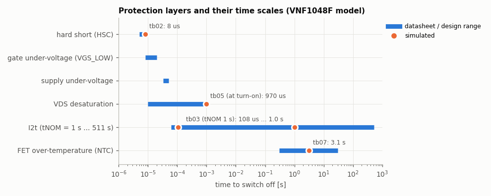

* Simulated switch-off times: hard short 8 µs (tb02), VDS desaturation 970 µs
  after turn-on (tb05, blanking-limited), I²t 108 µs to 1 s at tNOM = 1 s (tb03),
  FET over-temperature via the NTC 3.1 s (tb07). That is six decades.

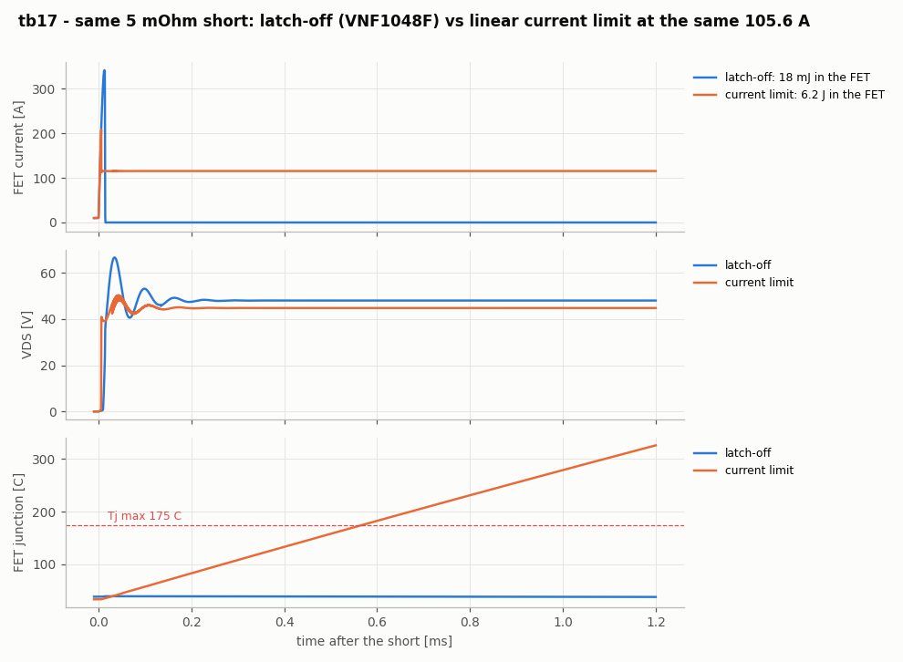

* tb17 puts the same 5 mΩ short on a latch-off channel and on an ideal linear
  current limiter at the same 105.6 A. The latch-off FET sees 340 A for ~10 µs
  and absorbs **18 mJ**. The limiter holds 115 A at VDS ≈ 45 V, which is
  **5.2 kW**: the junction passes 175 °C after 0.57 ms and the FET has absorbed
  6.2 J after 1.2 ms.
* *Show tb17 and ask:* "The limiter keeps the current three times lower. Why is
  it the one that destroys the FET?" Expected: the dissipation is VDS × I. The
  latch-off current flows while the FET is fully on (VDS ≈ 0) and only for µs.

### B3. Hard short: walk me through the first 20 µs. (L2–L3)

**Expected answer**
* The short appears; di/dt = V/L_loop (e.g. 48 V / 2 µH = 24 A/µs).
* The current crosses I_HSC; the comparator plus deglitch delay (~µs) sets the latch, and
  the gate is discharged (fast turn-off path). The current keeps rising
  during the delay, so the **peak current is well above I_HSC** (e.g. 105 A
  threshold → 300 A peak).
* At turn-off, the harness inductance energy ½·L·I² has to go somewhere:
  * **supply side**: VBAT overshoots (bulk capacitance + TVS limit it, it must stay
    below the controller abs-max);
  * **load side**: OUT goes negative (freewheel diode, controller OUT pin
    rating).
* The FET sees VDS = VBAT_peak − V_OUT,min during turn-off: check against BV
  and avalanche capability.
* The gate–source voltage can overshoot if the gate is held by a slew capacitor
  while the source collapses, so a VGS clamp (zener) is needed.

**Follow-ups**
* "How do you estimate the peak current?" I_HSC + (VBAT/L) × t_delay, limited
  by the loop resistance.
* "What sets the minimum bus capacitance?" ½·L·I_pk² ≤ ½·C·(V_max² − V_bat²), or
  the TVS absorbs the rest.
* "What happens with a slow turn-off (big RG)?" More energy in the FET, but a lower
  di/dt and therefore a lower overshoot. It is a trade-off.

**Red flags:** expects the current to stop at I_HSC; forgets the supply-side
overshoot.

**Simulation:** [`tb02`](../testbenches/tb02_hard_short.cir) (the event),
[`tb18`](../testbenches/tb18_short_di_dt.cir) (harness inductance), [`tb19`](../testbenches/tb19_turnoff_speed.cir) (turn-off
speed) and [`tb25`](../testbenches/tb25_supply_clamp.cir) (where the energy goes, see C3).

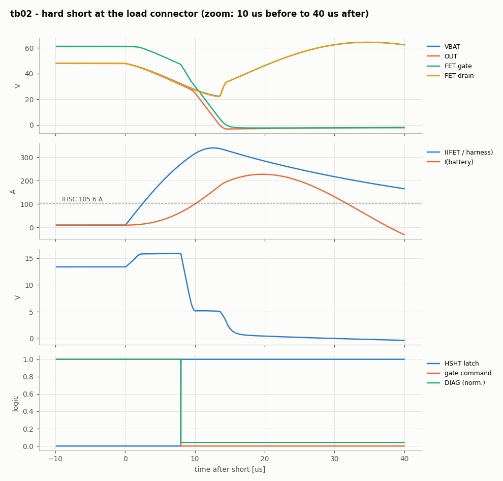

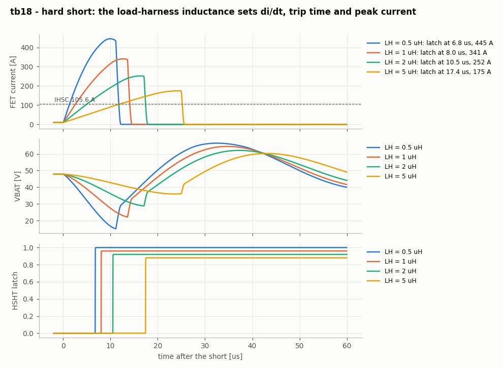

| load-harness L | current crosses IHSC | HSHT latch | peak current | VBAT peak | FET energy |
|---|---|---|---|---|---|
| 0.5 µH | 1.4 µs | 6.8 µs | 445 A | 66.4 V | 14 mJ |
| 1 µH (tb02) | 2.6 µs | 8.0 µs | 341 A | 64.4 V | 18 mJ |
| 2 µH | 5.0 µs | 10.5 µs | 252 A | 62.1 V | 21 mJ |
| 5 µH | 12.0 µs | 17.4 µs | 175 A | 60.2 V | 21 mJ |

* The current keeps rising after the latch, for the ~5 µs the driver needs to
  pull the gate down to the plateau. The peak sits at the real turn-off, 2–4×
  IHSC. The bus sags to 15–35 V during the event because the bus capacitor
  supplies the first microseconds.

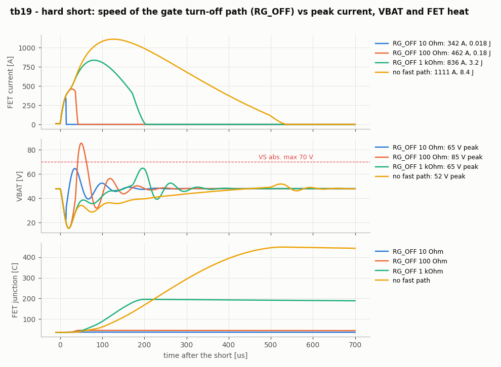

| turn-off path | peak current | off after the latch | VBAT peak | FET energy | Tj peak |
|---|---|---|---|---|---|
| fast path, RG_OFF 10 Ω | 341 A | 6 µs | 64 V | 0.018 J | 37 °C |
| RG_OFF 100 Ω | 462 A | 34 µs | **85 V** | 0.18 J | 46 °C |
| RG_OFF 1 kΩ | 836 A | 193 µs | 65 V | 3.2 J | 196 °C |
| no fast path (through RG_ON + C_SLEW) | 1.1 kA | 522 µs | 52 V | 8.4 J | 448 °C |

* The follow-up "what happens with a slow turn-off" has a non-obvious answer:
  a little slower (100 Ω) raises the peak current *and* still switches it off
  fast, so the supply overshoot gets worse (85 V > 70 V). Much slower lowers the
  overshoot but puts joules into the FET.
* *Show tb18 and ask:* "Why is the peak current more than three times the HSC
  threshold, and what sets it?" Expected: di/dt = V/L times (filter delay +
  gate discharge), limited by the loop resistance and the sagging bus.

### B4. Current sensing: shunt or RDS(on) sensing, and what limits the accuracy? (L2)

**Expected answer**
* **Shunt**: accurate, low drift (TCR ~50 ppm/K), but adds loss and cost.
  Needs Kelvin connections. 1 mΩ at 20 A = 20 mV / 0.4 W.
* **RDS(on) sensing**: no loss, but RDS(on) varies ~±30 % (spread) plus ~+70–100 %
  from 25 to 150 °C, so it needs temperature compensation. Fine for coarse protection, poor
  for accurate I²t.
* Error budget: shunt tolerance and TCR, amplifier offset (dominant at low current;
  a 100 µV offset is 5 % at 2 mV), gain error, ADC resolution, layout (copper
  in the sense path), thermal EMF.
* Choose R_sense so that V_sense at the nominal current is in the accurate range
  of the amplifier, while I_HSC × R_sense stays within the HSC threshold range.

**Follow-ups**
* "How does the sense accuracy translate into wire protection?" The I²t threshold
  tolerance adds to the wire margin. A 10 % current error is a ~20 % I²t error.
* "Where do you place the shunt?" Before the FET (high side), with Kelvin traces
  routed as a pair and away from the high-current path.

**Simulation:** [`tb20`](../testbenches/tb20_sense_error.cir), fixed settings (VOC 21.8 mV, ideal
curve) with the sensed resistance off by −10 … +20 %, 40 A overload.

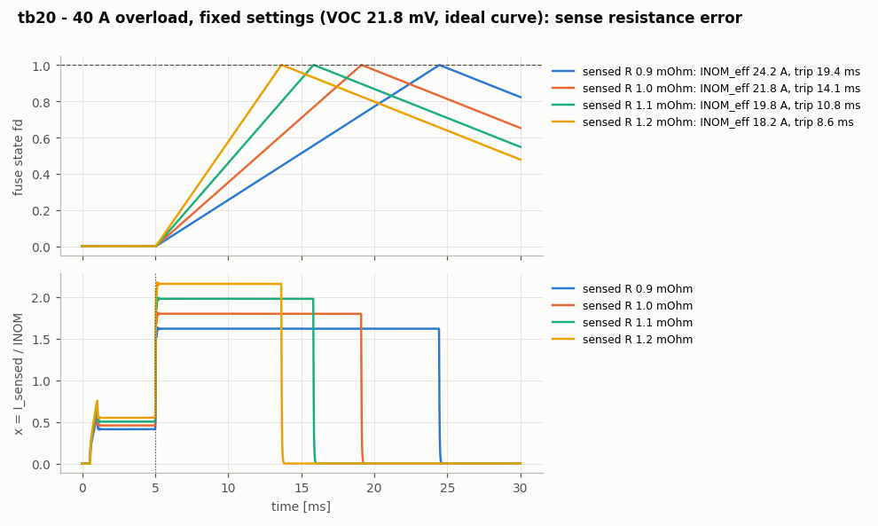

| sensed resistance | effective INOM | x at 40 A | trip time |
|---|---|---|---|
| 0.9 mΩ (−10 %) | 24.2 A | 1.62 | 19.4 ms (+38 %) |
| 1.0 mΩ | 21.8 A | 1.80 | 14.1 ms |
| 1.1 mΩ (+10 %) | 19.8 A | 1.98 | 10.8 ms (−23 %) |
| 1.2 mΩ (+0.2 mΩ copper in the Kelvin path) | 18.2 A | 2.16 | 8.6 ms (−39 %) |

* A 10 % current error is a ~20 % error in I² and up to ~40 % in trip time,
  because t ∝ 1/(x² − 1) is steep near INOM.
* *Ask:* "Which sign of error is a wire-protection problem and which is an
  availability problem?" Expected: reading low (−10 %) leaves the wire
  unprotected between 21.8 and 24.2 A. Reading high gives nuisance trips.

### B5. Gate drive in a high-side N-channel eFuse. (L1–L2)

**Expected answer**
* An N-FET high side needs VG > VBAT + VGS(on), so a **charge pump** or bootstrap
  is required (a bootstrap cannot hold 100 % duty, so a charge pump it is).
* VGS regulated to ~10–15 V, with a clamp to protect the gate (±20 V rating).
* The charge pump has finite current, which sets the turn-on time and limits
  parallel FETs (more gate charge).
* Gate under-voltage monitoring: with low VBAT or a weak pump the FET runs in
  its linear region.
* **Fast turn-off path** (diode around the turn-on resistor) so a short is
  interrupted in µs even when the turn-on is slewed.

**Follow-ups**
* "What about a P-channel FET?" Simpler drive, but 2–3× the RDS(on) for the same
  die. Uncommon for high current at 48 V.
* "Standby?" The charge pump consumes mA. In sleep mode, use a low-current bypass or turn
  off the pump (quiescent-current budget).

**Simulation:** [`tb06`](../testbenches/tb06_supply_transients.cir) (charge pump vs
VS), [`tb19`](../testbenches/tb19_turnoff_speed.cir) (fast turn-off path) and
[`tb08`](../testbenches/tb08_standby_autoon.cir) (stand-by).

* tb06: VCP − VS is 14.5 V at 48 V but only 9.0 V at VS = 6 V, where VGS falls
  to 8.6 V (VGS_LOW would latch below ~5 V). At low battery voltage the FET is
  close to its linear region.
* tb19 (table in B3): without the fast turn-off path the gate is held up by
  C_SLEW and discharges only through RG_ON (τ ≈ 100 µs). The FET then conducts
  1.1 kA for half a millisecond.
* tb08: in stand-by the charge pump is off and a 20 mA sleep load runs through
  the ~7 Ω bypass. A 5 A wake-up load starts the pump and the main FET by
  hardware (AUTO-ON) in 108 µs.
* tb34 (J1) shows a gate drive at the low end of its 12–15 V range slowing the
  dV/dt ramp enough to cause a VDS trip.
* *Show tb19 and ask:* "The driver pulls HS_GATE low within microseconds. Why
  does the FET stay on for 0.5 ms without the diode path?"

### B6. Turning off an inductive load or a long harness. (L2)

**Expected answer**
* Energy ½·L·I². Without a freewheel path OUT goes strongly negative until
  the FET avalanches (VDS = BV). The energy is then dissipated in the FET, which must be
  rated for single and repetitive avalanche, or the controller OUT pin gets
  damaged.
* Options: a freewheel diode (Schottky) from GND to OUT; a TVS across the FET or from OUT to GND
  (faster demagnetization, higher dissipation in the TVS); active clamping
  (the gate is partially re-enabled when VDS exceeds a threshold, so the FET absorbs the energy in a controlled way).
* Trade-off: freewheeling demagnetizes slowly (actuator releases slowly);
  clamping demagnetizes fast but puts the energy in the FET.

**Follow-ups**
* "Size it: 2 mH, 10 A." E = 100 mJ. Check the FET's single-pulse avalanche energy at
  hot Tj, or make the freewheel carry 10 A peak for a few ms (tb09).
* "What about the harness inductance of a resistive load?" µH × hundreds of A in a
  short gives mJ, so a freewheel or TVS is still needed.

**Simulation:** [`tb09`](../testbenches/tb09_inductive_turnoff.cir) and
[`tb21`](../testbenches/tb21_inductive_clamp.cir), 2 mH / 10 A switched off, three demagnetization paths.

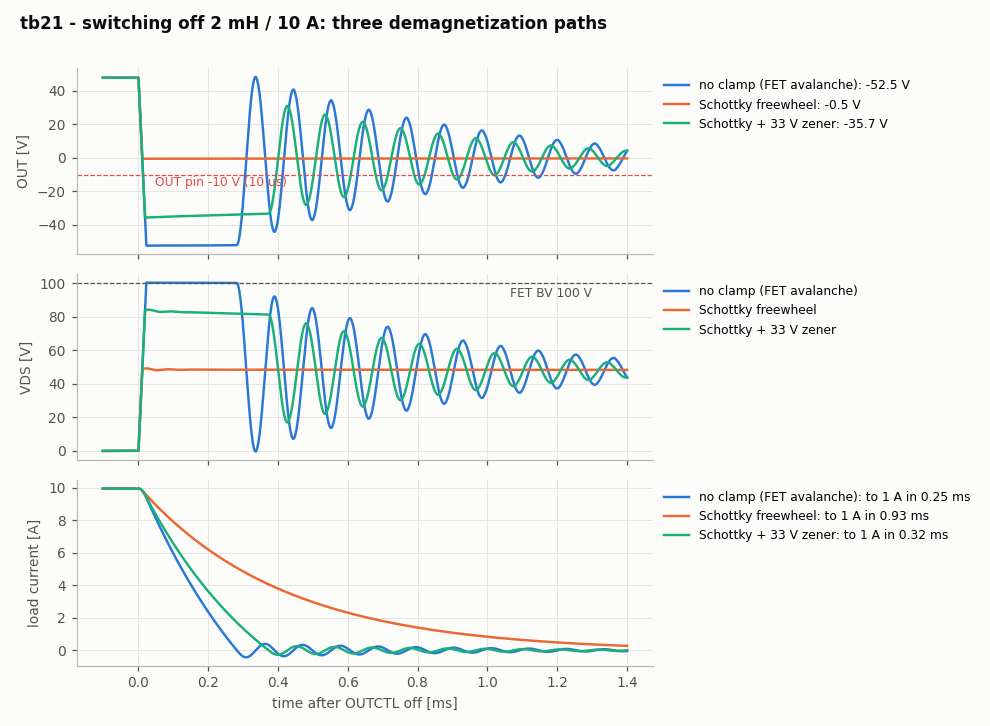

| path | OUT minimum | VDS peak | decay to 1 A | energy in FET | energy in clamp |
|---|---|---|---|---|---|
| none (FET avalanche) | −52.5 V | 100.4 V | 0.25 ms | **120 mJ** | – |
| Schottky freewheel | −0.5 V | 49 V | 0.93 ms | 2.4 mJ | (load R) |
| Schottky + 33 V zener | −35.7 V | 84 V | 0.32 ms | 7 mJ | 50 mJ |

* The zener clamp demagnetizes ~3× faster than the freewheel and keeps the FET
  out of avalanche. The ringing after demagnetization is the residual energy
  oscillating with the 100 nF at OUT.
* *Ask:* "A valve must close fast, so you pick the zener clamp. What does it do
  to the VNF1048F?" Expected: OUT at −36 V violates the OUT pin rating (−2 V DC,
  −10 V for 10 µs). The OUT sense pin then needs a series resistor and its own
  clamp.

---

## C. Power stage and component selection

### C1. How do you choose the MOSFET for a 48 V, 30 A channel? (L2)

**Expected answer**
* **VDS rating**: 80–100 V, from max transients plus the inductive kick at turn-off plus
  margin.
* **RDS(on)** at hot Tj: loss I²·R (30 A, 2 mΩ → 1.8 W at 25 °C, ~3 W
  hot), so thermal design decides the package (TOLL, D2PAK-7, LFPAK88).
* **SOA in linear mode**: the inrush or dV/dt ramp, and the time to trip
  on a short. Check the SOA curve at the pulse length, derated to hot Tj.
  Modern trench FETs have a reduced linear-mode SOA (thermal instability,
  the Spirito effect) at high VDS.
* Avalanche rating, gate charge (charge pump), AEC-Q101 qualification, body
  diode (reverse current), package current rating and bond wires.
* Short-circuit peak current: I_pk for a few µs is within the pulsed ID rating.

**Follow-ups**
* "Two FETs in parallel?" Fine when fully on (positive RDS(on) tempco shares the current),
  but **in linear mode they do not share** (negative tempco of VGS(th) at low current),
  so size the inrush SOA for one FET.
* "What is the Spirito effect?" At high VDS and low current the temperature coefficient
  of the drain current is positive, so a hot spot draws more current: local thermal
  runaway. The SOA at DC/long pulses is limited below the pure thermal line.

**Red flags:** picks a 60 V FET "because 48 V"; ignores linear-mode SOA.

**Simulation:** [`tb23`](../testbenches/tb23_linear_soa.cir) (linear-mode stress at 85 °C) and
[`tb22`](../testbenches/tb22_parallel_fets.cir) (parallel FETs).

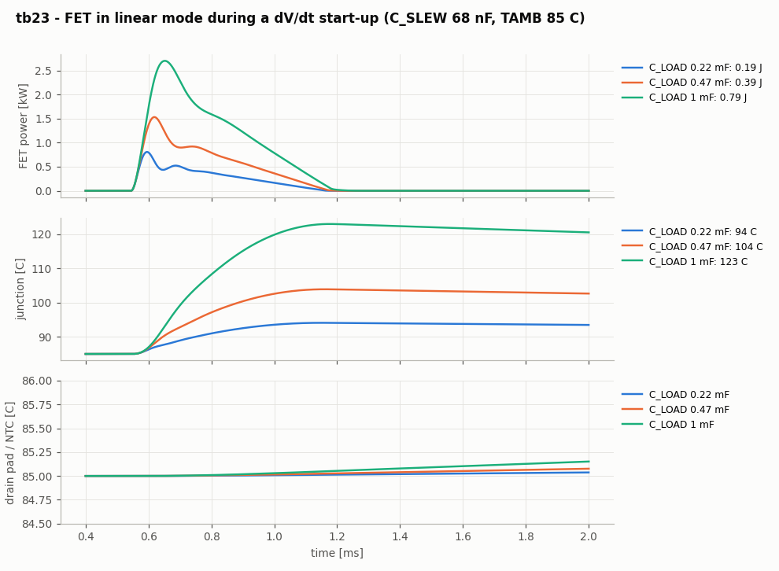

| C_LOAD | inrush | peak FET power | FET energy | Tj peak (from 85 °C) | pad/NTC rise |
|---|---|---|---|---|---|
| 0.22 mF | 21 A | 0.8 kW | 0.19 J | 94 °C | 0.06 K |
| 0.47 mF | 41 A | 1.5 kW | 0.39 J | 104 °C | 0.13 K |
| 1 mF | 79 A | 2.7 kW | 0.79 J | 123 °C | 0.26 K |

* The ramp lasts ~0.6 ms whatever the capacitance. The energy follows the
  half-energy rule (D2). That is the single pulse to check against the SOA curve,
  at VDS up to 42 V and derated to the starting Tj.

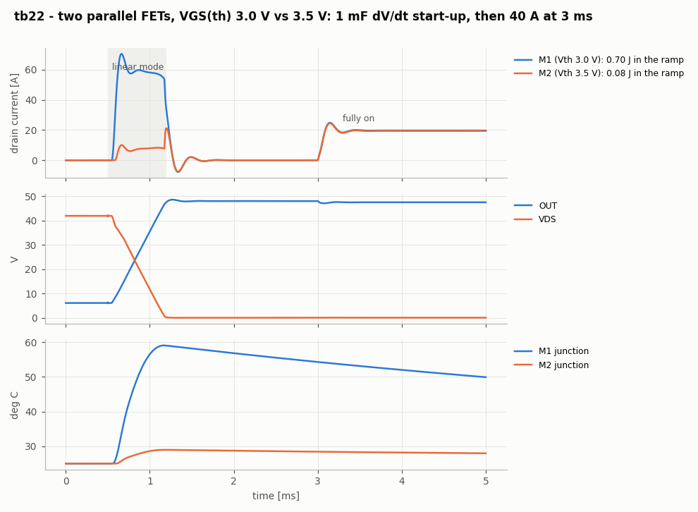

* tb22: two FETs that differ only in VGS(th) (3.0 vs 3.5 V). During the 1 mF
  ramp the low-threshold FET carries 70 A peak vs 21 A and absorbs 0.70 J vs
  0.08 J (Tj 59 vs 29 °C). Fully on at 40 A they share 19.7 / 19.4 A.
* Model limit: the VDMOS model is isothermal, so the positive feedback of a real
  hot FET (lower Vth, more current, the Spirito regime) is not in the plot. It
  only makes the imbalance worse.
* *Show tb22 and ask:* "Fix it with matched gate resistors?" Expected: no. Use
  source ballast or, more often, size one FET for the whole linear-mode pulse.

### C2. Back-to-back FETs: when and why? (L2–L3)

**Expected answer**
* A single FET conducts backwards through its body diode, so it cannot block reverse
  current (an output back-fed from a load with its own capacitors or
  generator, a motor in regeneration, or reverse battery).
* Back-to-back (common source or common drain) blocks in both directions and
  allows bidirectional switches (e.g. connecting two 48 V sub-nets or batteries).
* Cost: 2× RDS(on) and two gate-drive outputs.
* Reverse battery: on 48 V systems, reverse polarity protection is often handled
  at system level (keyed connectors), but the requirement has to be checked per OEM.

**Follow-ups**
* "Load with regeneration (EPS motor)?" Reverse current through the body diode when
  the FET is off. Either keep the FET on (synchronous) or block it, and protect the
  bus from over-voltage.

**Simulation:** [`tb24`](../testbenches/tb24_back_to_back.cir), a back-driven motor (55 V EMF) on a
single-FET channel and on a back-to-back channel.

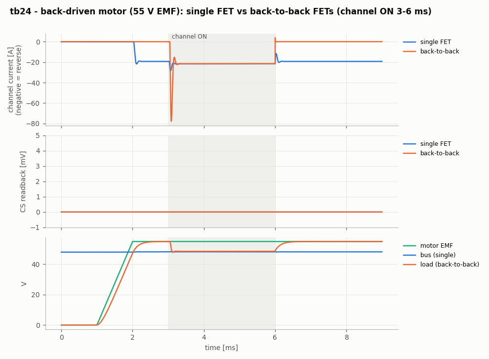

| | single FET | back-to-back |
|---|---|---|
| channel OFF: reverse current | **19.3 A** through the body diode (15.7 W) | 0 A, load held at 55 V |
| channel ON: reverse current | 21.7 A | 21.6 A |
| current-sense readback when ON | 0 mV | 0 mV |

* An "off" single FET is not off in the reverse direction. And when on, neither
  channel can see the reverse current: the VNF1048F sense is unidirectional.
* *Ask:* "Your EPS motor regenerates into an open channel. Where does the energy
  go, and what does the controller report?"

### C3. Supply-side components of the PDU input. (L2)

**Expected answer**
* Bulk and ceramic capacitance: limits the supply overshoot during short interruption
  and keeps the PDU powered through dips.
* TVS: clamp below the abs-max of the most sensitive component (e.g. a 58 V standoff
  with clamping < 70 V at the peak current), power-rated for the energy of interrupting a
  short. TVS parametric tolerance and temperature drift.
* Input filtering for EMC (conducted emissions/immunity).
* Reverse polarity element if required.

**Follow-ups**
* "What if the TVS is too low?" It conducts on normal over-voltage
  ranges (e.g. 54 V operation) and overheats. The standoff must exceed the max
  operating voltage including tolerance.
* "Which event sizes the TVS energy in a 48 V system?" Often not the short
  interruption (tens of mJ to a few J of harness energy) but a battery
  disconnect with the generator running. Then the TVS carries the generator's
  excess current until it has stopped (A5, bat07: 38 A at 70 V, for several
  ms).

**Simulation:** [`tb25`](../testbenches/tb25_supply_clamp.cir), the tb02 short (≈340 A interrupted)
with the input protection varied.

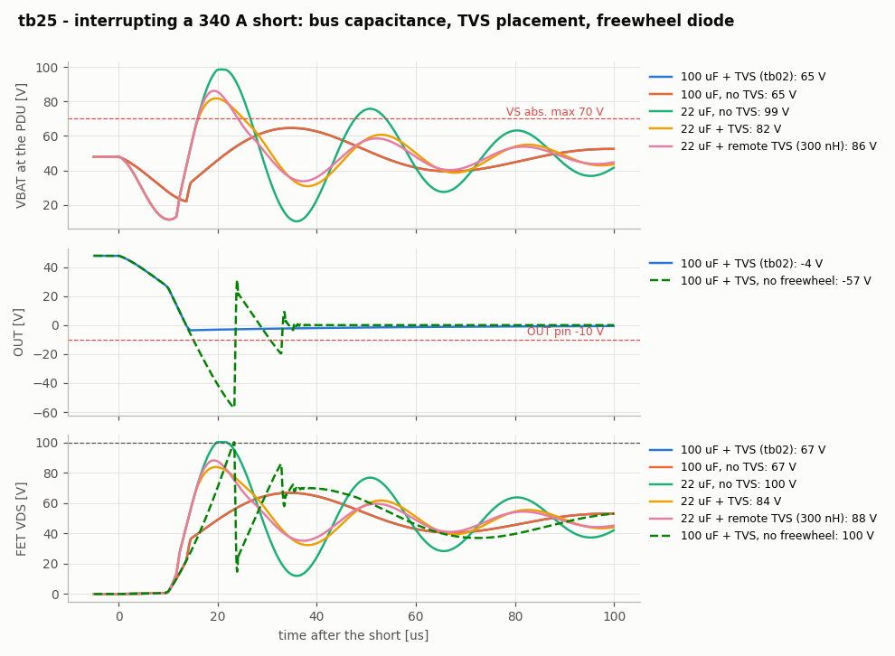

| input protection | VBAT peak | TVS peak current | FET VDS peak | OUT minimum |
|---|---|---|---|---|
| 100 µF + TVS (tb02) | 64.5 V | 2 A | 67 V | −3.5 V |
| 100 µF, no TVS | 64.5 V | – | 67 V | −3.5 V |
| 22 µF, no TVS | **98.6 V** | – | 100 V (avalanche) | −2.5 V |
| 22 µF + TVS | 81.7 V | 114 A | 84 V | −2.5 V |
| 22 µF + TVS behind 300 nH | 86.2 V | 121 A | 88 V | −2.5 V |
| 100 µF + TVS, no freewheel | 70.0 V | 37 A | 100 V (avalanche) | **−56.9 V** |

* With 100 µF the capacitor takes the harness energy and the TVS is nearly
  idle. With 22 µF the TVS clamps, but at ~110 A its dynamic resistance puts VS
  at 82 V, above the 70 V rating. A clamp is specified at its peak current, not
  at its breakdown voltage.
* *Ask:* "The TVS breaks down at 64 V. Why does VBAT reach 82 V, and what would
  you change first?" Expected: more bulk capacitance (it acts first), a
  lower-resistance TVS, or a tighter loop.

### C4. The 48/12 V DC/DC is the biggest load on one of your channels. What does the channel see from it? (L2)

**Expected answer**
* **A constant-power load.** I_in = P_in/V_in: 700 W is ~15 A at 48 V but
  ~20 A at 36 V and ~28 A at 26 V. The current *rises* when the 48 V bus dips.
  Size the channel's INOM and the wire for the lowest operating voltage, not
  for the nominal one.
* **A big input capacitance** (hundreds of µF): the eFuse's dV/dt or pre-charge
  has to handle it (D1–D4). The converter must not start before its input is up,
  which is what its UVLO with hysteresis is for (e.g. on at 30 V, off at 26 V),
  or it hiccups on its own pre-charge (J4).
* **Stand-by behaviour.** The converter's off-state input current vs the eFuse's
  OUT bias current. If the converter draws less than the eFuse leaks, the "off"
  input charges up, and a bleeder is needed.
* **The 12 V side.** The output is current-limited (~1.1 × rated). With a
  discharged 12 V battery the converter sits in its current limit, charging the
  battery, and the 12 V battery takes the 12 V load steps. A hard 12 V short
  makes it hiccup. The 48 V input then sees short bursts at full power.

**Follow-ups**
* "Your DC/DC has OVP at 60 V. Is that good for the 48 V network?" It protects
  the converter, but it also removes ~700 W of load at the moment of an
  over-voltage. During a battery disconnect (A5) that makes the bus rise further.
* "How does a 12 V load step reach the 48 V side?" Only through the converter's
  loop. With the converter in current limit it does not reach it at all.

**Red flags:** treats the DC/DC as a resistor; sizes the channel at 700 W/48 V;
has not thought about the converter starting during the eFuse ramp.

**Simulation:** [`dc01`](../testbenches/dc01_efficiency.cir) (efficiency, input
current), [`dc05`](../testbenches/dc05_input_transients.cir) (UVLO, OVP,
constant power), [`dc02`](../testbenches/dc02_load_transient.cir) (12 V load
steps) and [`dc08`](../testbenches/dc08_pdn_48v_12v.cir) (the whole chain).

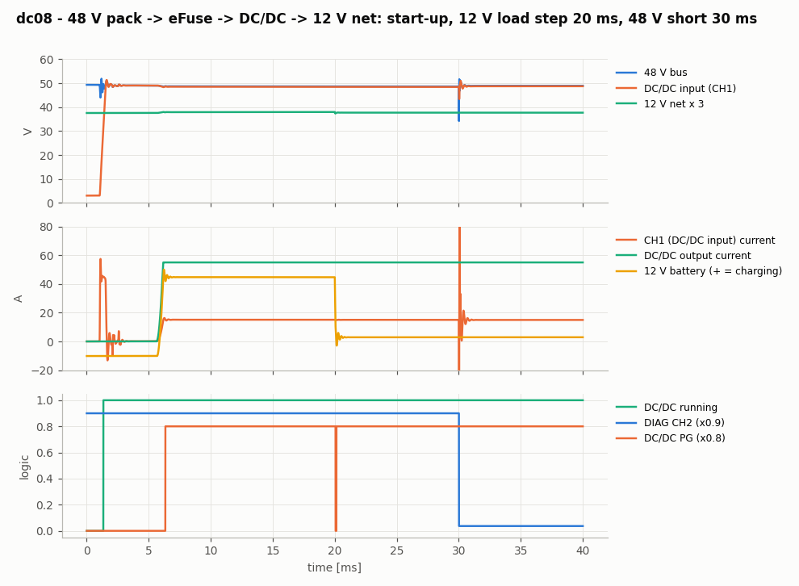

| Quantity | Simulated |
|---|---|
| efficiency at 700 W (36 / 48 / 54 V) | 96.3 / 95.9 / 95.7 % |
| input current at 700 W (36 / 48 / 54 V) | 20.2 / 15.2 / 13.6 A |
| 392 W load: input current at 36 V vs 54 V | 11.34 A vs 7.61 A |
| UVLO off / on, OVP trip / restart | 25.99 / 30.01 V, 60.01 / 57.99 V |
| dc08: eFuse inrush into the converter's 470 µF / start at | 57 A / 31.0 V on the ramp |
| dc08: converter in current limit, 12 V battery charging | 55 A, 44.7 A |
| dc08: +40 A on the 12 V net | battery charging drops to 2.9 A; the converter stays at 55 A |
| dc08: 48 V branch short | the DC/DC input stays ≥ 43.4 V; the 12 V net moves 0.5 mV |

* *Show dc08 and ask:* "The 12 V load stepped by 40 A, but the DC/DC current
  did not move. Where did the 40 A come from?" Expected: the converter was
  already in current limit charging the battery. The battery's charging current
  dropped from 44.7 A to 2.9 A.

### C5. Why can a regulated DC/DC oscillate with its input filter or harness, and how do you check it? (L2–L3)

**Expected answer**
* Below its loop bandwidth a regulated converter draws constant power, so its
  incremental input resistance is **negative**: dV/dI = −V²/P (−3.3 Ω for
  700 W at 48 V).
* The source inductance (harness, filter L) and the input capacitance form an
  LC resonance. Its only damping is the series resistances and the capacitor
  ESR. When the negative conductance P/V² outweighs that damping, the
  resonance grows into an oscillation.
* **Middlebrook criterion:** the source's output impedance (looking back from
  the converter) must stay well below |Z_in| = V²/P at all frequencies,
  especially at the filter resonance. Simple check:
  R_s·C + ESR·C > L·P/V².
* Fixes: a damping network (series R–C across the input, R ≈ √(L/C),
  C_d ≥ 4·C), an electrolytic with enough ESR instead of ceramics only, less
  source inductance, or a lower-Q filter. Check at the minimum input voltage
  and full power, where P/V² is largest.

**Follow-ups**
* "Why does it work on the bench and oscillate in the car?" The bench supply
  with short cables is stiff. The car adds metres of harness (µH) and maybe a
  filter.
* "Can you see this in a transient simulation with a resistive load model of
  the converter?" No. A resistor has positive incremental resistance. You need
  a constant-power or regulated model.

**Red flags:** thinks more ceramic capacitance always helps; has never heard of
negative input resistance.

**Simulation:** [`dc06`](../testbenches/dc06_impedance_ac.cir) (Z_in(f), Z_out(f))
and [`dc07`](../testbenches/dc07_input_filter_stability.cir) (three input set-ups,
25 A load).

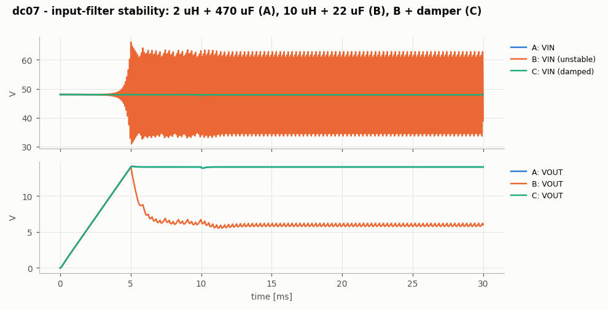

| Set-up | Eigenvalue (linearized) | Simulated |
|---|---|---|
| 2 µH feed, 470 µF electrolytic (15 mΩ) | Re = −6091 s⁻¹, stable | no ripple |
| 10 µH feed, 22 µF ceramic (2 mΩ) | Re = +2968 s⁻¹ at 10.7 kHz, **unstable** | 30 V p-p on the input, OVP trips, 12 V output collapses to ~6 V |
| the same + 220 µF / 0.68 Ω damper | Re = −7359 s⁻¹, stable | no ripple |

* dc06 gives Re(Z_in) = −6.17 Ω at 10 Hz for 350 W: the negative resistance,
  in parallel with the input capacitor.
* *Show dc07 case B and ask:* "Nothing in the circuit is faulty. What is
  oscillating, and what single part would you add?" Expected: harness L with
  the ceramic C, undamped by the negative input resistance. Add an R–C damper,
  or an electrolytic with ESR.

---

## D. Inrush and capacitive-load pre-charge

### D1. Why does switching on a load with a big input capacitor cause problems? (L1)

**Expected answer**
* A discharged capacitor is a short at t = 0: I = V/R_loop (48 V / 30 mΩ ≈
  1.5 kA). It trips the HSC, stresses the FET, dips the bus and stresses the capacitor
  (ripple current, ESR heating).
* The eFuse cannot tell this from a short, so the turn-on has to be controlled.

**Simulation:** [`tb26`](../testbenches/tb26_hard_turn_on.cir), switching on 1 mF.

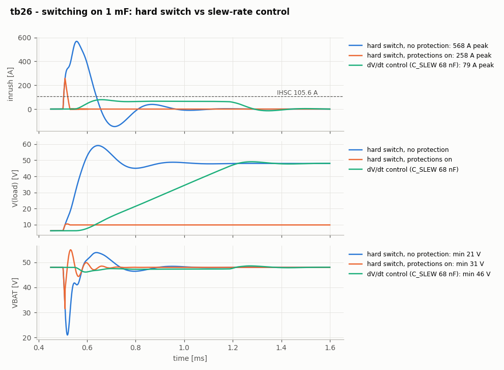

* Hard switch, no protection (relay-like): **568 A** peak, limited only by the
  loop L and R. The 48 V bus dips to **21 V** and the output overshoots to 59 V.
* The same hard switch with the protections active: the eFuse cannot tell this
  from a short. HSC latches 8.7 µs after turn-on at 255 A, and OUT stays at 10 V.
* dV/dt control (C_SLEW 68 nF): 79 A, OUT at 48 V after ~0.7 ms, 0.79 J in the
  FET, bus minimum 46 V.
* *Ask:* "Who else on the bus suffers in the first case?" Expected: every load on
  the 21 V bus (resets), plus the capacitor's ripple-current rating.

### D2. The half-energy rule: what is it, and why does it matter? (L2)

**Expected answer**
* Charging C from a constant voltage through **any resistive or linear** element
  dissipates **½·C·V²** in that element, the same energy the capacitor stores,
  independent of R, current or time. From V0: ½·C·(V − V0)².
* Example: 4.7 mF at 48 V gives 5.4 J per start-up. The design chooses only where the heat
  goes and at what peak power.
* Only inductor-based (switch-mode) pre-charge avoids it.

**Follow-ups**
* "Derive it." Q = CV drawn at voltage V gives E_source = CV²; E_cap = ½CV², so
  the loss is the difference.
* "Is the energy different with a 1 Ω or a 100 Ω pre-charge resistor?" No, only
  the time and the peak power differ.

**Red flags:** believes a larger resistor reduces the energy lost.

**Simulation:** [`tb27`](../testbenches/tb27_half_energy.cir), 4.7 mF charged to 48 V through
1 … 100 Ω, and [`tb13`](../testbenches/tb13_precharge_methods.cir) (methods compared).

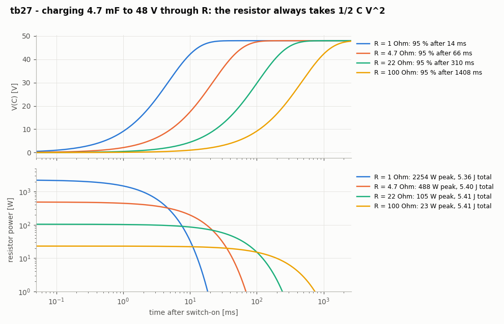

| R | energy in R | peak power | time to 95 % |
|---|---|---|---|
| 1 Ω | 5.36 J | 2254 W | 14 ms |
| 4.7 Ω | 5.40 J | 488 W | 66 ms |
| 22 Ω | 5.41 J | 105 W | 310 ms |
| 100 Ω | 5.41 J | 23 W | 1.41 s |

* The source delivers 10.8 J every time: half goes into the capacitor, half
  into the resistor. tb13 confirms the linear constant-current method also loses
  4.05 J; only the buck pre-charge avoids it (0.11 J).
* *Ask the quick-fire question before showing the table.*

### D3. Ways to pre-charge, with pros and cons. (L2)

**Expected answer**

| Method | Principle | Pros | Cons |
|---|---|---|---|
| dV/dt control of the main FET | gate slew (RG + C to GND), source follower, I = C·dV/dt | no extra parts | FET SOA in linear mode; window between I_HSC and VDS blanking, so limited C (~1–2 mF at 48 V / 100 A) |
| Resistor + bypass switch | R in parallel with the eFuse, then hand-over | simple, robust, heat in a resistor | slow (3–5τ), peak power V²/R, fault energy, sneak path |
| Constant current (linear) | current-regulated FET | predictable, faster than R for the same peak current | long linear-mode pulse at high VDS, the hardest SOA case |
| Switch-mode (buck, or bidirectional DC/DC) | the inductor limits the current | nearly lossless, low battery current | complexity, EMC |

**Follow-ups**
* "With your controller's VDS blanking of ~1 ms and I_HSC 105 A, what is the max
  C for the dV/dt method?" C_max ≈ I_HSC·t_blank/V ≈ 105 A × 0.96 ms / 48 V ≈ 2 mF
  before margins; ~1 mF with tolerances and the first-conduction spike (tb11).
* "Can the controller's low-current bypass pre-charge the load?" Usually not: it
  is rated for ~100 mA. On parts with AUTO-ON (VNF1048F), bypass saturation turns
  the main FET on immediately.

**Simulation:** [`tb11`](../testbenches/tb11_precharge_dvdt.cir) (the dV/dt
window), [`tb13`](../testbenches/tb13_precharge_methods.cir) (methods compared) and
[`tb28`](../testbenches/tb28_bypass_precharge.cir) (the bypass follow-up).

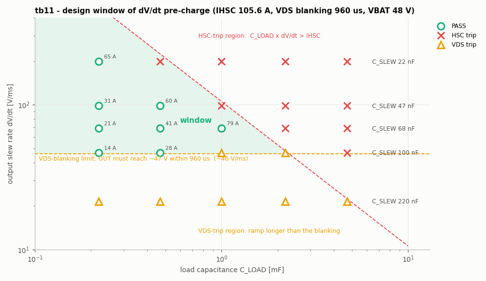

* tb11: with IHSC 105.6 A and 960 µs blanking a dV/dt window exists only below
  ~2 mF. At 1 mF, 22/47 nF trip the HSC, 68 nF passes (79 A), and 100/220 nF trip
  the VDS monitor.

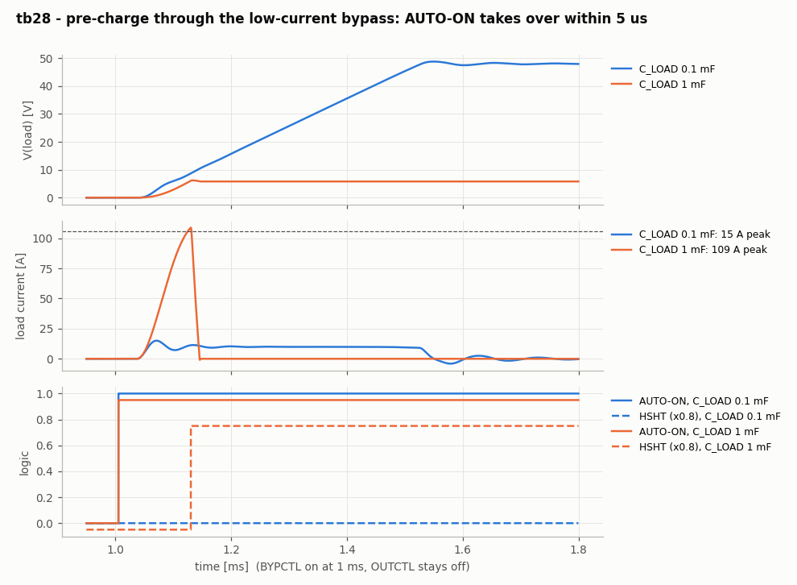

* tb28: the MCU enables only the bypass into a discharged load. The bypass
  current is limited, so VS − VOUT > 1.3 V at once and **AUTO-ON fires after
  5.5 µs**. The main FET then charges the load through its slew network: fine
  for 0.1 mF (15 A), HSC trip for 1 mF (109 A).
* *Show tb28 and ask:* "The MCU never set OUTCTL. Why did the main FET switch
  on, and why did it trip?"

### D4. When do you hand over from the pre-charge path to the main switch, and what can go wrong? (L2–L3)

**Expected answer**
* Hand over on **voltage across the switch** (VBAT − VOUT < ΔV_max), not on a
  fixed timer. A timer breaks with C tolerance, VBAT range, residual charge and
  load current.
* Residual inrush ≈ ΔV/R_loop. ΔV must be small enough that this current stays well below
  I_HSC (e.g. R_loop 50 mΩ, I_HSC 105 A gives ΔV < ~2.5 V with margin, i.e. ≥ 95 %).
* Supervision: an early checkpoint (V rising, catches a short), a timeout (leak,
  oversized C, load switched on), an abort that latches and reports, and never closing the main
  switch after an abort.
* Keep the load disabled until power-good. A **constant-power load** that starts
  on its own UVLO during pre-charge causes a hiccup (tb14).
* The fault case sizes the resistor: into a short, V²/R for the whole detection
  time (e.g. 480 W × 22 ms ≈ 10 J vs 4 J nominal).
* **The pre-charge path bypasses the eFuse protection**: limit its current by design, make
  it fail safe, monitor it, and open it when the main channel trips.

**Red flags:** fixed timer only; no fault handling; "the pre-charge resistor
just needs to handle the peak current."

**Simulation:** [`tb12`](../testbenches/tb12_precharge_resistor.cir) (the
hand-over point) and [`tb14`](../testbenches/tb14_precharge_faults.cir) (supervision and
faults).

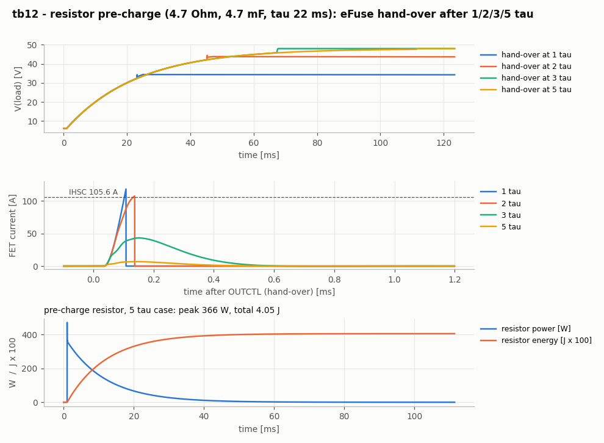

* tb12 (4.7 Ω, 4.7 mF, τ = 22 ms): hand-over at 1τ / 2τ (ΔV 15.6 / 5.9 V) trips
  the HSC with 117 / 108 A. At 3τ (ΔV 2.2 V) the residual inrush is 43 A, at 5τ
  7 A. A fixed timer at "3τ nominal" lands at 2.5τ with +20 % capacitance.

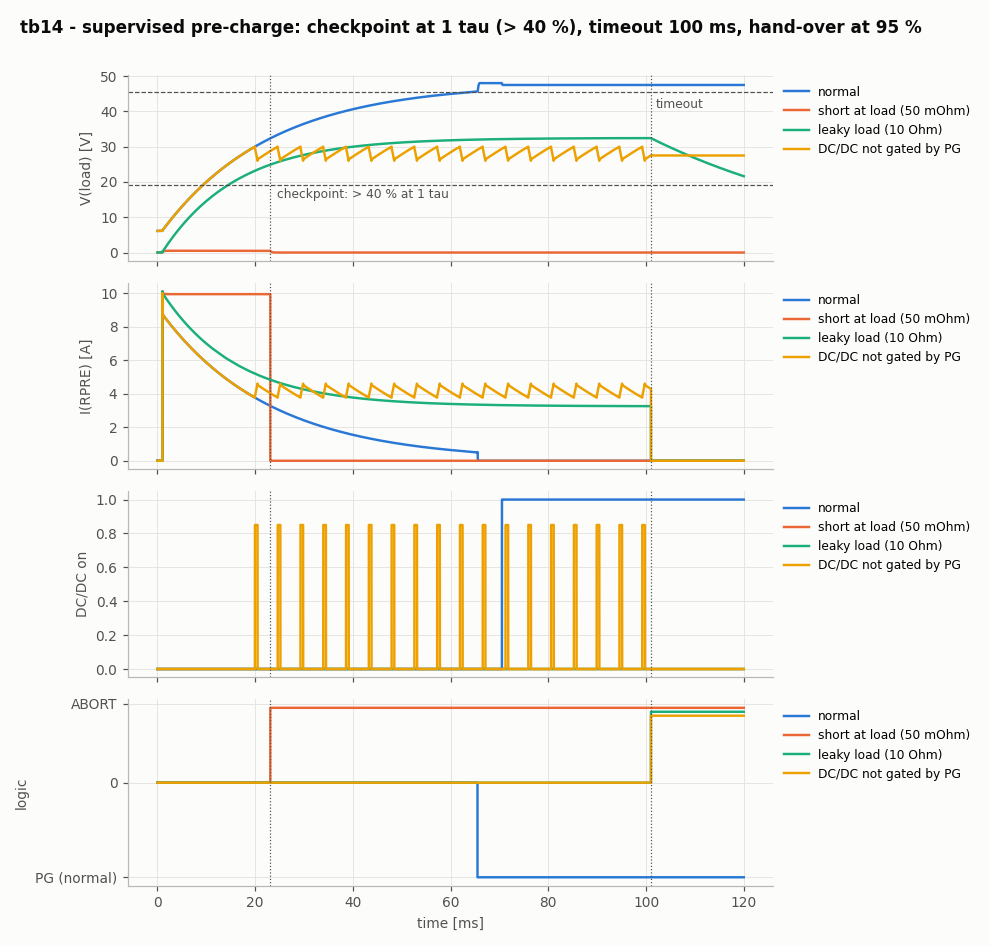

* tb14: a short at the load is aborted at the 1τ checkpoint (22 ms, 10.3 J in
  the resistor, eFuse never switched on). A leaky load is aborted by the timeout
  (100 ms, 9.8 J). A DC/DC that is not gated by power-good hiccups on its own
  UVLO. Every fault case puts ~2.5× the nominal 4 J into the resistor.
* *Ask:* "Which case sizes the pre-charge resistor?"

### D5. The 48 V pack closes onto the vehicle bus. Why does the pack need its own pre-charge, and how do you size it? (L2)

**Expected answer**
* All the 48 V loads' input capacitors (BSG inverter, DC/DC, PDU) add up to
  several mF.
* Closing the pack's switch onto a discharged bus gives
  I ≈ OCV/(R_pack + R_switch + ESR), around **2 kA**, with τ = R·C of a few
  hundred µs. That is long enough to trip the pack's own short-circuit
  protection, or to weld a contactor.
* Pre-charge through a resistor:
  * the peak current is OCV/R_PRE;
  * τ = R_PRE·C_bus, and the main switch closes after 3–5 τ;
  * the step at closing is ΔV/R_loop;
  * the resistor takes ½·C·V² (half-energy rule, D2): ~12 J for 10 mF at 49 V.
* Supervision:
  * close on a voltage-difference criterion, not only on a timer, so the bus
    capacitance tolerance and any load on the bus are covered;
  * abort on a timeout (a short on the bus, or a load that keeps the bus low);
  * check the resistor's pulse rating for a pre-charge into a fault.

**Follow-ups**
* "A load of 1 Ω is already on during pre-charge with 10 Ω. What happens?" The
  bus stalls at OCV·1/(1 + 10) ≈ 4.5 V, so the loads must stay off (or be gated
  by the pre-charge power-good) until the main switch is closed.

**Red flags:** closes the contactor directly onto mF; does not know the energy
in the resistor is fixed; uses a timer with no voltage check.

**Simulation:** [`bat06`](../testbenches/bat06_bms_protection.cir), cases A/B
(10 mF bus, 10 Ω pre-charge, BMS I_SC 1 kA / 100 µs).

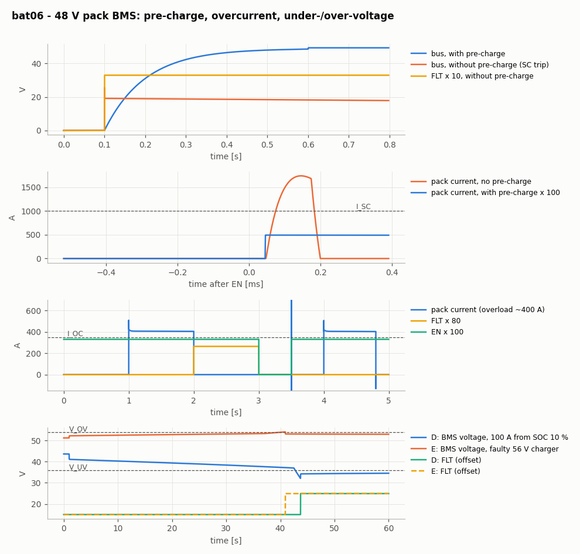

| Pre-charge | Bus when the main switch closes | Closing current | Result |
|---|---|---|---|
| 0.5 s (5 τ) | 99.3 % of OCV | 28 A | ok |
| 0.25 s (2.5 τ) | 92 % of OCV | 156 A | ok, 5× the closing step |
| none | 0 V | **1.74 kA** | the pack's SC protection trips after 174 µs; bus left at 19 V |

* The same bench covers the other BMS protections: an overload trip after exactly
  T_OC, a re-arm through EN, under-voltage at the end of discharge, and
  over-voltage from a faulty charger.
* *Ask:* "Without pre-charge the pack tripped its own protection. Would raising
  T_SC to 300 µs be a fix?" Expected: it removes the trip (verified: the
  1.7 kA inrush is then accepted), but at the cost of a slower reaction to a
  real short, and the contactor and capacitors still see the inrush. Pre-charge
  is the fix.

---

## E. Thermal, layout and PCB

### E1. How do you estimate the FET junction temperature (steady state and transient)? (L2)

**Expected answer**
* Steady state: P = I²·RDS(on)(Tj), solved iteratively because RDS(on) rises with Tj.
  Tj = T_amb + P·(Rth_jc + Rth_cb + Rth_ba). In a PDU, the board and its neighbours dominate.
* Transient (inrush, short, overload): use **Zth(t)** curves or an RC (Foster/Cauer)
  network. Short pulses are limited by the junction thermal capacitance.
* The worst case is the highest T_amb in the PDU location (e.g. 85–105 °C under the hood or
  in the trunk), all channels loaded, minimum airflow, and neighbouring heat sources.
* Validate with thermal simulation and an IR camera or thermocouples, correlated with
  the NTC reading.

**Follow-ups**
* "Where do you place the NTC, and what does it actually measure?" Near the FET drain pad,
  so it measures the board temperature with a lag, not Tj. That makes it a slow over-temperature
  protection only.

**Simulation:** [`tb23`](../testbenches/tb23_linear_soa.cir) (a transient pulse) and
[`tb07`](../testbenches/tb07_ntc_overtemp.cir) (slow overheating).

* tb23 (table in C1): during a 1 mF start-up the junction rises 38 K in
  ~0.6 ms, while the drain pad under the NTC rises **0.26 K**.
* tb07: at 105 °C ambient and 23 A (just below INOM) the pad reaches 120 °C after
  3.1 s and NTC_OVT trips. The junction peaks at 120.4 °C, so for slow heating
  pad and junction stay close.

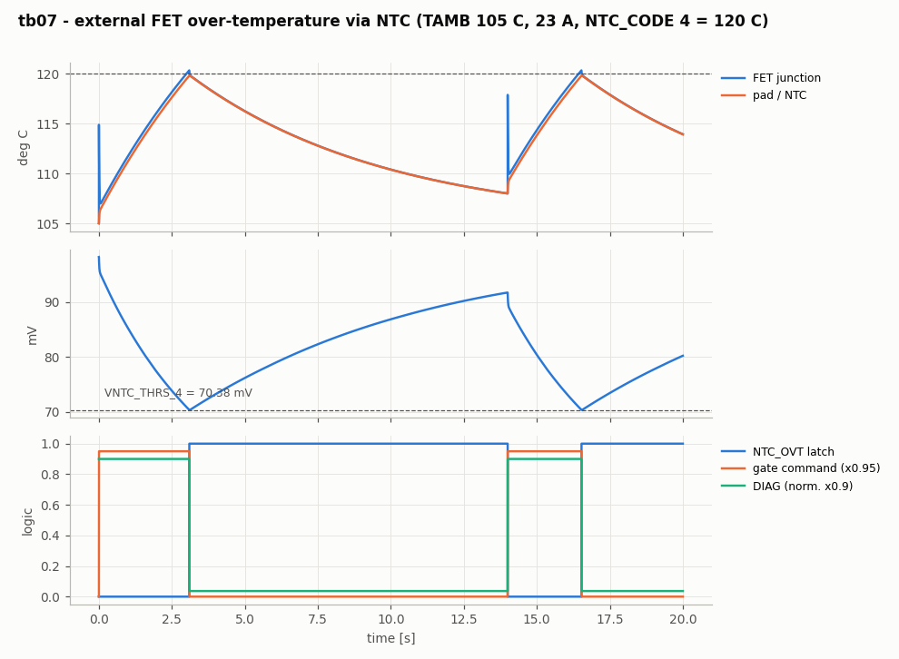

* *Show both and ask:* "The NTC barely moved in tb23. What protects the FET
  during the start-up, then?" Expected: the design itself (SOA check, Zth), the
  HSC and the VDS blanking window. The NTC covers only slow overheating.

### E2. Layout rules for a high-current eFuse channel. (L2)

**Expected answer**
* A short, wide, symmetric high-current path; enough copper and vias for current and heat
  (current density, temperature rise per IPC-2152).
* Kelvin sense connections at the shunt, routed as a differential pair away from
  switching nodes.
* Minimal loop inductance at the input capacitors and TVS (the clamp only works if the
  loop is small).
* A gate drive loop that is short and close to the FET; the controller ground referenced
  correctly (high di/dt ground shifts).
* Separation of the 48 V and 12 V domains (creepage/clearance, cross-short risk).

**Simulation:** [`tb25`](../testbenches/tb25_supply_clamp.cir) (TVS loop) and [`tb20`](../testbenches/tb20_sense_error.cir)
(Kelvin path).

* tb25: moving the TVS behind 300 nH of loop inductance adds 4.5 V at the VS pin
  (81.7 → 86.2 V) during the short interruption.
* tb20: 0.2 mΩ of copper inside the sense path of a 1 mΩ shunt is a +20 %
  current error. The channel trips at 18.2 A instead of 21.8 A, and 39 % earlier
  at 40 A.
* *Ask:* "Your Kelvin traces connect to the power copper a few millimetres away
  from the shunt pads. Estimate the error." Expected: 2 oz (70 µm) copper is
  ~0.25 mΩ per square, so one square of power path inside the sense loop adds
  ~25 % on a 1 mΩ shunt.

---

## F. Robustness: faults outside the channel

### F1. Short between the 48 V and 12 V nets. (L2–L3)

**Expected answer**
* It is one of the defining 48 V failure modes. The 12 V components (rated ~16–40 V)
  are destroyed unless the energy path is interrupted.
* The PDU must detect it: reverse current into 12 V loads, or over-voltage on the
  12 V side. Mitigations: separated grounds and connectors, isolation of
  12 V/48 V harness routing, reverse-blocking switches, and ECUs designed to survive
  the specified test.
* It is covered by dedicated tests in the 48 V standard (cross-short of the supply
  pins).

**Simulation:** [`tb29`](../testbenches/tb29_cross_short.cir), the 48 V load harness touches a 12 V wire.

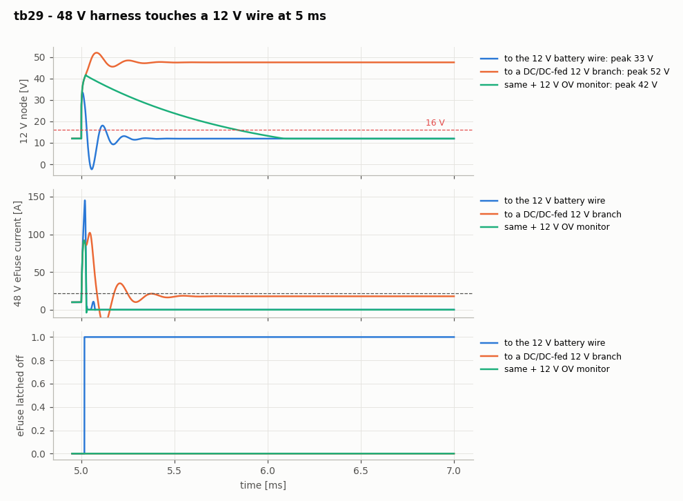

| 12 V side at the contact point | 12 V node peak | time above 16 V | 48 V eFuse |
|---|---|---|---|
| near the 12 V battery | 33 V | 0.13 ms | HSC trip 16 µs, 145 A |
| a 12 V branch fed by the DC/DC (cannot sink) | 52 V, then **47.5 V** | indefinitely | 17.8 A < INOM: **no trip** |
| the same + a 12 V OV monitor in the PDU | 42 V | 0.84 ms | switched off after 20 µs |

* The dangerous case is the high-impedance one. The 48 V eFuse sees a legal
  current and the 12 V ECU sits at 47.5 V. Detection has to be on the 12 V side,
  and even then the first microseconds reach ~40 V, which is why 12 V ECUs must
  survive the standard's cross-short test.
* *Ask:* "Your 48 V channel reports nothing. How do you find out?"

### F2. Ground loss and ground offset. (L2)

**Expected answer**
* The PDU or load loses its ground; current tries to return through I/O, communication lines or
  ESD structures.
* Ground offset between ECUs (volts at high currents) corrupts sensing and
  logic thresholds.
* Mitigations: defined ground concept, reverse-current-safe interfaces,
  tested per the standard's ground-loss/offset tests.

**Simulation:** [`tb30`](../testbenches/tb30_ground_fault.cir), a 10 A load ECU whose ground degrades
or opens, with a logic signal to the PDU.

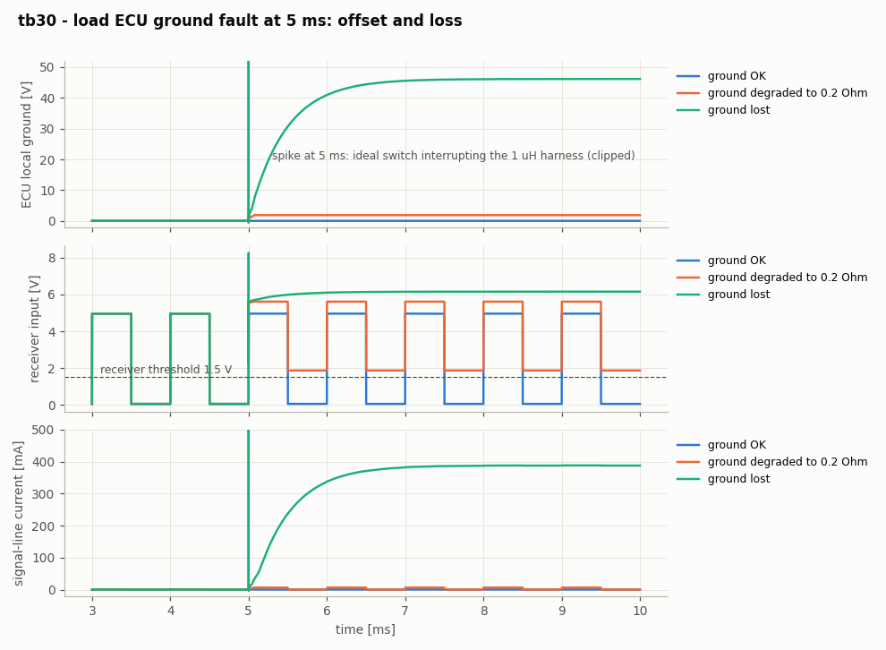

* Ground degraded to 0.2 Ω: the ECU ground sits 1.9 V above the PDU ground. The
  signal's "low" arrives at 1.86 V, above the 1.5 V threshold, so the PDU reads
  a constant "high".
* Ground lost: the ECU ground floats up to 46 V and the ECU is left with 1.9 V
  supply. Its 0.39 A supply current returns through the signal line and the
  receiver's ESD diode into the PDU's 5 V rail. The eFuse sees 0.39 A, i.e.
  nothing but an under-current.
* (The spike at 5 ms is the ideal switch interrupting the harness current. In
  reality it is an arc at the opening contact.)
* *Ask:* "Which signals in the PDU could reveal the lost ground?"

### F3. The FET fails short (stuck-on). How do you cover it? (L3)

**Expected answer**
* The most critical failure: the eFuse can no longer protect the wire.
* Detection: VDS ≈ 0 with the gate off, current flowing with OUTCTL off, or output
  voltage present when it should be off; done at start-up and periodically
  (latent fault).
* Reaction: a secondary disconnect (upstream eFuse, pyro fuse or main
  switch), a back-up melting fuse sized for the wire, a warning, and degraded
  operation.
* An ISO 26262 topic: single-point vs latent fault metric, diagnostic
  coverage, and a defined safe state.

**Red flags:** "the FET won't fail"; no notion of a secondary disconnect.

**Simulation:** [`tb35`](../testbenches/tb35_field_return.cir), case "FET shorted at 1 s" (plot in J5).

* The FET fails short at 1 s. The 30 A overload from 2 s trips the I²t at
  2.063 s and the gate goes off, but 29.6 A keeps flowing, also after the MCU
  switches the channel off at 6 s. The wire reaches 156 °C.
* A plausibility check, "OUT above 5 V for 20 ms while the gate command is off",
  flags it at 2.083 s. The reaction has to come from outside the channel
  (upstream disconnect).

---

## G. Functional safety, diagnostics and firmware interaction

### G1. What does ISO 26262 mean for a PDU channel? (L2–L3)

**Expected answer**
* A safety goal is derived from the HARA (e.g. "prevent loss of supply to an
  ASIL-rated load", "prevent wire overheating/fire").
* Hardware metrics: SPFM, LFM, PMHF; FMEDA of the channel, including shunt drift, ADC
  errors, FET short/open, and charge-pump failure.
* Safety mechanisms: redundant current measurement, plausibility checks
  (current vs FET state), self-tests of the protection paths, watchdogs, safe-state
  definition and fault-tolerant time interval.
* "Fail-safe off" vs "fail-operational" (redundant supply paths for
  steer-by-wire or brake-by-wire).

**Simulation:** not a simulation topic as such, but the benches give the numbers a
safety concept needs:
* reaction times for the fault-tolerant time interval: hardware HSC 8 µs (tb02),
  VDS monitor ~40 µs, firmware ~1 ms (tb32, G3);
* the signatures of the diagnostic cases: stuck-on FET, sense-path crack, sneak
  path (tb35, J5); a lost ground seen only as under-current (tb30, F2).

### G2. Retry strategy after a trip. (L2)

**Expected answer**
* Hard short: limited retries with increasing back-off. Each retry into a short
  stresses the FET and the bus (I_pk, ½LI²), so count the retries and latch permanently after N.
* Overload (I²t): wait for the thermal model to cool (thermal memory) before
  retrying.
* Capacitive load: a retry after a VDS trip may succeed because the cap is partly charged,
  but that is a design smell.
* Report to the vehicle network, store a DTC, and support load shedding.

**Simulation:** [`tb31`](../testbenches/tb31_retry.cir), retries into a permanent short and into a
persistent overload.

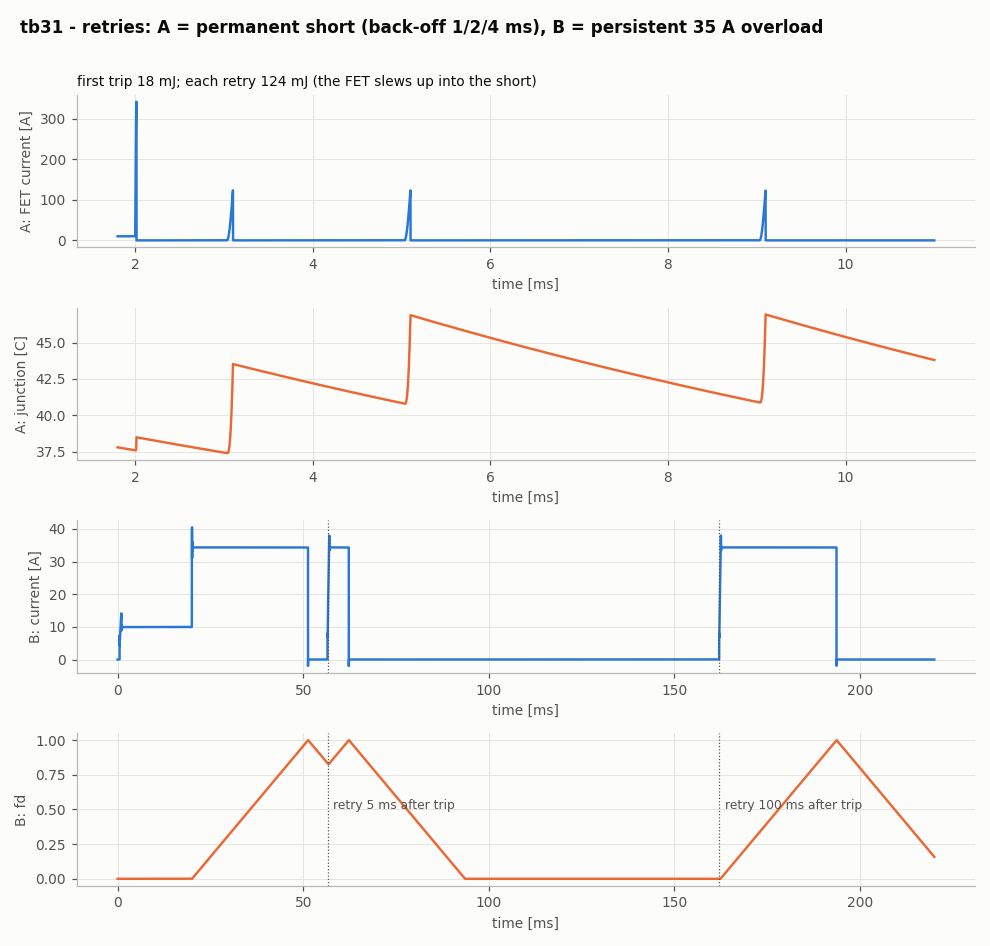

* Short, retries with 1 / 2 / 4 ms back-off: the first trip peaks at 340 A and
  costs 18 mJ. Each retry peaks at only ~121 A but costs **120 mJ**, 6.5× more.
  On a retry the FET is off and slews up through the dV/dt network into the
  short. It conducts in linear mode at ~48 V until the HSC trips. The junction
  climbs ~6 K per retry.
* Overload (x = 1.6): first trip after 31.3 ms. A retry 5 ms later starts with
  the fuse state still at 0.83 and re-trips after 5.7 ms. A retry 100 ms later
  starts from zero and runs the full 31.6 ms.
* *Show the A panel and ask:* "Why is the retry peak lower than the first trip
  but its energy six times higher?"

### G3. How do the hardware protections and the firmware share the work? (L2–L3)

**Expected answer**
* Fast protections (HSC, VDS, UV) must be **hardware**, independent of the MCU
  (µs, MCU-independent safe state).
* Slow ones (I²t, temperature, coordination, retry, power modes) can be configured
  or partly computed in firmware, but there must be a hardware fallback if the MCU or SPI fails
  (watchdog, limp-home defaults).
* Configuration integrity: register read-back, CRC/SPI frame checking, locked
  configuration.

**Simulation:** [`tb32`](../testbenches/tb32_hw_vs_fw.cir), the same short handled by the HSC, by the
VDS monitor alone, and by "firmware" (CS readback + 1 ms task).

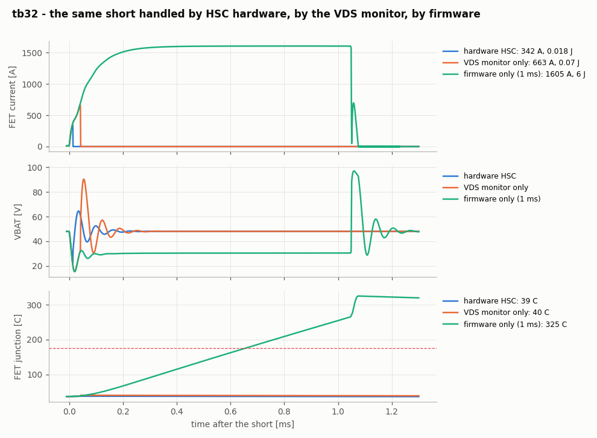

| protection | FET off after | peak current | FET energy | Tj peak |
|---|---|---|---|---|
| hardware HSC | 14 µs | 340 A | 0.018 J | 39 °C |
| VDS monitor only | 43 µs | 662 A | 0.07 J | 40 °C |
| firmware only | 1.07 ms | **1.6 kA** | **6 J** | 325 °C |

* In the firmware case the bus sits at 30 V for a millisecond (every other load
  on it resets), and switching off 1.6 kA late kicks VBAT to ~97 V. The VDS
  monitor is a useful second hardware layer.
* *Ask:* "Which protections may live in firmware, then?" Expected: I²t
  coordination, retries and power modes, with a hardware fallback.

---

## H. Validation and test

### H1. Outline the validation plan for an eFuse PDU. (L2–L3)

**Expected answer: a structured plan, not a list of tests**
* **Design verification by analysis and simulation**: worst-case analysis
  (tolerances, temperature, aging), Monte Carlo on the thresholds, SPICE
  of turn-on, short and turn-off with harness models, thermal simulation,
  and correlation of models with measurements.
* **Bench characterization**: trip curves vs the spec (I²t at several currents and
  temperatures), HSC threshold and delay, VDS blanking, sense accuracy over temperature,
  quiescent current, wake-up.
* **Electrical tests per the 48 V standard**: voltage ranges, slow ramps,
  over-voltage transients, dips and drops, ripple, ground loss and offset,
  the 48/12 V cross-short, reverse polarity if required.
* **Short-circuit robustness**: repeated short-circuit cycles at different
  temperatures, harness lengths and short positions (near/far, terminal/load).
  For smart power ICs there are short-circuit reliability characterization methods
  (e.g. AEC-Q100-012 for 12 V smart power; adapt the conditions for 48 V).
* **Environmental**: thermal cycling, humidity, vibration (solder joints of the heavy
  parts), per ISO 16750-3/-4 or the OEM's specifications.
* **EMC**: CISPR 25 emissions (switching edges, charge pump), immunity (BCI,
  radiated, transients), ESD.
* **System level and HIL**: fault injection (shorts, open loads, sensor faults),
  firmware/hardware interaction, network diagnostics, power modes, load profiles.
* **Traceability**: requirements to tests to results, and the DV/PV plan.

**Follow-ups**
* "How do you test the I²t curve efficiently?" Programmable electronic load
  or a power supply with current steps; measure the trip time at several x = I/I_nom at
  hot/room/cold; compare with the spec band and the wire curve; include
  repeated-pulse (thermal memory) and PWM tests.
* "How do you generate a realistic hard short?" A low-inductance short switch
  (MOSFET or pyro switch, or a mechanical contactor for long-term tests) at defined
  positions, with a realistic harness length (inductance!), and a defined
  battery/supply impedance. A lab supply with output capacitors behaves differently from a
  battery.

**Simulation:** the benches map onto the plan. I²t characterization at several
x is tb03, repeated pulses and thermal memory tb16, PWM tb04, a realistic short
with harness inductance tb18, 48 V supply profile tb06, and fault injection
tb14/tb35. tb18 is the argument for a defined harness in the short-circuit
set-up: the same channel trips at 7 or 17 µs and peaks at 445 or 175 A
depending only on L. For the "defined battery/supply impedance" of the
follow-up, bat02/bat03/bat05 give the pack's resistance, |Z(f)| and terminal
short current, and bat07 is the PDU fed by the pack model instead of an ideal
source.

### H2. Measuring a short-circuit event: what equipment and what pitfalls? (L2)

**Expected answer**
* Current: a high-bandwidth current probe (> 50 MHz for µs events, rated for the
  peak, no saturation; check the I·t product) or a coaxial shunt. A Rogowski coil for very
  high currents (AC only).
* Voltage: differential probes (floating high-side nodes), short ground leads,
  enough bandwidth, deskewed channels.
* Pitfalls: probe saturation at hundreds of A; ground loops; the lab supply's current
  limit and output capacitors distorting the result; a missing harness inductance
  (too optimistic); triggering on the right event; sampling rate.
* Record VBAT, OUT, VGS, VDS, I_FET and DIAG together, and calculate the FET energy (∫VDS·I dt).

**Simulation:** the tb02 waveforms seen through probe models (post-processing,
`iv_h2` in [`tools/plot_results.py`](../tools/plot_results.py)).

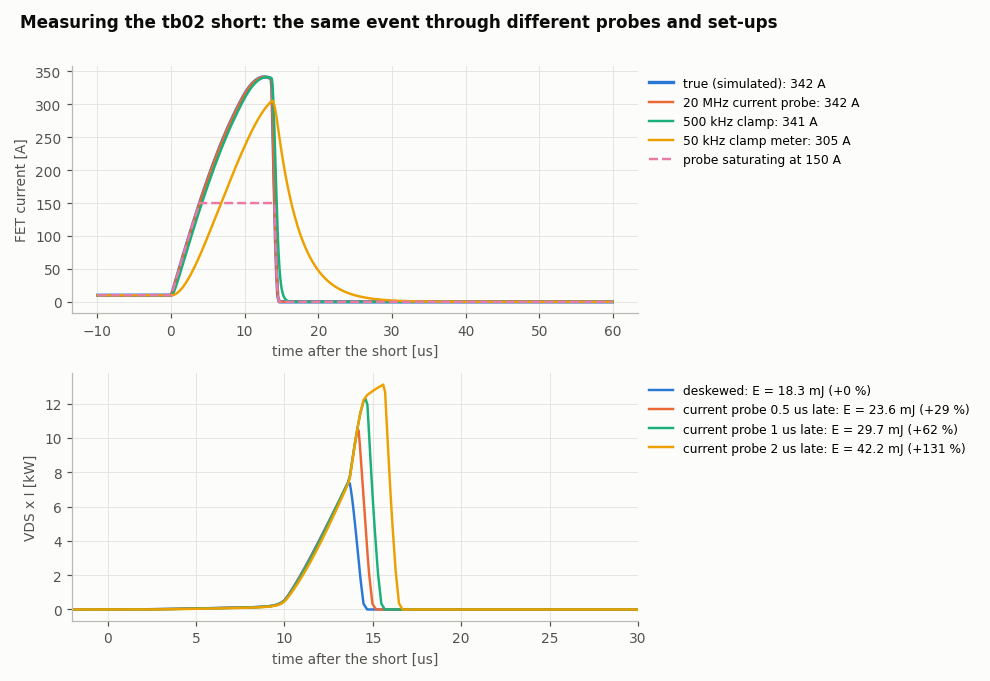

* 20 MHz probe and 500 kHz clamp: 340 / 339 A. A 50 kHz clamp-meter shows
  303 A, late and stretched. A probe that saturates at 150 A flattens the event
  completely.
* FET energy ∫VDS·I dt: 18.4 mJ deskewed. With the current probe 0.5 / 1 / 2 µs
  late: +29 / +62 / +129 %. Over a ~14 µs event, skew dominates the error budget.
* *Show and ask:* "Which of these would you trust, and how do you check skew
  before the test?"

### H3. Results correlation: the simulation says the HSC trips at 8 µs, the measurement says 15 µs. What do you check? (L2–L3)

**Expected answer**
* The di/dt in the setup: real harness/lab inductance vs the model (a slower current rise
  means a later threshold crossing).
* The threshold tolerance and the comparator/filter delay at temperature.
* Measurement artifacts: probe delay and deskew, current-probe bandwidth.
* The model's gate-discharge path vs the real one (RG_OFF, diode), FET Ciss/Crss at
  the actual bias.
* Then decide whether the model or the test setup has to be corrected, and document the
  correlation.

**Simulation:** [`tb18`](../testbenches/tb18_short_di_dt.cir) (table in B3). Only the load-harness
inductance changes, and the HSHT latch moves from 8.0 µs (1 µH) to 17.4 µs (5 µH)
while the peak falls from 341 A to 175 A. A bench set-up with ~4 µH instead of
1 µH reproduces "8 µs simulated, 15 µs measured" with no error in the
controller at all.

### H4. How do you verify that the channel protects the wire? (L3)

**Expected answer**
* Get the wire damage (smoke) curve from the harness supplier or the standard, for the wire
  type, bundle and ambient (bundled wire heats up more).
* Overlay the eFuse trip curve **including tolerances** (sense error, threshold
  spread, time tolerance) at worst-case ambient.
* Test: real wire with thermocouples under overload profiles; verify that the
  insulation stays below its rating when the eFuse trips at the worst-case edge of
  its tolerance.
* Include the thermal-memory cases: repeated overloads, retries.

**Simulation:** wire curve vs fuse curve (`iv_h4`, illustrative wire) and
[`tb16`](../testbenches/tb16_thermal_memory.cir) (wire temperature under repeated overloads).

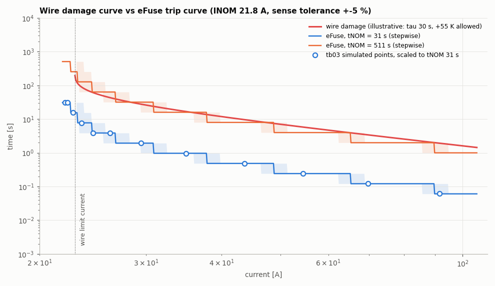

* With INOM 21.8 A, tNOM = 31 s stays below the (illustrative) wire damage curve.
  tNOM = 511 s crosses it between ~23 and ~45 A. The tb03 points (scaled to
  31 s) sit on the stepwise curve.
* The shaded band is ±5 % sense tolerance. At −5 % the effective INOM becomes
  22.9 A, right at the wire's limit current: the tolerance, not the typical
  curve, decides.
* *Ask:* "Which data do you need from the harness supplier to draw the red
  curve?"

---

## I. Design exercise (whiteboard, 20–30 min)

**Task to give the candidate:**

> Design one eFuse channel for a 48 V, 1 kW DC/DC converter (12 V output)
> in a zonal PDU. The DC/DC has 2.2 mF input capacitance (±20 %) and a UVLO
> of 30 V on / 26 V off. The feed is 2.5 mm², 3 m long. Ambient up to 85 °C.
> You have a high-side controller with I²t, hard-short (programmable 20–160 mV),
> VDS monitor with 960 µs blanking, and SPI. Walk me through your choices.

**What a strong candidate covers (with expected numbers)**

1. **Current**: 1 kW / 36 V (min unrestricted voltage) ≈ 28 A worst case (at
   48 V ≈ 21 A). Add efficiency and transients: I_nom ~30–33 A.
2. **Shunt**: e.g. 1 mΩ → 28 mV at max load; 1 W. Check the HSC range: 160 mV / 1 mΩ
   = 160 A max. A lower shunt (0.5 mΩ) gives more HSC headroom but less accuracy at
   low current. A strong candidate discusses this trade-off.
3. **I²t**: I_nom above the max continuous load with margin; tNOM chosen so
   the curve is below the 2.5 mm² wire curve at 85 °C. The candidate should ask for the
   wire curve rather than invent it.
4. **HSC**: above the inrush peak, below the FET's pulsed and SOA limit and the harness
   limit, e.g. 100–140 A. Estimate the short peak with ~2–3 µH (3 m wire + supply).
5. **FET**: 100 V, ~1–2 mΩ, TOLL/D2PAK-7; loss at 33 A hot ≈ 2–4 W, so a thermal check
   is needed. SOA check for the chosen inrush method.
6. **Inrush**: 2.2 mF + 20 % = 2.64 mF. The dV/dt method needs I = C·dV/dt < I_HSC
   **and** the ramp to finish within 0.96 ms (≥ ~46 V/ms), giving I ≥ 2.64 mF × 46 V/ms ≈
   120 A. That is too much for a 105 A HSC and marginal even at 140 A.
   **Conclusion: a separate pre-charge path is needed** (or a much higher HSC with a FET
   that can take it, or a DC/DC with its own soft-start). A strong
   candidate gets to this conclusion without help.
7. **Pre-charge**: e.g. R = 10 Ω → τ = 26 ms at C_max; 95 % after ~80 ms; peak
   230 W, ½CV² ≈ 3 J nominal (C_max). Short fault: 230 W × checkpoint time. The resistor
   must be pulse-rated, the switch must be a small FET/HSD.
   Voltage-based hand-over (≥ 95 %), checkpoint and timeout, DC/DC enable gated
   by power-good (constant-power load).
8. **Turn-off**: supply-side TVS and bulk capacitance for interrupting the short; freewheel
   diode at OUT; OUT negative-voltage rating of the controller.
9. **Diagnostics and firmware**: retry policy, DTCs, current readback for load
   monitoring, stuck-on detection, sleep current and wake-up strategy.
10. **Validation**: what they would test first (inrush at C_max/C_min and
    VBAT 36/52 V, short at the end of the 3 m harness, I²t vs the wire curve at 85 °C).

**Scoring hints**
* Junior: gets 1–5 with help.
* Solid designer: reaches the conclusion in step 6 alone, sizes the pre-charge
  roughly.
* Expert: covers tolerances throughout, supervision and fault energy of the pre-charge, the safety
  implications (sneak path, stuck-on), and a validation strategy.

**Simulation:** [`tb33`](../testbenches/tb33_design_exercise.cir) simulates the exercise: 2.64 mF
(C max), 1 kW constant power with UVLO 30/26 V, 3 m of 2.5 mm² (23 mΩ, 2.5 µH),
RSENSE 1 mΩ, INOM 32.2 A, IHSC 105.6 A. Use it as the answer key after the
candidate has reasoned, not before.

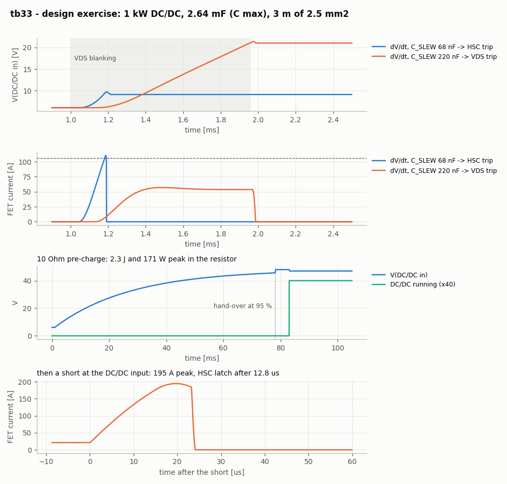

| approach | outcome |
|---|---|
| dV/dt, C_SLEW 68 nF (fast enough for the blanking) | HSC trip 0.19 ms after turn-on at 110 A, OUT stuck at 9 V |
| dV/dt, C_SLEW 220 nF (current below IHSC) | VDS trip 0.97 ms after turn-on, OUT at 21 V |
| 10 Ω pre-charge, hand-over at 95 %, DC/DC gated by power-good | hand-over at 77 ms, 2.3 J and 171 W peak in the resistor, 27 A at hand-over, DC/DC runs at 21.3 A |
| the same, then a short at the DC/DC input | 194 A peak, HSC latch 12.7 µs after the short, VBAT 60 V |

* The simulation confirms step 6: no dV/dt setting works for 2.64 mF with this
  controller. The pre-charge numbers are lower than ½CV² = 3 J and V²/R = 230 W
  because the output starts pre-biased at ~6 V (OUT bias current into the
  bleeder).

---

## J. Debug scenarios (pick 2–3)

### J1. "The channel to the DC/DC trips at key-on, but only at −40 °C."

**Expected reasoning**
* The input capacitance is lower when cold (electrolytic caps lose C at −40 °C), but the
  ESR is higher, which reduces the inrush peak.
* The DC/DC starts on its UVLO during the ramp and draws constant power while the voltage
  is low: more current, which pushes the I²t bucket or the HSC.
* The FET's VGS(th) is higher when cold, so the ramp starts later, the slew may shift, and the
  ramp may finish after the VDS blanking.
* The charge pump is slower when cold, so the VGS ramp and the VDS check are affected.
* Battery internal resistance is higher when cold, so VBAT dips further at inrush; the controller
  UV or the DC/DC UVLO interacts with it.
* **Method**: record VBAT, OUT, I, VGS, DIAG/SPI fault code at −40 °C and identify
  which protection fired first.

**Simulation:** [`tb34`](../testbenches/tb34_cold_start.cir), dV/dt start-up into a 1 kW DC/DC that
starts on its own UVLO. The cold parameter shifts are illustrative, not datasheet
values.

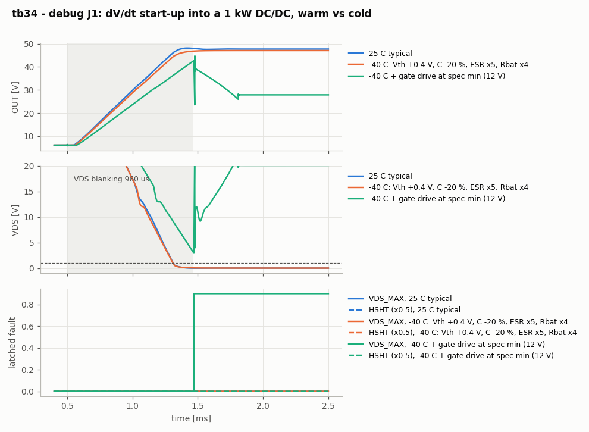

| case | OUT at 95 % after OUTCTL | VDS at the end of blanking | latched fault |
|---|---|---|---|
| 25 °C typical | 0.80 ms | 0.03 V | none |
| −40 °C: VGS(th) +0.4 V, C −20 %, ESR ×5, battery R ×4 | 0.85 ms | 0.08 V | none |
| −40 °C + gate drive at the low end of its range (VGS_ON 12 V) | never | 3.4 V | **VDS_MAX** at 970 µs |

* The ramp rate is set by the gate current (VGS_ON − VGS_plateau)/RG_ON. The
  cold threshold alone costs ~6 % and the 17 % margin absorbs it. Combined with
  a weaker gate drive, the ramp outlasts the blanking.
* It is the VDS monitor that fires, not the HSC or the I²t. That is why the
  first step is to read the latched fault.
* *Show the plot without the legend and ask:* "Which protection fired, and what
  would you measure at −40 °C to confirm it?"

### J2. "After a hard-short test the controller is damaged, but the FET is fine."

**Expected reasoning**
* VS over-voltage from the supply-side kick: TVS too far away or too high, or
  bulk capacitance missing in the test setup.
* OUT pin driven below its negative rating: no or slow freewheel diode, long
  load harness.
* A ground shift during the event, exceeding the logic pin ratings.
* Check with probing at the pins (not at the connector), then fix the clamp placement
  or the pin protection.

**Simulation:** [`tb25`](../testbenches/tb25_supply_clamp.cir) (table in C3). With 22 µF and no TVS
the FET survives in avalanche (VDS 100 V) while VS reaches 98.6 V, far beyond
the controller's 70 V. Without the freewheel diode OUT goes to −57 V (rating
−10 V for 10 µs). In both cases the FET is "fine" and the controller is not.

### J3. "I²t trips during normal operation of a PWM fan load, although the average current is below I_nom."

**Expected reasoning**
* The heat balance responds to **RMS**, not to the average. With peak 40 A at 50 % the RMS
  is 28 A while the average is 20 A.
* Also check the current-sense filtering and sampling (aliasing with the PWM frequency) and
  the inrush at each PWM edge (capacitors).
* Fix: size I_nom for the RMS, or move the filtering/PWM capacitance.

**Simulation:** [`tb04`](../testbenches/tb04_pwm_rms.cir), 40 A peak PWM.

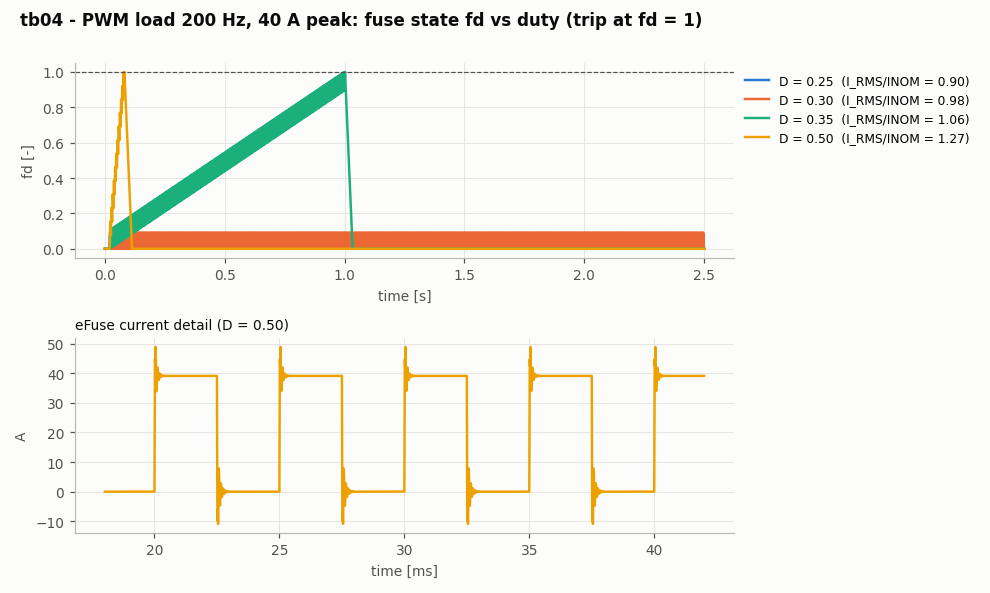

* At 50 % duty the average is ~20 A < INOM 21.8 A, but the RMS is ~27.7 A
  (1.27·INOM). The channel trips after 61 ms. At 25 % duty (19.6 A RMS) it never
  trips.

### J4. "The 12 V rail from the DC/DC browns out repeatedly right after key-on, but no eFuse fault is logged."

**Expected reasoning**
* A hiccup: the DC/DC starts on its own UVLO while it is pre-charged through a resistor or a slow
  ramp. The constant-power load collapses the voltage, stops and restarts (tb14 case 3).
* There is no eFuse fault because no eFuse threshold is crossed.
* Fix: gate the DC/DC enable with pre-charge power-good, and/or adapt the UVLO
  hysteresis.

**Simulation:** [`tb14`](../testbenches/tb14_precharge_faults.cir), case "DC/DC not
gated by PG" (plot in D4). The DC/DC starts at 30 V on its own UVLO and collapses
the 4.7 Ω path. It starts and stops 18 times (~0.5 ms on, 4.7 ms period). The
pre-charge is finally aborted by the timeout, and the eFuse never even switched
on, so it logged nothing.

### J5. "Field returns: wire harness damage on one branch, but the eFuse never reported an overload."

**Expected reasoning**
* Stuck-on FET (the protection is ineffective): check the stuck-on diagnostics.
* A sense path error (shunt solder crack giving a lower reading; Kelvin connection fault).
* An I²t configuration that does not match the wire (wrong tNOM/I_nom for the actual
  wire size or the bundle's thermal conditions).
* A sneak path: the pre-charge or bypass path feeding the branch with the main FET off.
* A fault downstream of a splice that carries more current than the wire is rated for.
* **Method**: return analysis, a configuration audit, FMEDA review, and an added
  plausibility check (current with the FET off).

**Simulation:** [`tb35`](../testbenches/tb35_field_return.cir), overload to 30 A at 2 s on a
2.5 mm²-class branch (wire model as tb16), MCU off at 6 s.

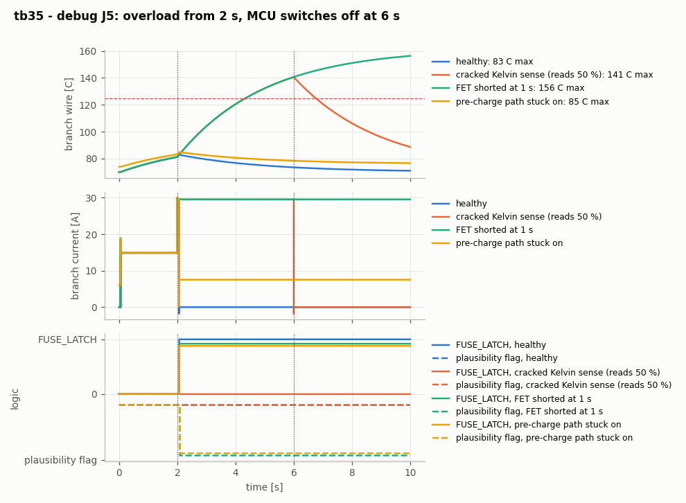

| case | eFuse | branch current after the trip | wire maximum | plausibility flag |
|---|---|---|---|---|
| healthy | I²t trip at 2.063 s | 0 | 83 °C | – |
| cracked Kelvin sense (reads 50 %) | **no trip** (x = 0.68) | 29.6 A until the MCU switches off | 141 °C | – |
| FET shorted at 1 s | trips, but cannot open | 29.6 A, also after MCU off | 156 °C | at 2.083 s |
| pre-charge path stuck on | trips | 7.5 A through 4.7 Ω (267 W in the resistor) | 85 °C | at 2.083 s |

* Two of the four damage the wire without any overload being reported. The
  "current or voltage present while off" check catches the stuck-on FET and the
  sneak path. The cracked sense line needs an independent measurement or a sense
  self-test.

### J6. "Some 12 V ECUs reset during engine start on cold mornings, never in summer."

**Expected reasoning**
* At the starter's inrush (locked rotor) the battery and the starter circuit
  form a divider: V_min ≈ OCV·R_starter/(R_battery + R_starter). The battery's
  internal resistance roughly **doubles at −18 °C** and is ~2.5× at −30 °C, so
  the dip is much deeper on the same car.
* Low SOC adds to it: lower OCV, higher resistance. So do short trips in winter
  and a quiescent-current drain overnight.
* The ECUs that reset are those whose reset threshold or supply design does not
  cover the starting profile (ISO 16750-2 / LV 124 starting pulse); check the
  hold-up capacitance and the regulator dropout.
* In a 48 V vehicle: does the BSG start the engine (no 12 V dip) or the 12 V
  starter (cold start)? Does the 48/12 V DC/DC support the 12 V net during the crank?
* **Method**: log the 12 V voltage at the battery and at the ECU, the battery
  SOC and temperature at −30 °C, and compare the minimum with the ECU's reset
  threshold.

**Simulation:** [`bat04`](../testbenches/bat04_cold_crank.cir), 12 V battery
(70 Ah defaults, SOC 80 %) with the same starter at three temperatures, plus a
700 A / 30 s CCA test at −18 °C.

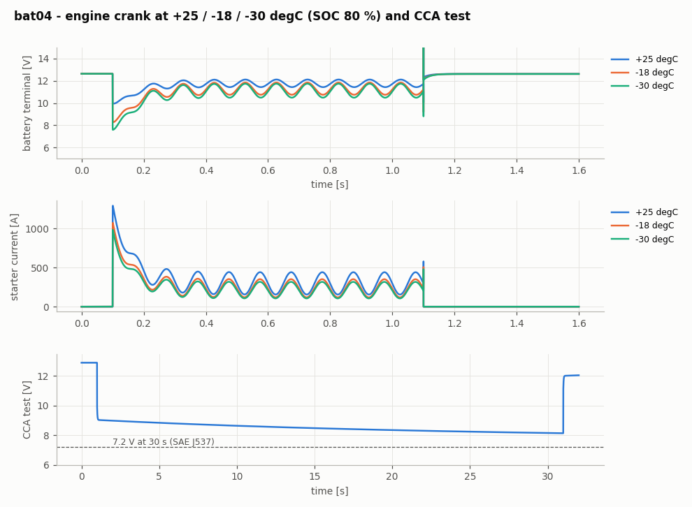

| | +25 °C | −18 °C | −30 °C |
|---|---|---|---|
| minimum voltage at the inrush | 9.95 V | 8.27 V | 7.59 V |
| inrush peak | 1294 A | 1074 A | 986 A |
| average voltage while cranking | 11.77 V | 11.29 V | 11.11 V |

* The CCA test ends at 8.14 V after 30 s (pass criterion ≥ 7.2 V), so this is a
  healthy battery. The cold dip is a battery-physics effect, not a defect.
* *Show the plot and ask:* "Same starter, same battery. Why is the dip 2.4 V
  deeper at −30 °C, and why is the cold inrush current *lower*?" Expected: R0
  is ×2.5, and the higher source resistance also limits the current.

### J7. "On the prototype harness the 48/12 V DC/DC keeps dropping its 12 V output. On the lab supply it is perfect."

**Expected reasoning**
* The difference is the source: the lab supply with short cables vs metres of
  vehicle harness (µH), maybe a new EMC filter, maybe a smaller input capacitor
  on the prototype.
* Suspect an **input-filter oscillation** (C5): measure the converter's input
  voltage with enough bandwidth. A sinusoid at 1/(2π√(L·C)), here ~10 kHz,
  growing with load is the signature. Its peaks can trip the converter's OVP
  or its valleys its UVLO, which shows up as "the output drops".
* Confirm by adding a temporary damper (R–C across the input) or bulk
  electrolytic capacitance; the oscillation disappears.
* Fix permanently: damping network, input capacitor with ESR, shorter or
  lower-inductance feed. Then re-check at the lowest input voltage and full load.

**Simulation:** [`dc07`](../testbenches/dc07_input_filter_stability.cir) case B
(plot in C5). The oscillation starts during the soft-start, as the drawn power
(and with it the negative conductance) grows, and settles at 30 V p-p on the
48 V input. The 60 V OVP cycling holds the 12 V output near 6 V. The same
converter on a 2 µH feed with 470 µF (case A) is clean.

---

## K. Quick-fire checks (5 min, any level)

| Question | Expected answer | Simulation |
|---|---|---|
| Energy stored in 4.7 mF at 48 V? | ½CV² ≈ 5.4 J | tb27 |
| di/dt of a 48 V short through 2 µH? | 24 A/µs | tb18 |
| Energy of 10 A in 2 mH? | 100 mJ | tb09, tb21 |
| Time constant of 4.7 Ω × 4.7 mF, and the time to 95 %? | 22 ms; ~3τ ≈ 66 ms | tb27 (66 ms) |
| Loss in 1 mΩ at 30 A? | 0.9 W | – |
| Why 100 V FETs on 48 V? | transients plus inductive overshoot plus margin | tb21, tb25 |
| DC voltage above which HV safety applies? | 60 V | – |
| What does an NTC on the FET pad actually measure? | PCB/pad temperature with a lag, not Tj | tb23, tb07 |
| Parallel FETs during inrush: do they share current? | No, not in linear mode | tb22 |
| Does a larger pre-charge resistor reduce the energy dissipated? | No, ½CV² regardless; only the time and the peak power change | tb27 |
| Bolted short on a full 12 V battery, 2 mΩ internal + 1 mΩ cable? | 12.9 V / 3 mΩ ≈ 4 kA | bat05 (4.2 kA) |
| Battery resistance at −18 °C compared with 25 °C? | roughly ×2 | bat02 (×1.97) |
| Above what frequency does a 17 mΩ / 1 µH pack look inductive? | R/(2πL) ≈ 2.7 kHz | bat03 |
| Pre-charge of 10 mF through 10 Ω: τ, and when to close? | 0.1 s; after 3–5 τ (0.3–0.5 s) | bat06 |
| Battery opens; 40 A excess into 0.7 mF of bus: dV/dt? | ≈ 57 V/ms | bat07 (58 V in 124 µs) |
| Incremental input resistance of a 700 W converter at 48 V? | −V²/P ≈ −3.3 Ω | dc06 (−6.4 Ω at 350 W) |
| Input current of a 700 W, 95 % converter at 26 V? | 700/0.95/26 ≈ 28 A | dc05 (constant power) |
| Resonance of 10 µH with 22 µF? | 1/(2π√(LC)) ≈ 10.7 kHz | dc07 |
| A 700 W / 14 V DC/DC charges a 12 V battery at 12.6 V: what current? | its current limit (~1.1 × 50 A = 55 A), not (14 − 12.6)/R | dc02, dc08 |

---

## Scoring sheet

Rate each area 0–3 (0 = no knowledge, 1 = textbook, 2 = applied with
numbers, 3 = can lead and teach it).

| Area | Sections | Score (0–3) | Notes |
|---|---|---|---|
| 48 V system, standards and the battery source | A | | |
| eFuse principles and protections | B | | |
| Power stage, FET, SOA; DC/DC as a load, input-filter stability | C | | |
| Inrush and pre-charge (channel and pack) | D | | |
| Thermal and layout | E | | |
| System faults (48/12 V short, ground, stuck-on) | F | | |
| Functional safety and firmware interaction | G | | |
| Validation strategy and measurement | H | | |
| Design exercise | I | | |
| Debug reasoning | J | | |

**Guidance**
* **Junior / L1** (~10–15 points): solid on A1–A3, B, D1 and the quick-fire section; needs help in the exercise.
* **Designer / L2** (~16–23 points): scores ≥ 2 in B, C, D and H; finishes the exercise
  through step 7 with little help.
* **Expert / L3** (≥ 24 points): ≥ 2 everywhere, 3 in at least three areas; brings up
  tolerances, fault energy, safety and validation without being prompted.

Things that weigh more than the score: whether the candidate **estimates with numbers**,
**states assumptions** and **asks for missing data** (wire curve, C tolerance,
battery impedance), and whether they treat validation as part of the design,
not as an afterthought.
